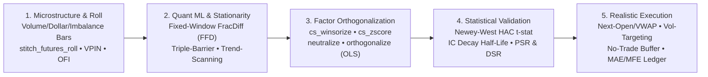
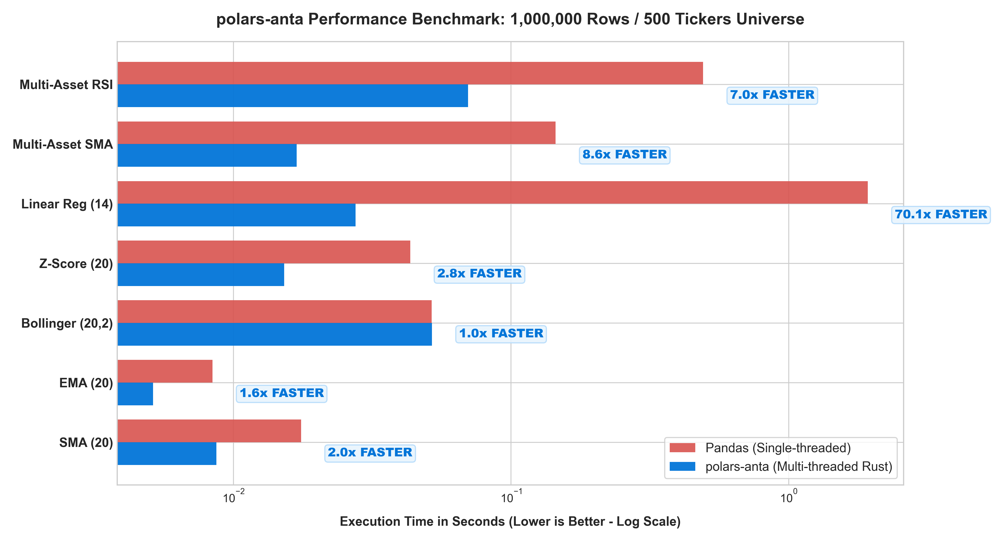

<div align="center">


### Alpha Research, Market Microstructure, Feature Engineering & Vectorized Backtesting in Polars

**Auditable mathematical expressions. Cross-sectional factor analytics and microstructure modeling. An intuitive dual `.anta` / `.ta` interface. Zero-C deployment with Rust-accelerated performance.**

An open-source quantitative research engine for market microstructure estimation, cross-sectional alpha discovery, statistical factor evaluation, technical feature engineering, and loop-free vectorized backtesting. Purpose-built for **quantitative researchers, prop trading desks, index futures & derivatives strategists, and systematic portfolio managers** who demand both sub-second execution speed and 100% mathematical transparency.

[](https://github.com/huuan26/polars-anta/actions/workflows/ci.yml)
[](https://pypi.org/project/polars-anta/)
[](https://pypi.org/project/polars-anta/)
[](https://pola.rs)
[](#api-reference--indicator-catalog)
[](https://huuan26.github.io/polars-anta/)
[](https://colab.research.google.com/github/huuan26/polars-anta/blob/master/examples/quickstart_colab.ipynb)
[](LICENSE)
[](https://github.com/huuan26/polars-anta/stargazers)

[**Documentation**](https://huuan26.github.io/polars-anta/) • [**Quick start**](#quick-start) • [**API Reference**](#api-reference--indicator-catalog) • [**Learning Resources**](#documentation-and-learning-resources) • [**Examples**](https://github.com/huuan26/polars-anta/tree/master/examples) • [**Report an issue**](https://github.com/huuan26/polars-anta/issues)

</div>

---

## What is `polars-anta`?

**`polars-anta`** (**A**lpha & **N**umerical **T**echnical **A**nalysis) is a Python library for **quantitative feature engineering, market microstructure analysis, cross-sectional alpha research, statistical signal validation, and vectorized portfolio backtesting** powered natively by [Polars](https://pola.rs/).

Unlike traditional technical analysis packages designed around single-asset retail charting, `polars-anta` is architected from the ground up for **buy-side research workflows**: unifying 33 formulaic alphas from Kakushadze's *101 Formulaic Alphas*, liquidity and price-impact estimators (Amihud, Kyle's $\lambda$, Roll, Corwin-Schultz), closed-form rolling OLS regressions, cross-sectional standardization/neutralization, Alphalens-style Rank IC evaluation, and transaction-cost-aware vectorized backtesting inside Polars' multi-threaded Rust query engine.

### Key properties

- **End-to-end alpha research lifecycle** — move seamlessly from raw OHLCV integrity auditing and multi-timeframe resampling to microstructure extraction, cross-sectional factor neutralization, IC/quantile decay analysis, and vectorized backtesting in one unified Arrow/Polars pipeline.
- **100% Auditable white-box mathematics** — every formula is a readable, closed-form Polars expression (`pl.Expr`) you can inspect in Python rather than an opaque C/Cython binary.
- **Rust-accelerated panel execution** — computations compile directly into Polars' multi-threaded Rust query planner and SIMD kernels, achieving up to **112.4x speedups** over Pandas without GIL contention.
- **No C compiler required** — a pure-Python wheel depending only on `polars` and `numpy`; installs with `pip` on Linux, macOS and Windows.
- **Built for Index Futures & Multi-Asset Universes** — evaluate intraday signals on single-instrument futures (e.g., **VN30F1M**, CME E-mini, Crypto Perpetuals) or scale cross-sectional alphas across thousands of equities simultaneously via `.over("symbol")` and `.over("timestamp")`.

> **Research pipeline:**
> <p align="center"><strong>Raw Market Data &rarr; Data Validation & Resampling &rarr; Microstructure & Alpha Expressions (<code>.anta</code> / <code>.ta</code>) &rarr; Cross-Sectional Neutralization &rarr; Rank IC & Quantile Validation &rarr; Cost-Aware Vectorized Backtest</strong></p>

| Capability | TA-Lib | pandas-ta | Alphalens (pandas) | `polars-anta` |
| :--- | :---: | :---: | :---: | :---: |
| **Deployment & C Dependencies** | External C library & MSVC / GCC | Pure Python / NumPy | Pandas-based | **Zero C compilation** (pure Polars & NumPy) |
| **Execution Engine** | Single-threaded C loops | Single-threaded Pandas / GIL | Single-threaded Pandas | **Multi-threaded Rust** query engine + SIMD |
| **Multi-Asset Panel Scaling** | Manual sequential loops | Slow `.groupby().apply()` | Pandas MultiIndex | **Native `.over("symbol")`** parallelization |
| **Dual Namespace API** | Unsupported | Single `.ta` accessor | Standalone functions only | **Both `.anta` & `.ta`** on `Expr`, `DataFrame`, `LazyFrame` |
| **Cross-Sectional & Orthogonalization** | Unsupported | Unsupported | Basic quantile bucketing | **Built-in `cs_winsorize`, `cs_zscore`, `neutralize`, `orthogonalize`** |
| **Microstructure & Derivatives** | Unsupported | Unsupported | Unsupported | **Volume/Dollar/Imbalance Bars, Futures Roll, VPIN, OFI, Kyle's $\lambda$** |
| **Quant ML (AFML Primitives)** | Unsupported | Unsupported | Unsupported | **Fixed-Window FracDiff (`frac_diff`), Triple-Barrier & Trend-Scanning** |
| **Evaluation & Backtesting** | Unsupported | Unsupported | IC only (no backtester) | **Newey-West HAC IC, `ic_decay`, PSR/DSR, Realistic Backtest & MAE/MFE** |
| **Lazy & Streaming Execution** | Unsupported | Unsupported | Unsupported | **Full `pl.LazyFrame`** query optimization & Arrow zero-copy |

### Example use cases

1. **Index Futures & Intraday Derivatives Desks (VN30F1M, CME E-Mini, Perpetual Futures)**
   Aggregate tick/minute feeds into information-driven bars (`resample_volume_bars`, `resample_dollar_bars`, `resample_imbalance_bars`), stitch continuous roll series (`stitch_futures_roll`), track intraday `session_vwap` z-scores, measure order flow toxicity (`vpin`, `ofi`) and carry (`futures_basis`, `oi_regime`), and backtest with next-bar open/VWAP execution (`execution_price="open"`), session flatten masks (`flat_mask`), and round-trip MAE/MFE excursion ledgers (`bt.trades()`).
2. **Cross-Sectional Statistical Arbitrage & Equity Factor Research**
   Construct, winsorize (`cs_winsorize` via Quantile/Z-Score/MAD), standardize (`cs_zscore`), sector-neutralize (`neutralize`), and Gram-Schmidt OLS residualize (`orthogonalize`) the 33 implemented formulaic alphas across thousands of tickers, then validate with Newey-West HAC *t*-statistics (`ic_summary`), multi-horizon Alpha Half-Life (`ic_decay`), and Deflated Sharpe Ratios (`deflated_sharpe_ratio`).
3. **Quantitative Machine Learning (AFML) Feature Stores**
   Transform non-stationary prices via Fixed-Window Fractional Differentiation (`frac_diff`), generate dynamic path-dependent labels (`triple_barrier_labels` with Meta-Labeling and `trend_scanning_labels`), and feed zero-copy Apache Arrow tensors directly into **LightGBM, XGBoost, CatBoost, or PyTorch**.

---

## Quick start

### 1. Install

`polars-anta` is available on PyPI with zero C compiler requirements:

```bash
python -m pip install polars-anta
```

To upgrade to the latest release:

```bash
python -m pip install --upgrade polars-anta
```

Or using [`uv`](https://github.com/astral-sh/uv):

```bash
uv add polars-anta
```

### 2. Verify your installation

Importing `polars_anta` automatically registers both `.anta` and `.ta` namespaces on Polars `Expr`, `DataFrame`, and `LazyFrame` objects:

```python
import polars as pl
import polars_anta as pa

df = pl.DataFrame({"close": [100.0, 102.0, 101.5, 104.0, 106.5, 105.0, 108.0]})
out = df.with_columns(
    pl.col("close").anta.ema(period=3).round(2).alias("ema_3"),
    pl.col("close").anta.rsi(period=3).round(2).alias("rsi_3"),
)
print(out.tail(3))
# shape: (3, 3)
# ┌───────┬────────┬───────┐
# │ close ┆ ema_3  ┆ rsi_3 │
# │ ---   ┆ ---    ┆ ---   │
# │ f64   ┆ f64    ┆ f64   │
# ╞═══════╪════════╪═══════╡
# │ 106.5 ┆ 104.59 ┆ 88.14 │
# │ 105.0 ┆ 104.80 ┆ 62.61 │
# │ 108.0 ┆ 106.40 ┆ 80.52 │
# └───────┴────────┴───────┘
```

### 3. Explore quantitative workflows

Start with our ready-to-run [example scripts](examples/) or [1-click Google Colab notebooks](#interactive-jupyter--colab-notebooks), or explore the five workflows below:

#### A. Intraday Derivatives, Information Bars, Roll Stitching & Microstructure

```python
# 1. Stitch continuous futures contracts (backward/ratio/panama) & sample Volume/Imbalance bars:
cont_df = raw_contracts.anta.stitch_futures_roll(method="backward")
vol_bars = cont_df.anta.resample_volume_bars(volume_threshold=5_000)

# 2. Extract Session-Anchored VWAP, Order Flow Toxicity (VPIN, OFI), Carry & OI Regimes:
deriv_features = vol_bars.with_columns(
    pl.col("close")
    .anta.session_vwap("high", "low", "volume", session_by="trading_date")
    .alias("svwap"),
    pl.col("close").anta.vpin("volume", period=20).alias("vpin_20"),
    pl.col("bid_price").anta.ofi("bid_size", "ask_price", "ask_size", period=5).alias("ofi_5"),
    pl.col("close").anta.futures_basis("spot_close", "days_to_expiry", period=20).alias("basis"),
    pl.col("close").anta.oi_regime("open_interest", period=1).alias("oi_state"),
).unnest("svwap", "basis", "oi_state")
```

#### B. Quant Machine Learning (AFML) — Fractional Differentiation & Dynamic Labeling

```python
# Memory-preserving stationary features (FFD) + Triple-Barrier & Trend-Scanning labels:
ml_dataset = df.with_columns(
    pl.col("close").anta.frac_diff(d=0.4, window=20).over("symbol").alias("close_ffd"),
    pl.col("close")
    .anta.triple_barrier_labels(
        volatility=pl.col("close").pct_change().rolling_std(20),
        horizon=12,
        pt_mult=2.0,
        sl_mult=1.5,
        side=pl.col("primary_signal"),  # Enables binary meta_label {0.0, 1.0}
    )
    .over("symbol")
    .alias("tb"),
    pl.col("close")
    .anta.trend_scanning_labels(min_window=5, max_window=20)
    .over("symbol")
    .alias("ts"),
).unnest("tb", "ts")
```

#### C. Cross-Sectional Standardization, Neutralization & Multi-Factor Orthogonalization

```python
alpha_df = panel_df.with_columns(
    (
        -pl.col("close").anta.ts_delta(5).over("symbol")
        * pl.col("volume").anta.ts_rank(20).over("symbol")
    ).alias("raw_alpha")
).with_columns(
    pl.col("raw_alpha")
    .anta.cs_winsorize(over="date", method="mad", threshold=3.0)
    .anta.cs_zscore(over="date", clip_bound=3.0)
    .anta.neutralize(by="sector", over="date", standardize=True)
    # Gram-Schmidt OLS projection orthogonal to Beta, Size & Volatility:
    .anta.orthogonalize(factors=["mkt_beta", "log_mcap", "vol_20"], over="date", standardize=True)
    .anta.ts_scale(a=1.0, over="date")
    .alias("pure_alpha_weight")
)
```

#### D. Factor Validation (Newey-West HAC IC, Alpha Half-Life & PSR / DSR)

```python
eval_df = alpha_df.anta.forward_returns(periods=(1, 5, 10), group_by="symbol")

# Autocorrelation-robust Newey-West HAC t-statistic & Multi-Horizon IC Decay Half-Life:
ic_stats = eval_df.anta.ic_summary("pure_alpha_weight", "fwd_ret_5", group_by="date", nw_lags=5)
decay_table = eval_df.anta.ic_decay("pure_alpha_weight", horizons=(1, 2, 3, 5, 10, 20), group_by="date")

# Non-normal skewness/kurtosis-adjusted PSR & multiple-testing Deflated Sharpe Ratio (DSR):
# "strat_ret" = a strategy return column, e.g. bt.data["net_return"] from df.anta.backtest(...)
sharpe_significance = eval_df.select(
    pl.col("strat_ret").anta.probabilistic_sharpe_ratio(benchmark_sr=1.0).alias("psr"),
    pl.col("strat_ret").anta.deflated_sharpe_ratio(n_trials=50, trials_sr_std=0.4).alias("dsr"),
)
```

#### E. Execution-Realistic Vectorized Backtest, Excursion Ledger (MAE/MFE) & Grid Sweep

```python
bt = (
    df.anta.ema(period=12, alias="ema_12")
    .anta.ema(period=26, alias="ema_26")
    .anta.backtest(
        entries=pl.col("ema_12").anta.crosses_above("ema_26"),
        exits=pl.col("ema_12").anta.crosses_below("ema_26"),
        execution_price="open",  # Fill at next-bar open (or "twap", "vwap", "close")
        flat_mask=pl.col("is_atc_bar"),  # Mandatory intraday EOD / roll flatten mask
        vol_target=0.15,  # 15% annualized target volatility scaling
        no_trade_buffer=0.05,  # Hysteresis buffer suppressing micro-turnover
        fee_rate=0.0005,
        slippage_rate=0.0002,
        initial_capital=100_000.0,
    )
)
print(bt.report())
print(bt.trades())  # Round-trip trade ledger with PnL, holding_bars, MAE & MFE!
```

---

## What can you model and compute?

| Area | Examples of functionality | API Docs |
| :--- | :--- | :---: |
| **Trend & Overlays** | Adaptive moving averages (`sma`, `ema`, `hma`, `kama`, `t3`, `alma`), `heikin_ashi`, `supertrend`, `ichimoku`, `adx`, `psar`, `pivot_points` | [Trend Docs](https://huuan26.github.io/polars-anta/indicators/trend/) |
| **Momentum Oscillators** | `rsi`, `macd`, `ppo`, `trix`, `stochastic`, `stoch_rsi`, `squeeze_momentum`, `stc`, `tsi`, `fisher_transform`, `cci`, `williams_r`, `kst` | [Momentum Docs](https://huuan26.github.io/polars-anta/indicators/momentum/) |
| **Volatility & Channels** | `atr`, `natr`, `bollinger_bands`, `keltner_channels`, `donchian_channels`, `chandelier_exit`, `parkinson_volatility`, `garman_klass_volatility`, `rogers_satchell_volatility`, `yang_zhang_volatility`, `ulcer_index` | [Volatility Docs](https://huuan26.github.io/polars-anta/indicators/volatility/) |
| **Volume & Money Flow** | `vwap`, `vwap_bands`, `session_vwap`, `obv`, `cmf`, `mfi`, `adl`, `klinger`, `force_index`, `nvi`, `pvi`, `vpci`, `vr` | [Volume Docs](https://huuan26.github.io/polars-anta/indicators/volume/) |
| **Statistics, OLS & Stationarity** | Rolling `zscore`, `percentile_rank`, `skewness`, `kurtosis`, CAPM `rolling_beta`/`rolling_alpha`, closed-form `linear_regression_*` (`slope`, `intercept`, `angle`, `forecast`, `r2`, `stderr`), Fixed-Window Fractional Differentiation (`frac_diff`) | [Stats Docs](https://huuan26.github.io/polars-anta/indicators/stats/) |
| **Alpha Factors, Microstructure & Futures** | Cross-sectional ops (`cs_rank`, `cs_zscore`, `cs_winsorize`, `neutralize`, `orthogonalize`), liquidity & order flow (`amihud_illiquidity`, `kyle_lambda`, `roll_spread`, `corwin_schultz_spread`, `vpin`, `ofi`), index futures (`futures_basis`, `oi_regime`), regime complexity (`hurst_exponent`, `fractal_dimension`, `entropy`), and 33 formulaic alphas (`alpha_001`–`alpha_030`, `alpha_041`, `alpha_054`, `alpha_101`) | [Alpha Docs](https://huuan26.github.io/polars-anta/indicators/alpha/) |
| **AFML Labeling, Factor Eval & Backtesting** | `triple_barrier_labels`, `trend_scanning_labels`, `forward_returns`, `information_coefficient`, Newey-West HAC `ic_summary`, `ic_decay`, `quantile_analysis`, `probabilistic_sharpe_ratio`, `deflated_sharpe_ratio`, `vectorized_backtest`, `extract_trades` (MAE/MFE), `parameter_sweep` | [Eval & Backtest Docs](https://huuan26.github.io/polars-anta/indicators/evaluation-and-backtest/) |
| **Data Engineering & Information Bars** | Multi-timeframe OHLCV aggregation (`resample_ohlcv`), information-driven bars (`resample_volume_bars`, `resample_dollar_bars`, `resample_imbalance_bars`), continuous futures roll stitching (`stitch_futures_roll`), schema & price integrity checks (`validate_ohlcv`), batch feature generator (`df.anta.add_all()`) | [Resampling Docs](https://huuan26.github.io/polars-anta/guides/resampling-and-dataframe-api/) |

---

## How `polars-anta` is organized

The library separates *data engineering*, *domain-specific indicator & alpha expressions*, *factor evaluation*, and *vectorized backtesting* into clean, self-contained modules so that each layer can be inspected and extended independently:

```text
polars_anta/
├── trend.py        # Moving averages, trend overlays, candlestick transforms & pivot systems
├── momentum.py     # Momentum oscillators, cycle detectors & divergence indicators
├── volatility.py   # OHLC volatility estimators, ATR trailing stops & price channels
├── volume.py       # Session/rolling VWAP bands, money flow & volume accumulation metrics
├── stats.py        # Rolling moments, CAPM beta/alpha, closed-form OLS & Fractional Diff (FFD)
├── alpha.py        # Cross-sectional orthogonalization, microstructure, futures & 33 formulaic alphas
├── evaluation.py   # AFML labeling, Newey-West Rank IC, IC decay, quantiles & PSR/DSR metrics
├── backtest.py     # Realistic vectorized backtester, vol-targeting, MAE/MFE ledger & sweeps
├── resample.py     # Calendar/Volume/Dollar/Imbalance bars, futures roll stitching & validation
└── namespace.py    # Dual .anta and .ta registration across Expr, DataFrame & LazyFrame
```



---

## Documentation and learning resources

| Resource | Description |
| :--- | :--- |
| [**Online Documentation**](https://huuan26.github.io/polars-anta/) | Full documentation website with search, mathematical formulas, and usage guides |
| [**Quantitative Theory & Workflows**](docs/guides/quant-theory-and-workflows.md) | Deep-dive guide into AFML labeling, fractional differentiation, microstructure bars, Newey-West HAC, and PSR/DSR |
| [**API Reference Overview**](docs/indicators/index.md) | Complete index of all supported functions, input arguments, and `pl.Struct` output schemas |
| [**Getting Started Guide**](docs/getting-started.md) | Introduction to Polars expressions, `.unnest()`, and fluent `.anta` / `.ta` chaining |
| [**Multi-Asset Universe Guide**](docs/guides/multi-asset.md) | Best practices for partitioning indicators and cross-sectional factors with `.over("ticker")` |
| [**Factor Evaluation & Backtesting Guide**](docs/indicators/evaluation-and-backtest.md) | Evaluating factor Rank IC / Quantiles and running `df.anta.backtest()` with transaction costs |
| [**Architecture & Vectorization**](docs/architecture.md) | Deep dive into closed-form OLS identities, Wilder smoothing recurrences, and stride kernels |
| [**Example Scripts**](examples/) | Standalone runnable Python scripts ([`quickstart.py`](examples/quickstart.py), [`04_backtest_showcase.py`](examples/04_backtest_showcase.py)) |
| [**Interactive Jupyter Notebooks**](#interactive-jupyter--colab-notebooks) | Hands-on tutorials runnable with 1 click in Google Colab |
| [**Benchmarks & Reproducibility**](docs/benchmarks.md) | 1,000,000-row benchmark methodology and reproduction script ([`benchmark_speed.py`](benchmarks/benchmark_speed.py)) |
| [**Roadmap**](ROADMAP.md) & [**Changelog**](CHANGELOG.md) | Release history, upcoming milestones, and version changes |

### Interactive Jupyter & Colab Notebooks

| Notebook | Topic & Workflow Covered | Launch in Browser |
| :--- | :--- | :---: |
| **[`quickstart_colab.ipynb`](examples/quickstart_colab.ipynb)** | 1-minute interactive demo covering expression syntax, 500-ticker scans, and live 112x speed benchmarks | [](https://colab.research.google.com/github/huuan26/polars-anta/blob/master/examples/quickstart_colab.ipynb) |
| **[`01_quickstart.ipynb`](examples/01_quickstart.ipynb)** | Step-by-step introduction to `.anta` / `.ta` expressions, `pl.Struct` unnesting, and indicator plotting | [](https://colab.research.google.com/github/huuan26/polars-anta/blob/master/examples/01_quickstart.ipynb) |
| **[`02_multi_asset_portfolio_scan.ipynb`](examples/02_multi_asset_portfolio_scan.ipynb)** | Screening a 500-ticker equity universe in ~50 ms using parallel `.over("ticker")` expressions | [](https://colab.research.google.com/github/huuan26/polars-anta/blob/master/examples/02_multi_asset_portfolio_scan.ipynb) |
| **[`03_crypto_momentum_scan.ipynb`](examples/03_crypto_momentum_scan.ipynb)** | Cross-sectional cryptocurrency momentum, volatility filtering, and composite ranking workflow | [](https://colab.research.google.com/github/huuan26/polars-anta/blob/master/examples/03_crypto_momentum_scan.ipynb) |
| **[`04_backtest_and_alpha_eval.ipynb`](examples/04_backtest_and_alpha_eval.ipynb)** | 1-line entry/exit crossovers, formatted tearsheets, 5-quantile IC analysis, and dollar-neutral portfolio backtesting | [](https://colab.research.google.com/github/huuan26/polars-anta/blob/master/examples/04_backtest_and_alpha_eval.ipynb) |

---

## Performance benchmark (1,000,000 rows)

<div align="center">



</div>

Benchmarks measured across **1,000,000 bars** (single-asset random walk) and a **500 tickers × 2,000 bars universe** (1,000,000 rows) on Polars' multi-threaded Rust engine vs. single-threaded Pandas:

| Operation / Indicator | Dataset Scale | Pandas Execution | `polars-anta` Execution | Measured Speedup |
| :--- | :--- | :---: | :---: | :---: |
| **Linear Regression Slope (OLS)** | 1,000,000 bars | 2.3529 s | **0.0209 s** | **112.4x Faster** |
| **Multi-Asset RSI (14)** | 500 tickers × 2k bars | 0.4398 s | **0.0545 s** | **8.1x Faster** |
| **Multi-Asset SMA (20)** | 500 tickers × 2k bars | 0.1345 s | **0.0168 s** | **8.0x Faster** |
| **Z-Score Normalization** | 1,000,000 bars | 0.0450 s | **0.0267 s** | **1.7x Faster** |
| **Exponential Moving Average** | 1,000,000 bars | 0.0100 s | **0.0069 s** | **1.5x Faster** |
| **Simple Moving Average** | 1,000,000 bars | 0.0170 s | **0.0153 s** | **1.1x Faster** |

---

## API Reference & Indicator Catalog

All 202 public functions (203 exports in `__all__`, including `BacktestResult`) are exported at the top level (`import polars_anta as pa`) and registered on `.anta` and `.ta` namespaces. Click any module below to expand its complete function signature reference, or visit the [Online API Reference](https://huuan26.github.io/polars-anta/indicators/).

<details>
<summary><strong>1. Trend & Overlays</strong> — <code>polars_anta.trend</code> · <a href="docs/indicators/trend.md">Detailed Docs</a></summary>

<br/>

| Function Signature | Output Type / Struct Fields | Description |
| :--- | :--- | :--- |
| `sma(close, period=10)` | `Float64` | Simple Moving Average |
| `ema(close, period=10)` | `Float64` | Exponential Moving Average |
| `wma(close, period=10)` | `Float64` | Linearly Weighted Moving Average |
| `hma(close, period=10)` | `Float64` | Hull Moving Average (low-lag trend filter) |
| `dema(close, period=10)` | `Float64` | Double Exponential Moving Average |
| `tema(close, period=10)` | `Float64` | Triple Exponential Moving Average |
| `zlema(close, period=10)` | `Float64` | Zero-Lag Exponential Moving Average |
| `t3(close, period=5, vfactor=0.7)` | `Float64` | Tillson T3 Generalized DEMA Smoothing |
| `alma(close, period=9, offset=0.85, sigma=6.0)` | `Float64` | Arnaud Legoux Gaussian-Filtered Moving Average |
| `kama(close, period=10, fast_span=2, slow_span=30)` | `Float64` | Kaufman's Efficiency-Adaptive Moving Average |
| `mcginley_dynamic(close, period=14, k=0.6)` | `Float64` | McGinley Dynamic Volatility-Adjusted Moving Average |
| `vidya(close, period=9, cmo_period=9)` | `Float64` | Chande's Variable Index Dynamic Average |
| `heikin_ashi(open, high, low, close)` | `Struct(ha_open, ha_high, ha_low, ha_close)` | Vectorized Heikin-Ashi Candlestick Transform (via closed-form `ewm_mean(alpha=0.5)`) |
| `supertrend(high, low, close, period=10, multiplier=3.0)` | `Struct(supertrend, direction)` | ATR-Based Dynamic Trailing Volatility Stop |
| `psar(high, low, af_step=0.02, af_max=0.2)` | `Float64` | Welles Wilder's Parabolic Stop and Reverse (SAR) |
| `ichimoku(high, low, close, tenkan=9, kijun=26, senkou_b=52, displacement=26)` | `Struct(tenkan_sen, kijun_sen, senkou_span_a, senkou_span_b, chikou_span)` | Ichimoku Kinko Hyo Equilibrium Cloud |
| `adx(high, low, close, period=14)` | `Struct(adx, plus_di, minus_di)` | Average Directional Movement Index (Wilder's smoothing) |
| `vortex(high, low, close, period=14)` | `Struct(vi_plus, vi_minus)` | Vortex Positive & Negative Trend Movement Indicator |
| `aroon(high, low, period=25)` | `Struct(up, down, oscillator)` | Aroon Trend Age Indicator & Oscillator |
| `ssl_channel(high, low, close, period=10)` | `Struct(ssl_up, ssl_down, hlv)` | Semaphore Signal Level (SSL) Channel |
| `trend_intensity_index(close, period=30, signal_period=None)` | `Float64` or `Struct(tii, tii_signal)` | M.H. Pee's Trend Intensity Index (TII) |
| `chop(high, low, close, period=14)` | `Float64` | E.W. Dreiss Choppiness Index (Trend vs. Consolidation `[0, 100]`) |
| `mass_index(high, low, fast_period=9, slow_period=25)` | `Float64` | Donald Dorsey's Range Bulge Reversal Predictor |
| `center_of_gravity(close, period=10)` | `Float64` | John Ehlers' Center of Gravity (COG) Oscillator |
| `pivot_points(high, low, close)` | `Struct(pivot, r1, r2, r3, s1, s2, s3)` | Classic Floor Trader Pivot Points |
| `fibonacci_pivots(high, low, close)` | `Struct(pivot, r1, r2, r3, s1, s2, s3)` | Fibonacci Retracement/Extension Pivot Points (38.2%, 61.8%, 100%) |
| `camarilla_pivots(high, low, close)` | `Struct(pivot, r1..r4, s1..s4)` | Camarilla Intraday Mean-Reversion & Breakout Pivots |
| `woodie_pivots(open, high, low, close)` | `Struct(pivot, r1, r2, s1, s2)` | Woodie's Close-Weighted Pivot Points |

</details>

<details>
<summary><strong>2. Momentum Oscillators</strong> — <code>polars_anta.momentum</code> · <a href="docs/indicators/momentum.md">Detailed Docs</a></summary>

<br/>

| Function Signature | Output Type / Struct Fields | Description |
| :--- | :--- | :--- |
| `rsi(close, period=14)` | `Float64` | Relative Strength Index (Wilder's RMA smoothing) |
| `macd(close, fast_period=12, slow_period=26, signal_period=9)` | `Struct(macd, signal, histogram)` | Moving Average Convergence Divergence |
| `ppo(close, fast_period=12, slow_period=26, signal_period=9)` | `Struct(ppo, signal, histogram)` | Percentage Price Oscillator (scale-invariant MACD) |
| `trix(close, period=15, signal_period=9)` | `Struct(trix, signal)` | Jack Hutson's Triple Exponential Average (1-bar % ROC of a triple EMA, plus EMA signal) |
| `stochastic(high, low, close, k_period=14, d_period=3, smooth_k=1)` | `Struct(k, d)` | Stochastic Oscillator (`%K`, `%D`) |
| `stoch_rsi(close, rsi_period=14, stoch_period=14, k_smooth=3, d_smooth=3)` | `Struct(k, d)` | Chande & Kroll's Stochastic RSI |
| `squeeze_momentum(high, low, close, bb_period=20, bb_mult=2.0, kc_period=20, kc_mult=1.5)` | `Struct(squeeze_on, squeeze_off, no_squeeze, momentum)` | John Carter's TTM Squeeze Volatility Compression & Linear Regression Momentum |
| `stc(close, fast_period=23, slow_period=50, cycle_period=10, factor=0.5)` | `Float64` | Doug Schaff's Trend Cycle (Double-Stochastic MACD Oscillator `[0, 100]`) |
| `tsi(close, long_period=25, short_period=13)` | `Float64` | William Blau's Double-Smoothed True Strength Index |
| `fisher_transform(high, low, period=10)` | `Struct(fisher, signal)` | John Ehlers' Gaussian Fisher Transform |
| `williams_r(high, low, close, period=14)` | `Float64` | Larry Williams' `%R` Overbought/Oversold Oscillator `[-100, 0]` |
| `cci(high, low, close, period=20, constant=0.015)` | `Float64` | Donald Lambert's Commodity Channel Index (Mean Absolute Deviation) |
| `roc(close, period=10)` | `Float64` | Percentage Rate of Change |
| `awesome_oscillator(high, low, fast_period=5, slow_period=34)` | `Float64` | Bill Williams' Midpoint Awesome Oscillator (AO) |
| `cmo(close, period=14)` | `Float64` | Tushar Chande's Momentum Oscillator `[-100, 100]` |
| `coppock(close, wma_period=10, fast_roc=11, slow_roc=14)` | `Float64` | Edwin Coppock's Long-Term Momentum Curve |
| `ultimate_oscillator(high, low, close, p1=7, p2=14, p3=28)` | `Float64` | Larry Williams' Multi-Timeframe Buying Pressure Oscillator |
| `rvi(open, high, low, close, period=10)` | `Struct(rvi, signal)` | John Ehlers' Symmetrically Weighted Relative Vigor Index |
| `kst(close, r1=10, r2=15, r3=20, r4=30, ...)` | `Struct(kst, signal)` | Martin Pring's "Know Sure Thing" Four-ROC Oscillator |
| `dpo(close, period=20)` | `Float64` | Detrended Price Oscillator (cycle isolator) |
| `bop(open, high, low, close)` | `Float64` | Igor Livshin's Balance of Market Power `[-1, 1]` |
| `cfo(close, period=14)` | `Float64` | Tushar Chande's OLS Forecast Oscillator (%) |

</details>

<details>
<summary><strong>3. Volatility & Channels</strong> — <code>polars_anta.volatility</code> · <a href="docs/indicators/volatility.md">Detailed Docs</a></summary>

<br/>

| Function Signature | Output Type / Struct Fields | Description |
| :--- | :--- | :--- |
| `true_range(high, low, close)` | `Float64` | Welles Wilder's Single-Bar True Range |
| `atr(high, low, close, period=14)` | `Float64` | Average True Range (Wilder's RMA smoothing) |
| `natr(high, low, close, period=14)` | `Float64` | Normalized Average True Range (`100 * ATR / Close`) |
| `bollinger_bands(close, period=20, num_std=2.0)` | `Struct(upper, middle, lower, bandwidth, percent_b)` | John Bollinger's Volatility Envelope, Bandwidth & `%B` |
| `bollinger_delta(close, period=20, num_std=2.0)` | `Float64` | Absolute Bollinger Band Spread (2 × k × σ) |
| `keltner_channels(high, low, close, ema_period=20, atr_period=10, multiplier=2.0)` | `Struct(upper, middle, lower)` | Chester Keltner / Linda Raschke EMA-ATR Volatility Channels |
| `keltner_width(high, low, close, ema_period=20, atr_period=10, multiplier=2.0)` | `Float64` | Normalized Keltner Channel Width (%) |
| `donchian_channels(high, low, period=20)` | `Struct(upper, middle, lower)` | Richard Donchian's Breakout High/Low Channels |
| `donchian_width(high, low, period=20)` | `Float64` | Normalized Donchian Channel Width (%) |
| `chandelier_exit(high, low, close, period=22, multiplier=3.0)` | `Struct(long_stop, short_stop)` | Chuck LeBeau's ATR Trailing Chandelier Exit Stops |
| `starc_bands(high, low, close, period=20, atr_period=15, multiplier=2.0)` | `Struct(upper, middle, lower)` | Manning Stoller's Average Range Channels (STARC) |
| `envelopes(close, period=20, percentage=0.025)` | `Struct(upper, middle, lower)` | Percentage Moving Average Envelopes |
| `stddev(close, period=20)` | `Float64` | Rolling Sample Standard Deviation |
| `ulcer_index(close, period=14)` | `Float64` | Peter Martin's Downside Drawdown Depth & Duration Risk Index |
| `historical_volatility(close, period=20, trading_periods=252)` | `Float64` | Annualized Close-to-Close Log Return Volatility |
| `parkinson_volatility(high, low, period=20, trading_periods=252)` | `Float64` | Parkinson (1980) Extreme-Value High-Low Range Volatility Estimator |
| `garman_klass_volatility(open, high, low, close, period=20, trading_periods=252)` | `Float64` | Garman & Klass (1980) Minimum-Variance OHLC Volatility Estimator |
| `rogers_satchell_volatility(open, high, low, close, period=20, trading_periods=252)` | `Float64` | Rogers & Satchell (1991) drift-independent OHLC volatility estimator |
| `yang_zhang_volatility(open, high, low, close, period=20, trading_periods=252)` | `Float64` | Yang & Zhang (2000) minimum-variance estimator combining overnight, open-to-close and Rogers–Satchell components |
| `chaikin_volatility(high, low, period=10, roc_period=10)` | `Float64` | Marc Chaikin's High-Low Range Expansion Rate of Change |

</details>

<details>
<summary><strong>4. Volume & Money Flow</strong> — <code>polars_anta.volume</code> · <a href="docs/indicators/volume.md">Detailed Docs</a></summary>

<br/>

| Function Signature | Output Type / Struct Fields | Description |
| :--- | :--- | :--- |
| `obv(close, volume)` | `Float64` | Joe Granville's Cumulative On-Balance Volume |
| `vwap(high, low, close, volume, period=None)` | `Float64` | Volume Weighted Average Price (Cumulative or Rolling Window) |
| `vwap_bands(high, low, close, volume, period=None, mult1=1.0, mult2=2.0, mult3=3.0)` | `Struct(vwap, upper_1..3, lower_1..3)` | VWAP with Volume-Weighted Standard Deviation Bands |
| `session_vwap(high, low, close, volume, session_by=None, mult1=1.0, mult2=2.0)` | `Struct(vwap, upper_1..2, lower_1..2, zscore)` | Session-Anchored VWAP Resetting per Trading Date/Session with Deviation Z-Score |
| `vwma(close, volume, period=20)` | `Float64` | Volume Weighted Moving Average |
| `cmf(high, low, close, volume, period=20)` | `Float64` | Marc Chaikin's Money Flow (CLV-Weighted Volume Ratio) |
| `adl(high, low, close, volume)` | `Float64` | Chaikin Accumulation / Distribution Line |
| `mfi(high, low, close, volume, period=14)` | `Float64` | Quong & Soudack's Volume-Weighted RSI (Money Flow Index `[0, 100]`) |
| `eom(high, low, volume, period=14, scale=10000.0)` | `Float64` | Richard Arms' Ease of Movement (EMV) |
| `klinger(high, low, close, volume, fast_period=34, slow_period=55, signal_period=13)` | `Struct(klinger, signal)` | Stephen Klinger's Volume Force Oscillator |
| `nvi(close, volume)` | `Float64` | Norman Fosback's Negative Volume Index (Smart-Money Tracker) |
| `pvi(close, volume)` | `Float64` | Positive Volume Index (Crowd-Activity Tracker) |
| `pvt(close, volume)` | `Float64` | Cumulative Return-Weighted Price Volume Trend |
| `force_index(close, volume, period=13)` | `Float64` | Alexander Elder's EMA-Smoothed Force Index |
| `vpci(close, volume, short_period=5, long_period=20)` | `Float64` | Buff Dormeier's Volume Price Confirmation Indicator |
| `vr(close, volume, period=26)` | `Float64` | Up-Volume vs. Down-Volume Ratio (%) |

</details>

<details>
<summary><strong>5. Quantitative Statistics & Regression</strong> — <code>polars_anta.stats</code> · <a href="docs/indicators/stats.md">Detailed Docs</a></summary>

<br/>

| Function Signature | Output Type | Description |
| :--- | :--- | :--- |
| `zscore(close, period=20)` | `Float64` | Rolling Standardized Z-Score Anomaly Metric (x_t - μ_t) / σ_t |
| `percentile_rank(close, period=20)` | `Float64` | Vectorized Rolling Empirical Percentile Rank [0.0, 1.0] |
| `skewness(close, period=20)` | `Float64` | Rolling Third Standardized Moment (Return Asymmetry) |
| `kurtosis(close, period=20)` | `Float64` | Rolling Fourth Standardized Moment (Excess Tail Risk) |
| `rolling_cov(x, y, period=20)` | `Float64` | Rolling Sample Covariance Cov(X, Y) |
| `rolling_corr(x, y, period=20)` | `Float64` | Rolling Pearson Linear Correlation Coefficient [-1.0, 1.0] |
| `rolling_beta(asset_ret, bench_ret, period=60)` | `Float64` | Rolling CAPM Systematic Market Beta Cov(R_a, R_m) / Var(R_m) |
| `rolling_alpha(asset_ret, bench_ret, rf=0.0, period=60)` | `Float64` | Rolling Jensen's Risk-Adjusted Excess Alpha |
| `linear_regression_slope(close, period=14)` | `Float64` | Closed-Form Vectorized OLS Linear Regression Slope (β₁) |
| `linear_regression_intercept(close, period=14)` | `Float64` | Closed-Form Vectorized OLS Linear Regression Intercept (β₀) |
| `linear_regression_angle(close, period=14)` | `Float64` | Rolling OLS Regression Trend Angle in Degrees arctan(β₁) × 180 / π |
| `linear_regression_forecast(close, period=14)` | `Float64` | Rolling OLS End-of-Window Fitted Value ŷ_t = β₀ + β₁(n - 1) |
| `linear_regression_r2(close, period=14)` | `Float64` | Closed-Form Rolling OLS Coefficient of Determination R² ∈ [0.0, 1.0] |
| `linear_regression_stderr(close, period=14)` | `Float64` | Closed-Form Rolling OLS Standard Error of the Estimate (Residual Dispersion) |
| `frac_diff(close, d=0.4, window=20)` | `Float64` | Fixed-Window Fractional Differentiation (FFD — López de Prado, 2018) (1 - B)<sup>d</sup> |

</details>

<details>
<summary><strong>6. Alpha Factor & Microstructure Primitives</strong> — <code>polars_anta.alpha</code> · <a href="docs/indicators/alpha.md">Detailed Docs</a></summary>

<br/>

| Function Signature | Domain | Description |
| :--- | :--- | :--- |
| `cs_rank(expr, over=None, method="average", percentile=True)` | Cross-Sectional | Cross-sectional percentile rank [0.0, 1.0] |
| `cs_zscore(expr, over=None, clip_bound=None)` | Cross-Sectional | Cross-sectional zero-mean unit-variance standardization with optional z-clipping |
| `cs_winsorize(expr, over=None, method="quantile", lower=0.01, upper=0.99, threshold=3.0)` | Cross-Sectional | Cross-sectional outlier clipping via `"quantile"`, `"zscore"`, or robust `"mad"` |
| `neutralize(expr, by, over=None, standardize=False)` | Cross-Sectional | Sector/industry/group demeaning & standardization |
| `orthogonalize(expr, factors, over=None, standardize=True, ridge=0.0)` | Cross-Sectional | Multi-factor OLS Gram-Schmidt residualization & standardization |
| `ts_scale(expr, a=1.0, over=None)` | Cross-Sectional | L1 book-size normalization (∑ |w_i| = a) |
| `amihud_illiquidity(close, volume, period=20, scale=1e6)` | Microstructure | Amihud (2002) Illiquidity Ratio: (1/N) ∑ (|r_t| / DollarVolume_t) × scale |
| `roll_spread(close, period=20)` | Microstructure | Roll (1984) Serial Price-Change Covariance Effective Bid-Ask Spread: 2 × sqrt(max(0, -Cov(ΔP_t, ΔP_{t-1}))) |
| `corwin_schultz_spread(high, low, period=20)` | Microstructure | Corwin & Schultz (2012) Two-Bar High-Low Range Effective Bid-Ask Spread Estimator |
| `kyle_lambda(close, volume, period=20, scale=1e6)` | Microstructure | Kyle (1985) Price-Impact Coefficient λ via Rolling OLS on Signed Dollar Volume |
| `vpin(close, volume, period=20)` | Microstructure | Bulk Volume Classification (BVC) Volume-Synchronized Probability of Informed Trading [0, 1] |
| `ofi(bid_price, bid_size, ask_price, ask_size, period=1)` | Microstructure | Cont, Kukanov & Stoikov (2014) Level-1 Order Flow Imbalance |
| `futures_basis(futures_close, spot_close, days_to_expiry=None, period=20)` | Index Futures | Futures-Spot Spread, Proportional Basis, Annualized Carry & Basis Z-Score (`Struct`) |
| `oi_regime(close, open_interest, period=1)` | Index Futures | 4-State Open Interest & Price Action Regime Classifier (`Struct`: Long/Short Buildup & Covering/Liquidation) |
| `twap(high, low, close, period=20)` | Microstructure | Rolling Time-Weighted Average Price |
| `relative_spread(high, low, close)` | Microstructure | Intraday High-Low Relative Range Proxy (H_t - L_t) / C_t |
| `hl_ratio(high, low)` | Microstructure | Log Intraday Volatility Expansion ln(H_t / L_t) |
| `co_ratio(close, open)` | Microstructure | Log Intraday Sentiment Drift ln(C_t / O_t) |
| `returns_divergence(close, volume, period=14)` | Microstructure | Rolling Price Return vs. Volume Change Divergence |
| `volume_weighted_momentum(close, volume, period=10)` | Microstructure | Price Rate of Change Amplified by Relative Volume Ratio |
| `ts_rank(close, period=10)` | Time-Series | Vectorized rolling percentile rank [0.0, 1.0] |
| `ts_argmax(close, period=10)` | Time-Series | Vectorized bars elapsed since rolling window peak |
| `ts_argmin(close, period=10)` | Time-Series | Vectorized bars elapsed since rolling window trough |
| `decay_linear(close, period=10)` | Time-Series | Linearly decaying weighted moving average |
| `ts_delta(expr, period=1)` | Time-Series | Difference operator x_t - x_{t-d} |
| `ts_delay(expr, period=1)` | Time-Series | Lag operator x_{t-d} |
| `signed_power(expr, exponent=2.0)` | Time-Series | Sign-preserving power sign(x) × |x|<sup>a</sup> |
| `ts_min(expr, period=10)` | Time-Series | Rolling window minimum |
| `ts_max(expr, period=10)` | Time-Series | Rolling window maximum |
| `ts_sum(expr, period=10)` | Time-Series | Rolling window sum |
| `ts_std(expr, period=10)` | Time-Series | Rolling sample standard deviation |
| `ts_product(expr, period=10)` | Time-Series | Vectorized rolling window product |
| `ts_correlation(x, y, period=10)` | Time-Series | Rolling Pearson correlation |
| `ts_covariance(x, y, period=10)` | Time-Series | Rolling sample covariance |
| `ts_zscore(close, period=20)` | Time-Series | Time-series rolling standardization (x_t - μ_t) / σ_t |
| `hurst_exponent(close, period=50)` | Regime / Complexity | Vectorized Rolling R/S Hurst Exponent H ∈ [0, 1] (mean-reversion vs. trend persistence) |
| `fractal_dimension(high, low, period=20)` | Regime / Complexity | John Ehlers' Fractal Dimension Index D ∈ [1, 2] (market noise vs. trend efficiency) |
| `entropy(close, period=20, bins=5)` | Regime / Complexity | Rolling Normalized Shannon Information Entropy [0, 1] |
| `alpha_001` – `alpha_030` | Formulaic Alpha | Canonical formulaic alphas (#1 through #30, Kakushadze 2016) |
| `alpha_041(high, low, close, volume)` | Formulaic Alpha | Geometric High-Low Midpoint vs. VWAP |
| `alpha_054(open, high, low, close)` | Formulaic Alpha | Intraday Candlestick Power Ratio |
| `alpha_101(open, high, low, close)` | Formulaic Alpha | Normalized Intraday Body-to-Range Momentum |

</details>

<details>
<summary><strong>7. Factor Evaluation, Performance Metrics & Vectorized Backtesting</strong> — <code>polars_anta.evaluation</code>, <code>backtest</code> · <a href="docs/indicators/evaluation-and-backtest.md">Detailed Docs</a></summary>

<br/>

| Function Signature | Domain | Description |
| :--- | :--- | :--- |
| `forward_returns(df, close_col="close", periods=(1, 5, 10), group_by=None)` | Factor Evaluation | Multi-horizon forward returns (P_{t+k} / P_t) - 1 for factor testing |
| `information_coefficient(df, factor_col, return_col, group_by=None, method="spearman")` | Factor Evaluation | Cross-sectional Rank IC (`"spearman"`) or Normal IC (`"pearson"`) series |
| `ic_summary(df, factor_col, return_col, group_by=None, method="spearman", nw_lags=None)` | Factor Evaluation | Summary dictionary (`ic_mean`, `ic_std`, `icir`, `t_stat`, `nw_t_stat`, `hit_rate`, `n_periods`) |
| `ic_decay(df, factor_col, close_col="close", horizons=(1, 2, 3, 5, 10, 20), ...)` | Factor Evaluation | Multi-horizon IC decay schedule with Newey-West HAC t-stat and exponential Alpha Half-Life |
| `quantile_analysis(df, factor_col, return_col, quantiles=5, group_by=None)` | Factor Evaluation | Quantile bucket returns, Sharpe, win rate, and cumulative performance (Q₁ ... Q_N) |
| `factor_turnover(df, factor_col, asset_col="ticker", time_col="timestamp", lag=1)` | Factor Evaluation | Rank autocorrelation and L1 signal turnover across periods |
| `triple_barrier_labels(close, volatility=None, horizon=10, pt_mult=2.0, sl_mult=2.0, ...)` | AFML Labeling | Dynamic Triple-Barrier & Meta-Labeling (`Struct(label, touch_bars, realized_return, meta_label)`) |
| `trend_scanning_labels(close, min_window=5, max_window=20, step=1)` | AFML Labeling | Multi-Horizon OLS Trend-Scanning Labels (`Struct(label, t_value, optimal_window, ret)`) |
| `drawdown_series(returns_or_equity, is_returns=True)` | Performance Metric | Underwater percentage drawdown curve ≤ 0.0 |
| `max_drawdown(returns_or_equity, is_returns=True)` | Performance Metric | Scalar Maximum Drawdown (MDD) |
| `sharpe_ratio(returns, risk_free_rate=0.0, annualization=252.0)` | Performance Metric | Annualized Sharpe Ratio scalar expression |
| `sortino_ratio(returns, risk_free_rate=0.0, annualization=252.0)` | Performance Metric | Annualized Sortino Ratio using downside deviation |
| `calmar_ratio(returns, annualization=252.0)` | Performance Metric | Annualized Return divided by |MDD| |
| `profit_factor(returns)` | Performance Metric | Gross Profit divided by |Gross Loss| |
| `win_rate(returns, include_zeros=False)` | Performance Metric | Proportion of active periods with positive returns |
| `probabilistic_sharpe_ratio(returns, benchmark_sr=0.0, risk_free_rate=0.0, annualization=252.0)` | Performance Metric | Skewness- & Kurtosis-adjusted Probabilistic Sharpe Ratio (PSR ∈ [0, 1]) |
| `deflated_sharpe_ratio(returns, n_trials=10, trials_sr_std=0.5, ...)` | Performance Metric | Multiple-Testing Deflated Sharpe Ratio (DSR ∈ [0, 1], Bailey & López de Prado 2014) |
| `crosses_above(a, b, over=None)` / `crosses_below(a, b, over=None)` | Backtesting | Boolean crossover/crossunder detection against another series or scalar threshold |
| `signals_to_positions(entries, exits, ...)` | Backtesting | Loop-free `.forward_fill()` state machine converting entry/exit triggers to positions |
| `vectorized_backtest(df, signal="signal", ...)` / `df.anta.backtest(...)` | Backtesting | Vectorized backtester with `execution_price` (`open`/`twap`/`vwap`), `flat_mask`, `vol_target`, `no_trade_buffer`, fees & slippage |
| `BacktestResult` / `extract_trades(bt_df)` | Backtesting | Result container (`.data`, `.summary`, `.report()`, `.trades()`) & Round-Trip Trade Ledger with MAE/MFE |
| `parameter_sweep(df, signals, ...)` / `compare_strategies(strategies)` | Backtesting | Multi-parameter grid evaluation with automatic Deflated Sharpe Ratio (`dsr`) & strategy comparison |

</details>

<details>
<summary><strong>8. Data Engineering, Information Bars & Futures Roll</strong> — <code>polars_anta.resample</code> · <a href="docs/guides/resampling-and-dataframe-api.md">Detailed Docs</a></summary>

<br/>

| Function Signature | Domain | Description |
| :--- | :--- | :--- |
| `validate_ohlcv(df, ...)` / `df.anta.validate_ohlcv(...)` | Data Integrity | Structural validation of OHLCV invariants (H_t ≥ max(O_t, C_t, L_t), L_t ≤ min(O_t, C_t, H_t), V_t ≥ 0, chronological monotonicity) |
| `resample_ohlcv(df, every, ...)` / `df.anta.resample(every, ...)` | Time Bar Aggregation | Multi-timeframe calendar aggregation (`"5m"`, `"15m"`, `"1h"`, `"1d"`) via `group_by_dynamic` |
| `resample_volume_bars(df, volume_threshold, ...)` | Information Bars | Cumulative Volume Bar sampling (∑ V_i ≥ Θ_V) restoring return Gaussianity |
| `resample_dollar_bars(df, dollar_threshold, ...)` | Information Bars | Cumulative Dollar/Notional Bar sampling (∑ P_i V_i ≥ Θ_D) invariant to price inflation |
| `resample_imbalance_bars(df, expected_imbalance, ...)` | Information Bars | López de Prado (2018) Tick/Volume Imbalance Bars (|∑ b_i v_i| ≥ Θ_imbalance) |
| `stitch_futures_roll(df, method="backward", ...)` | Continuous Futures | Non-leaky continuous futures stitching (`"backward"`, `"ratio"`, `"panama"`) across contract expiries |

</details>

---

## Quantitative Theory, Mathematical Foundations & Rust Vectorization Architecture

For complete derivations, step-by-step proofs, and research workflows, see [**Architecture & Mathematical Proofs**](docs/architecture.md) and [**Quantitative Theory & Workflows**](docs/guides/quant-theory-and-workflows.md).

### 1. Closed-Form Algebraic Reductions ($O(N)$ Rust Native Kernels)

- **112.4x Faster Rolling OLS Linear Regression (`linear_regression_slope`)**:
  Instead of solving $(X^{\top} X)^{-1} X^{\top} Y_t$ inside a Python loop over $N$ bars, `polars-anta` exploits the exact linear relationship between the Linearly Weighted Moving Average ($\text{WMA}_n$, weights $w_i \propto i+1$) and Simple Moving Average ($\text{SMA}_n$):

$$
\beta_{1,t} = \frac{6}{n - 1}\left(\text{WMA}_n(y)_t - \text{SMA}_n(y)_t\right), \qquad \beta_{0,t} = \text{SMA}_n(y)_t - \beta_{1,t}\frac{n - 1}{2}
$$

  Both $\text{WMA}_n$ and $\text{SMA}_n$ execute natively inside Polars' multi-threaded Rust engine with $O(1)$ amortized cost per bar.

- **Wilder's RMA & Heikin-Ashi via Exact `ewm_mean` Mapping**:
  Wilder's recursive smoothing and Heikin-Ashi candles are mapped directly to `pl.Expr.ewm_mean(alpha=1/n, adjust=False)` and `ewm_mean(alpha=0.5, adjust=False)`—eliminating sequential Python loops completely:

$$
\text{RMA}_t = \frac{1}{n}x_t + \frac{n-1}{n}\text{RMA}_{t-1}, \qquad \text{Open}_t^{\text{HA}} = \frac{1}{2}\text{Open}_{t-1}^{\text{HA}} + \frac{1}{2}\text{Close}_{t-1}^{\text{HA}}
$$

- **Fixed-Window Fractional Differentiation (`frac_diff`, López de Prado 2018)**:
  Expands the backshift operator $(1 - B)^{d} = \sum_{k=0}^{\infty} \omega_k B^k$ via recursive binomial weights $\omega_0 = 1, \; \omega_k = -\omega_{k-1} \frac{d - k + 1}{k}$ over a fixed window $W$, achieving statistical stationarity ($d \approx 0.3 \text{--} 0.5$) while preserving long-memory trend/cointegration information lost by first-differencing ($d=1$).

### 2. Cross-Sectional Factor Orthogonalization & Statistical Inference

- **Modified Gram-Schmidt Multi-Factor Projection (`orthogonalize`)**:
  Applies the Frisch-Waugh-Lovell theorem per timestamp cross-section (`over="date"`) to strip linear exposures to $K$ arbitrary risk factors $F = [f_1, \dots, f_K]$ (e.g., Market Beta, Log Size, Volatility, Liquidity) with optional Ridge regularization $\lambda \ge 0$:

$$
u_k = \tilde{f}_k - \sum_{j=1}^{k-1} \frac{\langle \tilde{f}_k, u_j \rangle}{\lVert u_j \rVert_2^2 + \lambda} u_j, \qquad \alpha_{\perp} = \tilde{\alpha} - \sum_{k=1}^{K} \frac{\langle \tilde{\alpha}, u_k \rangle}{\lVert u_k \rVert_2^2 + \lambda} u_k
$$

- **Newey-West HAC *t*-Statistics & Exponential Alpha Half-Life (`ic_summary`, `ic_decay`)**:
  Multi-period forward returns ($h > 1$) induce $\text{MA}(h-1)$ serial correlation in Information Coefficient series. `polars-anta` applies the Newey & West (1987) Bartlett kernel variance estimator:

$$
\hat{\Omega}_{\text{NW}} = \hat{\gamma}_0 + 2 \sum_{j=1}^{L} \left(1 - \frac{j}{L + 1}\right) \hat{\gamma}_j, \qquad t_{\text{NW}} = \frac{\overline{\text{IC}}}{\sqrt{\hat{\Omega}_{\text{NW}} / T}}
$$

  and fits $\ln |\text{IC}(h)| = a - \lambda h$ to estimate the exact signal **Half-Life** $t_{1/2} = \frac{\ln 2}{\lambda}$.

- **Probabilistic & Deflated Sharpe Ratios (`probabilistic_sharpe_ratio`, `deflated_sharpe_ratio`)**:
  Adjusts Sharpe Ratio inference for non-normal skewness ($\hat{\gamma}_3$), fat tails ($\hat{\gamma}_4$), and selection bias across $K$ tested parameter configurations (Bailey & López de Prado, 2014):

$$
\text{PSR}(\text{SR}^{\ast}) = \Phi\left(\frac{(\widehat{\text{SR}} - \text{SR}^{\ast})\sqrt{T - 1}}{\sqrt{1 - \hat{\gamma}_3 \widehat{\text{SR}} + \frac{\hat{\gamma}_4 - 1}{4}\widehat{\text{SR}}^2}}\right)
$$

$$
\text{SR}^{\ast}_{\text{DSR}} = \sigma_{\widehat{\text{SR}}} \left[ (1 - \gamma)\Phi^{-1}\left(1 - \frac{1}{K}\right) + \gamma \Phi^{-1}\left(1 - \frac{1}{K \cdot e}\right) \right]
$$

### 3. Zero-Copy Stride Windows & Loop-Free State Machines

- **Zero-Copy 2D Stride Views**: Path-dependent rolling operators (`triple_barrier_labels`, `trend_scanning_labels`, `hurst_exponent`, `entropy`, `ts_rank`, `ts_argmax`) construct virtual 2D rolling views `(N - P + 1, P)` via `numpy.lib.stride_tricks.sliding_window_view` with $O(1)$ pointer/stride metadata overhead and zero memory duplication.
- **State-Machine Backtesting & Excursion Analytics (`vectorized_backtest`, `extract_trades`)**:
  Compiles entry/exit signals into positions via `.forward_fill()`, applies dynamic volatility targeting, enforces intraday session flatten masks (`flat_mask`), executes at next-bar Open/TWAP/VWAP prices (`execution_price`), and groups active position runs via `.rle_id()` to compute exact per-trade **Maximum Adverse Excursion (MAE)** and **Maximum Favorable Excursion (MFE)**:

$$
w_t^{\text{vol}} = \text{clip}\left(\frac{\sigma_{\text{target}}}{\hat{\sigma}_{t-1}},\, 0,\, L_{\max}\right)
$$

---

## Design philosophy

`polars-anta` aims to balance **mathematical clarity**, **cross-sectional expressiveness**, and **execution speed**:

1. **Keep quantitative formulas inspectable** — write indicators using closed-form algebraic identities and native Polars expressions (`pl.Expr`) rather than hiding logic behind compiled C extensions.
2. **Eliminate Python loops** — express recursive smoothing (Wilder's RMA, Heikin-Ashi) via exact `ewm_mean` recurrences and path-dependent rolling operators via zero-copy `sliding_window_view` kernels.
3. **Treat single-asset and multi-asset panels uniformly** — every expression composes naturally with `.over("ticker")` for time-series operations and `.over("date")` for cross-sectional ranking and neutralization.
4. **Prevent look-ahead bias by default** — backtesting utilities shift signals by `signal_lag=1` bar out of the box and account for proportional transaction fees and slippage.
5. **Provide reproducible examples and parity tests** — verify mathematical accuracy through comprehensive unit test suites and self-contained notebooks.

---

## Contributing

Contributions from quantitative researchers, developers, and finance students are welcome! You can help by implementing new indicators, expanding formulaic alphas, improving documentation, or adding tutorial notebooks.

- Browse our open [**Good First Issues & Help Wanted tasks**](https://github.com/huuan26/polars-anta/issues) to find a self-contained issue with full mathematical specifications.
- Read [**CONTRIBUTING.md**](CONTRIBUTING.md) for development setup, testing (`pytest -v`), and linting (`ruff check .`) guidelines.

---

## Project status and support

`polars-anta` is an actively developed open-source project. If you find a bug, need an indicator, or want to suggest a quantitative workflow example, please [open an issue](https://github.com/huuan26/polars-anta/issues) or join [GitHub Discussions](https://github.com/huuan26/polars-anta/discussions).

**Disclaimer:** `polars-anta` is provided for educational and research purposes without warranty of any kind. Quantitative models and backtest results should be independently verified before being used for live trading, investment, or risk-management decisions.

## Author

`polars-anta` was created and is maintained by **Phan Bui Huu An** ([@huuan26](https://github.com/huuan26) • [phanbuihuuan261103@gmail.com](mailto:phanbuihuuan261103@gmail.com)).

## License

`polars-anta` is licensed under the **Apache License 2.0**. See the [LICENSE](LICENSE) file for details.

---

<div align="center">

**Explore the indicators • Run the Colab notebooks • Contribute to open quantitative finance**

[Documentation](https://huuan26.github.io/polars-anta/) • [API Reference](docs/indicators/index.md) • [Examples](examples/) • [GitHub Issues](https://github.com/huuan26/polars-anta/issues)

</div>
