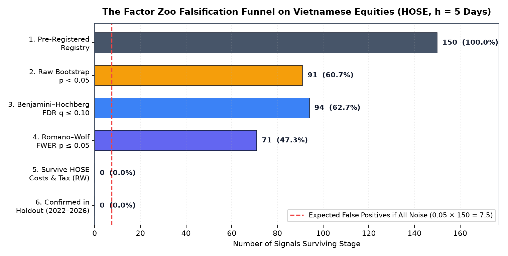

<div align="center">


**Cross-sectional alpha engineering, Alphalens-grade diagnostics, and cost-aware portfolio allocation in Polars.**

[](https://pypi.org/project/polars-anta/)
[](https://pypi.org/project/polars-anta/)
[](https://github.com/huuan26/polars-anta/actions/workflows/ci.yml)
[](https://huuan26.github.io/polars-anta/)
[](LICENSE)

[Quick Start](#quick-start) | [Empirical Validation](#cross-sectional-alpha-engineering--empirical-validation) | [Factor Zoo](#why-standalone-signals-fail-150-signals-on-vietnamese-equities) | [Workflows](#quantitative-workflows) | [API Overview](#architecture--api-overview) | [Resources](#documentation-and-learning-resources)

</div>

---

`polars-anta` is a pure-Python, zero-C quantitative finance library built on [Polars](https://pola.rs/) and NumPy (`241` public functions across `15` modules; `246` total exports). Rather than shipping an opaque C extension of standalone chart indicators, it provides inspectable mathematical primitives to turn noisy, crowded multi-asset signals (`time x asset x K factors`) into risk-neutralized, orthogonalized, and turnover-controlled portfolio weights:

- **Cross-sectional conditioning (`conditioning`)**: Rank-to-normal Gaussianization (`cs_gaussianize`), simultaneous two-stage Frisch-Waugh-Lovell group + risk neutralization (`neutralize_panel`), and loop-free batched 3D Lowdin SVD orthogonalization (`orthogonalize_panel`).
- **Alphalens-grade diagnostics & screening (`diagnostics`)**: Strictly causal tearsheets (`analyze_alpha`) measuring Rank IC, Newey-West HAC t-statistics, decay half-life, L1 turnover, gross margin (`bps` per unit turnover), breakeven cost, unbiased daily long/short attribution, and lagged ADV liquidity tiers, plus marginal screening (`marginal_alpha_report`).
- **RMT covariance & cost-aware FISTA allocation (`covariance`, `allocation`)**: Analytical Ledoit-Wolf shrinkage, Marchenko-Pastur denoising, Monotone FISTA with exact Lagrangian joint box-simplex + L1 turnover prox (`solve_fista`), and embargoed walk-forward optimization (`combine_alphas_walkforward`).
- **Statistical falsification, AFML & microstructure (`inference`, `evaluation`, `backtest`, `alpha`, `resample`)**: Stationary block bootstrap, Romano-Wolf FWER, Hansen SPA, CSCV PBO, empirical-Bayes shrinkage, Fixed-Window Fractional Differentiation (`frac_diff`), zero-copy `sliding_window_view` Triple-Barrier / Trend-Scanning labeling, information bars, and `150+` native signal expressions.

| Project facts | |
| :--- | :--- |
| **Install** | `pip install polars-anta` or `uv add polars-anta` |
| **Python & Deps** | Python `3.10-3.14`; runtime dependencies strictly `polars>=1.0.0`, `numpy>=1.24.0` (zero SciPy/CVXPY/C) |
| **Documentation** | [Online Documentation](https://huuan26.github.io/polars-anta/) · [Quickstart Colab](https://colab.research.google.com/github/huuan26/polars-anta/blob/master/examples/quickstart_colab.ipynb) · [Apache 2.0 License](LICENSE) |

---

## Quick start

```bash
python -m pip install polars-anta
# or with uv:
uv add polars-anta
```

Importing `polars_anta` registers `.anta` and `.ta` namespaces on Polars `Expr`, `DataFrame`, and `LazyFrame`:

```python
import polars as pl
import polars_anta as pa  # registers .anta and .ta namespaces

df = pl.DataFrame({"close": [100.0, 102.0, 101.5, 104.0, 106.5, 105.0, 108.0]})
out = df.with_columns(
    pl.col("close").anta.ema(period=3).round(2).alias("ema_3"),
    pl.col("close").anta.rsi(period=3).round(2).alias("rsi_3"),
)
print(out.tail(3))
```

Falsify candidate signals against multiple-testing bias (`BH FDR`, `Romano-Wolf FWER`, `Empirical Bayes`, `CUSUM`) in 10 lines:

```python
import numpy as np
import polars as pl
import polars_anta as pa

rng = np.random.default_rng(42)
n_dates, n_tickers = 250, 40
panel = pl.DataFrame(
    {
        "date": np.repeat(np.arange(n_dates), n_tickers),
        "ticker": np.tile(np.arange(n_tickers), n_dates),
        "sig_true": rng.standard_normal(n_dates * n_tickers),
        "sig_noise_1": rng.standard_normal(n_dates * n_tickers),
        "sig_noise_2": rng.standard_normal(n_dates * n_tickers),
    }
).with_columns(
    (0.08 * pl.col("sig_true") + rng.standard_normal(n_dates * n_tickers)).alias("fwd_ret_5")
)

result = panel.anta.falsify_factors(
    factor_cols=["sig_true", "sig_noise_1", "sig_noise_2"],
    return_col="fwd_ret_5",
    group_by="date",
    horizon=5,
    n_boot=500,
    seed=42,
)
print(result.report())
```

---

## Cross-sectional alpha engineering & empirical validation

### 1. Real-market out-of-sample validation (Global Crypto, US Equities, Vietnam HOSE)

[`benchmarks/real_market_alpha_engineering.py`](benchmarks/real_market_alpha_engineering.py) ([full 4-stage output](docs/assets/real_market_alpha_engineering.md)) evaluates the 4-stage pipeline out of sample (`signal_lag = 1`) using 6 public daily OHLCV/orderflow signals across three distinct real-world friction regimes:

| Market & Regime | Pipeline Stage | Rank IC (NW t) | Daily Turnover | Gross Margin (bps) | Gross Sharpe | Net Sharpe |
| :--- | :--- | :---: | :---: | :---: | :---: | :---: |
| **Crypto L/S** (`N=24`, `10 bps` OW) | `0. Raw Equal-Weight` | `+0.0452` (`+4.45`) | `0.436` | `+8.31` | `+0.62` | `-0.13` |
| **Crypto L/S** (`N=24`, `10 bps` OW) | `1. FWL + Lowdin (EW)` | `+0.0307` (`+4.04`) | `0.586` | `+6.00` | `+0.86` | `-0.58` |
| **Crypto L/S** (`N=24`, `10 bps` OW) | `3. Cost-Aware RMT + FISTA` | `-0.0047` (`-0.68`) | `0.206` | `-8.14` | `-0.43` | `-0.95` |
| **US Equities L/S** (`N=30`, `10 bps` OW) | `0. Raw Equal-Weight` | `+0.0014` (`+0.15`) | `0.294` | `-1.22` | `-0.10` | `-0.89` |
| **US Equities L/S** (`N=30`, `10 bps` OW) | `1. FWL + Lowdin (EW)` | `+0.0029` (`+0.55`) | `0.539` | `-1.96` | `-0.44` | `-2.69` |
| **US Equities L/S** (`N=30`, `10 bps` OW) | `3. Cost-Aware RMT + FISTA` | `+0.0003` (`+0.08`) | `0.049` | `+8.65` | `+0.24` | `-0.04` |
| **Vietnam HOSE L/O** (`N<=150`, `30 bps` OW) | `0. Raw Equal-Weight` | `+0.0138` (`+2.82`) | `0.385` | `-14.90` | `-0.59` | `-1.78` |
| **Vietnam HOSE L/O** (`N<=150`, `30 bps` OW) | `1. FWL + Lowdin (EW)` | `+0.0150` (`+4.25`) | `0.387` | `-5.74` | `-0.23` | `-1.41` |
| **Vietnam HOSE L/O** (`N<=150`, `30 bps` OW) | `3. Cost-Aware RMT + FISTA` | `+0.0043` (`+1.41`) | `0.091` | `+12.68` | `+0.13` | `-0.17` |

**Key empirical findings:**
- **Global Crypto (`data-api.binance.vision`, 2024-08 to 2026-11, with real `taker_buy_volume` orderflow)**: Raw Equal-Weight captures significant predictability (`Rank IC = +0.0452`, `NW t = +4.45`, `+8.31 bps` gross margin - viable under VIP/maker fees below `8.3 bps`, `-0.13` Net Sharpe at `10 bps` taker cost), while Stage 1 FWL + Lowdin increases pure cross-sectional Gross Sharpe from `+0.62` to `+0.86`. Conversely, Stage 3 (120-day factor timing) degrades on fast-rotating altcoin regimes (`-0.95`), illustrating that FWL + Lowdin Equal-Weight outperforms trailing factor-timing when `N = 24` regimes invert faster than a 120-day covariance window.
- **US Large-Caps & Sector ETFs (2022-09 to 2026-11)**: On a near-zero-alpha public OHLCV baseline (`Raw IC = +0.0014`), naive Stage 2 unpenalized walk-forward (full table) churns `59.5%/day` (`-3.65` Net Sharpe). Stage 3 cuts turnover **12x** (`0.595 -> 0.049`) and flips Gross Margin from `-2.25` to **`+8.65 bps`** (`-0.04` Net Sharpe).
- **Vietnam `HOSE` Long-Only Holdout (2022-01 to 2026-11, `60 bps` round-trip)**: Stage 1 FWL beta + size neutralization + Lowdin raises `NW t` from `+2.82` to `+4.25`. Stage 3 cuts daily turnover **4.2x** (`0.385 -> 0.091`) and lifts Gross Margin by **`+27.58 bps`** (`-14.90 -> +12.68 bps`, `-0.17` vs `-1.78` Raw EW), confirming that clearing HOSE's `60 bps` long-only hurdle requires deeper fundamental or intraday alpha beyond 6 daily OHLCV signals.

### 2. Controlled synthetic ablation & exact solver invariants

When stationary net-positive latent factors are planted under controlled sector/beta contamination (`N = 150`, `T = 600`, `10 bps` one-way cost), [`benchmarks/alpha_engineering_validation.py`](benchmarks/alpha_engineering_validation.py) ([full output](docs/assets/alpha_engineering_validation.md)) isolates each module's contribution:

| Pipeline Stage (Controlled Synthetic) | Rank IC | ICIR | Daily Turnover | Gross Margin (bps) | Gross Sharpe | Net Sharpe (`10 bps`) |
| :--- | :---: | :---: | :---: | :---: | :---: | :---: |
| `0. Raw Signals (Equal-Weight)` | `+0.0288` | `+0.222` | `1.218` | `+5.33` | `+3.57` | `-3.13` |
| `1. FWL + Lowdin Ortho (Equal-Weight)` | `+0.0311` | `+0.436` | `1.128` | `+6.50` | `+7.75` | `-4.16` |
| `2. Unpenalized Walk-Forward (Sample Cov)` | `+0.0269` | `+0.372` | `1.151` | `+5.66` | `+6.77` | `-5.16` |
| `3. Full Pipeline (RMT + Cost-Aware FISTA + EMA)` | `+0.0208` | `+0.365` | `0.457` | `+18.10` | `+9.26` | `+4.14` |

| Deterministic Mathematical Invariant | Observed Residual / Error | Acceptance Bound |
| :--- | :---: | :---: |
| FWL Simultaneous Sector + Risk Exposure (`max |X_t^T F_neut,t|`) | `5.72e-13` | `< 1.00e-10` |
| Batched Lowdin Orthogonality (`||F_t^T F_t / (N_t - 1) - I_K||_F`) | `4.14e-15` | `< 1.00e-10` |
| Lowdin Permutation Equivariance (`max |F_pi - F P|`) | `3.55e-15` | `< 1.00e-11` |
| Joint Box-Simplex + L1 FISTA KKT Stationarity Residual | `5.09e-11` | `< 1.00e-07` |
| Causal Embargo Prefix-Invariance Leakage (`horizon=5, signal_lag=1`) | `0.00e+00` | `== 0.00e+00` |

End-to-end runnable pipeline (see [`examples/07_cross_sectional_alpha_engineering.py`](examples/07_cross_sectional_alpha_engineering.py) for full synthetic panel generation):

```python
import polars as pl
import polars_anta as pa

raw_cols = ["alpha_1", "alpha_2", "alpha_3"]

# 1. Gaussianize, neutralize sector + beta (FWL), and symmetrically orthogonalize (Lowdin SVD):
neut = panel.with_columns(
    [pl.col(c).anta.cs_gaussianize(over="date").alias(f"{c}_g") for c in raw_cols]
).anta.neutralize_panel(
    [f"{c}_g" for c in raw_cols], time_col="date", risk_cols=["beta"], group_col="sector"
)
neut_cols = [f"{c}_g_neut" for c in raw_cols]
ortho = neut.anta.orthogonalize_panel(neut_cols, time_col="date", method="lowdin")

# 2. Check whether candidate alpha_3 adds independent dimension (Delta N_eff & FWL Residual IC):
marg = ortho.anta.marginal_alpha_report(
    candidate_col="alpha_3_g_neut",
    benchmark_cols=["alpha_1_g_neut", "alpha_2_g_neut"],
    return_col="fwd_1",
    time_col="date",
)

# 3. Causal embargo walk-forward allocation (RMT + factor-return cost drag + FISTA + EMA):
wf = ortho.anta.combine_alphas_walkforward(
    factor_cols=[f"{c}_ortho" for c in neut_cols],
    return_col="fwd_1",
    time_col="date",
    asset_col="ticker",
    lookback=60,
    horizon=1,
    signal_lag=1,
    objective_mode="factor_return",
    one_way_cost_bps=10.0,
    signal_ema_alpha=0.25,
    turnover_penalty=0.01,
    constraint="box",
    lower_bound=-1.0,
    upper_bound=1.0,
    cov_estimator="marchenko_pastur",
    ic_shrinkage="empirical_bayes",
)

# 4. Full Alphalens-grade tearsheet (IC, Margin bps, Breakeven Cost, Lagged ADV Sub-Universe):
diag = wf.data.anta.analyze_alpha(
    "composite_alpha", close_col="close", volume_col="volume", asset_col="ticker", time_col="date"
)
print(diag.report())
```

---

## Why standalone signals fail: 150 signals on Vietnamese equities

Every daily signal in `polars-anta` (**150** signals, **146** unique) was evaluated through the library's preregistered falsification pipeline on the point-in-time top-150 liquid stocks of `HOSE` (`2014-2021` discovery, `2022-2026` locked holdout, `60 bps` round-trip cost):

| Question | Result |
| :--- | ---: |
| Signals tested | **150** (`146` unique) |
| Effectively independent tests among them | **N_eff = 6.00** |
| Significant after Romano-Wolf FWER (5%) | **71** |
| Stable over discovery (`2014-2021`) | **64** |
| Replicated in locked holdout (`2022-2026`) | **38 of 64** (`97.6%` median IC retention) |
| Significant long-only excess return after `60 bps` RT cost | **0** (max breakeven `20.5 bps` RT) |

<div align="center">



</div>

Read the full preregistered report in [`research/factor_zoo/REPORT.md`](research/factor_zoo/REPORT.md).

<details>
<summary>Study design, preregistration checksum, and Track A / Track B breakdown</summary>

| Design choice | Value |
| :--- | :--- |
| Universe & Horizon | Point-in-time top-150 `HOSE` stocks; 5 trading days open-to-open (`60 bps` RT cost) |
| Sample Split | Discovery `2014-01-01` to `2021-12-31`; Locked holdout `2022-01-01` to `2026-11-10` |
| Preregistration | [`PREREGISTRATION.md`](research/factor_zoo/PREREGISTRATION.md) ([`4c1a4b5`](https://github.com/huuan26/polars-anta/commit/4c1a4b559d22a1367ce46b513ab7ff1079fff360)) with verified SHA-256 registry |

- **Track A (Statistical Predictability)**: `94/150` pass BH FDR `q <= 0.10`, `71/150` pass Romano-Wolf FWER `p <= 0.05`, `64` stable (`robust`), `38` replicate in holdout (`65.5%` discovery / `90.0%` holdout of top-10 spread comes from the uncapturable short leg).
- **Track B (Long-Only Implementability)**: Out of `80` Track A candidates, `12` show positive mean net excess return, `2` pass unadjusted `p <= 0.05`, **`0`** survive BH FDR `q <= 0.10` or holdout confirmation at `60 bps`.

</details>

---

## Quantitative workflows

```text
1. Raw Feeds & Bars ──> 2. Conditioning (FWL + Lowdin) ──> 3. Diagnostics & Inference ──> 4. Cost-Aware Allocation & Backtest
   resample_ohlcv          cs_gaussianize                     analyze_alpha                solve_fista (joint box-simplex+L1)
   volume/dollar bars      neutralize_panel (FWL)             marginal_alpha_report        combine_alphas_walkforward (embargo)
   stitch_futures_roll     orthogonalize_panel (SVD)          falsify_factors (RW/PBO)     vectorized_backtest (MAE/MFE)
```

All workflows operate uniformly on `"ticker"` asset keys across `.anta`, `.ta`, and top-level imports:

#### A. Intraday derivatives, information bars, roll stitching & microstructure
```python
cont_df = raw_contracts.anta.stitch_futures_roll(method="back_adjust")
vol_bars = cont_df.anta.resample_volume_bars(
    threshold=5_000,
    additional_aggs=[
        pl.col("trading_date").last(),
        pl.col("bid_price").last(),
        pl.col("bid_size").last(),
        pl.col("ask_price").last(),
        pl.col("ask_size").last(),
        pl.col("spot_close").last(),
        pl.col("days_to_expiry").last(),
        pl.col("open_interest").last(),
    ],
)

deriv_features = (
    vol_bars.anta.session_vwap(session_by="trading_date", unnest=True, prefix="svwap_")
    .with_columns(
        pl.col("close").anta.vpin("volume", period=20).alias("vpin_20"),
        pl.col("bid_price").anta.ofi("bid_size", "ask_price", "ask_size", period=5).alias("ofi_5"),
        pl.col("close")
        .anta.futures_basis("spot_close", "days_to_expiry", period=20)
        .alias("basis"),
        pl.col("close").anta.oi_regime("open_interest", period=1).alias("oi_state"),
    )
    .unnest("basis", "oi_state")
)
```

#### B. Quant ML (AFML): Fixed-Window Fractional Differentiation & Path-Dependent Labels
```python
ml_dataset = (
    df.with_columns(
        pl.col("close").anta.frac_diff(d=0.4, window=20).over("ticker").alias("close_ffd")
    )
    .anta.triple_barrier_labels(
        horizon=12,
        pt_mult=2.0,
        sl_mult=1.5,
        side="primary_signal",
        unnest=True,
        group_by="ticker",
    )
    .anta.trend_scanning_labels(min_window=5, max_window=20, unnest=True, group_by="ticker")
)
```

#### C. Cross-sectional conditioning: Gaussianize -> Simultaneous FWL -> Lowdin SVD
```python
cond_df = (
    panel_df.with_columns(
        (
            -pl.col("close").anta.ts_delta(5).over("ticker")
            * pl.col("volume").anta.ts_rank(20).over("ticker")
        ).alias("a_rev"),
        pl.col("close").pct_change(20).over("ticker").alias("a_mom"),
    )
    .with_columns(
        pl.col("a_rev").anta.cs_gaussianize(over="date").alias("a_rev_g"),
        pl.col("a_mom").anta.cs_gaussianize(over="date").alias("a_mom_g"),
    )
    .anta.neutralize_panel(
        ["a_rev_g", "a_mom_g"],
        time_col="date",
        risk_cols=["mkt_beta", "log_mcap", "vol_20"],
        group_col="sector",
    )
    .anta.orthogonalize_panel(["a_rev_g_neut", "a_mom_g_neut"], time_col="date", method="lowdin")
)
```

#### D. Factor validation (Newey-West HAC IC, Decay Half-Life, PSR & DSR)
```python
eval_df = cond_df.anta.forward_returns(periods=(1, 5, 10), group_by="ticker")

ic_stats = eval_df.anta.ic_summary("a_rev_g_neut_ortho", "fwd_ret_5", group_by="date", nw_lags=5)
decay_table = eval_df.anta.ic_decay(
    "a_rev_g_neut_ortho", horizons=(1, 2, 3, 5, 10, 20), asset_col="ticker", group_by="date"
)
sharpe_significance = eval_df.select(
    pl.col("strat_ret").anta.probabilistic_sharpe_ratio(benchmark_sr=1.0).alias("psr"),
    pl.col("strat_ret").anta.deflated_sharpe_ratio(n_trials=50, trials_sr_std=0.4).alias("dsr"),
)
```

#### E. Execution-realistic vectorized backtest & excursion ledger (MAE/MFE)
```python
bt = (
    df.anta.ema(period=12, alias="ema_12")
    .anta.ema(period=26, alias="ema_26")
    .anta.backtest(
        entries=pl.col("ema_12").anta.crosses_above("ema_26"),
        exits=pl.col("ema_12").anta.crosses_below("ema_26"),
        execution_price="open",
        flat_mask=pl.col("is_atc_bar"),
        vol_target=0.15,
        no_trade_buffer=0.05,
        fee_rate=0.0005,
        slippage_rate=0.0002,
        initial_capital=100_000.0,
    )
)
print(bt.report())
print(bt.trades())  # Round-trip ledger with PnL, holding_bars, MAE, and MFE
```

---

## Architecture & API overview

All **`241` public functions** (`246` exports including result dataclasses `AlphaDiagnosticReport`, `OptimizationResult`, `WalkForwardAllocationResult`, `BacktestResult`, `FalsificationResult`) are exposed at the top level (`import polars_anta as pa`) and registered on `.anta` and `.ta`. Full signatures and mathematical formulas live in the [online API documentation](https://huuan26.github.io/polars-anta/indicators/).

| Area & Source Module(s) | Functions | Key Highlights | API Reference |
| :--- | :---: | :--- | :--- |
| **Alpha Engineering** (`conditioning`, `diagnostics`, `covariance`, `allocation`) | 17 | `cs_gaussianize`, `neutralize_panel`, `orthogonalize_panel`, `lowdin_matrix`, `collinearity_summary`, `analyze_alpha`, `marginal_alpha_report`, `ledoit_wolf_shrinkage`, `marchenko_pastur_denoise`, `solve_fista`, `combine_alphas_walkforward` | [Alpha Engineering](https://huuan26.github.io/polars-anta/indicators/alpha-engineering/) |
| **Statistical Inference** (`inference`) | 17 | `stationary_bootstrap_indices`, `bootstrap_test`, `adjust_pvalues`, `romano_wolf`, `spa_test`, `pbo_cscv`, `empirical_bayes_shrinkage`, `oos_r2`, `clark_west_test`, `diebold_mariano_test`, `cusum_mean_test`, `breakeven_cost`, `falsify_factors`, `sweep_robustness` | [Inference & Falsification](https://huuan26.github.io/polars-anta/indicators/inference/) |
| **Evaluation & Backtest** (`evaluation`, `backtest`) | 28 | `triple_barrier_labels`, `trend_scanning_labels`, `forward_returns`, `ic_summary`, `ic_decay`, `quantile_analysis`, `probabilistic_sharpe_ratio`, `deflated_sharpe_ratio`, `vectorized_backtest`, `extract_trades`, `parameter_sweep` | [Evaluation & Backtest](https://huuan26.github.io/polars-anta/indicators/evaluation-and-backtest/) |
| **Alpha & Microstructure** (`alpha`) | 71 | `cs_rank`, `cs_zscore`, `cs_winsorize`, `neutralize`, `orthogonalize`, `vpin`, `ofi`, `amihud_illiquidity`, `roll_spread`, `corwin_schultz_spread`, `kyle_lambda`, `futures_basis`, `oi_regime`, `hurst_exponent`, `alpha_001..101` (33 formulas) | [Alpha & Microstructure](https://huuan26.github.io/polars-anta/indicators/alpha/) |
| **Statistics & OLS** (`stats`) | 15 | `frac_diff`, `zscore`, `percentile_rank`, `skewness`, `kurtosis`, `rolling_beta`, `rolling_alpha`, `rolling_cov`, `rolling_corr`, closed-form OLS `linear_regression_*` (`slope`, `intercept`, `angle`, `forecast`, `r2`, `stderr`) | [Statistics & OLS](https://huuan26.github.io/polars-anta/indicators/stats/) |
| **Information Bars & Roll** (`resample`) | 6 | `resample_ohlcv`, `resample_volume_bars`, `resample_dollar_bars`, `resample_imbalance_bars`, `stitch_futures_roll`, `validate_ohlcv` | [Resampling & Roll](https://huuan26.github.io/polars-anta/guides/resampling-and-dataframe-api/) |
| **Trend & Overlays** (`trend`) | 28 | `sma`, `ema`, `wma`, `hma`, `dema`, `tema`, `zlema`, `t3`, `alma`, `kama`, `mcginley_dynamic`, `vidya`, `heikin_ashi`, `supertrend`, `psar`, `ichimoku`, `adx`, `vortex`, `aroon`, `pivot_points` | [Trend Indicators](https://huuan26.github.io/polars-anta/indicators/trend/) |
| **Momentum Oscillators** (`momentum`) | 23 | `rsi`, `macd`, `ppo`, `trix`, `stochastic`, `stoch_rsi`, `squeeze_momentum`, `stc`, `tsi`, `fisher_transform`, `williams_r`, `cci`, `roc`, `awesome_oscillator`, `cmo`, `ultimate_oscillator` | [Momentum Indicators](https://huuan26.github.io/polars-anta/indicators/momentum/) |
| **Volatility & Channels** (`volatility`) | 20 | `atr`, `natr`, `true_range`, `bollinger_bands`, `keltner_channels`, `donchian_channels`, `chandelier_exit`, `parkinson_volatility`, `garman_klass_volatility`, `rogers_satchell_volatility`, `yang_zhang_volatility`, `ulcer_index` | [Volatility Indicators](https://huuan26.github.io/polars-anta/indicators/volatility/) |
| **Volume & Money Flow** (`volume`) | 16 | `vwap`, `vwap_bands`, `session_vwap`, `vwma`, `obv`, `cmf`, `adl`, `mfi`, `eom`, `klinger`, `nvi`, `pvi`, `pvt`, `force_index`, `vpci`, `vr` | [Volume Indicators](https://huuan26.github.io/polars-anta/indicators/volume/) |

---

## Performance benchmark (1,000,000 rows)

<div align="center">


</div>

Measured on **1,000,000 bars** (single-asset random walk) and a **500 tickers x 2,000 bars universe** (`1,000,000` rows), comparing Polars' multi-threaded Rust engine against single-threaded pandas (`python benchmarks/benchmark_speed.py`):

| Operation / Indicator | Dataset Scale | pandas | `polars-anta` | Speedup |
| :--- | :--- | ---: | ---: | ---: |
| **Linear regression slope (OLS)** | 1,000,000 bars | 2.3529 s | **0.0209 s** | **112.4x** |
| **Multi-asset RSI (14)** | 500 tickers x 2k bars | 0.4398 s | **0.0545 s** | **8.1x** |
| **Multi-asset SMA (20)** | 500 tickers x 2k bars | 0.1345 s | **0.0168 s** | **8.0x** |
| **Z-score normalization** | 1,000,000 bars | 0.0450 s | **0.0267 s** | **1.7x** |
| **Exponential moving average** | 1,000,000 bars | 0.0100 s | **0.0069 s** | **1.5x** |
| **Simple moving average** | 1,000,000 bars | 0.0170 s | **0.0153 s** | **1.1x** |

> Baselines use straightforward pandas (`rolling().mean()`, `groupby().apply()`, and `rolling().apply()` for OLS WMA terms). A manually vectorized pandas/NumPy OLS narrows the 112.4x gap considerably; exact speedups depend on CPU core count.

---

## Documentation and learning resources

| Resource | Description |
| :--- | :--- |
| [**Cross-Sectional Alpha Engineering**](docs/indicators/alpha-engineering.md) | Two-stage FWL, Lowdin SVD, Alphalens diagnostics, Marchenko-Pastur RMT, and FISTA walkthrough |
| [**Real-Market Empirical Benchmark**](docs/assets/real_market_alpha_engineering.md) | Full 4-stage out-of-sample results on Binance Crypto, US Equities/ETFs, and Vietnam HOSE ([script](benchmarks/real_market_alpha_engineering.py)) |
| [**Factor Zoo Empirical Study**](research/factor_zoo/REPORT.md) | Preregistered falsification study of 150 signals on Vietnamese equities (`HOSE`, 2014-2026) |
| [**Architecture & Mathematical Proofs**](docs/architecture.md) | Closed-form OLS identities, Wilder `ewm_mean` mappings, and `sliding_window_view` design |
| [**Quantitative Theory & Workflows**](docs/guides/quant-theory-and-workflows.md) | AFML labeling, FFD, microstructure bars, Newey-West HAC, PSR and DSR derivations |
| [**Multi-Asset Scaling**](docs/guides/multi-asset.md) & [**Benchmarks**](docs/benchmarks.md) | `.over("ticker")` partitioning and 1,000,000-row benchmark methodology |
| [**Roadmap**](ROADMAP.md) and [**Changelog**](CHANGELOG.md) | Release history (`v0.5.0`) and development milestones |

### Examples & interactive notebooks

| Script / Notebook | Topic | Launch / Path |
| :--- | :--- | :--- |
| [`07_cross_sectional_alpha_engineering.py`](examples/07_cross_sectional_alpha_engineering.py) | Full 4-stage FWL -> Lowdin -> RMT -> Cost-Aware FISTA -> Alphalens tearsheet | Python script |
| [`04_backtest_showcase.py`](examples/04_backtest_showcase.py) & [`quickstart.py`](examples/quickstart.py) | Standalone quickstart and strategy execution backtest showcase | Python scripts |
| [`quickstart_colab.ipynb`](examples/quickstart_colab.ipynb) | Interactive quickstart and live speed benchmark | [Open in Colab](https://colab.research.google.com/github/huuan26/polars-anta/blob/master/examples/quickstart_colab.ipynb) |
| [`01_quickstart.ipynb`](examples/01_quickstart.ipynb) | `.anta` / `.ta` expressions, `pl.Struct` unnesting and plotting | [Open in Colab](https://colab.research.google.com/github/huuan26/polars-anta/blob/master/examples/01_quickstart.ipynb) |
| [`02_multi_asset_portfolio_scan.ipynb`](examples/02_multi_asset_portfolio_scan.ipynb) | Parallel 500-ticker equity screening with `.over("ticker")` | [Open in Colab](https://colab.research.google.com/github/huuan26/polars-anta/blob/master/examples/02_multi_asset_portfolio_scan.ipynb) |
| [`03_crypto_momentum_scan.ipynb`](examples/03_crypto_momentum_scan.ipynb) | Cross-sectional crypto momentum and volatility filtering | [Open in Colab](https://colab.research.google.com/github/huuan26/polars-anta/blob/master/examples/03_crypto_momentum_scan.ipynb) |
| [`04_backtest_and_alpha_eval.ipynb`](examples/04_backtest_and_alpha_eval.ipynb) | 5-quantile IC analysis and dollar-neutral backtesting | [Open in Colab](https://colab.research.google.com/github/huuan26/polars-anta/blob/master/examples/04_backtest_and_alpha_eval.ipynb) |
| [`05_statistical_arbitrage_pairs_trading.ipynb`](examples/05_statistical_arbitrage_pairs_trading.ipynb) | Pairs trading: log-spread z-scores and rolling correlation | [Open in Colab](https://colab.research.google.com/github/huuan26/polars-anta/blob/master/examples/05_statistical_arbitrage_pairs_trading.ipynb) |
| [`06_multi_factor_sector_neutral_portfolio.ipynb`](examples/06_multi_factor_sector_neutral_portfolio.ipynb) | Multi-factor sector neutralization and composite backtesting | [Open in Colab](https://colab.research.google.com/github/huuan26/polars-anta/blob/master/examples/06_multi_factor_sector_neutral_portfolio.ipynb) |

---

## Contributing, support & license

Contributions are welcome - browse [issues](https://github.com/huuan26/polars-anta/issues), join [GitHub Discussions](https://github.com/huuan26/polars-anta/discussions), and follow [CONTRIBUTING.md](CONTRIBUTING.md) (`pytest`, `ruff check .`).

**Disclaimer:** `polars-anta` is provided for educational and research purposes without warranty of any kind. Quantitative models and backtests must be independently verified before live trading or risk decisions.

Maintained by **Phan Bui Huu An** ([@huuan26](https://github.com/huuan26), [phanbuihuuan261103@gmail.com](mailto:phanbuihuuan261103@gmail.com)) under the **Apache License 2.0** ([LICENSE](LICENSE)).
