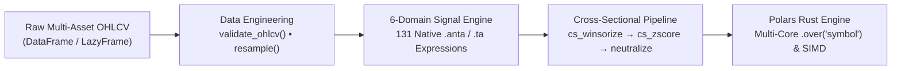

<div align="center">


<br/>
<br/>

**ANTA (Alpha & Numerical Technical Analysis): Ultra-fast, zero-C-dependency technical analysis, market microstructure, and alpha factor library powered natively by Polars Expressions.**

[](https://github.com/huuan26/polars-anta/actions/workflows/ci.yml)
[](https://pypi.org/project/polars-anta/)
[](https://huuan26.github.io/polars-anta/)
[](https://colab.research.google.com/github/huuan26/polars-anta/blob/master/examples/quickstart_colab.ipynb)
[](https://github.com/huuan26/polars-anta/releases/latest)
[](LICENSE)
[](https://pypi.org/project/polars-anta/)
[](https://pola.rs)
[](#supported-indicators-175-indicators-alpha-factors--evaluation-primitives)
[](https://github.com/astral-sh/ruff)

[Documentation](https://huuan26.github.io/polars-anta/) • [Why polars-anta?](#why-polars-anta) • [Architecture](#architecture--execution-pipeline) • [Benchmarks](#performance-benchmark-1000000-rows) • [Installation](#installation) • [Quickstart](#quickstart--quantitative-workflows) • [Indicator Catalog (175)](#supported-indicators-175-indicators-alpha-factors--evaluation-primitives) • [Development](#development--testing)

</div>

> **Try it immediately in your browser:** Run our [1-Minute Interactive Colab Demo](https://colab.research.google.com/github/huuan26/polars-anta/blob/master/examples/quickstart_colab.ipynb) with 1-click execution & live **112.4x speedup** benchmarks!
>
> **Latest Highlights:** Expanded to **175 native indicators, alpha factors & evaluation primitives** - featuring **33 WorldQuant 101 Formulaic Alphas** (`alpha_001`–`alpha_030`, `alpha_041`, `alpha_054`, `alpha_101`), an **Alphalens-Style Factor Evaluation Suite** (`information_coefficient`, `ic_summary`, `quantile_analysis`, `factor_turnover`), **Strategy Performance Metrics** (`sharpe_ratio`, `sortino_ratio`, `calmar_ratio`, `max_drawdown`, `profit_factor`), and a **Lightweight Vectorized Backtester** (`df.anta.backtest()`).

---

## Why `polars-anta`?

Quantitative researchers and financial engineers have historically faced a trade-off between installation complexity, cross-sectional expressiveness, and execution speed:

| Capability | TA-Lib | pandas-ta | `polars-anta` |
| :--- | :---: | :---: | :---: |
| **Dependencies** | External C library & MSVC / GCC | Pure Python / NumPy | **Zero C compilation** (pure Polars & NumPy) |
| **Execution Engine** | Single-threaded C loops | Single-threaded Pandas / GIL | **Multi-threaded Rust** query engine + SIMD |
| **Multi-Asset Scaling** | Manual sequential loops | Slow `.groupby().apply()` | **Native `.over("symbol")`** parallelization |
| **Dual Namespace API** | Unsupported | Single `.ta` accessor | **Both `.anta` & `.ta`** on `Expr`, `DataFrame`, `LazyFrame` |
| **Cross-Sectional Alpha Ops** | Unsupported | Unsupported | **Built-in `cs_winsorize`, `cs_zscore`, `cs_rank`, `neutralize`** |
| **Market Microstructure** | Unsupported | Unsupported | **Amihud Illiquidity, Kyle's $\lambda$, Roll & Corwin-Schultz Spreads** |
| **Multi-Timeframe OHLCV** | Unsupported | Slow Pandas resampling | **Zero-copy `resample_ohlcv` & `validate_ohlcv`** |
| **Lazy Evaluation** | Unsupported | Unsupported | **Full `pl.LazyFrame`** query optimization & streaming |
| **Memory Layout** | Array conversion overhead | High Pandas copy footprint | **Zero-copy Apache Arrow** columnar buffers |

`polars-anta` eliminates this compromise by implementing technical indicators, statistical regressions, and WorldQuant-style alpha factors directly as **Polars Expressions (`pl.Expr`)**. Computations are pushed into Polars' multi-threaded Rust engine and vectorized `sliding_window_view` kernels, eliminating Python GIL bottlenecks without requiring any C compilers.

---

## Architecture & Execution Pipeline



### Core Architectural Pillars

- **Dual Namespaces (`.anta` & `.ta`)**: Invoke any indicator via `pl.col("close").anta.<indicator>()` or the shorthand `pl.col("close").ta.<indicator>()` across Expressions, DataFrames, and LazyFrames.
- **Fluent Pipeline Chaining**: Chain data validation, timeframe resampling, and multi-indicator transformations directly on `df.anta...` or `lf.anta...`, or generate a complete quantitative feature suite in one call via `df.anta.add_all(group_by="symbol")`.
- **Closed-Form Algebraic Vectorization**: Rolling OLS Linear Regression (`slope`, `intercept`, `angle`, `forecast`), CAPM `rolling_beta`/`rolling_alpha`, and `heikin_ashi` are rewritten in closed-form algebraic identities and native Polars `ewm_mean` recurrences—achieving **112.4x speedups** over rolling Python/Pandas UDFs.
- **Zero-Loop Stride-Tricks Kernels**: Path-dependent rolling operators (`ts_rank`, `percentile_rank`, `ts_argmax`, `ts_argmin`, `ts_product`, `hurst_exponent`) use contiguous zero-copy `numpy.lib.stride_tricks.sliding_window_view` matrices instead of Python loops.
- **Typed `pl.Struct` Outputs**: Multi-line indicators (`macd`, `bollinger_bands`, `keltner_channels`, `ichimoku`, `supertrend`, `heikin_ashi`, `squeeze_momentum`) return strongly-typed `pl.Struct` expressions with `unnest=True` support on DataFrames/LazyFrames.

---

## Performance Benchmark (1,000,000 Rows)

<div align="center">


</div>

Benchmarks measured across **1,000,000 bars** (single-asset random walk) and a **500 tickers × 2,000 bars universe** (1,000,000 rows). Computations executed on Polars' multi-threaded Rust query engine vs single-threaded Pandas:

| Operation / Indicator | Dataset Scale | Pandas Execution | `polars-anta` Execution | Measured Speedup |
| :--- | :--- | :---: | :---: | :---: |
| **Linear Regression Slope (OLS)** | 1,000,000 bars | 2.3529 s | **0.0209 s** | **112.4x Faster** |
| **Multi-Asset RSI (14)** | 500 tickers × 2k bars | 0.4398 s | **0.0545 s** | **8.1x Faster** |
| **Multi-Asset SMA (20)** | 500 tickers × 2k bars | 0.1345 s | **0.0168 s** | **8.0x Faster** |
| **Z-Score Normalization** | 1,000,000 bars | 0.0450 s | **0.0267 s** | **1.7x Faster** |
| **Exponential Moving Average** | 1,000,000 bars | 0.0100 s | **0.0069 s** | **1.5x Faster** |
| **Simple Moving Average** | 1,000,000 bars | 0.0170 s | **0.0153 s** | **1.1x Faster** |

*Reproduce benchmarks locally using `pip install -e ".[benchmark]"` followed by `python benchmarks/benchmark_speed.py`.*

---

## Installation

Install directly from PyPI with zero C compiler requirements:

```bash
pip install polars-anta
```

Or using [`uv`](https://github.com/astral-sh/uv):

```bash
uv add polars-anta
```

*Requirements: Python >= 3.10, Polars >= 1.0.0, NumPy >= 1.24.0*

---

## Quickstart & Quantitative Workflows

### 1. Fluent DataFrame & LazyFrame Chaining (`.anta` or `.ta`)

Validate raw OHLCV data, resample timeframes, transform candlesticks to Heikin-Ashi, and chain technical indicators on any `pl.DataFrame` or `pl.LazyFrame`:

```python
import polars as pl
import polars_anta  # Registers .anta and .ta on Expressions, DataFrames, and LazyFrames

# End-to-end fluent pipeline on a multi-asset DataFrame or LazyFrame:
df_features = (
    df.anta.validate_ohlcv()
    .anta.resample("15m", group_by="symbol")
    .anta.heikin_ashi(unnest=True)
    .anta.sma(20)
    .anta.rsi(14)
    .anta.macd(unnest=True)
    .anta.bollinger_bands(period=20, unnest=True)
)

# Or generate a comprehensive quantitative feature suite in a single call:
df_all = df.anta.add_all(group_by="symbol")
```

### 2. Composable Expression Syntax (`pl.col(...).anta` or `.ta`)

Compose indicators directly inside `.select()` or `.with_columns()` alongside native Polars expressions:

```python
import polars as pl
import polars_anta as pa

df = pl.DataFrame(
    {
        "open": [100.0, 101.5, 101.0, 102.5, 104.0, 103.5, 105.0],
        "high": [101.8, 103.0, 102.5, 104.2, 105.8, 105.0, 106.5],
        "low": [99.2, 100.8, 100.1, 101.8, 103.2, 102.8, 104.2],
        "close": [101.2, 102.4, 101.8, 103.9, 105.1, 104.4, 106.0],
        "volume": [1200, 1450, 1100, 1800, 2100, 1600, 2400],
    }
)

result = df.with_columns(
    pl.col("close").anta.ema(period=3).alias("ema_3"),
    pl.col("close").anta.rsi(period=3).alias("rsi_3"),
    pa.heikin_ashi("open", "high", "low", "close").alias("ha"),
    pl.col("close").anta.bollinger_bands(period=3).alias("bb"),
).unnest("ha", "bb")
```

### 3. Market-Wide Multi-Asset Parallel Execution (`.over("ticker")`)

Polars automatically partitions and parallelizes `.anta` expressions across all CPU cores when combined with `.over("ticker")`:

```python
# Compute indicators across thousands of symbols simultaneously in Rust
universe_features = universe.with_columns(
    pl.col("close").anta.sma(20).over("ticker").alias("sma_20"),
    pl.col("close").anta.rsi(14).over("ticker").alias("rsi_14"),
    pl.col("close").anta.stc(fast_period=23, slow_period=50).over("ticker").alias("stc"),
    pl.col("close").anta.linear_regression_slope(14).over("ticker").alias("ols_slope"),
    pl.col("close").anta.obv("volume").over("ticker").alias("obv"),
)
```

### 4. Institutional Alpha & Market Microstructure Pipeline

Combine time-series liquidity/microstructure estimators with cross-sectional outlier clipping (`cs_winsorize`), standardization (`cs_zscore`), sector neutralization (`neutralize`), and L1 book scaling (`ts_scale`):

```python
import polars as pl
import polars_anta as pa

alpha_df = (
    panel_df.with_columns(
        # 1. Time-series liquidity & price-impact estimators per asset
        pl.col("close").anta.amihud_illiquidity("volume", period=20).over("symbol").alias("amihud"),
        pl.col("close").anta.kyle_lambda("volume", period=20).over("symbol").alias("kyle_lambda"),
        pa.corwin_schultz_spread("high", "low", period=20).over("symbol").alias("cs_spread"),
        # 2. Raw momentum-reversal alpha signal
        (
            -pl.col("close").anta.ts_delta(5).over("symbol")
            * pl.col("volume").anta.ts_rank(20).over("symbol")
        ).alias("raw_alpha"),
    )
    .with_columns(
        # 3. Cross-sectional winsorization (1%/99%) & Z-score standardization per date
        pl.col("raw_alpha")
        .anta.cs_winsorize(over="date", method="quantile", lower=0.01, upper=0.99)
        .anta.cs_zscore(over="date", clip_bound=3.0)
        .alias("clean_alpha")
    )
    .with_columns(
        # 4. Sector-neutralize and scale to unit L1 long-short book ($1 long + $1 short)
        pa.ts_scale(
            pa.neutralize("clean_alpha", by="sector", over="date", standardize=True),
            a=1.0,
            over="date",
        ).alias("portfolio_weight")
    )
)
```

### 5. Factor Evaluation (IC / Quantiles) & Lightweight Vectorized Backtester

Evaluate alpha predictive power with **Rank IC / ICIR**, **Quantile Monotonicity**, and run a loop-free **Vectorized Backtest** (supporting 1-line `entries`/`exits` crossover triggers, automatic portfolio weight normalization, fee/slippage deduction, and formatted tearsheets):

```python
import polars as pl
import polars_anta as pa

# A. Single-Asset 1-Line Entry/Exit Crossover Backtest & Formatted Tearsheet
bt_ema = (
    df.anta.ema(period=12, alias="ema_12")
    .anta.ema(period=26, alias="ema_26")
    .anta.backtest(
        entries=pl.col("ema_12").anta.crosses_above("ema_26"),
        exits=pl.col("ema_12").anta.crosses_below("ema_26"),
        fee_rate=0.0005,
        slippage_rate=0.0002,
        initial_capital=100_000.0,
    )
)
print(bt_ema.report())

# B. Multi-Asset WorldQuant Alpha #12 Evaluation (Rank IC + 5-Quantiles + Dollar-Neutral Backtest)
eval_df = panel_df.anta.alpha_012(group_by="symbol").anta.forward_returns(
    periods=(1, 5), group_by="symbol"
)

ic_stats = eval_df.anta.ic_summary(
    "alpha_012", "fwd_ret_1", group_by="timestamp", method="spearman"
)
quantiles_df = eval_df.anta.quantile_analysis(
    "alpha_012", "fwd_ret_1", quantiles=5, group_by="timestamp"
)

bt_portfolio = eval_df.anta.backtest(
    signal="alpha_012",
    group_by="symbol",
    time_col="timestamp",
    weight_scheme="dollar_neutral",
    fee_rate=0.0005,
    slippage_rate=0.0002,
    signal_lag=1,
    initial_capital=100_000.0,
)
print(pa.compare_strategies({"EMA Crossover": bt_ema, "Alpha #12 L/S": bt_portfolio}))
```

### 6. Interactive Jupyter Notebooks

Run our interactive tutorials directly in your browser with zero setup:

| Notebook | Description | Interactive Demo |
| :--- | :--- | :---: |
| **Quickstart & Live Benchmark** | 1-minute demo covering single-asset syntax, 500-ticker scans, and live 112x speed benchmark. | [](https://colab.research.google.com/github/huuan26/polars-anta/blob/master/examples/quickstart_colab.ipynb) |
| **01 - Quickstart Tutorial** | Comprehensive walk-through of expression syntax, `pl.Struct` unnesting, and plotting. | [](https://colab.research.google.com/github/huuan26/polars-anta/blob/master/examples/01_quickstart.ipynb) |
| **02 - Multi-Asset Portfolio Scan** | Real-world 500-ticker breakout screening in 50 milliseconds using `.over("ticker")`. | [](https://colab.research.google.com/github/huuan26/polars-anta/blob/master/examples/02_multi_asset_portfolio_scan.ipynb) |
| **03 - Crypto Multi-Pair Momentum Scan** | Cross-sectional crypto momentum & volatility ranking workflow. | [](https://colab.research.google.com/github/huuan26/polars-anta/blob/master/examples/03_crypto_momentum_scan.ipynb) |
| **04 - Vectorized Backtest & Alpha Eval** | 1-line entry/exit crossovers, formatted tearsheets, 5-quantile IC & dollar-neutral portfolio backtesting. | [](https://colab.research.google.com/github/huuan26/polars-anta/blob/master/examples/04_backtest_and_alpha_eval.ipynb) |

---

## Supported Indicators (175 Indicators, Alpha Factors & Evaluation Primitives)

All 175 indicators, formulaic alphas, and evaluation functions are exported at the top level (`import polars_anta as pa`) and registered on `.anta` and `.ta` namespaces where applicable.

| Category / Module | Count | Key Highlights |
| :--- | :---: | :--- |
| **[1. Trend & Overlays](#1-trend--overlays-28-indicators)** (`polars_anta.trend`) | **28** | `sma`, `ema`, `hma`, `kama`, `t3`, `alma`, `heikin_ashi`, `supertrend`, `ichimoku`, `adx`, `psar`, `ssl_channel`, `pivot_points` |
| **[2. Momentum Oscillators](#2-momentum-oscillators-21-indicators)** (`polars_anta.momentum`) | **21** | `rsi`, `macd`, `stochastic`, `squeeze_momentum`, `stc`, `tsi`, `fisher_transform`, `cci`, `williams_r`, `kst`, `ppo` |
| **[3. Volatility & Channels](#3-volatility--channels-18-indicators)** (`polars_anta.volatility`) | **18** | `atr`, `natr`, `bollinger_bands`, `keltner_channels`, `donchian_channels`, `parkinson_volatility`, `garman_klass_volatility`, `ulcer_index` |
| **[4. Volume & Money Flow](#4-volume--money-flow-15-indicators)** (`polars_anta.volume`) | **15** | `vwap`, `vwap_bands`, `obv`, `cmf`, `mfi`, `adl`, `klinger`, `force_index`, `vpci`, `vr` |
| **[5. Statistics & Vectorized OLS](#5-quantitative-statistics--regression-12-indicators)** (`polars_anta.stats`) | **12** | `zscore`, `percentile_rank`, `skewness`, `kurtosis`, `rolling_beta`, `rolling_alpha`, `linear_regression_slope`, `linear_regression_forecast` |
| **[6. Alpha & Microstructure Primitives](#6-alpha-factor--microstructure-primitives-66-primitives)** (`polars_anta.alpha`) | **66** | `cs_rank`, `cs_zscore`, `cs_winsorize`, `neutralize`, `amihud_illiquidity`, `roll_spread`, `corwin_schultz_spread`, `kyle_lambda`, `hurst_exponent`, `alpha_001`–`alpha_030`, `alpha_041`, `alpha_054`, `alpha_101` |
| **[7. Factor Evaluation & Backtesting](#7-factor-evaluation-performance-metrics--vectorized-backtesting-14-tools)** (`polars_anta.evaluation`, `backtest`) | **14** | `information_coefficient`, `ic_summary`, `quantile_analysis`, `factor_turnover`, `sharpe_ratio`, `sortino_ratio`, `calmar_ratio`, `max_drawdown`, `profit_factor`, `vectorized_backtest` |
| **Data Engineering Utilities** (`polars_anta.resample`) | **2+** | `validate_ohlcv`, `resample_ohlcv`, `df.anta.add_all()` |

<details open>
<summary><h3>1. Trend & Overlays (28 Indicators)</h3></summary>

| Function Signature | Output Type / Struct Fields | Description |
| :--- | :--- | :--- |
| `sma(close, period=10)` | `Float64` | Simple Moving Average |
| `ema(close, period=10)` | `Float64` | Exponential Moving Average |
| `wma(close, period=10)` | `Float64` | Linearly Weighted Moving Average |
| `hma(close, period=10)` | `Float64` | Hull Moving Average (low-lag trend filter) |
| `dema(close, period=10)` | `Float64` | Double Exponential Moving Average |
| `tema(close, period=10)` | `Float64` | Triple Exponential Moving Average |
| `zlema(close, period=10)` | `Float64` | Zero-Lag Exponential Moving Average |
| `t3(close, period=5, vfactor=0.7)` | `Float64` | Tillson T3 Generalized DEMA Smoothing |
| `alma(close, period=9, offset=0.85, sigma=6.0)` | `Float64` | Arnaud Legoux Gaussian-Filtered Moving Average |
| `kama(close, period=10, fast_span=2, slow_span=30)` | `Float64` | Kaufman's Efficiency-Adaptive Moving Average |
| `mcginley_dynamic(close, period=14, k=0.6)` | `Float64` | McGinley Dynamic Volatility-Adjusted Moving Average |
| `vidya(close, period=9, cmo_period=9)` | `Float64` | Chande's Variable Index Dynamic Average |
| `heikin_ashi(open, high, low, close)` | `Struct(ha_open, ha_high, ha_low, ha_close)` | Vectorized Heikin-Ashi Candlestick Transform (via closed-form `ewm_mean(alpha=0.5)`) |
| `supertrend(high, low, close, period=10, multiplier=3.0)` | `Struct(supertrend, direction)` | ATR-Based Dynamic Trailing Volatility Stop |
| `psar(high, low, af_step=0.02, af_max=0.2)` | `Float64` | Welles Wilder's Parabolic Stop and Reverse (SAR) |
| `ichimoku(high, low, close, tenkan=9, kijun=26, senkou_b=52, displacement=26)` | `Struct(tenkan_sen, kijun_sen, senkou_span_a, senkou_span_b, chikou_span)` | Ichimoku Kinko Hyo Equilibrium Cloud |
| `adx(high, low, close, period=14)` | `Struct(adx, plus_di, minus_di)` | Average Directional Movement Index (Wilder's smoothing) |
| `vortex(high, low, close, period=14)` | `Struct(vi_plus, vi_minus)` | Vortex Positive & Negative Trend Movement Indicator |
| `aroon(high, low, period=25)` | `Struct(up, down, oscillator)` | Aroon Trend Age Indicator & Oscillator |
| `ssl_channel(high, low, close, period=10)` | `Struct(ssl_up, ssl_down, hlv)` | Semaphore Signal Level (SSL) Channel |
| `trend_intensity_index(close, period=30, signal_period=None)` | `Float64` or `Struct(tii, tii_signal)` | M.H. Pee's Trend Intensity Index (TII) |
| `chop(high, low, close, period=14)` | `Float64` | E.W. Dreiss Choppiness Index (Trend vs. Consolidation `[0, 100]`) |
| `mass_index(high, low, fast_period=9, slow_period=25)` | `Float64` | Donald Dorsey's Range Bulge Reversal Predictor |
| `center_of_gravity(close, period=10)` | `Float64` | John Ehlers' Center of Gravity (COG) Oscillator |
| `pivot_points(high, low, close)` | `Struct(pivot, r1, r2, r3, s1, s2, s3)` | Classic Floor Trader Pivot Points |
| `fibonacci_pivots(high, low, close)` | `Struct(pivot, r1, r2, r3, s1, s2, s3)` | Fibonacci Retracement/Extension Pivot Points (38.2%, 61.8%, 100%) |
| `camarilla_pivots(high, low, close)` | `Struct(pivot, r1..r4, s1..s4)` | Camarilla Intraday Mean-Reversion & Breakout Pivots |
| `woodie_pivots(open, high, low, close)` | `Struct(pivot, r1, r2, s1, s2)` | Woodie's Close-Weighted Pivot Points |

</details>

<details open>
<summary><h3>2. Momentum Oscillators (21 Indicators)</h3></summary>

| Function Signature | Output Type / Struct Fields | Description |
| :--- | :--- | :--- |
| `rsi(close, period=14)` | `Float64` | Relative Strength Index (Wilder's RMA smoothing) |
| `macd(close, fast_period=12, slow_period=26, signal_period=9)` | `Struct(macd, signal, histogram)` | Moving Average Convergence Divergence |
| `ppo(close, fast_period=12, slow_period=26, signal_period=9)` | `Struct(ppo, signal, histogram)` | Percentage Price Oscillator (scale-invariant MACD) |
| `stochastic(high, low, close, k_period=14, d_period=3, smooth_k=1)` | `Struct(k, d)` | Stochastic Oscillator (`%K`, `%D`) |
| `stoch_rsi(close, rsi_period=14, stoch_period=14, k_smooth=3, d_smooth=3)` | `Struct(k, d)` | Chande & Kroll's Stochastic RSI |
| `squeeze_momentum(high, low, close, bb_period=20, bb_mult=2.0, kc_period=20, kc_mult=1.5)` | `Struct(squeeze_on, squeeze_off, no_squeeze, momentum)` | John Carter's TTM Squeeze Volatility Compression & Linear Regression Momentum |
| `stc(close, fast_period=23, slow_period=50, cycle_period=10, factor=0.5)` | `Float64` | Doug Schaff's Trend Cycle (Double-Stochastic MACD Oscillator `[0, 100]`) |
| `tsi(close, long_period=25, short_period=13)` | `Float64` | William Blau's Double-Smoothed True Strength Index |
| `fisher_transform(high, low, period=10)` | `Struct(fisher, signal)` | John Ehlers' Gaussian Fisher Transform |
| `williams_r(high, low, close, period=14)` | `Float64` | Larry Williams' `%R` Overbought/Oversold Oscillator `[-100, 0]` |
| `cci(high, low, close, period=20, constant=0.015)` | `Float64` | Donald Lambert's Commodity Channel Index (Mean Absolute Deviation) |
| `roc(close, period=10)` | `Float64` | Percentage Rate of Change |
| `awesome_oscillator(high, low, fast_period=5, slow_period=34)` | `Float64` | Bill Williams' Midpoint Awesome Oscillator (AO) |
| `cmo(close, period=14)` | `Float64` | Tushar Chande's Momentum Oscillator `[-100, 100]` |
| `coppock(close, wma_period=10, fast_roc=11, slow_roc=14)` | `Float64` | Edwin Coppock's Long-Term Momentum Curve |
| `ultimate_oscillator(high, low, close, p1=7, p2=14, p3=28)` | `Float64` | Larry Williams' Multi-Timeframe Buying Pressure Oscillator |
| `rvi(open, high, low, close, period=10)` | `Struct(rvi, signal)` | John Ehlers' Symmetrically Weighted Relative Vigor Index |
| `kst(close, r1=10, r2=15, r3=20, r4=30, ...)` | `Struct(kst, signal)` | Martin Pring's "Know Sure Thing" Four-ROC Oscillator |
| `dpo(close, period=20)` | `Float64` | Detrended Price Oscillator (cycle isolator) |
| `bop(open, high, low, close)` | `Float64` | Igor Livshin's Balance of Market Power `[-1, 1]` |
| `cfo(close, period=14)` | `Float64` | Tushar Chande's OLS Forecast Oscillator (%) |

</details>

<details open>
<summary><h3>3. Volatility & Channels (18 Indicators)</h3></summary>

| Function Signature | Output Type / Struct Fields | Description |
| :--- | :--- | :--- |
| `true_range(high, low, close)` | `Float64` | Welles Wilder's Single-Bar True Range |
| `atr(high, low, close, period=14)` | `Float64` | Average True Range (Wilder's RMA smoothing) |
| `natr(high, low, close, period=14)` | `Float64` | Normalized Average True Range (`100 * ATR / Close`) |
| `bollinger_bands(close, period=20, num_std=2.0)` | `Struct(upper, middle, lower, bandwidth, percent_b)` | John Bollinger's Volatility Envelope, Bandwidth & `%B` |
| `bollinger_delta(close, period=20, num_std=2.0)` | `Float64` | Absolute Bollinger Band Spread ($2 \cdot k \cdot \sigma$) |
| `keltner_channels(high, low, close, ema_period=20, atr_period=10, multiplier=2.0)` | `Struct(upper, middle, lower)` | Chester Keltner / Linda Raschke EMA-ATR Volatility Channels |
| `keltner_width(high, low, close, ema_period=20, atr_period=10, multiplier=2.0)` | `Float64` | Normalized Keltner Channel Width (%) |
| `donchian_channels(high, low, period=20)` | `Struct(upper, middle, lower)` | Richard Donchian's Breakout High/Low Channels |
| `donchian_width(high, low, period=20)` | `Float64` | Normalized Donchian Channel Width (%) |
| `chandelier_exit(high, low, close, period=22, multiplier=3.0)` | `Struct(long_stop, short_stop)` | Chuck LeBeau's ATR Trailing Chandelier Exit Stops |
| `starc_bands(high, low, close, period=20, atr_period=15, multiplier=2.0)` | `Struct(upper, middle, lower)` | Manning Stoller's Average Range Channels (STARC) |
| `envelopes(close, period=20, percentage=0.025)` | `Struct(upper, middle, lower)` | Percentage Moving Average Envelopes |
| `stddev(close, period=20)` | `Float64` | Rolling Sample Standard Deviation |
| `ulcer_index(close, period=14)` | `Float64` | Peter Martin's Downside Drawdown Depth & Duration Risk Index |
| `historical_volatility(close, period=20, trading_days=252)` | `Float64` | Annualized Close-to-Close Log Return Volatility |
| `parkinson_volatility(high, low, period=20, trading_days=252)` | `Float64` | Parkinson (1980) Extreme-Value High-Low Range Volatility Estimator |
| `garman_klass_volatility(open, high, low, close, period=20, trading_days=252)` | `Float64` | Garman & Klass (1980) Minimum-Variance OHLC Volatility Estimator |
| `chaikin_volatility(high, low, period=10, roc_period=10)` | `Float64` | Marc Chaikin's High-Low Range Expansion Rate of Change |

</details>

<details open>
<summary><h3>4. Volume & Money Flow (15 Indicators)</h3></summary>

| Function Signature | Output Type / Struct Fields | Description |
| :--- | :--- | :--- |
| `obv(close, volume)` | `Float64` | Joe Granville's Cumulative On-Balance Volume |
| `vwap(high, low, close, volume, period=None)` | `Float64` | Volume Weighted Average Price (Cumulative or Rolling Window) |
| `vwap_bands(high, low, close, volume, period=None, mult1=1.0, mult2=2.0, mult3=3.0)` | `Struct(vwap, upper_1..3, lower_1..3)` | Institutional VWAP with Volume-Weighted Standard Deviation Bands |
| `vwma(close, volume, period=20)` | `Float64` | Volume Weighted Moving Average |
| `cmf(high, low, close, volume, period=20)` | `Float64` | Marc Chaikin's Money Flow (CLV-Weighted Volume Ratio) |
| `adl(high, low, close, volume)` | `Float64` | Chaikin Accumulation / Distribution Line |
| `mfi(high, low, close, volume, period=14)` | `Float64` | Quong & Soudack's Volume-Weighted RSI (Money Flow Index `[0, 100]`) |
| `eom(high, low, volume, period=14, scale=10000.0)` | `Float64` | Richard Arms' Ease of Movement (EMV) |
| `klinger(high, low, close, volume, fast_period=34, slow_period=55, signal_period=13)` | `Struct(klinger, signal)` | Stephen Klinger's Volume Force Oscillator |
| `nvi(close, volume)` | `Float64` | Norman Fosback's Negative Volume Index (Smart-Money Tracker) |
| `pvi(close, volume)` | `Float64` | Positive Volume Index (Crowd-Activity Tracker) |
| `pvt(close, volume)` | `Float64` | Cumulative Return-Weighted Price Volume Trend |
| `force_index(close, volume, period=13)` | `Float64` | Alexander Elder's EMA-Smoothed Force Index |
| `vpci(close, volume, short_period=5, long_period=20)` | `Float64` | Buff Dormeier's Volume Price Confirmation Indicator |
| `vr(close, volume, period=26)` | `Float64` | Up-Volume vs. Down-Volume Ratio (%) |

</details>

<details open>
<summary><h3>5. Quantitative Statistics & Regression (12 Indicators)</h3></summary>

| Function Signature | Output Type | Description |
| :--- | :--- | :--- |
| `zscore(close, period=20)` | `Float64` | Rolling Standardized Z-Score Anomaly Metric $(x_t - \mu_t) / \sigma_t$ |
| `percentile_rank(close, period=20)` | `Float64` | Vectorized Rolling Empirical Percentile Rank $[0.0, 1.0]$ |
| `skewness(close, period=20)` | `Float64` | Rolling Third Standardized Moment (Return Asymmetry) |
| `kurtosis(close, period=20)` | `Float64` | Rolling Fourth Standardized Moment (Excess Tail Risk) |
| `rolling_cov(x, y, period=20)` | `Float64` | Rolling Sample Covariance $\text{Cov}(X, Y)$ |
| `rolling_corr(x, y, period=20)` | `Float64` | Rolling Pearson Linear Correlation Coefficient $[-1.0, 1.0]$ |
| `rolling_beta(asset_ret, bench_ret, period=60)` | `Float64` | Rolling CAPM Systematic Market Beta $\text{Cov}(R_a, R_m) / \text{Var}(R_m)$ |
| `rolling_alpha(asset_ret, bench_ret, rf=0.0, period=60)` | `Float64` | Rolling Jensen's Risk-Adjusted Excess Alpha |
| `linear_regression_slope(close, period=14)` | `Float64` | Closed-Form Vectorized OLS Linear Regression Slope ($\beta_1$) |
| `linear_regression_intercept(close, period=14)` | `Float64` | Closed-Form Vectorized OLS Linear Regression Intercept ($\beta_0$) |
| `linear_regression_angle(close, period=14)` | `Float64` | Rolling OLS Regression Trend Angle in Degrees $\arctan(\beta_1) \cdot \frac{180}{\pi}$ |
| `linear_regression_forecast(close, period=14)` | `Float64` | Rolling OLS End-of-Window Fitted Value $\hat{y}_t = \beta_0 + \beta_1 (n - 1)$ |

</details>

<details open>
<summary><h3>6. Alpha Factor & Microstructure Primitives (66 Primitives)</h3></summary>

| Function Signature | Domain | Description |
| :--- | :--- | :--- |
| `cs_rank(expr, over=None, method="average", percentile=True)` | Cross-Sectional | WorldQuant `rank(x)` cross-sectional percentile rank $[0.0, 1.0]$ |
| `cs_zscore(expr, over=None, clip_bound=None)` | Cross-Sectional | Cross-sectional zero-mean unit-variance standardization with optional $z$-clipping |
| `cs_winsorize(expr, over=None, method="quantile", lower=0.01, upper=0.99, threshold=3.0)` | Cross-Sectional | Cross-sectional outlier clipping via `"quantile"`, `"zscore"`, or robust `"mad"` |
| `neutralize(expr, by, over=None, standardize=False)` | Cross-Sectional | WorldQuant `indneutralize(x, g)` sector/group demeaning & standardization |
| `ts_scale(expr, a=1.0, over=None)` | Cross-Sectional | WorldQuant `scale(x, a)` L1 book-size normalization ($\sum |w_i| = a$) |
| `amihud_illiquidity(close, volume, period=20, scale=1e6)` | Microstructure | Amihud (2002) Illiquidity Ratio $\frac{1}{N}\sum \frac{|r_t|}{\text{DollarVolume}_t} \times \text{scale}$ |
| `roll_spread(close, period=20)` | Microstructure | Roll (1984) Serial Price-Change Covariance Effective Bid-Ask Spread $2\sqrt{\max(0, -\text{Cov}(\Delta P_t, \Delta P_{t-1}))}$ |
| `corwin_schultz_spread(high, low, period=20)` | Microstructure | Corwin & Schultz (2012) Two-Bar High-Low Range Effective Bid-Ask Spread Estimator |
| `kyle_lambda(close, volume, period=20, scale=1e6)` | Microstructure | Kyle (1985) Price-Impact Coefficient $\lambda$ via Rolling OLS on Signed Dollar Volume |
| `twap(high, low, close, period=20)` | Microstructure | Rolling Time-Weighted Average Price |
| `relative_spread(high, low, close)` | Microstructure | Intraday High-Low Relative Range Proxy $(H_t - L_t) / C_t$ |
| `hl_ratio(high, low)` | Microstructure | Log Intraday Volatility Expansion $\ln(H_t / L_t)$ |
| `co_ratio(close, open)` | Microstructure | Log Intraday Sentiment Drift $\ln(C_t / O_t)$ |
| `returns_divergence(close, volume, period=14)` | Microstructure | Rolling Price Return vs. Volume Change Divergence |
| `volume_weighted_momentum(close, volume, period=10)` | Microstructure | Price Rate of Change Amplified by Relative Volume Ratio |
| `ts_rank(close, period=10)` | Time-Series | Vectorized WorldQuant `ts_rank(x, d)` rolling percentile rank $[0.0, 1.0]$ |
| `ts_argmax(close, period=10)` | Time-Series | Vectorized WorldQuant `ts_argmax(x, d)` bars elapsed since rolling window peak |
| `ts_argmin(close, period=10)` | Time-Series | Vectorized WorldQuant `ts_argmin(x, d)` bars elapsed since rolling window trough |
| `decay_linear(close, period=10)` | Time-Series | WorldQuant `decay_linear(x, d)` linearly decaying weighted moving average |
| `ts_delta(expr, period=1)` | Time-Series | WorldQuant `delta(x, d)` difference $x_t - x_{t-d}$ |
| `ts_delay(expr, period=1)` | Time-Series | WorldQuant `delay(x, d)` lag operator $x_{t-d}$ |
| `signed_power(expr, exponent=2.0)` | Time-Series | WorldQuant `signed_power(x, a)` sign-preserving power $\text{sign}(x) \cdot |x|^a$ |
| `ts_min(expr, period=10)` | Time-Series | WorldQuant `ts_min(x, d)` rolling minimum |
| `ts_max(expr, period=10)` | Time-Series | WorldQuant `ts_max(x, d)` rolling maximum |
| `ts_sum(expr, period=10)` | Time-Series | WorldQuant `ts_sum(x, d)` rolling sum |
| `ts_std(expr, period=10)` | Time-Series | WorldQuant `ts_std(x, d)` rolling sample standard deviation |
| `ts_product(expr, period=10)` | Time-Series | Vectorized WorldQuant `product(x, d)` rolling window product |
| `ts_correlation(x, y, period=10)` | Time-Series | WorldQuant `correlation(x, y, d)` rolling Pearson correlation |
| `ts_covariance(x, y, period=10)` | Time-Series | WorldQuant `covariance(x, y, d)` rolling sample covariance |
| `ts_zscore(close, period=20)` | Time-Series | Time-series rolling standardization $(x_t - \mu_t) / \sigma_t$ |
| `hurst_exponent(close, period=50)` | Regime / Complexity | Vectorized Rolling R/S Hurst Exponent $H \in [0, 1]$ (mean-reversion vs. trend persistence) |
| `fractal_dimension(high, low, period=20)` | Regime / Complexity | John Ehlers' Fractal Dimension Index $D \in [1, 2]$ (market noise vs. trend efficiency) |
| `entropy(close, period=20, bins=5)` | Regime / Complexity | Rolling Normalized Shannon Information Entropy $[0, 1]$ |
| `alpha_001` – `alpha_030` | Formulaic Alpha | 30 Canonical WorldQuant 101 Formulaic Alphas (#1 through #30, Kakushadze 2016) |
| `alpha_041(high, low, close, volume)` | Formulaic Alpha | WorldQuant 101 Formulaic Alpha #41 (Geometric High-Low Midpoint vs. VWAP) |
| `alpha_054(open, high, low, close)` | Formulaic Alpha | WorldQuant 101 Formulaic Alpha #54 (Intraday Candlestick Power Ratio) |
| `alpha_101(open, high, low, close)` | Formulaic Alpha | WorldQuant 101 Formulaic Alpha #101 (Normalized Intraday Body-to-Range Momentum) |

</details>

<details open>
<summary><h3>7. Factor Evaluation, Performance Metrics & Vectorized Backtesting (14 Tools)</h3></summary>

| Function Signature | Domain | Description |
| :--- | :--- | :--- |
| `forward_returns(df, close_col="close", periods=(1, 5, 10), group_by=None)` | Factor Evaluation | Multi-horizon forward returns $(P_{t+k} / P_t) - 1$ for factor testing |
| `information_coefficient(df, factor_col, return_col, group_by=None, method="spearman")` | Factor Evaluation | Cross-sectional Rank IC (`"spearman"`) or Normal IC (`"pearson"`) series |
| `ic_summary(df, factor_col, return_col, group_by=None, method="spearman")` | Factor Evaluation | Summary dictionary (`ic_mean`, `ic_std`, `icir`, `t_stat`, `hit_rate`, `n_periods`) |
| `quantile_analysis(df, factor_col, return_col, quantiles=5, group_by=None)` | Factor Evaluation | Quantile bucket returns, Sharpe, win rate, and cumulative performance ($Q_1 \dots Q_N$) |
| `factor_turnover(df, factor_col, asset_col="ticker", time_col="timestamp", lag=1)` | Factor Evaluation | Rank autocorrelation and L1 signal turnover across periods |
| `drawdown_series(returns_or_equity, is_returns=True)` | Performance Metric | Underwater percentage drawdown curve $\le 0.0$ |
| `max_drawdown(returns_or_equity, is_returns=True)` | Performance Metric | Scalar Maximum Drawdown (MDD) |
| `sharpe_ratio(returns, risk_free_rate=0.0, annualization=252.0)` | Performance Metric | Annualized Sharpe Ratio scalar expression |
| `sortino_ratio(returns, risk_free_rate=0.0, annualization=252.0)` | Performance Metric | Annualized Sortino Ratio using downside deviation |
| `calmar_ratio(returns, annualization=252.0)` | Performance Metric | Annualized Return divided by $|MDD|$ |
| `profit_factor(returns)` | Performance Metric | Gross Profit divided by $|Gross Loss|$ |
| `win_rate(returns, include_zeros=False)` | Performance Metric | Proportion of active periods with positive returns |
| `crosses_above(a, b, over=None)` / `crosses_below(a, b, over=None)` | Backtesting | Boolean crossover/crossunder detection against another series or scalar threshold |
| `signals_to_positions(entries, exits, ...)` | Backtesting | Loop-free `.forward_fill()` state machine converting entry/exit triggers to positions |
| `vectorized_backtest(df, signal="signal", ...)` / `df.anta.backtest(...)` | Backtesting | Vectorized backtester with `entries`/`exits`, `weight_scheme`, fees, slippage & tearsheet |
| `BacktestResult` / `compare_strategies(strategies)` | Backtesting | Result container (`.data`, `.summary`, `.report()`) & multi-strategy comparison table |

</details>

---

## Development & Testing

```bash
# Clone the repository
git clone https://github.com/huuan26/polars-anta.git
cd polars-anta

# Install in editable mode with development dependencies
pip install -e ".[dev]"

# Run the test suite (160 unit tests across all 131 indicators & primitives)
pytest -v

# Run linter and formatter checks
ruff check .
ruff format --check .
```

---

## Author & Community

- **Author**: Phan Bui Huu An — [phanbuihuuan261103@gmail.com](mailto:phanbuihuuan261103@gmail.com)
- **GitHub**: [@huuan26](https://github.com/huuan26)
- **Discussions & Feature Requests**: [GitHub Discussions](https://github.com/huuan26/polars-anta/discussions)

---

## License

Licensed under the Apache License, Version 2.0. See [LICENSE](LICENSE) for details.
