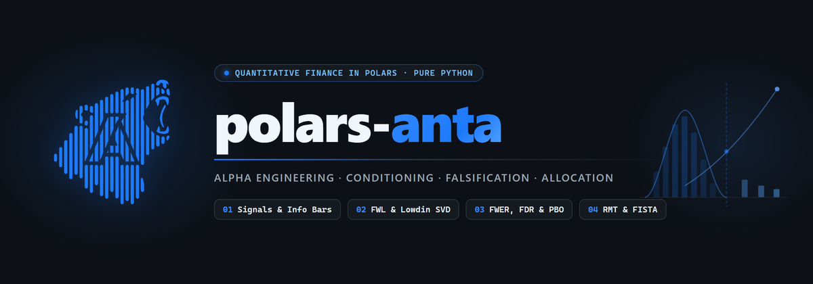
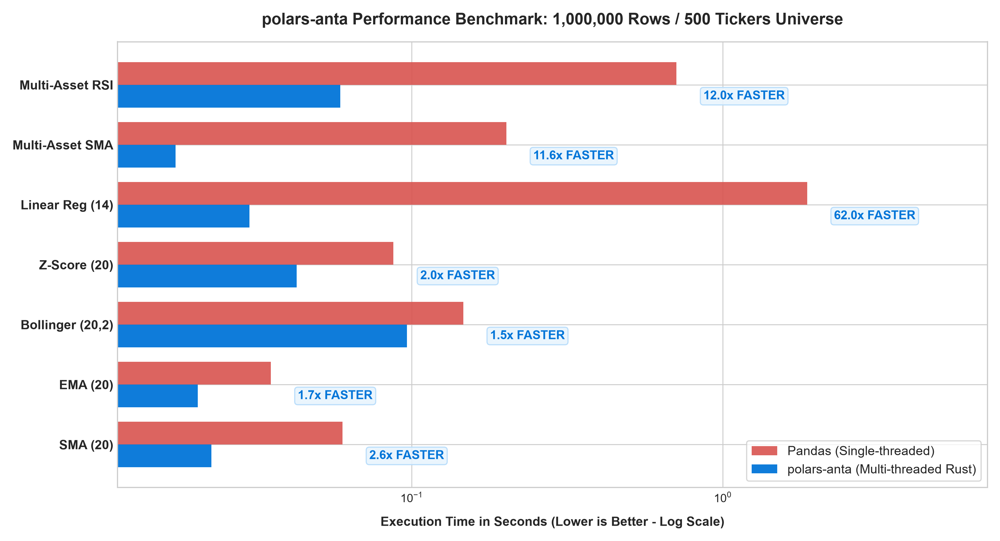

<div align="center">



[](https://pypi.org/project/polars-anta/)
[](https://pypi.org/project/polars-anta/)
[](https://github.com/huuan26/polars-anta/actions/workflows/ci.yml)
[](https://huuan26.github.io/polars-anta/)
[](https://colab.research.google.com/github/huuan26/polars-anta/blob/master/examples/quickstart_colab.ipynb)
[](https://github.com/huuan26/polars-anta/blob/master/LICENSE)

[Why polars-anta?](#why-polars-anta) | [Architecture & API](#architecture--api) | [Quick Start](#quick-start) | [Benchmarks & Studies](#benchmarks--empirical-studies) | [Docs & Examples](#documentation--examples)

</div>

---

## Why polars-anta?

Most technical analysis packages stop at computing single-asset indicators. `polars-anta` connects the entire quantitative research workflow in [Polars](https://pola.rs/) and NumPy - from raw price and order-flow features to cross-sectional risk neutralization, overfitting checks, transaction-cost-aware portfolio optimization, and vectorized backtesting.

- **End-to-end research pipeline**: Compute 240+ indicators and microstructure features, neutralize sector/beta exposures, filter out false discoveries, optimize portfolio weights under turnover costs, and run backtests in one library.
- **Zero heavy dependencies**: Pure Python with strict `mypy` static typing on `polars>=1.0.0` and `numpy>=1.24.0` - no C compiler, SciPy, or CVXPY required.
- **Time-series + cross-section in one query**: Register fluent `.anta` (and `.ta`) namespaces on `Expr`, `DataFrame`, and `LazyFrame`; combine per-asset `.over("ticker")` indicators with per-timestamp `.over("date")` normalization seamlessly.
- **Built for realistic trading**: Enforces causal `signal_lag` execution, forecast-horizon embargoes during walk-forward optimization, and explicit transaction-cost and turnover controls.

---

## Architecture & API

Full signatures, `pl.Struct` schemas, and mathematical derivations are documented in the [online API catalog](https://huuan26.github.io/polars-anta/indicators/).

| Stage & Modules | What It Solves | Representative Functions | API Docs |
| :--- | :--- | :--- | :--- |
| **1. Technical & Bars** (`trend`, `momentum`, `volatility`, `volume`, `resample`) | 100+ technical indicators, volume/dollar/imbalance bars & continuous futures roll | `sma`, `ema`, `rsi`, `macd`, `yang_zhang_volatility`, `session_vwap`, `resample_volume_bars`, `stitch_futures_roll` | [Indicators](https://huuan26.github.io/polars-anta/indicators/) |
| **2. Alpha & Microstructure** (`alpha`, `stats`) | Formulaic alphas, order-flow imbalance, rolling regressions & fractional diff | `frac_diff`, `linear_regression_slope`, `rolling_beta`, `vpin`, `ofi`, `futures_basis`, `alpha_001..101` | [Alpha & Stats](https://huuan26.github.io/polars-anta/indicators/alpha/) |
| **3. Cross-Sectional Conditioning** (`conditioning`) | Outlier clipping, sector/risk neutralization & order-independent factor decorrelation | `cs_rank`, `cs_zscore`, `cs_gaussianize`, `neutralize_panel`, `orthogonalize_panel`, `collinearity_summary` | [Conditioning](https://huuan26.github.io/polars-anta/indicators/alpha-engineering/) |
| **4. Signal Validation** (`diagnostics`, `inference`) | Alpha tearsheets, breakeven costs, bootstrap p-values & false-discovery control | `analyze_alpha`, `marginal_alpha_report`, `falsify_factors`, `romano_wolf`, `pbo_cscv` | [Inference](https://huuan26.github.io/polars-anta/indicators/inference/) |
| **5. Portfolio Optimization** (`covariance`, `allocation`) | Covariance cleaning & turnover-penalized walk-forward weight allocation | `ledoit_wolf_shrinkage`, `marchenko_pastur_denoise`, `solve_fista`, `combine_alphas_walkforward` | [Allocation](https://huuan26.github.io/polars-anta/indicators/alpha-engineering/) |
| **6. Labeling & Backtesting** (`evaluation`, `backtest`) | ML barrier/trend labels, vectorized execution, Sharpe adjustments & trade ledgers | `triple_barrier_labels`, `trend_scanning_labels`, `ic_summary`, `vectorized_backtest`, `extract_trades` | [Backtesting](https://huuan26.github.io/polars-anta/indicators/evaluation-and-backtest/) |

---

## Quick start

```bash
python -m pip install polars-anta
# or with uv:
uv add polars-anta
```

### 1. Time-series and cross-sectional features in one query

Importing `polars_anta` registers `.anta` and `.ta` on Polars objects. Time-series expressions compose with `.over("ticker")` and cross-sectional expressions compose with `.over("date")`:

```python
import numpy as np
import polars as pl
import polars_anta as pa

rng = np.random.default_rng(7)
tickers, n_days = ["AAPL", "MSFT", "NVDA", "XOM"], 30
close = 100.0 * np.exp(np.cumsum(rng.normal(0.001, 0.015, (4, n_days)), axis=1)).ravel()
df = pl.DataFrame(
    {
        "date": np.tile(np.arange(n_days), 4),
        "ticker": np.repeat(tickers, n_days),
        "open": close * 0.999,
        "high": close * 1.008,
        "low": close * 0.992,
        "close": close,
    }
)

out = df.with_columns(
    pl.col("close").anta.frac_diff(d=0.4, window=15).over("ticker").alias("ffd"),
    pl.col("open")
    .anta.yang_zhang_volatility("high", "low", "close", period=15)
    .over("ticker")
    .round(2)
    .alias("yz_vol"),
).with_columns(pl.col("ffd").anta.cs_gaussianize(over="date").round(3).alias("alpha_gauss"))
print(out.filter(pl.col("date") == 29).select("date", "ticker", "yz_vol", "alpha_gauss"))
```

```text
shape: (4, 4)
┌──────┬────────┬────────┬─────────────┐
│ date ┆ ticker ┆ yz_vol ┆ alpha_gauss │
│ ---  ┆ ---    ┆ ---    ┆ ---         │
│ i64  ┆ str    ┆ f64    ┆ f64         │
╞══════╪════════╪════════╪═════════════╡
│ 29   ┆ AAPL   ┆ 27.01  ┆ -1.15       │
│ 29   ┆ MSFT   ┆ 27.34  ┆ 1.15        │
│ 29   ┆ NVDA   ┆ 22.36  ┆ 0.319       │
│ 29   ┆ XOM    ┆ 21.17  ┆ -0.319      │
└──────┴────────┴────────┴─────────────┘
```

### 2. Risk neutralization, signal validation & cost-aware allocation

Clean raw signals across sectors and market beta, decorrelate crowded factors, filter out noise under multiple testing, and combine signals walk-forward with transaction-cost penalties (runnable script in [`examples/07_cross_sectional_alpha_engineering.py`](https://github.com/huuan26/polars-anta/blob/master/examples/07_cross_sectional_alpha_engineering.py)):

```python
raw_cols = ["alpha_1", "alpha_2", "alpha_3"]

# 1. Cross-sectional normalization -> sector & beta neutralization -> symmetric decorrelation:
neut = panel.with_columns(
    [pl.col(c).anta.cs_gaussianize(over="date").alias(f"{c}_g") for c in raw_cols]
).anta.neutralize_panel(
    [f"{c}_g" for c in raw_cols], time_col="date", risk_cols=["beta"], group_col="sector"
)
neut_cols = [f"{c}_g_neut" for c in raw_cols]
ortho = neut.anta.orthogonalize_panel(neut_cols, time_col="date", method="lowdin")

# 2. Screen candidate signals against multiple-testing overfitting:
verdicts = ortho.anta.falsify_factors(
    factor_cols=neut_cols, return_col="fwd_1", group_by="date", horizon=1, n_boot=200, seed=42
)

# 3. Walk-forward portfolio allocation with covariance cleaning & turnover penalty:
wf = ortho.anta.combine_alphas_walkforward(
    factor_cols=[f"{c}_ortho" for c in neut_cols],
    return_col="fwd_1",
    time_col="date",
    asset_col="ticker",
    lookback=60,
    horizon=1,
    signal_lag=1,
    objective_mode="factor_return",
    one_way_cost_bps=10.0,
    signal_ema_alpha=0.35,
    turnover_penalty=0.006,
    constraint="box",
    lower_bound=-1.0,
    upper_bound=1.0,
    cov_estimator="marchenko_pastur",
)

# 4. Out-of-sample tearsheet (IC, turnover, net Sharpe, breakeven cost & liquidity tiers):
diag = wf.data.anta.analyze_alpha(
    "composite_alpha",
    close_col="close",
    volume_col="volume",
    asset_col="ticker",
    time_col="date",
    one_way_cost_bps=10.0,
)
print(diag.report())
```

```text
=== Alpha Diagnostic Report: composite_alpha ===
IC Mean: +0.0555 | ICIR: +0.648 | NW t-stat: +10.40 | Half-Life: inf
Gross Sharpe: +11.70 | Net Sharpe: +8.17 | Max DD: -0.71%
Turnover: 0.379 | Gross Margin: +33.15 bps | Breakeven Cost: +33.15 bps
Spread Attribution -> Long Leg: 53.4% | Short Leg: 46.6%
```

<details>
<summary><b>More workflows: Intraday futures & order flow, ML labeling, and vectorized backtesting</b></summary>

<br/>

**Intraday futures roll, volume bars & order-flow features:**

```python
cont_df = raw_contracts.anta.stitch_futures_roll(method="back_adjust")
vol_bars = cont_df.anta.resample_volume_bars(
    threshold=5_000,
    additional_aggs=[
        pl.col("trading_date").last(),
        pl.col("bid_price").last(),
        pl.col("bid_size").last(),
        pl.col("ask_price").last(),
        pl.col("ask_size").last(),
    ],
)
features = vol_bars.anta.session_vwap(
    session_by="trading_date", unnest=True, prefix="svwap_"
).with_columns(
    pl.col("close").anta.vpin("volume", period=20).alias("vpin_20"),
    pl.col("bid_price").anta.ofi("bid_size", "ask_price", "ask_size", period=5).alias("ofi_5"),
)
```

**Stationary features & ML return labeling (triple-barrier & trend-scanning):**

```python
ml_dataset = (
    df.with_columns(
        pl.col("close").anta.frac_diff(d=0.4, window=20).over("ticker").alias("close_ffd")
    )
    .anta.triple_barrier_labels(
        horizon=12, pt_mult=2.0, sl_mult=1.5, unnest=True, group_by="ticker"
    )
    .anta.trend_scanning_labels(min_window=5, max_window=20, unnest=True, group_by="ticker")
)
```

**Vectorized backtesting, overfitting-adjusted Sharpe & round-trip trade ledger:**

```python
bt = (
    df.anta.ema(period=12, alias="ema_12")
    .anta.ema(period=26, alias="ema_26")
    .anta.backtest(
        entries=pl.col("ema_12").anta.crosses_above("ema_26"),
        exits=pl.col("ema_12").anta.crosses_below("ema_26"),
        execution_price="open",
        vol_target=0.15,
        no_trade_buffer=0.05,
        fee_rate=0.0005,
        slippage_rate=0.0002,
    )
)
print(bt.trades())  # Round-trip trade ledger with PnL, holding_bars, MAE, and MFE
```

</details>

---

## Benchmarks & empirical studies

### 1. 1,000,000-row execution throughput & numerical accuracy

<div align="center">



</div>

- **Rust-backed expression speed** ([`benchmarks/benchmark_speed.py`](https://github.com/huuan26/polars-anta/blob/master/benchmarks/benchmark_speed.py), [methodology](https://huuan26.github.io/polars-anta/benchmarks/)): On `1,000,000` single-asset bars and a `500 tickers x 2,000 bars` panel, `polars-anta` runs **Linear regression slope in `0.0301 s` vs pandas `1.8652 s` (`62.0x`)**, **Multi-asset RSI in `0.0589 s` vs `0.7096 s` (`12.0x`)**, and **Multi-asset SMA in `0.0174 s` vs `0.2014 s` (`11.6x`)**.
- **Verified numerical guarantees** ([`benchmarks/alpha_engineering_validation.py`](https://github.com/huuan26/polars-anta/blob/master/benchmarks/alpha_engineering_validation.py)): Neutralization, factor decorrelation, and constrained portfolio solvers satisfy `< 1e-10` orthogonality residuals and `0.00` future weight leakage in walk-forward tests ([validation log](https://github.com/huuan26/polars-anta/blob/master/docs/assets/alpha_engineering_validation.md)).

### 2. Real-market empirical findings (Crypto, US Equities & Vietnam HOSE)

- **150-signal out-of-sample audit on Vietnam `HOSE` (`2014-2026`)**: Testing all 150 daily signals on liquid `HOSE` equities shows that while `91/150` pass naive `p <= 0.05`, strong cross-correlation reduces them to roughly `6` independent signal dimensions. `38` signals maintain predictive power in the `2022-2026` holdout (`97.6%` median IC retention), yet **`0` standalone signals beat `60 bps` round-trip long-only costs** without portfolio-level turnover control ([full study](https://github.com/huuan26/polars-anta/blob/master/research/factor_zoo/REPORT.md)).
- **Turnover & cost control across 3 markets** ([`benchmarks/real_market_alpha_engineering.py`](https://github.com/huuan26/polars-anta/blob/master/benchmarks/real_market_alpha_engineering.py)): Across Binance Spot Crypto (`24` USDT pairs), US Large-Cap Equities (`30` tickers), and Vietnam `HOSE` (`<= 150` stocks), cost-aware walk-forward optimization cuts daily turnover by **4x to 12x** relative to unpenalized rebalancing and improves out-of-sample gross margin by **`+27.6 bps`** on `HOSE` ([benchmark report](https://github.com/huuan26/polars-anta/blob/master/docs/assets/real_market_alpha_engineering.md)).

<div align="center">


</div>

---

## Documentation & examples

| Resource | Links |
| :--- | :--- |
| **Getting Started & Colab** | [Quickstart Guide](https://huuan26.github.io/polars-anta/getting-started/) - [Google Colab Notebook](https://colab.research.google.com/github/huuan26/polars-anta/blob/master/examples/quickstart_colab.ipynb) - [`quickstart.py`](https://github.com/huuan26/polars-anta/blob/master/examples/quickstart.py) |
| **Guides & Architecture** | [Alpha Engineering](https://huuan26.github.io/polars-anta/indicators/alpha-engineering/) - [Quant Theory & Workflows](https://huuan26.github.io/polars-anta/guides/quant-theory-and-workflows/) - [Multi-Asset Scaling](https://huuan26.github.io/polars-anta/guides/multi-asset/) - [Bars & Futures Roll](https://huuan26.github.io/polars-anta/guides/resampling-and-dataframe-api/) - [Architecture & Proofs](https://huuan26.github.io/polars-anta/architecture/) |
| **Empirical Research** | [HOSE 150-Signal Study](https://github.com/huuan26/polars-anta/blob/master/research/factor_zoo/REPORT.md) - [3-Market Turnover Benchmark](https://github.com/huuan26/polars-anta/blob/master/docs/assets/real_market_alpha_engineering.md) - [Speed Benchmarks](https://huuan26.github.io/polars-anta/benchmarks/) |
| **Example Scripts & Notebooks** | [`07_cross_sectional_alpha_engineering.py`](https://github.com/huuan26/polars-anta/blob/master/examples/07_cross_sectional_alpha_engineering.py) - [`04_backtest_showcase.py`](https://github.com/huuan26/polars-anta/blob/master/examples/04_backtest_showcase.py) - [All 7 Jupyter Tutorials (`examples/`)](https://github.com/huuan26/polars-anta/tree/master/examples) - [Changelog](https://github.com/huuan26/polars-anta/blob/master/CHANGELOG.md) |

---

## Contributing & license

Contributions are welcome - see [CONTRIBUTING.md](https://github.com/huuan26/polars-anta/blob/master/CONTRIBUTING.md), [open issues](https://github.com/huuan26/polars-anta/issues), and [GitHub Discussions](https://github.com/huuan26/polars-anta/discussions).

**Disclaimer:** `polars-anta` is provided for educational and research purposes without warranty of any kind. Quantitative models and backtests must be independently verified before live trading or risk decisions.

Maintained by **Phan Bui Huu An** ([@huuan26](https://github.com/huuan26), [phanbuihuuan261103@gmail.com](mailto:phanbuihuuan261103@gmail.com)) under the **Apache License 2.0** ([LICENSE](https://github.com/huuan26/polars-anta/blob/master/LICENSE)).
