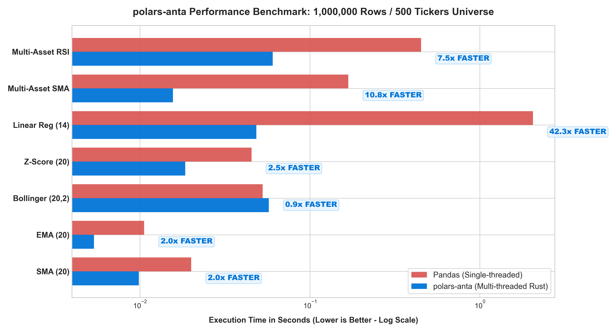

<div align="center">

# polars-anta

**ANTA (Alpha & Numerical Technical Analysis): Ultra-fast, zero-C-dependency technical analysis and factor library powered natively by Polars Expressions.**

[](https://github.com/huuan26/polars-anta/actions/workflows/ci.yml)
[](https://pypi.org/project/polars-anta/)
[](https://huuan26.github.io/polars-anta/)
[](https://colab.research.google.com/github/huuan26/polars-anta/blob/master/examples/quickstart_colab.ipynb)
[](https://github.com/huuan26/polars-anta/releases/latest)
[](LICENSE)
[](https://pypi.org)
[](https://pola.rs)
[](https://github.com/astral-sh/ruff)
[](#)

[Documentation](https://huuan26.github.io/polars-anta/) • [Features](#key-features) • [Benchmark](#performance-benchmark-1000000-rows) • [Installation](#installation) • [Quickstart](#quickstart) • [Tutorials](#3-interactive-jupyter-notebooks) • [Indicators](#supported-indicators-102-indicators) • [Development](#development--testing)

</div>

> ⚡ **Try it immediately in your browser:** Run our [1-Minute Interactive Colab Demo](https://colab.research.google.com/github/huuan26/polars-anta/blob/master/examples/quickstart_colab.ipynb) with 1-click execution & live 112x speedup benchmarks!

---

## Why `polars-anta`?

Quantitative researchers and financial engineers have historically faced a trade-off between installation complexity and computation speed:

| Capability | TA-Lib | pandas-ta | `polars-anta` |
| :--- | :---: | :---: | :---: |
| **Dependencies** | Requires external C library & MSVC / GCC | Pure Python / NumPy | **Zero C compilation** (pure Polars) |
| **Execution Engine** | Single-threaded C loops | Single-threaded Pandas / GIL | **Multi-threaded Rust** query engine |
| **Multi-Asset Scaling** | Manual sequential loops | Slow `.groupby().apply()` | **Native `.over("ticker")`** parallelization |
| **Dual Expression Namespace** | Unsupported | Unsupported | **Both `.anta` & `.ta`** supported |
| **Lazy Evaluation** | Unsupported | Unsupported | **Full `pl.LazyFrame`** streaming support |
| **Memory Layout** | Array conversion overhead | High Pandas memory footprint | **Zero-copy Arrow memory format** |

`polars-anta` eliminates this compromise by implementing financial indicators directly as **Polars Expressions (`pl.Expr`)**. Computations are pushed into Polars' multi-threaded Rust engine, eliminating Python GIL bottlenecks without requiring any C compilers.

---

## Performance Benchmark (1,000,000 Rows)

<div align="center">



</div>

Benchmarks measured across **1,000,000 bars** (single-asset random walk) and a **500 tickers x 2,000 bars universe**. Computations executed on Polars' multi-threaded Rust query engine vs single-threaded Pandas:

| Operation / Indicator | Dataset Scale | Pandas Execution | `polars-anta` Execution | Measured Speedup |
| :--- | :--- | :---: | :---: | :---: |
| **Linear Regression Slope** | 1,000,000 bars | 2.3529 s | **0.0209 s** | **112.4x Faster** |
| **Multi-Asset RSI** | 500 tickers x 2k bars | 0.4398 s | **0.0545 s** | **8.1x Faster** |
| **Multi-Asset SMA** | 500 tickers x 2k bars | 0.1345 s | **0.0168 s** | **8.0x Faster** |
| **Z-Score Normalization** | 1,000,000 bars | 0.0450 s | **0.0267 s** | **1.7x Faster** |
| **Exponential Moving Average** | 1,000,000 bars | 0.0100 s | **0.0069 s** | **1.5x Faster** |
| **Simple Moving Average** | 1,000,000 bars | 0.0170 s | **0.0153 s** | **1.1x Faster** |

*Reproduce benchmarks locally using `pip install -e .[benchmark]` followed by `python benchmarks/benchmark_speed.py`.*

---

## Key Features

- **Dual Expression Namespaces**: Call indicators via `pl.col("close").anta.<indicator>()` or the classic shorthand `pl.col("close").ta.<indicator>()`.
- **Expression-First Design**: Compose indicators directly within `.select()`, `.with_columns()`, and lazy query plans.
- **Parallel Multi-Asset Computation**: Compute indicators across thousands of tickers in parallel using Polars' native window context:
  ```python
  pl.col("close").anta.rsi(14).over("symbol")
  ```
- **Structured Outputs**: Multi-component indicators (MACD, Bollinger Bands, Stochastic, Keltner Channels) return typed `pl.Struct` expressions that maintain clean schemas.
- **Zero-C Compilation**: `pip install polars-anta` works out of the box across Linux, macOS, and Windows.

---

## Installation

```bash
pip install polars-anta
```

*Requirements: Python >= 3.10, Polars >= 1.0.0*

---

## Quickstart

### 1. Modern Chained Expression Syntax (`.anta` or `.ta`)

```python
import polars as pl
import polars_anta  # Registers both `.anta` and `.ta` expression namespaces

df = pl.DataFrame(
    {
        "open": [100.0, 102.0, 101.5, 103.0, 105.0],
        "high": [101.5, 103.5, 103.0, 104.5, 106.5],
        "low": [98.8, 100.8, 100.3, 101.8, 103.8],
        "close": [100.0, 102.0, 101.5, 103.0, 105.0],
        "volume": [1000, 1050, 1100, 1150, 1200],
    }
)

# Compute indicators directly on expressions (using .anta or .ta)
result = df.with_columns(
    pl.col("close").anta.sma(period=3).alias("sma_3"),
    pl.col("close").anta.rsi(period=3).alias("rsi_3"),
    pl.col("close").anta.bollinger_bands(period=3).alias("bb"),
)

# Unnest structured outputs as needed
print(result.unnest("bb"))
```

### 2. Market-Wide Multi-Asset Parallel Execution

Running technical indicators across an entire investment universe is a common bottleneck. In `polars-anta`, Polars distributes evaluation across all CPU cores automatically:

```python
# Compute indicators across thousands of symbols simultaneously in Rust
universe.with_columns(
    [
        pl.col("close").anta.sma(20).over("ticker").alias("sma_20"),
        pl.col("close").anta.rsi(14).over("ticker").alias("rsi_14"),
        pl.col("close").anta.macd().over("ticker").alias("macd"),
        pl.col("close").anta.obv("volume").over("ticker").alias("obv"),
    ]
)
```

### 3. Interactive Jupyter Notebooks

Run our interactive tutorials directly in your browser with zero setup:

| Notebook | Description | Interactive Demo |
| :--- | :--- | :---: |
| **Quickstart & Live Benchmark** | 1-minute demo covering single-asset syntax, 500-ticker scans, and live 112x speed benchmark. | [](https://colab.research.google.com/github/huuan26/polars-anta/blob/master/examples/quickstart_colab.ipynb) |
| **01 - Quickstart Tutorial** | Comprehensive walk-through of expression syntax, Struct unnesting, and plotting. | [](https://colab.research.google.com/github/huuan26/polars-anta/blob/master/examples/01_quickstart.ipynb) |
| **02 - Multi-Asset Portfolio Scan** | Real-world 500-ticker breakout screening in 50 milliseconds using `.over("ticker")`. | [](https://colab.research.google.com/github/huuan26/polars-anta/blob/master/examples/02_multi_asset_portfolio_scan.ipynb) |

---

## Supported Indicators (102 Indicators)

### Trend & Overlays (26 Indicators)
- **`sma(close, period=10)`**: Simple Moving Average
- **`ssl_channel(high, low, close, period=10)`**: SSL Channel (`ssl_up`, `ssl_down`, `hlv`)
- **`ema(close, period=10)`**: Exponential Moving Average
- **`wma(close, period=10)`**: Linearly-Weighted Moving Average
- **`hma(close, period=10)`**: Hull Moving Average
- **`dema(close, period=10)`**: Double Exponential Moving Average
- **`tema(close, period=10)`**: Triple Exponential Moving Average
- **`zlema(close, period=10)`**: Zero-Lag Exponential Moving Average
- **`vortex(high, low, close, period=14)`**: Vortex Indicator (`vi_plus`, `vi_minus`)
- **`adx(high, low, close, period=14)`**: Average Directional Index (`adx`, `plus_di`, `minus_di`)
- **`aroon(high, low, period=25)`**: Aroon Oscillator & Indicator (`up`, `down`, `oscillator`)
- **`chop(high, low, close, period=14)`**: Choppiness Index (Trend vs Consolidation)
- **`t3(close, period=5, vfactor=0.7)`**: Tillson T3 Moving Average
- **`alma(close, period=9, offset=0.85, sigma=6.0)`**: Arnaud Legoux Moving Average (Gaussian-filtered)
- **`mass_index(high, low, fast_period=9, slow_period=25)`**: Mass Index (Reversal predictor)
- **`supertrend(high, low, close, period=10, multiplier=3.0)`**: SuperTrend Volatility Stop (`supertrend`, `direction`)
- **`psar(high, low, af_step=0.02, af_max=0.2)`**: Parabolic Stop and Reverse (Trailing SAR)
- **`kama(close, period=10, fast_span=2, slow_span=30)`**: Kaufman's Adaptive Moving Average
- **`mcginley_dynamic(close, period=14, k=0.6)`**: McGinley Dynamic Average
- **`vidya(close, period=9, cmo_period=9)`**: Variable Index Dynamic Average (Chande's VIDYA)
- **`center_of_gravity(close, period=10)`**: Ehlers Center of Gravity Oscillator
- **`ichimoku(high, low, close, tenkan=9, kijun=26, senkou_b=52, displacement=26)`**: Ichimoku Kinko Hyo Cloud
- **`pivot_points(high, low, close)`**: Floor Trader Standard Pivot Points (`pivot`, `r1-r3`, `s1-s3`)
- **`fibonacci_pivots(high, low, close)`**: Fibonacci Pivot Points (38.2%, 61.8%, 100%)
- **`camarilla_pivots(high, low, close)`**: Camarilla Intraday Pivot Points (`r1-r4`, `s1-s4`)
- **`woodie_pivots(open, high, low, close)`**: Woodie's Heavy-Close Pivot Points

### Momentum (20 Indicators)
- **`rsi(close, period=14)`**: Relative Strength Index (Wilder's smoothing)
- **`macd(close, fast=12, slow=26, signal=9)`**: Moving Average Convergence Divergence (`macd`, `signal`, `histogram`)
- **`stochastic(high, low, close, k=14, d=3)`**: Stochastic Oscillator (%K, %D)
- **`squeeze_momentum(high, low, close, bb_period=20, bb_mult=2.0, kc_period=20, kc_mult=1.5)`**: Squeeze Momentum Indicator (`squeeze_on`, `squeeze_off`, `no_squeeze`, `momentum`)
- **`williams_r(high, low, close, period=14)`**: Williams %R
- **`cci(high, low, close, period=20)`**: Commodity Channel Index
- **`roc(close, period=10)`**: Rate of Change (Momentum %)
- **`stoch_rsi(close, rsi_period=14, stoch_period=14)`**: Stochastic RSI (%K, %D)
- **`awesome_oscillator(high, low, fast=5, slow=34)`**: Awesome Oscillator (AO)
- **`tsi(close, long_period=25, short_period=13)`**: True Strength Index (TSI)
- **`cmo(close, period=14)`**: Chande Momentum Oscillator
- **`ppo(close, fast=12, slow=26, signal=9)`**: Percentage Price Oscillator (`ppo`, `signal`, `histogram`)
- **`coppock(close, wma_period=10, fast_roc=11, slow_roc=14)`**: Coppock Curve
- **`ultimate_oscillator(high, low, close, p1=7, p2=14, p3=28)`**: Ultimate Oscillator (UO)
- **`fisher_transform(high, low, period=10)`**: Ehlers Fisher Transform (`fisher`, `signal`)
- **`rvi(open, high, low, close, period=10)`**: Relative Vigor Index (`rvi`, `signal`)
- **`kst(close)`**: "Know Sure Thing" Oscillator (`kst`, `signal`)
- **`dpo(close, period=20)`**: Detrended Price Oscillator
- **`bop(open, high, low, close)`**: Balance of Market Power
- **`cfo(close, period=14)`**: Chande Forecast Oscillator

### Volatility & Channels (18 Indicators)
- **`true_range(high, low, close)`**: True Range
- **`atr(high, low, close, period=14)`**: Average True Range
- **`bollinger_bands(close, period=20, num_std=2.0)`**: Bollinger Bands (Upper, Middle, Lower, Bandwidth, %B)
- **`keltner_channels(high, low, close, ema=20, atr=10, multiplier=2.0)`**: Keltner Channels
- **`donchian_channels(high, low, period=20)`**: Donchian Channels (Upper, Middle, Lower)
- **`stddev(close, period=20)`**: Rolling Standard Deviation
- **`ulcer_index(close, period=14)`**: Ulcer Index (Downside Drawdown Risk)
- **`chandelier_exit(high, low, close, period=22, multiplier=3.0)`**: Chandelier Exit (`long_stop`, `short_stop`)
- **`natr(high, low, close, period=14)`**: Normalized Average True Range (%)
- **`historical_volatility(close, period=20, trading_days=252)`**: Annualized Log Historical Volatility
- **`parkinson_volatility(high, low, period=20, trading_days=252)`**: Parkinson Extreme-Value Volatility
- **`garman_klass_volatility(open, high, low, close, period=20, trading_days=252)`**: Garman-Klass Efficient Volatility
- **`chaikin_volatility(high, low, period=10, roc_period=10)`**: Chaikin Volatility
- **`donchian_width(high, low, period=20)`**: Donchian Channel Width (%)
- **`envelopes(close, period=20, percentage=0.025)`**: Moving Average Envelopes (`upper`, `middle`, `lower`)
- **`keltner_width(high, low, close, ema=20, atr=10, multiplier=2.0)`**: Normalized Keltner Channel Width (%)
- **`bollinger_delta(close, period=20, num_std=2.0)`**: Bollinger Band Spread ($2 \cdot k \cdot \sigma$)
- **`starc_bands(high, low, close, period=20, atr_period=15, multiplier=2.0)`**: STARC Bands (Stoller Average Range Channels)

### Volume (14 Indicators)
- **`obv(close, volume)`**: On-Balance Volume
- **`vwap(high, low, close, volume, period=None)`**: Volume Weighted Average Price (Cumulative or Rolling)
- **`vwma(close, volume, period=20)`**: Volume Weighted Moving Average
- **`cmf(high, low, close, volume, period=20)`**: Chaikin Money Flow
- **`adl(high, low, close, volume)`**: Accumulation/Distribution Line
- **`mfi(high, low, close, volume, period=14)`**: Money Flow Index
- **`eom(high, low, volume, period=14)`**: Ease of Movement (EMV)
- **`klinger(high, low, close, volume, fast=34, slow=55, signal=13)`**: Klinger Volume Oscillator (`klinger`, `signal`)
- **`nvi(close, volume)`**: Negative Volume Index
- **`pvi(close, volume)`**: Positive Volume Index
- **`pvt(close, volume)`**: Price Volume Trend
- **`force_index(close, volume, period=13)`**: Elder's Force Index
- **`vpci(close, volume, short_period=5, long_period=20)`**: Volume Price Confirmation Indicator
- **`vr(close, volume, period=26)`**: Volume Ratio (Bullish vs Bearish volume)

### Quantitative Statistics & Regression (12 Indicators)
- **`zscore(close, period=20)`**: Rolling Z-Score standardized anomaly score
- **`percentile_rank(close, period=20)`**: Rolling Percentile Rank $[0.0, 1.0]$
- **`skewness(close, period=20)`**: Rolling Sample Skewness (asymmetry metric)
- **`kurtosis(close, period=20)`**: Rolling Excess Kurtosis (tail-risk metric)
- **`rolling_cov(x, y, period=20)`**: Rolling Sample Covariance between two series
- **`rolling_corr(x, y, period=20)`**: Rolling Pearson Correlation $[-1.0, 1.0]$
- **`rolling_beta(asset_ret, bench_ret, period=60)`**: Rolling CAPM Market Beta ($\text{Cov} / \text{Var}$)
- **`rolling_alpha(asset_ret, bench_ret, rf=0.0, period=60)`**: Rolling Jensen's Risk-Adjusted Alpha
- **`linear_regression_slope(close, period=14)`**: Vectorized OLS Linear Regression Slope
- **`linear_regression_intercept(close, period=14)`**: Vectorized OLS Linear Regression Intercept
- **`linear_regression_angle(close, period=14)`**: Linear Regression Trend Angle in degrees
- **`linear_regression_forecast(close, period=14)`**: Linear Regression Current/Next-Bar Value Forecast

### Alpha Factor Primitives (12 Indicators)
- **`ts_rank(close, period=10)`**: Time-Series Rank (WorldQuant Alpha 101 primitive)
- **`ts_argmax(close, period=10)`**: Time-Series ArgMax (lookback bars ago of window peak)
- **`ts_argmin(close, period=10)`**: Time-Series ArgMin (lookback bars ago of window trough)
- **`decay_linear(close, period=10)`**: Linearly Weighted Decay moving transform
- **`ts_zscore(close, period=20)`**: Time-Series Standardized Normalization
- **`returns_divergence(close, volume, period=14)`**: Price vs Volume Momentum Divergence
- **`hl_ratio(high, low)`**: Log Intraday Range Expansion $\ln(\text{High} / \text{Low})$
- **`co_ratio(close, open)`**: Log Intraday Sentiment Drift $\ln(\text{Close} / \text{Open})$
- **`volume_weighted_momentum(close, volume, period=10)`**: Momentum amplified by relative volume
- **`relative_spread(high, low, close)`**: Normalized Bar Range $(\text{High} - \text{Low}) / \text{Close}$
- **`twap(high, low, close, period=20)`**: Rolling Time-Weighted Average Price
- **`entropy(close, period=20, bins=5)`**: Rolling Shannon Information Entropy (Regime detector)

---

## Architecture & Performance

`polars-anta` is designed around three architectural pillars:

1. **Arrow Memory Layout**: Avoids memory copying between indicator transformations.
2. **SIMD-Accelerated Vectorization**: Executes through Polars' optimized analytical kernels.
3. **Query Optimization**: Integrates with Polars' expression engine for predicate pushdown and dead-code elimination.

---

## Development & Testing

```bash
# Clone the repository
git clone https://github.com/huuan26/polars-anta.git
cd polars-anta

# Install in editable mode with development dependencies
pip install -e .[dev]

# Run the test suite
pytest -v

# Run linter and formatter checks
ruff check .
ruff format --check .
```

---

## Author & Community

- **Author**: An Phan (Phan Bùi Hữu Ân) - [phanbuihuuan261103@gmail.com](mailto:phanbuihuuan261103@gmail.com)
- **GitHub**: [@huuan26](https://github.com/huuan26/polars-anta)
- **Discussion & Feature Requests**: [GitHub Discussions](https://github.com/huuan26/polars-anta/discussions)

---

## License

Licensed under the Apache License, Version 2.0. See [LICENSE](LICENSE) for details.
