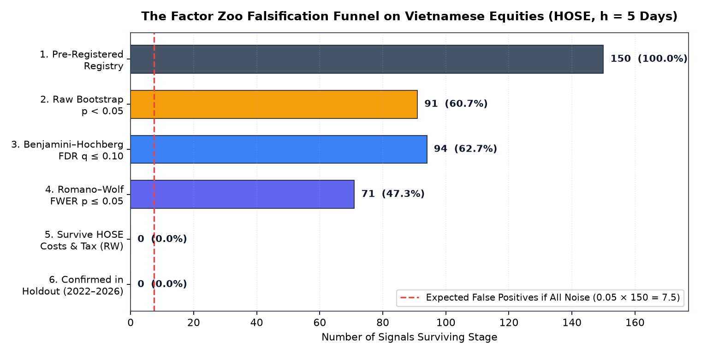

<div align="center">


**Build alpha signals in Polars, then test whether they are real.**

[Case Study](#case-study-150-signals-on-vietnamese-equities) | [Documentation](https://huuan26.github.io/polars-anta/) | [Quick Start](#quick-start) | [API Reference](#api-reference) | [Examples](examples/) | [Report an Issue](https://github.com/huuan26/polars-anta/issues)

</div>

---

## Overview

`polars-anta` is an open-source Python library for quantitative research, built on [Polars](https://pola.rs/). It combines two things in one package:

1. **Signal building blocks.** 219 functions for technical indicators, formulaic alphas, market microstructure features, factor evaluation and vectorized backtesting, all written as native Polars expressions.
2. **Tools to falsify those signals.** Block bootstrap tests, multiple-testing corrections (Benjamini-Hochberg, Romano-Wolf), Hansen's SPA test, probability of backtest overfitting, empirical-Bayes shrinkage and transaction-cost breakeven analysis.

The motivation is simple: when you test hundreds of signals, many of them will look significant by chance. `polars-anta` is designed to help you find out which ones actually survive. The name stands for **A**lpha and **N**umerical **T**echnical **A**nalysis.

| Project facts | |
| :--- | :--- |
| Install | `pip install polars-anta` or `uv add polars-anta` |
| Python | 3.10, 3.11, 3.12, 3.13, 3.14 |
| Runtime dependencies | `polars>=1.0.0`, `numpy>=1.24.0` (no C compiler required) |
| Engine | Native Polars expressions on the multi-threaded Rust engine |
| Status | [CI workflow](https://github.com/huuan26/polars-anta/actions/workflows/ci.yml), [Docs workflow](https://github.com/huuan26/polars-anta/actions/workflows/docs.yml), [PyPI release](https://pypi.org/project/polars-anta/) |
| Try online | [Quickstart notebook on Google Colab](https://colab.research.google.com/github/huuan26/polars-anta/blob/master/examples/quickstart_colab.ipynb) |
| License | [Apache License 2.0](LICENSE) |

---

## Case study: 150 signals on Vietnamese equities

We ran every daily signal in `polars-anta` (**150** signals, **146** unique) through the library's own falsification pipeline on the most liquid stocks of the Ho Chi Minh Stock Exchange (`HOSE`). The analysis plan was committed to Git before any results were computed, and the `2022-2026` holdout was evaluated only after the discovery results were committed.

> **Why Vietnam?** `HOSE` is a retail-driven emerging market with daily price limits, no short selling for most investors and high trading costs. It is far less studied than US equities, which makes it a demanding out-of-sample test for signals that were designed elsewhere.

| Question | Result |
| :--- | ---: |
| Signals tested | **150** |
| Effectively independent tests among them | $N_{\text{eff}} = 6.00$ |
| Significant after multiple-testing correction (Romano-Wolf, 5% FWER) | **71** |
| Significant and stable over the discovery period (`2014-2021`) | **64** |
| Still significant in the locked holdout (`2022-2026`) | **38** of 64 |
| Significant long-only excess return after `60 bps` round-trip costs | **0** |

<div align="center">



</div>

**What this means**

- **Most signals are variations of the same effect.** 91 of 150 signals pass a naive $p \le 0.05$ test, but their daily ICs move together so closely that they amount to only $N_{\text{eff}} = 6.00$ independent tests. Much of this common component is short-term (5-day) reversal: removing it raises $N_{\text{eff}}$ from 6.00 to 9.37.
- **The predictive power holds up out of sample.** 38 of the 64 stable discovery signals remain significant in the holdout, with a median IC retention of 97.6%.
- **But it does not pay for itself.** The strongest signals replace 63.8% to 87.2% of the portfolio every 5 days and break even at 20.5 bps round-trip at best, well below realistic costs. In addition, 65.5% of the top-10 signals' long-short spread in discovery (90.0% in holdout) comes from the short leg, which long-only investors cannot capture.

Read the full study in [`research/factor_zoo/REPORT.md`](research/factor_zoo/REPORT.md).

<details markdown="1">
<summary>Study design, reproducibility and full results tables</summary>

| Design choice | Value |
| :--- | :--- |
| Universe | Point-in-time top-150 most liquid `HOSE` stocks |
| Signals | 150 signals at default parameters (146 unique; 4 exact duplicate pairs disclosed) |
| Discovery sample | `2014-01-01` to `2021-12-31` |
| Locked holdout | `2022-01-01` to `2026-11-10` |
| Forecast horizon | 5 trading days, open to open |
| Execution costs | `60 bps` round-trip (brokerage, slippage and sell tax) |
| Analysis plan | [`PREREGISTRATION.md`](research/factor_zoo/PREREGISTRATION.md), committed in [`4c1a4b5`](https://github.com/huuan26/polars-anta/commit/4c1a4b559d22a1367ce46b513ab7ff1079fff360) |
| Signal registry checksum | SHA-256 recorded in `PREREGISTRATION.md` and verified by the pipeline |
| Deviations from the plan | [Deviations and Timeline](research/factor_zoo/REPORT.md#31-deviations-from-the-analysis-plan--timeline) |

**Track A: statistical predictability** (cross-sectional Rank IC, 5-day horizon)

| Stage | Signals | Share | Notes |
| :--- | ---: | ---: | :--- |
| A1. Tested | **150** | `100.0%` | 146 unique signals |
| A2. Benjamini-Hochberg FDR $q \le 0.10$ | **94** | `62.7%` | Raw bootstrap $p \le 0.05$: **91** ($\approx 7.5$ expected by chance) |
| A3. Romano-Wolf FWER $p \le 0.05$ | **71** | `47.3%` | Joint bootstrap across all 150 IC series |
| A4. Stable (`robust` verdict) | **64** | `42.7%` | Plus **16** `fdr_only`, **14** `decaying`, **56** `noise` |
| A5. Replicate in holdout | **38** | `25.3%` | **38** of **64** pass holdout RW $p \le 0.05$; **54** keep their sign |

**Track B: economic implementability** (long-only top quintile vs. equal-weight universe)

| Stage | Signals | Share of 80 Candidates |
| :--- | ---: | ---: |
| B1. Candidates evaluated (`robust` + `fdr_only`) | **80** | `100.0%` |
| B2. Positive net excess return after costs | **12** | `15.0%` |
| B3. Unadjusted one-sided $p \le 0.05$ | **2** | `2.5%` (`trix_15`, `tsi`) |
| B4. Benjamini-Hochberg FDR $q \le 0.10$ | **0** | `0.0%` |
| B5. Confirmed in holdout | **0** | `0.0%` |

A cost sweep from 0 to 60 bps round-trip finds **0** significant long-only strategies at $\ge 30$ bps in discovery and at $\ge 10$ bps in holdout ([`REPORT.md` Section 8.3](research/factor_zoo/REPORT.md#83-exploratory-post-holdout-analyses)).

</details>

---

## Falsify your own signals in 10 lines

Pass any multi-asset Polars panel to `df.anta.falsify_factors(...)` to run the full 7-stage statistical sieve: Rank IC, Newey-West HAC, Politis-Romano stationary bootstrap, Benjamini-Hochberg FDR and Romano-Wolf stepdown FWER, empirical-Bayes shrinkage, OLS-CUSUM structural stability, and a final verdict.

```python
import numpy as np
import polars as pl
import polars_anta as pa

rng = np.random.default_rng(42)
n_dates, n_tickers = 250, 40
panel = pl.DataFrame(
    {
        "date": np.repeat(np.arange(n_dates), n_tickers),
        "ticker": np.tile(np.arange(n_tickers), n_dates),
        "sig_true": rng.standard_normal(n_dates * n_tickers),
        "sig_noise_1": rng.standard_normal(n_dates * n_tickers),
        "sig_noise_2": rng.standard_normal(n_dates * n_tickers),
    }
).with_columns(
    (0.08 * pl.col("sig_true") + rng.standard_normal(n_dates * n_tickers)).alias("fwd_ret_5")
)

result = panel.anta.falsify_factors(
    factor_cols=["sig_true", "sig_noise_1", "sig_noise_2"],
    return_col="fwd_ret_5",
    group_by="date",
    horizon=5,
    n_boot=500,
    seed=42,
)
print(result.report())
```

---

## Research workflow

```mermaid
flowchart LR
    A["1. Signals<br/>.anta and .ta expressions<br/>150+ indicators and alphas"] --> B["2. Cross-sectional prep<br/>cs_winsorize, cs_zscore<br/>neutralize, orthogonalize"]
    B --> C["3. IC and Newey-West HAC<br/>ic_matrix, ic_summary<br/>auto-lag Bartlett kernel"]
    C --> D["4. Stationary bootstrap<br/>Politis-Romano 1994<br/>preserves time dependence"]
    D --> E["5. FDR and Romano-Wolf<br/>Benjamini-Hochberg q<br/>joint stepdown FWER"]
    E --> F["6. EB shrinkage and CUSUM<br/>Efron-Morris posterior IC<br/>structural break test"]
    F --> G["7. Transaction costs<br/>df.anta.backtest<br/>breakeven_cost"]
    G --> H["8. Locked holdout<br/>out-of-sample replication<br/>PBO and SPA diagnostics"]
```



---

## What is inside

`polars-anta` is a pure Python and Polars library for feature engineering, market microstructure analysis, cross-sectional alpha research, statistical signal falsification and vectorized backtesting.

- **Auditable white-box mathematics.** Every indicator, closed-form rolling OLS identity and cross-sectional projection is an inspectable Polars expression (`pl.Expr`) or NumPy kernel, not an opaque C or Cython binary.
- **No C compiler required.** Runtime dependencies are only `polars>=1.0.0` and `numpy>=1.24.0`; the package installs cleanly with `pip` or `uv` on Linux, macOS and Windows.
- **Single-instrument futures and cross-sectional equity panels.** Sample intraday volume, dollar and imbalance bars, stitch futures rolls (for example VN30F1M, CME E-mini or crypto perpetuals), or scale cross-sectional expressions across hundreds of tickers with `.over("symbol")` and `.over("date")`.

| Area | Examples of functionality | API docs |
| :--- | :--- | :--- |
| **Statistical inference and falsification** | Stationary bootstrap (`stationary_bootstrap_indices`, `bootstrap_test`), multiple testing (`adjust_pvalues`, `romano_wolf`, `spa_test`), backtest overfitting (`pbo_cscv`), empirical-Bayes shrinkage (`empirical_bayes_shrinkage`), out-of-sample and stability tests (`oos_r2`, `clark_west_test`, `diebold_mariano_test`, `cusum_mean_test`, `breakeven_cost`, `breakeven_cost_from_backtest`), panel falsification (`ic_matrix`, `long_short_returns`, `falsify_factors`, `sweep_robustness`) | [Inference](https://huuan26.github.io/polars-anta/indicators/inference/) |
| **AFML labeling, factor evaluation and backtesting** | `triple_barrier_labels`, `trend_scanning_labels`, `forward_returns`, `information_coefficient`, Newey-West HAC `ic_summary`, `ic_decay`, `quantile_analysis`, `probabilistic_sharpe_ratio`, `deflated_sharpe_ratio`, `vectorized_backtest`, `extract_trades` (MAE and MFE), `parameter_sweep` | [Evaluation and backtest](https://huuan26.github.io/polars-anta/indicators/evaluation-and-backtest/) |
| **Alpha factors, microstructure and futures** | Cross-sectional operators (`cs_rank`, `cs_zscore`, `cs_winsorize`, `neutralize`, `orthogonalize`), liquidity and order flow (`amihud_illiquidity`, `kyle_lambda`, `roll_spread`, `corwin_schultz_spread`, `vpin`, `ofi`), index futures (`futures_basis`, `oi_regime`), regime complexity (`hurst_exponent`, `fractal_dimension`, `entropy`) and 33 formulaic alphas (`alpha_001` to `alpha_030`, `alpha_041`, `alpha_054`, `alpha_101`) | [Alpha](https://huuan26.github.io/polars-anta/indicators/alpha/) |
| **Statistics, OLS and stationarity** | Rolling `zscore`, `percentile_rank`, `skewness`, `kurtosis`, CAPM `rolling_beta` and `rolling_alpha`, closed-form `linear_regression_*` (`slope`, `intercept`, `angle`, `forecast`, `r2`, `stderr`), fixed-window fractional differentiation (`frac_diff`) | [Stats](https://huuan26.github.io/polars-anta/indicators/stats/) |
| **Trend, momentum, volatility and volume** | Adaptive moving averages (`sma`, `ema`, `hma`, `kama`, `t3`, `alma`), `heikin_ashi`, `supertrend`, `ichimoku`, `rsi`, `macd`, `trix`, `squeeze_momentum`, `tsi`, `atr`, `bollinger_bands`, `rogers_satchell_volatility`, `yang_zhang_volatility`, `vwap_bands`, `session_vwap`, `cmf`, `mfi` | [Catalog](https://huuan26.github.io/polars-anta/indicators/) |
| **Data engineering and information bars** | Multi-timeframe OHLCV aggregation (`resample_ohlcv`), information-driven bars (`resample_volume_bars`, `resample_dollar_bars`, `resample_imbalance_bars`), continuous futures roll stitching (`stitch_futures_roll`), schema and price integrity checks (`validate_ohlcv`), batch feature generator (`df.anta.add_all()`) | [Resampling](https://huuan26.github.io/polars-anta/guides/resampling-and-dataframe-api/) |

### Package layout

| Module (`src/polars_anta/`) | Contents |
| :--- | :--- |
| `inference.py` | Stationary bootstrap, Romano-Wolf, SPA, CSCV PBO, empirical Bayes and `falsify_factors` |
| `evaluation.py` | AFML labeling, Newey-West Rank IC, IC decay, quantile analysis, PSR and DSR metrics |
| `backtest.py` | Vectorized backtester, volatility targeting, MAE and MFE trade ledger, parameter sweeps |
| `alpha.py` | Cross-sectional orthogonalization, microstructure, futures and 33 formulaic alphas |
| `stats.py` | Rolling moments, CAPM beta and alpha, closed-form OLS, fractional differentiation |
| `resample.py` | Calendar, volume, dollar and imbalance bars, futures roll stitching and validation |
| `trend.py` | Moving averages, trend overlays, candlestick transforms and pivot systems |
| `momentum.py` | Momentum oscillators, cycle detectors and divergence indicators |
| `volatility.py` | OHLC volatility estimators, ATR trailing stops and price channels |
| `volume.py` | Session and rolling VWAP bands, money flow and volume accumulation metrics |
| `namespace.py` | `.anta` and `.ta` registration on `Expr`, `DataFrame` and `LazyFrame` |

---

## Quick start

```bash
python -m pip install polars-anta
# or with uv:
uv add polars-anta
```

Importing `polars_anta` registers both the `.anta` and `.ta` namespaces on Polars `Expr`, `DataFrame` and `LazyFrame` objects:

```python
import polars as pl
import polars_anta as pa

df = pl.DataFrame({"close": [100.0, 102.0, 101.5, 104.0, 106.5, 105.0, 108.0]})
out = df.with_columns(
    pl.col("close").anta.ema(period=3).round(2).alias("ema_3"),
    pl.col("close").anta.rsi(period=3).round(2).alias("rsi_3"),
)
print(out.tail(3))
```

---

## Quantitative workflows

Start with the ready-to-run [example scripts](examples/) or the [Jupyter and Colab notebooks](#jupyter-and-colab-notebooks), or explore the five core workflows below. The snippets assume your own input data frames with the referenced columns.

#### A. Intraday derivatives, information bars, roll stitching and microstructure

```python
# 1. Stitch continuous futures contracts (backward, ratio or panama) and sample volume bars:
cont_df = raw_contracts.anta.stitch_futures_roll(method="backward")
vol_bars = cont_df.anta.resample_volume_bars(volume_threshold=5_000)

# 2. Session-anchored VWAP, order flow toxicity (VPIN, OFI), carry and open interest regimes:
deriv_features = vol_bars.with_columns(
    pl.col("close")
    .anta.session_vwap("high", "low", "volume", session_by="trading_date")
    .alias("svwap"),
    pl.col("close").anta.vpin("volume", period=20).alias("vpin_20"),
    pl.col("bid_price").anta.ofi("bid_size", "ask_price", "ask_size", period=5).alias("ofi_5"),
    pl.col("close").anta.futures_basis("spot_close", "days_to_expiry", period=20).alias("basis"),
    pl.col("close").anta.oi_regime("open_interest", period=1).alias("oi_state"),
).unnest("svwap", "basis", "oi_state")
```

#### B. Quant machine learning (AFML): fractional differentiation and dynamic labeling

```python
# Memory-preserving stationary features (FFD) plus triple-barrier and trend-scanning labels:
ml_dataset = df.with_columns(
    pl.col("close").anta.frac_diff(d=0.4, window=20).over("symbol").alias("close_ffd"),
    pl.col("close")
    .anta.triple_barrier_labels(
        volatility=pl.col("close").pct_change().rolling_std(20),
        horizon=12,
        pt_mult=2.0,
        sl_mult=1.5,
        side=pl.col("primary_signal"),  # Enables the binary meta_label {0.0, 1.0}
    )
    .over("symbol")
    .alias("tb"),
    pl.col("close")
    .anta.trend_scanning_labels(min_window=5, max_window=20)
    .over("symbol")
    .alias("ts"),
).unnest("tb", "ts")
```

#### C. Cross-sectional standardization, neutralization and multi-factor orthogonalization

```python
alpha_df = panel_df.with_columns(
    (
        -pl.col("close").anta.ts_delta(5).over("symbol")
        * pl.col("volume").anta.ts_rank(20).over("symbol")
    ).alias("raw_alpha")
).with_columns(
    pl.col("raw_alpha")
    .anta.cs_winsorize(over="date", method="mad", threshold=3.0)
    .anta.cs_zscore(over="date", clip_bound=3.0)
    .anta.neutralize(by="sector", over="date", standardize=True)
    # Gram-Schmidt OLS projection orthogonal to beta, size and volatility:
    .anta.orthogonalize(factors=["mkt_beta", "log_mcap", "vol_20"], over="date", standardize=True)
    .anta.ts_scale(a=1.0, over="date")
    .alias("pure_alpha_weight")
)
```

#### D. Factor validation (Newey-West HAC IC, alpha half-life, PSR and DSR)

```python
eval_df = alpha_df.anta.forward_returns(periods=(1, 5, 10), group_by="symbol")

# Autocorrelation-robust Newey-West HAC t-statistic and multi-horizon IC decay half-life:
ic_stats = eval_df.anta.ic_summary("pure_alpha_weight", "fwd_ret_5", group_by="date", nw_lags=5)
decay_table = eval_df.anta.ic_decay(
    "pure_alpha_weight", horizons=(1, 2, 3, 5, 10, 20), group_by="date"
)

# Skewness and kurtosis adjusted PSR, and the multiple-testing Deflated Sharpe Ratio (DSR):
# "strat_ret" is a strategy return column, e.g. bt.data["net_return"] from df.anta.backtest(...)
sharpe_significance = eval_df.select(
    pl.col("strat_ret").anta.probabilistic_sharpe_ratio(benchmark_sr=1.0).alias("psr"),
    pl.col("strat_ret").anta.deflated_sharpe_ratio(n_trials=50, trials_sr_std=0.4).alias("dsr"),
)
```

#### E. Execution-realistic vectorized backtest, excursion ledger (MAE and MFE) and grid sweep

```python
bt = (
    df.anta.ema(period=12, alias="ema_12")
    .anta.ema(period=26, alias="ema_26")
    .anta.backtest(
        entries=pl.col("ema_12").anta.crosses_above("ema_26"),
        exits=pl.col("ema_12").anta.crosses_below("ema_26"),
        execution_price="open",  # Fill at next-bar open (or "twap", "vwap", "close")
        flat_mask=pl.col("is_atc_bar"),  # Intraday end-of-day or roll flatten mask
        vol_target=0.15,  # 15% annualized target volatility scaling
        no_trade_buffer=0.05,  # Hysteresis buffer suppressing micro-turnover
        fee_rate=0.0005,
        slippage_rate=0.0002,
        initial_capital=100_000.0,
    )
)
print(bt.report())
print(bt.trades())  # Round-trip trade ledger with PnL, holding_bars, MAE and MFE
```

---

## API reference

All 219 public functions (221 exports in `__all__`, including `BacktestResult` and `FalsificationResult`) are exported at the top level (`import polars_anta as pa`) and registered on the `.anta` and `.ta` namespaces. Expand a module below for its function signatures, or visit the [online API reference](https://huuan26.github.io/polars-anta/indicators/).

<details>
<summary><strong>1. Trend and overlays</strong>: <code>polars_anta.trend</code> (<a href="docs/indicators/trend.md">detailed docs</a>)</summary>

<br/>

| Function Signature | Output Type / Struct Fields | Description |
| :--- | :--- | :--- |
| `sma(close, period=10)` | `Float64` | Simple Moving Average |
| `ema(close, period=10)` | `Float64` | Exponential Moving Average |
| `wma(close, period=10)` | `Float64` | Linearly Weighted Moving Average |
| `hma(close, period=10)` | `Float64` | Hull Moving Average (low-lag trend filter) |
| `dema(close, period=10)` | `Float64` | Double Exponential Moving Average |
| `tema(close, period=10)` | `Float64` | Triple Exponential Moving Average |
| `zlema(close, period=10)` | `Float64` | Zero-Lag Exponential Moving Average |
| `t3(close, period=5, vfactor=0.7)` | `Float64` | Tillson T3 Generalized DEMA Smoothing |
| `alma(close, period=9, offset=0.85, sigma=6.0)` | `Float64` | Arnaud Legoux Gaussian-Filtered Moving Average |
| `kama(close, period=10, fast_span=2, slow_span=30)` | `Float64` | Kaufman's Efficiency-Adaptive Moving Average |
| `mcginley_dynamic(close, period=14, k=0.6)` | `Float64` | McGinley Dynamic Volatility-Adjusted Moving Average |
| `vidya(close, period=9, cmo_period=9)` | `Float64` | Chande's Variable Index Dynamic Average |
| `heikin_ashi(open, high, low, close)` | `Struct(ha_open, ha_high, ha_low, ha_close)` | Vectorized Heikin-Ashi Candlestick Transform (via closed-form `ewm_mean(alpha=0.5)`) |
| `supertrend(high, low, close, period=10, multiplier=3.0)` | `Struct(supertrend, direction)` | ATR-Based Dynamic Trailing Volatility Stop |
| `psar(high, low, af_step=0.02, af_max=0.2)` | `Float64` | Welles Wilder's Parabolic Stop and Reverse (SAR) |
| `ichimoku(high, low, close, tenkan=9, kijun=26, senkou_b=52, displacement=26)` | `Struct(tenkan_sen, kijun_sen, senkou_span_a, senkou_span_b, chikou_span)` | Ichimoku Kinko Hyo Equilibrium Cloud |
| `adx(high, low, close, period=14)` | `Struct(adx, plus_di, minus_di)` | Average Directional Movement Index (Wilder's smoothing) |
| `vortex(high, low, close, period=14)` | `Struct(vi_plus, vi_minus)` | Vortex Positive and Negative Trend Movement Indicator |
| `aroon(high, low, period=25)` | `Struct(up, down, oscillator)` | Aroon Trend Age Indicator and Oscillator |
| `ssl_channel(high, low, close, period=10)` | `Struct(ssl_up, ssl_down, hlv)` | Semaphore Signal Level (SSL) Channel |
| `trend_intensity_index(close, period=30, signal_period=None)` | `Float64` or `Struct(tii, tii_signal)` | M.H. Pee's Trend Intensity Index (TII) |
| `chop(high, low, close, period=14)` | `Float64` | E.W. Dreiss Choppiness Index (trend vs. consolidation, `[0, 100]`) |
| `mass_index(high, low, fast_period=9, slow_period=25)` | `Float64` | Donald Dorsey's Range Bulge Reversal Predictor |
| `center_of_gravity(close, period=10)` | `Float64` | John Ehlers' Center of Gravity (COG) Oscillator |
| `pivot_points(high, low, close)` | `Struct(pivot, r1, r2, r3, s1, s2, s3)` | Classic Floor Trader Pivot Points |
| `fibonacci_pivots(high, low, close)` | `Struct(pivot, r1, r2, r3, s1, s2, s3)` | Fibonacci Retracement and Extension Pivot Points (38.2%, 61.8%, 100%) |
| `camarilla_pivots(high, low, close)` | `Struct(pivot, r1..r4, s1..s4)` | Camarilla Intraday Mean-Reversion and Breakout Pivots |
| `woodie_pivots(open, high, low, close)` | `Struct(pivot, r1, r2, s1, s2)` | Woodie's Close-Weighted Pivot Points |

</details>

<details>
<summary><strong>2. Momentum oscillators</strong>: <code>polars_anta.momentum</code> (<a href="docs/indicators/momentum.md">detailed docs</a>)</summary>

<br/>

| Function Signature | Output Type / Struct Fields | Description |
| :--- | :--- | :--- |
| `rsi(close, period=14)` | `Float64` | Relative Strength Index (Wilder's RMA smoothing) |
| `macd(close, fast_period=12, slow_period=26, signal_period=9)` | `Struct(macd, signal, histogram)` | Moving Average Convergence Divergence |
| `ppo(close, fast_period=12, slow_period=26, signal_period=9)` | `Struct(ppo, signal, histogram)` | Percentage Price Oscillator (scale-invariant MACD) |
| `trix(close, period=15, signal_period=9)` | `Struct(trix, signal)` | Jack Hutson's Triple Exponential Average (1-bar % ROC of a triple EMA, plus EMA signal) |
| `stochastic(high, low, close, k_period=14, d_period=3, smooth_k=1)` | `Struct(k, d)` | Stochastic Oscillator (`%K`, `%D`) |
| `stoch_rsi(close, rsi_period=14, stoch_period=14, k_smooth=3, d_smooth=3)` | `Struct(k, d)` | Chande and Kroll's Stochastic RSI |
| `squeeze_momentum(high, low, close, bb_period=20, bb_mult=2.0, kc_period=20, kc_mult=1.5)` | `Struct(squeeze_on, squeeze_off, no_squeeze, momentum)` | John Carter's TTM Squeeze Volatility Compression and Linear Regression Momentum |
| `stc(close, fast_period=23, slow_period=50, cycle_period=10, factor=0.5)` | `Float64` | Doug Schaff's Trend Cycle (double-stochastic MACD oscillator, `[0, 100]`) |
| `tsi(close, long_period=25, short_period=13)` | `Float64` | William Blau's Double-Smoothed True Strength Index |
| `fisher_transform(high, low, period=10)` | `Struct(fisher, signal)` | John Ehlers' Gaussian Fisher Transform |
| `williams_r(high, low, close, period=14)` | `Float64` | Larry Williams' `%R` Overbought/Oversold Oscillator `[-100, 0]` |
| `cci(high, low, close, period=20, constant=0.015)` | `Float64` | Donald Lambert's Commodity Channel Index (Mean Absolute Deviation) |
| `roc(close, period=10)` | `Float64` | Percentage Rate of Change |
| `awesome_oscillator(high, low, fast_period=5, slow_period=34)` | `Float64` | Bill Williams' Midpoint Awesome Oscillator (AO) |
| `cmo(close, period=14)` | `Float64` | Tushar Chande's Momentum Oscillator `[-100, 100]` |
| `coppock(close, wma_period=10, fast_roc=11, slow_roc=14)` | `Float64` | Edwin Coppock's Long-Term Momentum Curve |
| `ultimate_oscillator(high, low, close, p1=7, p2=14, p3=28)` | `Float64` | Larry Williams' Multi-Timeframe Buying Pressure Oscillator |
| `rvi(open, high, low, close, period=10)` | `Struct(rvi, signal)` | John Ehlers' Symmetrically Weighted Relative Vigor Index |
| `kst(close, r1=10, r2=15, r3=20, r4=30, ...)` | `Struct(kst, signal)` | Martin Pring's "Know Sure Thing" Four-ROC Oscillator |
| `dpo(close, period=20)` | `Float64` | Detrended Price Oscillator (cycle isolator) |
| `bop(open, high, low, close)` | `Float64` | Igor Livshin's Balance of Market Power `[-1, 1]` |
| `cfo(close, period=14)` | `Float64` | Tushar Chande's OLS Forecast Oscillator (%) |

</details>

<details>
<summary><strong>3. Volatility and channels</strong>: <code>polars_anta.volatility</code> (<a href="docs/indicators/volatility.md">detailed docs</a>)</summary>

<br/>

| Function Signature | Output Type / Struct Fields | Description |
| :--- | :--- | :--- |
| `true_range(high, low, close)` | `Float64` | Welles Wilder's Single-Bar True Range |
| `atr(high, low, close, period=14)` | `Float64` | Average True Range (Wilder's RMA smoothing) |
| `natr(high, low, close, period=14)` | `Float64` | Normalized Average True Range (`100 * ATR / Close`) |
| `bollinger_bands(close, period=20, num_std=2.0)` | `Struct(upper, middle, lower, bandwidth, percent_b)` | John Bollinger's Volatility Envelope, Bandwidth and `%B` |
| `bollinger_delta(close, period=20, num_std=2.0)` | `Float64` | Absolute Bollinger Band Spread (2 × k × σ) |
| `keltner_channels(high, low, close, ema_period=20, atr_period=10, multiplier=2.0)` | `Struct(upper, middle, lower)` | Chester Keltner and Linda Raschke EMA-ATR Volatility Channels |
| `keltner_width(high, low, close, ema_period=20, atr_period=10, multiplier=2.0)` | `Float64` | Normalized Keltner Channel Width (%) |
| `donchian_channels(high, low, period=20)` | `Struct(upper, middle, lower)` | Richard Donchian's Breakout High/Low Channels |
| `donchian_width(high, low, period=20)` | `Float64` | Normalized Donchian Channel Width (%) |
| `chandelier_exit(high, low, close, period=22, multiplier=3.0)` | `Struct(long_stop, short_stop)` | Chuck LeBeau's ATR Trailing Chandelier Exit Stops |
| `starc_bands(high, low, close, period=20, atr_period=15, multiplier=2.0)` | `Struct(upper, middle, lower)` | Manning Stoller's Average Range Channels (STARC) |
| `envelopes(close, period=20, percentage=0.025)` | `Struct(upper, middle, lower)` | Percentage Moving Average Envelopes |
| `stddev(close, period=20)` | `Float64` | Rolling Sample Standard Deviation |
| `ulcer_index(close, period=14)` | `Float64` | Peter Martin's Downside Drawdown Depth and Duration Risk Index |
| `historical_volatility(close, period=20, trading_periods=252)` | `Float64` | Annualized Close-to-Close Log Return Volatility |
| `parkinson_volatility(high, low, period=20, trading_periods=252)` | `Float64` | Parkinson (1980) Extreme-Value High-Low Range Volatility Estimator |
| `garman_klass_volatility(open, high, low, close, period=20, trading_periods=252)` | `Float64` | Garman and Klass (1980) Minimum-Variance OHLC Volatility Estimator |
| `rogers_satchell_volatility(open, high, low, close, period=20, trading_periods=252)` | `Float64` | Rogers and Satchell (1991) drift-independent OHLC volatility estimator |
| `yang_zhang_volatility(open, high, low, close, period=20, trading_periods=252)` | `Float64` | Yang and Zhang (2000) minimum-variance estimator combining overnight, open-to-close and Rogers-Satchell components |
| `chaikin_volatility(high, low, period=10, roc_period=10)` | `Float64` | Marc Chaikin's High-Low Range Expansion Rate of Change |

</details>

<details>
<summary><strong>4. Volume and money flow</strong>: <code>polars_anta.volume</code> (<a href="docs/indicators/volume.md">detailed docs</a>)</summary>

<br/>

| Function Signature | Output Type / Struct Fields | Description |
| :--- | :--- | :--- |
| `obv(close, volume)` | `Float64` | Joe Granville's Cumulative On-Balance Volume |
| `vwap(high, low, close, volume, period=None)` | `Float64` | Volume Weighted Average Price (cumulative or rolling window) |
| `vwap_bands(high, low, close, volume, period=None, mult1=1.0, mult2=2.0, mult3=3.0)` | `Struct(vwap, upper_1..3, lower_1..3)` | VWAP with Volume-Weighted Standard Deviation Bands |
| `session_vwap(high, low, close, volume, session_by=None, mult1=1.0, mult2=2.0)` | `Struct(vwap, upper_1..2, lower_1..2, zscore)` | Session-Anchored VWAP Resetting per Trading Date or Session, with Deviation Z-Score |
| `vwma(close, volume, period=20)` | `Float64` | Volume Weighted Moving Average |
| `cmf(high, low, close, volume, period=20)` | `Float64` | Marc Chaikin's Money Flow (CLV-Weighted Volume Ratio) |
| `adl(high, low, close, volume)` | `Float64` | Chaikin Accumulation/Distribution Line |
| `mfi(high, low, close, volume, period=14)` | `Float64` | Quong and Soudack's Volume-Weighted RSI (Money Flow Index `[0, 100]`) |
| `eom(high, low, volume, period=14, scale=10000.0)` | `Float64` | Richard Arms' Ease of Movement (EMV) |
| `klinger(high, low, close, volume, fast_period=34, slow_period=55, signal_period=13)` | `Struct(klinger, signal)` | Stephen Klinger's Volume Force Oscillator |
| `nvi(close, volume)` | `Float64` | Norman Fosback's Negative Volume Index (smart-money tracker) |
| `pvi(close, volume)` | `Float64` | Positive Volume Index (crowd-activity tracker) |
| `pvt(close, volume)` | `Float64` | Cumulative Return-Weighted Price Volume Trend |
| `force_index(close, volume, period=13)` | `Float64` | Alexander Elder's EMA-Smoothed Force Index |
| `vpci(close, volume, short_period=5, long_period=20)` | `Float64` | Buff Dormeier's Volume Price Confirmation Indicator |
| `vr(close, volume, period=26)` | `Float64` | Up-Volume vs. Down-Volume Ratio (%) |

</details>

<details>
<summary><strong>5. Quantitative statistics and regression</strong>: <code>polars_anta.stats</code> (<a href="docs/indicators/stats.md">detailed docs</a>)</summary>

<br/>

| Function Signature | Output Type | Description |
| :--- | :--- | :--- |
| `zscore(close, period=20)` | `Float64` | Rolling Standardized Z-Score Anomaly Metric (x_t - μ_t) / σ_t |
| `percentile_rank(close, period=20)` | `Float64` | Vectorized Rolling Empirical Percentile Rank [0.0, 1.0] |
| `skewness(close, period=20)` | `Float64` | Rolling Third Standardized Moment (return asymmetry) |
| `kurtosis(close, period=20)` | `Float64` | Rolling Fourth Standardized Moment (excess tail risk) |
| `rolling_cov(x, y, period=20)` | `Float64` | Rolling Sample Covariance Cov(X, Y) |
| `rolling_corr(x, y, period=20)` | `Float64` | Rolling Pearson Linear Correlation Coefficient [-1.0, 1.0] |
| `rolling_beta(asset_ret, bench_ret, period=60)` | `Float64` | Rolling CAPM Systematic Market Beta Cov(R_a, R_m) / Var(R_m) |
| `rolling_alpha(asset_ret, bench_ret, rf=0.0, period=60)` | `Float64` | Rolling Jensen's Risk-Adjusted Excess Alpha |
| `linear_regression_slope(close, period=14)` | `Float64` | Closed-Form Vectorized OLS Linear Regression Slope (β₁) |
| `linear_regression_intercept(close, period=14)` | `Float64` | Closed-Form Vectorized OLS Linear Regression Intercept (β₀) |
| `linear_regression_angle(close, period=14)` | `Float64` | Rolling OLS Regression Trend Angle in Degrees arctan(β₁) × 180 / π |
| `linear_regression_forecast(close, period=14)` | `Float64` | Rolling OLS End-of-Window Fitted Value ŷ_t = β₀ + β₁(n - 1) |
| `linear_regression_r2(close, period=14)` | `Float64` | Closed-Form Rolling OLS Coefficient of Determination R² in [0.0, 1.0] |
| `linear_regression_stderr(close, period=14)` | `Float64` | Closed-Form Rolling OLS Standard Error of the Estimate (residual dispersion) |
| `frac_diff(close, d=0.4, window=20)` | `Float64` | Fixed-Window Fractional Differentiation (FFD, López de Prado 2018) (1 - B)<sup>d</sup> |

</details>

<details>
<summary><strong>6. Alpha factor and microstructure primitives</strong>: <code>polars_anta.alpha</code> (<a href="docs/indicators/alpha.md">detailed docs</a>)</summary>

<br/>

| Function Signature | Domain | Description |
| :--- | :--- | :--- |
| `cs_rank(expr, over=None, method="average", percentile=True)` | Cross-Sectional | Cross-sectional percentile rank [0.0, 1.0] |
| `cs_zscore(expr, over=None, clip_bound=None)` | Cross-Sectional | Cross-sectional zero-mean unit-variance standardization with optional z-clipping |
| `cs_winsorize(expr, over=None, method="quantile", lower=0.01, upper=0.99, threshold=3.0)` | Cross-Sectional | Cross-sectional outlier clipping via `"quantile"`, `"zscore"`, or robust `"mad"` |
| `neutralize(expr, by, over=None, standardize=False)` | Cross-Sectional | Sector, industry or group demeaning and standardization |
| `orthogonalize(expr, factors, over=None, standardize=True, ridge=0.0)` | Cross-Sectional | Multi-factor OLS Gram-Schmidt residualization and standardization |
| `ts_scale(expr, a=1.0, over=None)` | Cross-Sectional | L1 book-size normalization (∑ \|w_i\| = a) |
| `amihud_illiquidity(close, volume, period=20, scale=1e6)` | Microstructure | Amihud (2002) Illiquidity Ratio: (1/N) ∑ (\|r_t\| / DollarVolume_t) × scale |
| `roll_spread(close, period=20)` | Microstructure | Roll (1984) Serial Price-Change Covariance Effective Bid-Ask Spread: 2 × sqrt(max(0, -Cov(ΔP_t, ΔP_{t-1}))) |
| `corwin_schultz_spread(high, low, period=20)` | Microstructure | Corwin and Schultz (2012) Two-Bar High-Low Range Effective Bid-Ask Spread Estimator |
| `kyle_lambda(close, volume, period=20, scale=1e6)` | Microstructure | Kyle (1985) Price-Impact Coefficient λ via Rolling OLS on Signed Dollar Volume |
| `vpin(close, volume, period=20)` | Microstructure | Bulk Volume Classification (BVC) Volume-Synchronized Probability of Informed Trading [0, 1] |
| `ofi(bid_price, bid_size, ask_price, ask_size, period=1)` | Microstructure | Cont, Kukanov and Stoikov (2014) Level-1 Order Flow Imbalance |
| `futures_basis(futures_close, spot_close, days_to_expiry=None, period=20)` | Index Futures | Futures-Spot Spread, Proportional Basis, Annualized Carry and Basis Z-Score (`Struct`) |
| `oi_regime(close, open_interest, period=1)` | Index Futures | 4-State Open Interest and Price Action Regime Classifier (`Struct`: long/short buildup, covering and liquidation) |
| `twap(high, low, close, period=20)` | Microstructure | Rolling Time-Weighted Average Price |
| `relative_spread(high, low, close)` | Microstructure | Intraday High-Low Relative Range Proxy (H_t - L_t) / C_t |
| `hl_ratio(high, low)` | Microstructure | Log Intraday Volatility Expansion ln(H_t / L_t) |
| `co_ratio(close, open)` | Microstructure | Log Intraday Sentiment Drift ln(C_t / O_t) |
| `returns_divergence(close, volume, period=14)` | Microstructure | Rolling Price Return vs. Volume Change Divergence |
| `volume_weighted_momentum(close, volume, period=10)` | Microstructure | Price Rate of Change Amplified by Relative Volume Ratio |
| `ts_rank(close, period=10)` | Time-Series | Vectorized rolling percentile rank [0.0, 1.0] |
| `ts_argmax(close, period=10)` | Time-Series | Vectorized bars elapsed since rolling window peak |
| `ts_argmin(close, period=10)` | Time-Series | Vectorized bars elapsed since rolling window trough |
| `decay_linear(close, period=10)` | Time-Series | Linearly decaying weighted moving average |
| `ts_delta(expr, period=1)` | Time-Series | Difference operator x_t - x_{t-d} |
| `ts_delay(expr, period=1)` | Time-Series | Lag operator x_{t-d} |
| `signed_power(expr, exponent=2.0)` | Time-Series | Sign-preserving power sign(x) × \|x\|<sup>a</sup> |
| `ts_min(expr, period=10)` | Time-Series | Rolling window minimum |
| `ts_max(expr, period=10)` | Time-Series | Rolling window maximum |
| `ts_sum(expr, period=10)` | Time-Series | Rolling window sum |
| `ts_std(expr, period=10)` | Time-Series | Rolling sample standard deviation |
| `ts_product(expr, period=10)` | Time-Series | Vectorized rolling window product |
| `ts_correlation(x, y, period=10)` | Time-Series | Rolling Pearson correlation |
| `ts_covariance(x, y, period=10)` | Time-Series | Rolling sample covariance |
| `ts_zscore(close, period=20)` | Time-Series | Time-series rolling standardization (x_t - μ_t) / σ_t |
| `hurst_exponent(close, period=50)` | Regime / Complexity | Vectorized Rolling R/S Hurst Exponent H in [0, 1] (mean reversion vs. trend persistence) |
| `fractal_dimension(high, low, period=20)` | Regime / Complexity | John Ehlers' Fractal Dimension Index D in [1, 2] (market noise vs. trend efficiency) |
| `entropy(close, period=20, bins=5)` | Regime / Complexity | Rolling Normalized Shannon Information Entropy [0, 1] |
| `alpha_001` to `alpha_030` | Formulaic Alpha | Canonical formulaic alphas (#1 through #30, Kakushadze 2016) |
| `alpha_041(high, low, close, volume)` | Formulaic Alpha | Geometric High-Low Midpoint vs. VWAP |
| `alpha_054(open, high, low, close)` | Formulaic Alpha | Intraday Candlestick Power Ratio |
| `alpha_101(open, high, low, close)` | Formulaic Alpha | Normalized Intraday Body-to-Range Momentum |

</details>

<details>
<summary><strong>7. Factor evaluation, performance metrics and vectorized backtesting</strong>: <code>polars_anta.evaluation</code>, <code>polars_anta.backtest</code> (<a href="docs/indicators/evaluation-and-backtest.md">detailed docs</a>)</summary>

<br/>

| Function Signature | Domain | Description |
| :--- | :--- | :--- |
| `forward_returns(df, close_col="close", periods=(1, 5, 10), group_by=None)` | Factor Evaluation | Multi-horizon forward returns (P_{t+k} / P_t) - 1 for factor testing |
| `information_coefficient(df, factor_col, return_col, group_by=None, method="spearman")` | Factor Evaluation | Cross-sectional Rank IC (`"spearman"`) or Normal IC (`"pearson"`) series |
| `ic_summary(df, factor_col, return_col, group_by=None, method="spearman", nw_lags=None)` | Factor Evaluation | Summary dictionary (`ic_mean`, `ic_std`, `icir`, `t_stat`, `nw_t_stat`, `hit_rate`, `n_periods`) |
| `ic_decay(df, factor_col, close_col="close", horizons=(1, 2, 3, 5, 10, 20), ...)` | Factor Evaluation | Multi-horizon IC decay schedule with Newey-West HAC t-stat and exponential alpha half-life |
| `quantile_analysis(df, factor_col, return_col, quantiles=5, group_by=None)` | Factor Evaluation | Quantile bucket returns, Sharpe, win rate, and cumulative performance (Q₁ ... Q_N) |
| `factor_turnover(df, factor_col, asset_col="ticker", time_col="timestamp", lag=1)` | Factor Evaluation | Rank autocorrelation and L1 signal turnover across periods |
| `triple_barrier_labels(close, volatility=None, horizon=10, pt_mult=2.0, sl_mult=2.0, ...)` | AFML Labeling | Dynamic Triple-Barrier and Meta-Labeling (`Struct(label, touch_bars, realized_return, meta_label)`) |
| `trend_scanning_labels(close, min_window=5, max_window=20, step=1)` | AFML Labeling | Multi-Horizon OLS Trend-Scanning Labels (`Struct(label, t_value, optimal_window, ret)`) |
| `drawdown_series(returns_or_equity, is_returns=True)` | Performance Metric | Underwater percentage drawdown curve ≤ 0.0 |
| `max_drawdown(returns_or_equity, is_returns=True)` | Performance Metric | Scalar Maximum Drawdown (MDD) |
| `sharpe_ratio(returns, risk_free_rate=0.0, annualization=252.0)` | Performance Metric | Annualized Sharpe Ratio scalar expression |
| `sortino_ratio(returns, risk_free_rate=0.0, annualization=252.0)` | Performance Metric | Annualized Sortino Ratio using downside deviation |
| `calmar_ratio(returns, annualization=252.0)` | Performance Metric | Annualized Return divided by \|MDD\| |
| `profit_factor(returns)` | Performance Metric | Gross Profit divided by \|Gross Loss\| |
| `win_rate(returns, include_zeros=False)` | Performance Metric | Proportion of active periods with positive returns |
| `probabilistic_sharpe_ratio(returns, benchmark_sr=0.0, risk_free_rate=0.0, annualization=252.0)` | Performance Metric | Skewness and Kurtosis Adjusted Probabilistic Sharpe Ratio (PSR in [0, 1]) |
| `deflated_sharpe_ratio(returns, n_trials=10, trials_sr_std=0.5, ...)` | Performance Metric | Multiple-Testing Deflated Sharpe Ratio (DSR in [0, 1], Bailey and López de Prado 2014) |
| `crosses_above(a, b, over=None)` / `crosses_below(a, b, over=None)` | Backtesting | Boolean crossover and crossunder detection against another series or scalar threshold |
| `signals_to_positions(entries, exits, ...)` | Backtesting | Loop-free `.forward_fill()` state machine converting entry/exit triggers to positions |
| `vectorized_backtest(df, signal="signal", ...)` / `df.anta.backtest(...)` | Backtesting | Vectorized backtester with `execution_price` (`open`/`twap`/`vwap`), `flat_mask`, `vol_target`, `no_trade_buffer`, fees and slippage |
| `BacktestResult` / `extract_trades(bt_df)` | Backtesting | Result container (`.data`, `.summary`, `.report()`, `.trades()`) and round-trip trade ledger with MAE/MFE |
| `parameter_sweep(df, signals, ...)` / `compare_strategies(strategies)` | Backtesting | Multi-parameter grid evaluation with automatic Deflated Sharpe Ratio (`dsr`) and strategy comparison |

</details>

<details>
<summary><strong>8. Data engineering, information bars and futures roll</strong>: <code>polars_anta.resample</code> (<a href="docs/guides/resampling-and-dataframe-api.md">detailed docs</a>)</summary>

<br/>

| Function Signature | Domain | Description |
| :--- | :--- | :--- |
| `validate_ohlcv(df, ...)` / `df.anta.validate_ohlcv(...)` | Data Integrity | Structural validation of OHLCV invariants (H_t ≥ max(O_t, C_t, L_t), L_t ≤ min(O_t, C_t, H_t), V_t ≥ 0, chronological monotonicity) |
| `resample_ohlcv(df, every, ...)` / `df.anta.resample(every, ...)` | Time Bar Aggregation | Multi-timeframe calendar aggregation (`"5m"`, `"15m"`, `"1h"`, `"1d"`) via `group_by_dynamic` |
| `resample_volume_bars(df, volume_threshold, ...)` | Information Bars | Cumulative volume bar sampling (∑ V_i ≥ Θ_V) restoring return Gaussianity |
| `resample_dollar_bars(df, dollar_threshold, ...)` | Information Bars | Cumulative dollar (notional) bar sampling (∑ P_i V_i ≥ Θ_D) invariant to price inflation |
| `resample_imbalance_bars(df, expected_imbalance, ...)` | Information Bars | López de Prado (2018) tick and volume imbalance bars (\|∑ b_i v_i\| ≥ Θ_imbalance) |
| `stitch_futures_roll(df, method="backward", ...)` | Continuous Futures | Non-leaky continuous futures stitching (`"backward"`, `"ratio"`, `"panama"`) across contract expiries |

</details>

<details>
<summary><strong>9. Statistical inference and falsification</strong>: <code>polars_anta.inference</code> (<a href="docs/indicators/inference.md">detailed docs</a>)</summary>

<br/>

| Function Signature | Domain | Description |
| :--- | :--- | :--- |
| `stationary_bootstrap_indices(n_obs, n_boot=1000, mean_block=None, seed=None)` | Bootstrap | Politis and Romano (1994) circular stationary bootstrap index matrix `(n_boot, n_obs)` |
| `bootstrap_test(series, statistic="mean", null_value=0.0, alternative="two-sided", ...)` | Bootstrap Inference | Stationary bootstrap hypothesis test and percentile CI for the sample mean or annualized Sharpe ratio |
| `adjust_pvalues(p_values, method="bh")` | Multiple Testing | Classical FWER and FDR $p$-value adjustments (`"bonferroni"`, `"holm"`, `"bh"`, `"by"`) |
| `romano_wolf(data, exclude=(), n_boot=2000, mean_block=None, alternative="two-sided", seed=None)` | Multiple Testing | Romano and Wolf (2005, 2016) studentized stepdown $\max$-$t$ FWER control via stationary bootstrap |
| `spa_test(data, benchmark=None, exclude=(), n_boot=2000, mean_block=None, seed=None)` | Multiple Testing | Hansen (2005) Superior Predictive Ability (`p_lower`, `p_consistent`) and White (2000) Reality Check (`p_upper`) |
| `pbo_cscv(data, exclude=(), n_splits=16, max_combinations=20_000, seed=None)` | Overfitting | Bailey et al. (2017) Combinatorially Symmetric Cross-Validation Probability of Backtest Overfitting (PBO) |
| `empirical_bayes_shrinkage(estimates, std_errors, names=None, prior="zero", groups=None)` | Shrinkage | Efron and Morris (1975), Jensen, Kelly and Pedersen (2023) empirical-Bayes normal shrinkage |
| `oos_r2(actual, predicted, benchmark=None, min_train=20)` | Forecast Evaluation | Campbell and Thompson (2008) out-of-sample $R^2_{\text{OOS}}$ against a benchmark or expanding mean |
| `clark_west_test(actual, predicted_model, predicted_benchmark, nw_lags=None)` | Forecast Evaluation | Clark and West (2007) MSPE-adjusted one-sided test for nested forecast models |
| `diebold_mariano_test(actual, pred1, pred2, loss="squared", horizon=1, nw_lags=None)` | Forecast Evaluation | Diebold and Mariano (1995) Newey-West HAC test for equal predictive accuracy |
| `cusum_mean_test(series, nw_lags=None)` | Structural Stability | Ploberger and Krämer (1992) HAC-standardized OLS-CUSUM supremum test for mean stability |
| `breakeven_cost(gross_returns, turnover)` / `breakeven_cost_from_backtest(bt)` | Transaction Costs | Exact per-unit-turnover fee rate (`breakeven_fee_rate`, `breakeven_bps`) that zeroes the net mean return |
| `ic_matrix(df, factor_cols, return_col, group_by, method="spearman")` | Panel Evaluation | Single-pass cross-sectional Rank or Pearson IC matrix `(T × K)` across multiple candidate factors |
| `long_short_returns(df, factor_cols, return_col, group_by, quantiles=5, mode="long_short")` | Panel Evaluation | Top-minus-bottom quantile (`"long_short"`) or top-quantile (`"long_only"`) factor return matrix |
| `falsify_factors(df, factor_cols, return_col, group_by, horizon=1, ...)` / `FalsificationResult` | Factor Falsification | 7-stage statistical sieve (IC, NW HAC, stationary bootstrap, BH FDR and Romano-Wolf FWER, EB shrinkage, CUSUM, verdict) |
| `sweep_robustness(df, signals, ...)` | Sweep Diagnostics | Audits `parameter_sweep` grids with CSCV PBO, Hansen SPA and Romano-Wolf FWER |

</details>

---

## Performance benchmark (1,000,000 rows)

<div align="center">


</div>

Benchmarks are measured on **1,000,000 bars** (single-asset random walk) and on a **500 tickers × 2,000 bars universe** (1,000,000 rows), comparing Polars' multi-threaded Rust engine with single-threaded pandas:

| Operation / Indicator | Dataset Scale | pandas | `polars-anta` | Speedup |
| :--- | :--- | ---: | ---: | ---: |
| **Linear regression slope (OLS)** | 1,000,000 bars | 2.3529 s | **0.0209 s** | **112.4x** |
| **Multi-asset RSI (14)** | 500 tickers × 2k bars | 0.4398 s | **0.0545 s** | **8.1x** |
| **Multi-asset SMA (20)** | 500 tickers × 2k bars | 0.1345 s | **0.0168 s** | **8.0x** |
| **Z-score normalization** | 1,000,000 bars | 0.0450 s | **0.0267 s** | **1.7x** |
| **Exponential moving average** | 1,000,000 bars | 0.0100 s | **0.0069 s** | **1.5x** |
| **Simple moving average** | 1,000,000 bars | 0.0170 s | **0.0153 s** | **1.1x** |

> Baselines are straightforward pandas implementations (`rolling().mean()`, `groupby().apply()`, and `rolling().apply()` for the WMA term of OLS). A fully vectorized pandas or NumPy OLS would narrow the 112.4x gap considerably, and speedups vary by hardware. Reproduce with `python benchmarks/benchmark_speed.py`.

---

## Documentation and learning resources

| Resource | Description |
| :--- | :--- |
| [**Factor Zoo Empirical Study**](research/factor_zoo/REPORT.md) | Pre-specified falsification study of 150 technical and formulaic signals on Vietnamese equities (`HOSE`, 2014 to 2026) |
| [**Statistical Inference and Falsification**](docs/indicators/inference.md) | Stationary bootstrap, Romano-Wolf stepdown, Hansen SPA, CSCV PBO, empirical-Bayes shrinkage and Monte Carlo size and power validation |
| [**Online Documentation**](https://huuan26.github.io/polars-anta/) | Full documentation website with search, mathematical formulas and usage guides |
| [**Quantitative Theory and Workflows**](docs/guides/quant-theory-and-workflows.md) | AFML labeling, fractional differentiation, microstructure bars, Newey-West HAC, PSR and DSR |
| [**API Reference Overview**](docs/indicators/index.md) | Index of all supported functions, input arguments and `pl.Struct` output schemas |
| [**Getting Started Guide**](docs/getting-started.md) | Polars expressions, `.unnest()`, and fluent `.anta` and `.ta` chaining |
| [**Multi-Asset Universe Guide**](docs/guides/multi-asset.md) | Partitioning indicators and cross-sectional factors with `.over("ticker")` |
| [**Factor Evaluation and Backtesting Guide**](docs/indicators/evaluation-and-backtest.md) | Rank IC, quantile analysis and `df.anta.backtest()` with transaction costs |
| [**Architecture and Vectorization**](docs/architecture.md) | Closed-form OLS identities, Wilder smoothing recurrences and stride kernels |
| [**Benchmarks and Reproducibility**](docs/benchmarks.md) | 1,000,000-row benchmark methodology and reproduction script ([`benchmark_speed.py`](benchmarks/benchmark_speed.py)) |
| [**Roadmap**](ROADMAP.md) and [**Changelog**](CHANGELOG.md) | Release history, upcoming milestones and version changes |

### Jupyter and Colab notebooks

| Notebook | Topic | Launch |
| :--- | :--- | :--- |
| [`quickstart_colab.ipynb`](examples/quickstart_colab.ipynb) | One-minute interactive demo covering expression syntax, 500-ticker scans and live speed benchmarks | [Open in Colab](https://colab.research.google.com/github/huuan26/polars-anta/blob/master/examples/quickstart_colab.ipynb) |
| [`01_quickstart.ipynb`](examples/01_quickstart.ipynb) | Step-by-step introduction to `.anta` and `.ta` expressions, `pl.Struct` unnesting and indicator plotting | [Open in Colab](https://colab.research.google.com/github/huuan26/polars-anta/blob/master/examples/01_quickstart.ipynb) |
| [`02_multi_asset_portfolio_scan.ipynb`](examples/02_multi_asset_portfolio_scan.ipynb) | Screening a 500-ticker equity universe with parallel `.over("ticker")` expressions | [Open in Colab](https://colab.research.google.com/github/huuan26/polars-anta/blob/master/examples/02_multi_asset_portfolio_scan.ipynb) |
| [`03_crypto_momentum_scan.ipynb`](examples/03_crypto_momentum_scan.ipynb) | Cross-sectional cryptocurrency momentum, volatility filtering and composite ranking | [Open in Colab](https://colab.research.google.com/github/huuan26/polars-anta/blob/master/examples/03_crypto_momentum_scan.ipynb) |
| [`04_backtest_and_alpha_eval.ipynb`](examples/04_backtest_and_alpha_eval.ipynb) | Entry and exit crossovers, tearsheets, 5-quantile IC analysis and dollar-neutral portfolio backtesting | [Open in Colab](https://colab.research.google.com/github/huuan26/polars-anta/blob/master/examples/04_backtest_and_alpha_eval.ipynb) |
| [`05_statistical_arbitrage_pairs_trading.ipynb`](examples/05_statistical_arbitrage_pairs_trading.ipynb) | Statistical arbitrage and pairs trading: log-spread z-scores, rolling correlation and mean-reversion entry/exit signals | [Open in Colab](https://colab.research.google.com/github/huuan26/polars-anta/blob/master/examples/05_statistical_arbitrage_pairs_trading.ipynb) |
| [`06_multi_factor_sector_neutral_portfolio.ipynb`](examples/06_multi_factor_sector_neutral_portfolio.ipynb) | Multi-factor alpha combination: cross-sectional winsorization, sector neutralization, Rank IC comparison and dollar-neutral composite backtesting | [Open in Colab](https://colab.research.google.com/github/huuan26/polars-anta/blob/master/examples/06_multi_factor_sector_neutral_portfolio.ipynb) |

---

## Mathematical foundations

Full derivations and research workflows are in [Architecture and Mathematical Proofs](docs/architecture.md) and [Quantitative Theory and Workflows](docs/guides/quant-theory-and-workflows.md).

### 1. Closed-form algebraic reductions

**Rolling OLS slope in $O(N)$ (`linear_regression_slope`).** Instead of solving $(X^{\top} X)^{-1} X^{\top} Y_t$ in a Python loop over $N$ bars, `polars-anta` uses the exact linear relationship between the linearly weighted moving average ($\text{WMA}_n$, weights $w_i \propto i+1$) and the simple moving average ($\text{SMA}_n$):

$$
\beta_{1,t} = \frac{6}{n - 1}\left(\text{WMA}_n(y)_t - \text{SMA}_n(y)_t\right), \qquad \beta_{0,t} = \text{SMA}_n(y)_t - \beta_{1,t}\frac{n - 1}{2}
$$

Both $\text{WMA}_n$ and $\text{SMA}_n$ run natively in Polars' multi-threaded Rust engine with $O(1)$ amortized cost per bar.

**Wilder's RMA and Heikin-Ashi via exact `ewm_mean` mapping.** Wilder's recursive smoothing and Heikin-Ashi candles map directly to `pl.Expr.ewm_mean(alpha=1/n, adjust=False)` and `ewm_mean(alpha=0.5, adjust=False)`, which removes sequential Python loops:

$$
\text{RMA}_t = \frac{1}{n}x_t + \frac{n-1}{n}\text{RMA}_{t-1}, \qquad \text{Open}_t^{\text{HA}} = \frac{1}{2}\text{Open}_{t-1}^{\text{HA}} + \frac{1}{2}\text{Close}_{t-1}^{\text{HA}}
$$

**Fixed-window fractional differentiation (`frac_diff`, López de Prado 2018).** The backshift operator $(1 - B)^{d} = \sum_{k=0}^{\infty} \omega_k B^k$ is expanded with recursive binomial weights $\omega_0 = 1, \; \omega_k = -\omega_{k-1} \frac{d - k + 1}{k}$ over a fixed window $W$. Values of $d$ between $0.3$ and $0.5$ typically achieve stationarity while preserving the long-memory information that first differencing ($d = 1$) removes.

### 2. Cross-sectional orthogonalization and statistical inference

**Modified Gram-Schmidt multi-factor projection (`orthogonalize`).** Applies the Frisch-Waugh-Lovell theorem per cross-section (`over="date"`) to strip linear exposures to $K$ risk factors $F = [f_1, \dots, f_K]$ (for example market beta, log size, volatility or liquidity), with optional ridge regularization $\lambda \ge 0$:

$$
u_k = \tilde{f}_k - \sum_{j=1}^{k-1} \frac{\langle \tilde{f}_k, u_j \rangle}{\lVert u_j \rVert_2^2 + \lambda} u_j, \qquad \alpha_{\perp} = \tilde{\alpha} - \sum_{k=1}^{K} \frac{\langle \tilde{\alpha}, u_k \rangle}{\lVert u_k \rVert_2^2 + \lambda} u_k
$$

**Newey-West HAC t-statistics and alpha half-life (`ic_summary`, `ic_decay`).** Multi-period forward returns ($h > 1$) induce $\text{MA}(h-1)$ serial correlation in the Information Coefficient series, so `polars-anta` uses the Newey and West (1987) Bartlett kernel variance estimator:

$$
\hat{\Omega}_{\text{NW}} = \hat{\gamma}_0 + 2 \sum_{j=1}^{L} \left(1 - \frac{j}{L + 1}\right) \hat{\gamma}_j, \qquad t_{\text{NW}} = \frac{\overline{\text{IC}}}{\sqrt{\hat{\Omega}_{\text{NW}} / T}}
$$

It then fits $\ln |\text{IC}(h)| = a - \lambda h$ to estimate the signal half-life $t_{1/2} = \ln 2 / \lambda$.

**Probabilistic and Deflated Sharpe Ratios (`probabilistic_sharpe_ratio`, `deflated_sharpe_ratio`).** Sharpe ratio inference is adjusted for skewness ($\hat{\gamma}_3$), fat tails ($\hat{\gamma}_4$) and selection bias across $K$ tested configurations (Bailey and López de Prado, 2014), where $\gamma$ in the DSR threshold is the Euler-Mascheroni constant:

$$
\text{PSR}(\text{SR}^{\ast}) = \Phi\left(\frac{(\widehat{\text{SR}} - \text{SR}^{\ast})\sqrt{T - 1}}{\sqrt{1 - \hat{\gamma}_3 \widehat{\text{SR}} + \frac{\hat{\gamma}_4 - 1}{4}\widehat{\text{SR}}^2}}\right)
$$

$$
\text{SR}^{\ast}_{\text{DSR}} = \sigma_{\widehat{\text{SR}}} \left[ (1 - \gamma)\Phi^{-1}\left(1 - \frac{1}{K}\right) + \gamma \Phi^{-1}\left(1 - \frac{1}{K \cdot e}\right) \right]
$$

### 3. Zero-copy stride windows and loop-free state machines

**Zero-copy 2D stride views.** Path-dependent rolling operators (`triple_barrier_labels`, `trend_scanning_labels`, `hurst_exponent`, `entropy`, `ts_rank`, `ts_argmax`) build virtual 2D rolling views of shape `(N - P + 1, P)` with `numpy.lib.stride_tricks.sliding_window_view`, which costs only pointer and stride metadata and duplicates no memory.

**State-machine backtesting and excursion analytics (`vectorized_backtest`, `extract_trades`).** Entry and exit signals are compiled into positions with `.forward_fill()`. The backtester applies dynamic volatility targeting, enforces intraday flatten masks (`flat_mask`), fills at next-bar open, TWAP or VWAP prices (`execution_price`), and groups position runs with `.rle_id()` to compute per-trade Maximum Adverse Excursion (MAE) and Maximum Favorable Excursion (MFE):

$$
w_t^{\text{vol}} = \text{clip}\left(\frac{\sigma_{\text{target}}}{\hat{\sigma}_{t-1}},\, 0,\, L_{\max}\right)
$$

---

## Design philosophy

`polars-anta` balances mathematical clarity, statistical rigor and execution speed:

1. **Keep formulas inspectable.** Indicators use closed-form algebraic identities and native Polars expressions (`pl.Expr`) instead of compiled C extensions.
2. **Falsify before deploying.** Multiple-testing adjustments (BH FDR, Romano-Wolf stepdown, Hansen SPA, CSCV PBO), empirical-Bayes shrinkage, structural break tests (OLS-CUSUM) and transaction-cost hurdles are first-class primitives.
3. **Eliminate Python loops.** Recursive smoothing (Wilder's RMA, Heikin-Ashi) uses exact `ewm_mean` recurrences, and path-dependent rolling operators use zero-copy `sliding_window_view` kernels.
4. **Treat single-asset and multi-asset panels uniformly.** Every expression composes with `.over("ticker")` for time-series operations and `.over("date")` for cross-sectional ranking and neutralization.
5. **Prevent look-ahead bias by default.** Backtesting utilities shift signals by `signal_lag=1` bar and account for proportional transaction fees and slippage.

---

## Contributing

Contributions from quantitative researchers, developers and finance students are welcome. You can help by implementing new indicators, expanding formulaic alphas, improving documentation or adding tutorial notebooks.

- Browse the open [issues](https://github.com/huuan26/polars-anta/issues) to find a self-contained task with a full mathematical specification.
- Read [CONTRIBUTING.md](CONTRIBUTING.md) for development setup, testing (`pytest -v`) and linting (`ruff check .`) guidelines.

---

## Project status and support

`polars-anta` is an actively developed open-source project. If you find a bug, need an indicator or want to suggest a quantitative workflow example, please [open an issue](https://github.com/huuan26/polars-anta/issues) or join [GitHub Discussions](https://github.com/huuan26/polars-anta/discussions).

**Disclaimer:** `polars-anta` is provided for educational and research purposes without warranty of any kind. Quantitative models and backtest results should be independently verified before being used for live trading, investment or risk-management decisions.

## Author

`polars-anta` is created and maintained by **Phan Bui Huu An** ([@huuan26](https://github.com/huuan26), [phanbuihuuan261103@gmail.com](mailto:phanbuihuuan261103@gmail.com)).

## License

`polars-anta` is licensed under the **Apache License 2.0**. See the [LICENSE](LICENSE) file for details.
