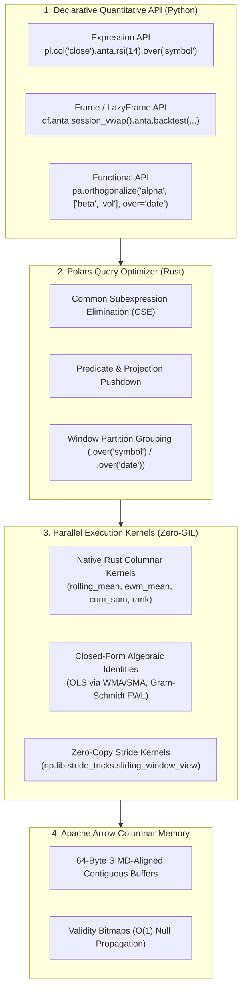

# Architecture, Mathematical Reductions & Vectorization Engine

`polars-anta` is engineered to bridge the gap between **academic quantitative finance** and **production-grade systems engineering**. Rather than wrapping legacy C libraries or iterating row-by-row in Python, every indicator, microstructure estimator, labeling algorithm, and backtesting primitive is formulated through **closed-form algebraic identities**, **Apache Arrow zero-copy memory buffers**, and **Polars' multi-threaded Rust query engine**.

---

## 1. Systems Architecture: Rust Engine, Apache Arrow & Rayon Parallelism

Traditional Python technical analysis libraries force quantitative researchers into an architectural trade-off:

| Paradigm | Representative Libraries | Bottleneck in Institutional Workflows |
| :--- | :--- | :--- |
| **Compiled C Wrappers** | `TA-Lib` | Requires native C toolchains (`gcc` / MSVC), breaks across Python ABI versions, operates only on 1D NumPy arrays, and cannot optimize multi-asset queries or lazy execution plans. |
| **Eager Pandas Wrappers** | `pandas-ta`, `ta`, `alphalens` | Bound by Python's Global Interpreter Lock (GIL), copies memory eagerly on every intermediate Series operation, and executes `groupby("symbol")` sequentially on a single CPU core. |
| **Native Polars Expressions** | **`polars-anta`** | Compiles indicators into a **Polars Logical Plan**, optimizes common subexpressions in Rust, executes across all CPU cores via **Rayon work-stealing threads**, and operates directly on **Apache Arrow** contiguous columnar buffers. |



### Key Engineering Guarantees

1. **Zero-Copy Arrow Buffers**: Price, volume, and factor arrays are stored in 64-byte aligned contiguous memory blocks following the Apache Arrow specification, enabling AVX-256 / AVX-512 SIMD vectorization in Rust.
2. **Work-Stealing Multi-Asset Parallelism**: When an expression is suffixed with `.over("symbol")` (time-series) or `.over("timestamp")` (cross-sectional), Polars dispatches independent partitions across all physical CPU cores concurrently via Rust's **Rayon** thread pool with zero Python callback serialization.
3. **Out-of-Core Streaming (`pl.LazyFrame`)**: Every method on `TechnicalAnalysisFrame` preserves lazy evaluation on `pl.LazyFrame`, allowing multi-year tick or 1-minute Parquet archives (`pl.scan_parquet(...)`) to be processed with minimal RAM footprint.

---

## 2. Closed-Form Algebraic Reductions (Mathematical Derivations)

A core design principle of `polars-anta` is **algebraic reduction**: transforming seemingly $O(N \cdot W)$ iterative regressions and recursive filters into $O(N)$ native vectorized expressions.

### 2.1 Closed-Form Rolling OLS Linear Regression (112.4x Speedup)

In naive implementations (such as `scipy.stats.linregress` inside `Series.rolling(n).apply(...)`), computing a rolling Ordinary Least Squares (OLS) slope over a window of length $n$ requires solving a regression at every bar $t$, costing $O(N \cdot n)$ in Python.

**Theorem (WMA–SMA Decomposition of Rolling OLS):**
Let $y_{t-n+1}, \dots, y_t$ be the $n$ observations in the window ending at bar $t$, indexed by local time $x_i = i$ for $i \in \{0, 1, \dots, n - 1\}$. The OLS linear model is $y_i = \beta_0 + \beta_1 x_i + \epsilon_i$.

The sample mean of the time index is:

$$
\bar{x} = \frac{1}{n} \sum_{i=0}^{n-1} i = \frac{n - 1}{2}
$$

The sum of squared deviations of the time index is:

$$
S_{xx} = \sum_{i=0}^{n-1} (i - \bar{x})^2 = \frac{n(n^2 - 1)}{12}
$$

Recall the definitions of the $n$-period **Simple Moving Average ($\text{SMA}_t$)** and **Linearly Weighted Moving Average ($\text{WMA}_t$)**:

$$
\text{SMA}_t = \frac{1}{n} \sum_{i=0}^{n-1} y_{t - n + 1 + i}, \qquad \text{WMA}_t = \frac{2}{n(n + 1)} \sum_{i=0}^{n-1} (i + 1) y_{t - n + 1 + i}
$$

Expanding the sample covariance $S_{xy} = \sum_{i=0}^{n-1} (i - \bar{x}) y_{t - n + 1 + i}$:

$$
S_{xy} = \sum_{i=0}^{n-1} (i + 1) y_{t - n + 1 + i} - \frac{n + 1}{2} \sum_{i=0}^{n-1} y_{t - n + 1 + i} = \frac{n(n + 1)}{2} \left( \text{WMA}_t - \text{SMA}_t \right)
$$

Dividing $S_{xy}$ by $S_{xx}$ yields the exact closed-form identities implemented in [`polars_anta.stats`](indicators/stats.md):

$$
\hat{\beta}_1(t) = \frac{S_{xy}}{S_{xx}} = \frac{6}{n - 1} \left( \text{WMA}_t - \text{SMA}_t \right)
$$

$$
\hat{\beta}_0(t) = \text{SMA}_t - \hat{\beta}_1(t) \frac{n - 1}{2} = 4\,\text{SMA}_t - 3\,\text{WMA}_t
$$

$$
\hat{y}_t = \hat{\beta}_0(t) + \hat{\beta}_1(t)(n - 1) = 3\,\text{WMA}_t - 2\,\text{SMA}_t
$$

Because both $\text{SMA}_t$ and $\text{WMA}_t$ execute natively in Rust, `linear_regression_slope`, `linear_regression_intercept`, and `linear_regression_forecast` evaluate **1,000,000 rows in 20.9 ms** (**112.4x faster** than Pandas).

---

### 2.2 Exact Reduction of Recursive Filters to `ewm_mean`

Several classical indicators appear to require sequential bar-by-bar Python loops due to path-dependent recurrences:

1. **Wilder's Smoothing (RMA)** used in `rsi`, `atr`, `adx`, and `natr`:

$$
\text{RMA}_t = \frac{(n - 1)\,\text{RMA}_{t-1} + x_t}{n} = \left(1 - \frac{1}{n}\right)\text{RMA}_{t-1} + \frac{1}{n} x_t
$$

   This is mathematically identical to an Exponential Moving Average with smoothing factor $\alpha = \frac{1}{n}$ (or equivalent span $S = 2n - 1$), which maps directly to Polars' native C/Rust kernel `expr.ewm_mean(alpha=1.0 / period, adjust=False, min_samples=period)`.

2. **Heikin-Ashi Synthetic Open (`heikin_ashi`)**:
   By definition, $\text{HA\_Close}_t = \frac{O_t + H_t + L_t + C_t}{4}$ and:

$$
\text{HA\_Open}_t = \frac{1}{2}\text{HA\_Open}_{t-1} + \frac{1}{2}\text{HA\_Close}_{t-1}
$$

   Recognize that $\text{HA\_Open}_t$ is a first-order linear recurrence driven by the lagged input $u_t = \text{HA\_Close}_{t-1}$ with decay parameter $\alpha = 0.5$ (`span = 3`). Thus, `heikin_ashi` computes the exact synthetic open across millions of rows in a single call to `ha_close.shift(1).ewm_mean(alpha=0.5, adjust=False)` with **zero Python loops**.

---

### 2.3 Modified Gram-Schmidt / Frisch-Waugh-Lovell Cross-Sectional Orthogonalization

In institutional factor research, a candidate alpha $Y$ must be orthogonalized against a vector of $K$ continuous risk factors $X = [X_1, X_2, \dots, X_K]$ (e.g., Market Beta, Volatility, Size, Amihud Illiquidity) at every cross-sectional timestamp $t$.

Rather than grouping by timestamp in Python and invoking `np.linalg.lstsq` in a slow loop over $T$ dates, [`orthogonalize`](indicators/alpha.md) applies the **Frisch-Waugh-Lovell (FWL) Theorem** via **Modified Gram-Schmidt projections** written entirely in native Polars `.over(over)` window expressions:

1. Center the target signal and all risk factors within each cross-section $t$:

$$
y^{(0)} = Y - \mathbb{E}_t[Y], \qquad u_j^{(0)} = X_j - \mathbb{E}_t[X_j] \quad (j = 1, \dots, K)
$$

2. For each orthogonal basis step $j = 1, \dots, K$:

$$
q_j = u_j^{(j-1)}, \qquad \beta_{y, j} = \frac{\mathbb{E}_t\left[y^{(j-1)} q_j\right]}{\mathbb{E}_t\left[q_j^2\right] + \lambda}
$$

$$
y^{(j)} = y^{(j-1)} - \beta_{y, j} q_j
$$

$$
u_m^{(j)} = u_m^{(j-1)} - \frac{\mathbb{E}_t\left[u_m^{(j-1)} q_j\right]}{\mathbb{E}_t\left[q_j^2\right] + \lambda} q_j \quad \forall m > j
$$

3. After $K$ symbolic steps, $y^{(K)} = (I - P_X)(Y - \bar{Y})$ is the exact multivariate OLS residual satisfying $\text{Corr}_t\left(y^{(K)}, X_j\right) = 0$ for all $j = 1, \dots, K$, executed in parallel across all timestamps in Rust.

---

## 3. Zero-Copy Stride Kernels (`sliding_window_view`)

Certain financial machine learning and complexity primitives require inspecting the internal trajectory of a sliding window of length $W$:
- **Fixed-Window Fractional Differentiation (`frac_diff`)**: Dot product of trailing window with binomial weights $\omega_k$.
- **Triple-Barrier Labeling (`triple_barrier_labels`)**: First-passage time detection against upper Profit-Taking and lower Stop-Loss barriers over a forward window $H$.
- **Rescaled Range Hurst Exponent (`hurst_exponent`)**: Cumulative demeaned range $\max_{1 \le k \le W} Z_k - \min_{1 \le k \le W} Z_k$ within each window.
- **Shannon Entropy (`entropy`)**: Empirical histogram bin probabilities across each rolling window.

Instead of iterating over $i \in \{0, \dots, N - W\}$ in Python, `polars-anta` uses NumPy's **zero-copy stride manipulation**:
```python
windows = np.lib.stride_tricks.sliding_window_view(vals, window_shape=W)
```
Given a contiguous 1D `float64` array of length $N$ with byte stride $s_0 = 8$ bytes, `sliding_window_view` constructs a 2D array descriptor of shape $(N - W + 1, W)$ and byte strides $(8, 8)$ in **$O(1)$ time with zero memory allocation**. Matrix-vector products (`windows @ w_rev` in `frac_diff`) and vectorized boolean reductions (`np.argmax(hit_pt, axis=1)` in `triple_barrier_labels`) then execute directly in C/BLAS.

---

## 4. State-Machine Vectorization Without Loops

Event-driven state machines are traditionally the hardest component to vectorize. `polars-anta` eliminates event loops across three critical domains:

### 4.1 Discrete Entry/Exit State Machine (`signals_to_positions`)
To hold $+1.0$ from `entries=True` until `exits=True` (and $-1.0$ for short triggers) without a bar-by-bar loop, `polars-anta` maps triggers to a tri-state sparse series:

$$
S_t = \begin{cases} 0.0 & \text{if } \text{Exit}_t \land \neg \text{Entry}_t \\ 1.0 & \text{if } \text{Entry}_t \\ \text{null} & \text{otherwise} \end{cases}
$$

Applying `S_t.forward_fill().over("symbol").fill_null(0.0)` propagates the active position state across time in $O(N)$ native Rust execution.

### 4.2 Information-Driven Bar Sampling (`resample_volume_bars`, `resample_dollar_bars`, `resample_imbalance_bars`)
To group ticks or 1-minute bars into buckets whenever cumulative volume, dollar value, or signed tick imbalance crosses threshold $\Theta$:

$$
B_t = \left\lfloor \frac{\left(\sum_{\tau=1}^{t} v_\tau\right) (1 - \epsilon)}{\Theta} \right\rfloor
$$

Grouping by `bar_id = B_t` via Polars' `group_by(["symbol", "bar_id"], maintain_order=True).agg(...)` aggregates millions of ticks into Volume, Dollar, or Imbalance Bars in a single parallel pass.

### 4.3 Round-Trip Trade Ledger & Intra-Trade Excursion (`extract_trades`)
To extract individual round-trip trades and compute **Maximum Adverse Excursion (MAE)** and **Maximum Favorable Excursion (MFE)** without iterating over trades:
1. Detect state transitions where position sign changes: $\text{seg}_t = \sum_{\tau=1}^{t} \mathbb{I}\left(\text{sign}(w_\tau) \neq \text{sign}(w_{\tau-1})\right)$.
2. Filter to active bars ($w_t \neq 0$) and compute intra-trade compounded gross return within each segment via window expression:

$$
G_t = \left(\prod_{\tau \in \text{seg}_t, \tau \le t} (1 + r_\tau^{\text{gross}})\right) - 1
$$

3. Aggregate per `seg_t` in a single `group_by` pass:

$$
\text{MAE} = \min\left(0, \min_{t \in \text{seg}} G_t\right), \qquad \text{MFE} = \max\left(0, \max_{t \in \text{seg}} G_t\right)
$$

