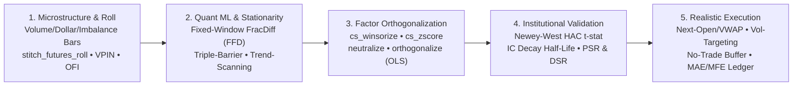

<div align="center">
  
</div>

<div align="center">

### Institutional-Grade Alpha Research, Market Microstructure, Quantitative Feature Engineering & Vectorized Backtesting in Polars

**Auditable mathematical expressions. Cross-sectional factor analytics and microstructure modeling. An intuitive dual `.anta` / `.ta` interface. Zero-C deployment with Rust-accelerated performance.**

</div>

---

## What is `polars-anta`?

**`polars-anta`** (**A**lpha & **N**umerical **T**echnical **A**nalysis) is an institutional-grade quantitative finance library for **market microstructure estimation, derivatives analytics, machine learning labeling & stationarity (AFML), cross-sectional factor engineering, statistical alpha evaluation, and execution-realistic vectorized backtesting** in Python and Polars.

Purpose-built for **quantitative researchers, proprietary trading desks, index futures strategists (e.g., VN30F1M, CME E-mini, Crypto Perpetuals), and systematic portfolio managers**, `polars-anta` implements technical indicators, closed-form OLS regressions, formulaic alpha primitives, and portfolio evaluation tools directly as Polars Expressions (`pl.Expr`)—combining 100% auditable, white-box mathematical formulas with Polars' multi-threaded Rust execution engine.



---

## The 4 Institutional Quantitative Pillars

| Pillar | Core Capabilities & Primitives | Documentation |
| :--- | :--- | :--- |
| **1. Intraday Microstructure & Derivatives** | Information-driven sampling (`resample_volume_bars`, `resample_dollar_bars`, `resample_imbalance_bars`), continuous contract stitching (`stitch_futures_roll`), session-anchored VWAP (`session_vwap`), order flow toxicity (`vpin`, `ofi`), and index futures carry/positioning (`futures_basis`, `oi_regime`). | [Resampling & Roll Guide](guides/resampling-and-dataframe-api.md) · [Alpha & Microstructure](indicators/alpha.md) |
| **2. Quant Machine Learning (AFML Primitives)** | Memory-preserving stationarity via Fixed-Window Fractional Differentiation (`frac_diff`), path-dependent dynamic Triple-Barrier & Meta-Labeling (`triple_barrier_labels`), and multi-horizon OLS Trend-Scanning labels (`trend_scanning_labels`). | [Stats & FFD](indicators/stats.md) · [AFML Labeling](indicators/evaluation-and-backtest.md) |
| **3. Institutional Factor Validation** | Multi-factor Modified Gram-Schmidt OLS residualization (`orthogonalize`), Newey-West HAC autocorrelation-robust IC inference (`ic_summary`), multi-horizon IC decay & exponential Alpha Half-Life (`ic_decay`), and non-normal multiple-testing Sharpe adjustments (`probabilistic_sharpe_ratio`, `deflated_sharpe_ratio`). | [Quant Theory Guide](guides/quant-theory-and-workflows.md) · [Eval & Backtest](indicators/evaluation-and-backtest.md) |
| **4. Execution-Realistic Backtesting** | Custom fill benchmarks (`execution_price` in `{"close", "open", "twap", "vwap"}`), intraday session flatten masks (`flat_mask`), ex-ante volatility targeting (`vol_target`), turnover hysteresis zones (`no_trade_buffer`), round-trip trade ledgers with Maximum Adverse/Favorable Excursion (`bt.trades()`), and DSR-adjusted grid sweeps (`parameter_sweep`). | [Backtesting Reference](indicators/evaluation-and-backtest.md) |

---

## Core Mathematical & Systems Foundations

### 1. Exact Algebraic Reductions ($O(N)$ Rust Native Kernels)
Rather than iterating row-by-row in Python or Cython, `polars-anta` reduces time-series regressions and recursive filters into closed-form combinations of Polars native primitives:

- **112.4x Faster Rolling OLS Slope via WMA–SMA Identity**:
  By exploiting the exact linear relationship between the Linearly Weighted Moving Average ($\text{WMA}_n$) and Simple Moving Average ($\text{SMA}_n$), rolling Ordinary Least Squares slope is evaluated in $O(1)$ per bar:

  $$\beta_{1,t} = \frac{6}{n + 1}\left(\text{WMA}_n(y)_t - \text{SMA}_n(y)_t\right), \qquad \beta_{0,t} = \text{SMA}_n(y)_t - \beta_{1,t}\frac{n - 1}{2}$$

- **Fixed-Window Fractional Differentiation (FFD)**:
  Applies the binomial expansion of the backshift operator $(1 - B)^d = \sum_{k=0}^{W-1} \omega_k B^k$ with recursive weights $\omega_0 = 1, \, \omega_k = -\omega_{k-1} \frac{d - k + 1}{k}$ to achieve stationarity while preserving long-memory cointegration at $d \in (0, 1)$.

- **Modified Gram-Schmidt Cross-Sectional Orthogonalization**:
  Applies the Frisch-Waugh-Lovell theorem per timestamp cross-section to strip collinear risk exposures ($F = [f_1, \dots, f_K]$) via sequential orthogonal projections $u_k = \tilde{f}_k - \sum_{j < k} \frac{\langle \tilde{f}_k, u_j \rangle}{\|u_j\|_2^2 + \lambda} u_j$.

- **Newey-West HAC & Deflated Sharpe Ratio (DSR)**:
  Corrects Rank IC $t$-statistics for overlapping forward-return serial correlation via Bartlett kernel weights $w_j = 1 - \frac{j}{L+1}$, and penalizes backtest Sharpe ratios for skewness ($\hat{\gamma}_3$), fat tails ($\hat{\gamma}_4$), and the variance of $K$ independent parameter trials ($E[\max_k \widehat{SR}_k]$).

---

## Documentation and Learning Resources

| Resource | Description |
| :--- | :--- |
| [**Quantitative Theory & Institutional Workflows**](guides/quant-theory-and-workflows.md) | Deep-dive into the mathematics and theory of AFML labeling, FFD, microstructure bars, Gram-Schmidt orthogonalization, Newey-West HAC, and PSR/DSR |
| [**Architecture & Mathematical Proofs**](architecture.md) | Step-by-step algebraic proofs of the WMA–SMA OLS identity, Wilder RMA recurrences, and zero-copy `sliding_window_view` vectorization |
| [**API Reference & Catalog**](indicators/index.md) | Complete module-by-module function signatures, `pl.Struct` fields, and mathematical formulas across 155+ primitives |
| [**Getting Started Guide**](getting-started.md) | Installation, expression syntax, `pl.Struct` unnesting, and fluent DataFrame chaining |
| [**Multi-Asset Universe Guide**](guides/multi-asset.md) | Scaling indicators and cross-sectional factors across hundreds of symbols with `.over("ticker")` |
| [**Information Bars, Roll & Resampling**](guides/resampling-and-dataframe-api.md) | Calendar/Volume/Dollar/Imbalance bars, continuous futures stitching (`stitch_futures_roll`), and OHLCV validation |
| [**Factor Evaluation & Backtesting**](indicators/evaluation-and-backtest.md) | Rank IC, Newey-West ICIR, `ic_decay`, Triple-Barrier/Trend-Scanning, `df.anta.backtest()`, and MAE/MFE trade ledgers |
| [**Performance Benchmarks**](benchmarks.md) | 1,000,000-row latency comparisons against Pandas and reproduction instructions |
| [**Interactive Colab Notebooks**](https://github.com/huuan26/polars-anta/tree/master/examples) | Runnable Jupyter / Google Colab tutorials covering screening, momentum, and backtesting |

---

## Institutional Quick Start

### 1. Install

```bash
pip install polars-anta
```

### 2. Microstructure, Fractional Differentiation & AFML Triple-Barrier Labeling

```python
import polars as pl
import polars_anta as pa  # Registers .anta and .ta namespaces

df = pl.read_parquet("vn30f1m_intraday.parquet")

features = (
    df.with_columns(
        pl.col("close").anta.frac_diff(d=0.4, window=20).alias("close_ffd"),
        pl.col("close").anta.vpin("volume", period=20).alias("vpin_20"),
        pl.col("close").anta.futures_basis("spot_close", "days_to_expiry", 20).alias("basis"),
        pl.col("close").anta.triple_barrier_labels(
            volatility=pl.col("close").pct_change().rolling_std(20),
            horizon=12,
            pt_mult=2.0,
            sl_mult=1.5,
        ).alias("tb"),
    )
    .unnest("basis", "tb")
)
```

### 3. Execution-Realistic Vectorized Backtest & Excursion Ledger (MAE / MFE)

```python
bt = (
    df.anta.ema(12, alias="ema_12")
    .anta.ema(26, alias="ema_26")
    .anta.backtest(
        entries=pl.col("ema_12").anta.crosses_above("ema_26"),
        exits=pl.col("ema_12").anta.crosses_below("ema_26"),
        execution_price="open",       # Fill at next-bar open price
        flat_mask=pl.col("is_eod"),   # Force flat before ATC / overnight
        vol_target=0.15,              # 15% annualized volatility target
        no_trade_buffer=0.05,         # Suppress micro-rebalancing turnover
        fee_rate=0.0005,
        slippage_rate=0.0002,
    )
)
print(bt.report())
print(bt.trades())  # Trade-by-trade PnL, holding_bars, MAE & MFE
```
