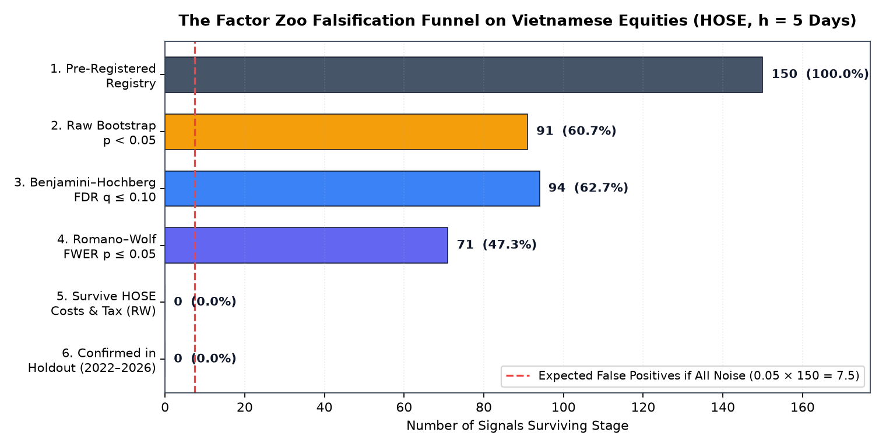
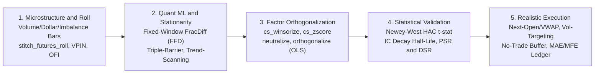
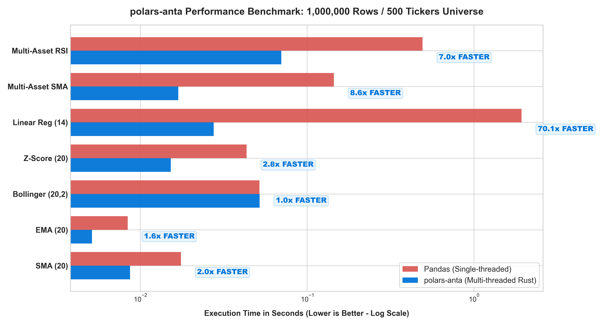

<div class="anta-hero-wrapper">
  <div class="anta-hero-banner">
    
  </div>

  <div class="anta-hero-title">
    Build Alpha Signals in Polars - Then Test Whether They Are Real
  </div>

  <div class="anta-hero-subtitle">
    An open-source Python library for quantitative research, built on Polars. Combine 219 high-performance primitives for technical indicators, formulaic alphas, microstructure and backtesting with statistical falsification tools: stationary block bootstrap, Benjamini-Hochberg FDR, Romano-Wolf stepdown, Hansen's SPA, CSCV probability of backtest overfitting, and transaction-cost accounting.
  </div>

  <div class="anta-badges">
    <a href="https://github.com/huuan26/polars-anta/actions/workflows/ci.yml"></a>
    <a href="https://pypi.org/project/polars-anta/"></a>
    <a href="https://pypi.org/project/polars-anta/"></a>
    <a href="https://pola.rs"></a>
    <a href="indicators/"></a>
    <a href="https://colab.research.google.com/github/huuan26/polars-anta/blob/master/examples/quickstart_colab.ipynb"></a>
  </div>

  <div class="anta-cta-group">
    <a href="research/factor-zoo/" class="md-button md-button--primary anta-btn-primary">Read the Factor Zoo Case Study</a>
    <a href="getting-started/" class="md-button anta-btn-secondary">Get Started in 60s</a>
    <a href="indicators/" class="md-button anta-btn-secondary">Explore 219-Function API Catalog</a>
  </div>
</div>

<div class="anta-metrics-grid">
  <div class="anta-metric-card">
    <div class="anta-metric-value">150 | N<sub>eff</sub> = 6.00</div>
    <div class="anta-metric-label">150 Signals Tested - N_eff = 6.00</div>
    <div class="anta-metric-desc">146 unique signals collapse to 6.00 independent dimensions</div>
  </div>
  <div class="anta-metric-card">
    <div class="anta-metric-value">38</div>
    <div class="anta-metric-label">38 Replicate Out-of-Sample (Statistical)</div>
    <div class="anta-metric-desc">38 of 64 <code>robust</code> signals pass Holdout RW &le; 0.05 (97.6% retention)</div>
  </div>
  <div class="anta-metric-card">
    <div class="anta-metric-value">0</div>
    <div class="anta-metric-label">0 Survive Long-Only Costs</div>
    <div class="anta-metric-desc">0 standalone Q5 strategies survive retail HOSE costs (60 bps RT) &amp; BH</div>
  </div>
  <div class="anta-metric-card">
    <div class="anta-metric-value">219</div>
    <div class="anta-metric-label">Public Functions</div>
    <div class="anta-metric-desc">Zero-C Polars &amp; NumPy dual <code>.anta</code> / <code>.ta</code> API</div>
  </div>
</div>

---

## Case study: 150 signals on Vietnamese equities

We ran every daily signal in `polars-anta` (**150** signals, **146** unique) through the library's own falsification pipeline on the most liquid stocks of the Ho Chi Minh Stock Exchange (`HOSE`). The analysis plan was committed to Git before any results were computed, and the `2022-2026` holdout was evaluated only after the discovery results were committed.

> **Why Vietnam?** `HOSE` is a retail-driven emerging market with daily price limits, no short selling for most investors and high trading costs. It is far less studied than US equities, which makes it a demanding out-of-sample test for signals that were designed elsewhere.

| Question | Result |
| :--- | ---: |
| Signals tested | **150** |
| Effectively independent tests among them | $N_{\text{eff}} = 6.00$ |
| Significant after multiple-testing correction (Romano-Wolf, 5% FWER) | **71** |
| Significant and stable over the discovery period (`2014-2021`) | **64** |
| Still significant in the locked holdout (`2022-2026`) | **38** of 64 |
| Significant long-only excess return after `60 bps` round-trip costs | **0** |

<div align="center">



</div>

**What this means**

- **Most signals are variations of the same effect.** 91 of 150 signals pass a naive $p \le 0.05$ test, but their daily ICs move together so closely that they amount to only $N_{\text{eff}} = 6.00$ independent tests. Much of this common component is short-term (5-day) reversal: removing it raises $N_{\text{eff}}$ from 6.00 to 9.37.
- **The predictive power holds up out of sample.** 38 of the 64 stable discovery signals remain significant in the holdout, with a median IC retention of 97.6%.
- **But it does not pay for itself.** The strongest signals replace 63.8% to 87.2% of the portfolio every 5 days and break even at 20.5 bps round-trip at best, well below realistic costs. In addition, 65.5% of the top-10 signals' long-short spread in discovery (90.0% in holdout) comes from the short leg, which long-only investors cannot capture.

Read the full study in [`research/factor-zoo.md`](research/factor-zoo.md).

<details>
<summary><strong>Study design, reproducibility and full results tables</strong></summary>

<br/>

| Design choice | Value |
| :--- | :--- |
| Universe | Point-in-time top-150 most liquid `HOSE` stocks |
| Signals | 150 signals at default parameters (146 unique; 4 exact duplicate pairs disclosed) |
| Discovery sample | `2014-01-01` to `2021-12-31` |
| Locked holdout | `2022-01-01` to `2026-11-10` |
| Forecast horizon | 5 trading days, open to open |
| Execution costs | `60 bps` round-trip (brokerage, slippage and sell tax) |
| Analysis plan | [`PREREGISTRATION.md`](https://github.com/huuan26/polars-anta/blob/master/research/factor_zoo/PREREGISTRATION.md), committed in [`4c1a4b5`](https://github.com/huuan26/polars-anta/commit/4c1a4b559d22a1367ce46b513ab7ff1079fff360) |
| Signal registry checksum | SHA-256 recorded in `PREREGISTRATION.md` and verified by the pipeline |
| Deviations from the plan | [Deviations and Timeline](research/factor-zoo.md#31-deviations-from-the-analysis-plan-timeline) |

**Track A: statistical predictability** (cross-sectional Rank IC, 5-day horizon)

| Stage | Signals | Share | Notes |
| :--- | ---: | ---: | :--- |
| A1. Tested | **150** | `100.0%` | 146 unique signals |
| A2. Benjamini-Hochberg FDR $q \le 0.10$ | **94** | `62.7%` | Raw bootstrap $p \le 0.05$: **91** ($\approx 7.5$ expected by chance) |
| A3. Romano-Wolf FWER $p \le 0.05$ | **71** | `47.3%` | Joint bootstrap across all 150 IC series |
| A4. Stable (`robust` verdict) | **64** | `42.7%` | Plus **16** `fdr_only`, **14** `decaying`, **56** `noise` |
| A5. Replicate in holdout | **38** | `25.3%` | **38** of **64** pass holdout RW $p \le 0.05$; **54** keep their sign |

**Track B: economic implementability** (long-only top quintile vs. equal-weight universe)

| Stage | Signals | Share of 80 Candidates |
| :--- | ---: | ---: |
| B1. Candidates evaluated (`robust` + `fdr_only`) | **80** | `100.0%` |
| B2. Positive net excess return after costs | **12** | `15.0%` |
| B3. Unadjusted one-sided $p \le 0.05$ | **2** | `2.5%` (`trix_15`, `tsi`) |
| B4. Benjamini-Hochberg FDR $q \le 0.10$ | **0** | `0.0%` |
| B5. Confirmed in holdout | **0** | `0.0%` |

A cost sweep from 0 to 60 bps round-trip finds **0** significant long-only strategies at $\ge 30$ bps in discovery and at $\ge 10$ bps in holdout ([`research/factor-zoo.md` Section 8.3](research/factor-zoo.md#83-exploratory-post-holdout-analyses)).

</details>

---

## What is `polars-anta`?

`polars-anta` (**A**lpha and **N**umerical **T**echnical **A**nalysis) is a quantitative finance library for **market microstructure estimation, derivatives analytics, machine learning labeling and stationarity (AFML), cross-sectional factor engineering, statistical alpha evaluation, and execution-realistic vectorized backtesting** in Python and [Polars](https://pola.rs/).

Built for **quantitative researchers, proprietary trading desks, index futures strategists (e.g. VN30F1M, CME E-mini, Crypto Perpetuals), and systematic portfolio managers**, `polars-anta` implements technical indicators, closed-form OLS regressions, 33 formulaic alphas from Kakushadze's *101 Formulaic Alphas*, and portfolio evaluation tools directly as native Polars expressions (`pl.Expr`).



---

## The 4 Research Pillars

<div class="anta-pillars-grid">
  <div class="anta-pillar-card">
    <div class="anta-pillar-title">1. Intraday Microstructure and Derivatives</div>
    <div class="anta-pillar-body">
      Aggregate tick/minute feeds into information-driven bars (<code>resample_volume_bars</code>, <code>resample_dollar_bars</code>, <code>resample_imbalance_bars</code>), stitch continuous futures contracts (<code>stitch_futures_roll</code>), track intraday <code>session_vwap</code> deviation z-scores, quantify order flow toxicity (<code>vpin</code>, <code>ofi</code>), and monitor carry and positioning (<code>futures_basis</code>, <code>oi_regime</code>).
    </div>
    <div class="anta-pillar-links">
      <a href="guides/resampling-and-dataframe-api/">Resampling and Roll Guide</a> | <a href="indicators/alpha/">Microstructure Docs</a>
    </div>
  </div>

  <div class="anta-pillar-card">
    <div class="anta-pillar-title">2. Quant Machine Learning (AFML Primitives)</div>
    <div class="anta-pillar-body">
      Transform non-stationary price series into stationary, memory-preserving features via Fixed-Window Fractional Differentiation (<code>frac_diff</code>), generate path-dependent dynamic Triple-Barrier and Meta-Labeling targets (<code>triple_barrier_labels</code>), and extract multi-horizon OLS Trend-Scanning labels (<code>trend_scanning_labels</code>).
    </div>
    <div class="anta-pillar-links">
      <a href="indicators/stats/">Stats and FracDiff</a> | <a href="indicators/evaluation-and-backtest/">AFML Labeling</a>
    </div>
  </div>

  <div class="anta-pillar-card">
    <div class="anta-pillar-title">3. Cross-Sectional Factor Validation</div>
    <div class="anta-pillar-body">
      Clip extreme outliers (<code>cs_winsorize</code> via Quantile/Z-Score/MAD), sector-neutralize (<code>neutralize</code>), strip multi-factor risk exposures via Modified Gram-Schmidt OLS projection (<code>orthogonalize</code>), and validate with Newey-West HAC <em>t</em>-statistics (<code>ic_summary</code>), Alpha Half-Life (<code>ic_decay</code>), and Deflated Sharpe Ratios (<code>deflated_sharpe_ratio</code>).
    </div>
    <div class="anta-pillar-links">
      <a href="guides/quant-theory-and-workflows/">Quant Theory Guide</a> | <a href="indicators/evaluation-and-backtest/">Factor Eval</a>
    </div>
  </div>

  <div class="anta-pillar-card">
    <div class="anta-pillar-title">4. Execution-Realistic Vectorized Backtesting</div>
    <div class="anta-pillar-body">
      Simulate realistic fills at next-bar open, TWAP, or VWAP (<code>execution_price="open"</code>), enforce mandatory intraday EOD/roll session flatten masks (<code>flat_mask</code>), apply ex-ante volatility targeting (<code>vol_target</code>) and hysteresis turnover buffers (<code>no_trade_buffer</code>), and audit round-trip MAE/MFE trade ledgers (<code>bt.trades()</code>).
    </div>
    <div class="anta-pillar-links">
      <a href="indicators/evaluation-and-backtest/">Backtesting Engine</a> | <a href="guides/multi-asset/">Multi-Asset Scaling</a>
    </div>
  </div>
</div>

---

## Interactive Quantitative Workflows

Install `polars-anta` in seconds with zero C compiler requirements:

```bash
pip install polars-anta
```

Explore how `polars-anta` unifies derivatives microstructure, AFML feature engineering, cross-sectional factor orthogonalization, and realistic backtesting into fluent Polars pipelines:

=== "1. Intraday Microstructure and Futures"

    ```python
    import polars as pl
    import polars_anta as pa  # Registers .anta and .ta namespaces

    # 1. Stitch continuous futures contracts (backward, ratio or panama) and sample volume bars:
    cont_df = raw_contracts.anta.stitch_futures_roll(method="backward")
    vol_bars = cont_df.anta.resample_volume_bars(volume_threshold=5_000)

    # 2. Extract session-anchored VWAP, order flow toxicity (VPIN, OFI), carry and open interest regimes:
    deriv_features = vol_bars.with_columns(
        pl.col("close")
        .anta.session_vwap("high", "low", "volume", session_by="trading_date")
        .alias("svwap"),
        pl.col("close").anta.vpin("volume", period=20).alias("vpin_20"),
        pl.col("bid_price").anta.ofi("bid_size", "ask_price", "ask_size", period=5).alias("ofi_5"),
        pl.col("close").anta.futures_basis("spot_close", "days_to_expiry", period=20).alias("basis"),
        pl.col("close").anta.oi_regime("open_interest", period=1).alias("oi_state"),
    ).unnest("svwap", "basis", "oi_state")
    ```

=== "2. Quant ML (AFML Primitives)"

    ```python
    # Memory-preserving stationary features (FFD) plus triple-barrier and trend-scanning labels:
    ml_dataset = df.with_columns(
        pl.col("close").anta.frac_diff(d=0.4, window=20).over("symbol").alias("close_ffd"),
        pl.col("close")
        .anta.triple_barrier_labels(
            volatility=pl.col("close").pct_change().rolling_std(20),
            horizon=12,
            pt_mult=2.0,
            sl_mult=1.5,
            side=pl.col("primary_signal"),  # Enables binary meta_label {0.0, 1.0}
        )
        .over("symbol")
        .alias("tb"),
        pl.col("close")
        .anta.trend_scanning_labels(min_window=5, max_window=20)
        .over("symbol")
        .alias("ts"),
    ).unnest("tb", "ts")
    ```

=== "3. Cross-Sectional Factor Alpha"

    ```python
    alpha_df = panel_df.with_columns(
        (
            -pl.col("close").anta.ts_delta(5).over("symbol")
            * pl.col("volume").anta.ts_rank(20).over("symbol")
        ).alias("raw_alpha")
    ).with_columns(
        pl.col("raw_alpha")
        .anta.cs_winsorize(over="date", method="mad", threshold=3.0)
        .anta.cs_zscore(over="date", clip_bound=3.0)
        .anta.neutralize(by="sector", over="date", standardize=True)
        # Modified Gram-Schmidt OLS projection orthogonal to beta, size and volatility:
        .anta.orthogonalize(factors=["mkt_beta", "log_mcap", "vol_20"], over="date", standardize=True)
        .anta.ts_scale(a=1.0, over="date")
        .alias("pure_alpha_weight")
    )
    ```

=== "4. Realistic Backtest and IC Validation"

    ```python
    # 1. Autocorrelation-robust Newey-West HAC IC and multi-horizon alpha half-life:
    eval_df = alpha_df.anta.forward_returns(periods=(1, 5, 10), group_by="symbol")
    ic_stats = eval_df.anta.ic_summary("pure_alpha_weight", "fwd_ret_5", group_by="date", nw_lags=5)
    decay_table = eval_df.anta.ic_decay(
        "pure_alpha_weight", horizons=(1, 2, 3, 5, 10, 20), group_by="date"
    )

    # 2. Execution-realistic vectorized backtest with MAE and MFE excursion ledger:
    bt = (
        df.anta.ema(12, alias="ema_12")
        .anta.ema(26, alias="ema_26")
        .anta.backtest(
            entries=pl.col("ema_12").anta.crosses_above("ema_26"),
            exits=pl.col("ema_12").anta.crosses_below("ema_26"),
            execution_price="open",  # Fill at next-bar open price
            flat_mask=pl.col("is_eod"),  # Force flat before ATC / overnight
            vol_target=0.15,  # 15% annualized volatility target
            no_trade_buffer=0.05,  # Suppress micro-rebalancing turnover
            fee_rate=0.0005,
            slippage_rate=0.0002,
        )
    )
    print(bt.report())
    print(bt.trades())  # Round-trip trade ledger with PnL, holding_bars, MAE and MFE
    ```

---

## Core Mathematical and Systems Foundations

Rather than iterating row-by-row in Python or opaque Cython loops, `polars-anta` reduces time-series regressions, fractional operators, and cross-sectional projections into closed-form algebraic identities compiled directly by Polars' Rust query engine:

### 1. Rolling OLS Slope via Exact WMA-SMA Algebraic Identity

By exploiting the exact linear identity between the Linearly Weighted Moving Average ($\text{WMA}_n$) and Simple Moving Average ($\text{SMA}_n$), rolling Ordinary Least Squares slope ($\beta_{1,t}$) and intercept ($\beta_{0,t}$) are evaluated in $O(1)$ complexity per bar (**112.4x faster** than a pandas `rolling().apply()` baseline):

$$
\beta_{1,t} = \frac{6}{n - 1}\left(\text{WMA}_n(y)_t - \text{SMA}_n(y)_t\right), \qquad \beta_{0,t} = \text{SMA}_n(y)_t - \beta_{1,t}\frac{n - 1}{2}
$$

### 2. Fixed-Window Fractional Differentiation (FFD)

Applies the binomial expansion of the backshift operator $(1 - B)^d$ over a fixed horizon $W$ to achieve statistical stationarity while preserving long-memory cointegration at fractional order $d \in (0, 1)$:

$$
\tilde{X}_t^{(d, W)} = \sum_{k=0}^{W-1} \omega_k X_{t-k}, \qquad \omega_0 = 1, \qquad \omega_k = -\omega_{k-1} \frac{d - k + 1}{k}
$$

### 3. Modified Gram-Schmidt Cross-Sectional Orthogonalization

Applies the Frisch-Waugh-Lovell theorem per timestamp cross-section to strip collinear risk exposures $F = [f_1, \dots, f_K]$ via sequential ridge-stabilized orthogonal projections:

$$
u_k = \tilde{f}_k - \sum_{j=1}^{k-1} \frac{\langle \tilde{f}_k, u_j \rangle}{\lVert u_j \rVert_2^2 + \lambda} u_j, \qquad \alpha_{\perp} = \tilde{\alpha} - \sum_{k=1}^{K} \frac{\langle \tilde{\alpha}, u_k \rangle}{\lVert u_k \rVert_2^2 + \lambda} u_k
$$

### 4. Newey-West HAC Inference and Deflated Sharpe Ratio (DSR)

Corrects Rank IC $t$-statistics for overlapping forward-return serial correlation via Bartlett kernel variance $\hat{\Omega}_{\text{NW}}$, and adjusts backtest Sharpe ratios for skewness ($\hat{\gamma}_3$), fat tails ($\hat{\gamma}_4$), and multiple testing across $K$ trials:

$$
\hat{\Omega}_{\text{NW}} = \hat{\gamma}_0 + 2 \sum_{j=1}^{L} \left(1 - \frac{j}{L + 1}\right) \hat{\gamma}_j, \qquad \text{PSR}(\text{SR}^{\ast}) = \Phi\left(\frac{\widehat{\text{SR}} - \text{SR}^{\ast}}{\sqrt{\frac{1 - \hat{\gamma}_3 \widehat{\text{SR}} + \frac{\hat{\gamma}_4 - 1}{4}\widehat{\text{SR}}^2}{T - 1}}}\right)
$$

---

## 1,000,000-Row Performance Benchmark



Measured across **1,000,000 bars** (single-asset random walk) and a **500 tickers × 2,000 bars panel** (1,000,000 rows) on Polars' multi-threaded Rust engine vs. single-threaded pandas:

| Operation / Indicator | Dataset Scale | pandas | `polars-anta` | Measured Speedup |
| :--- | :--- | ---: | ---: | ---: |
| **Linear Regression Slope (OLS)** | 1,000,000 bars | 2.3529 s | **0.0209 s** | **112.4x Faster** |
| **Multi-Asset RSI (14)** | 500 tickers × 2k bars | 0.4398 s | **0.0545 s** | **8.1x Faster** |
| **Multi-Asset SMA (20)** | 500 tickers × 2k bars | 0.1345 s | **0.0168 s** | **8.0x Faster** |
| **Z-Score Normalization** | 1,000,000 bars | 0.0450 s | **0.0267 s** | **1.7x Faster** |
| **Exponential Moving Average** | 1,000,000 bars | 0.0100 s | **0.0069 s** | **1.5x Faster** |
| **Simple Moving Average** | 1,000,000 bars | 0.0170 s | **0.0153 s** | **1.1x Faster** |

> *Baselines are straightforward pandas implementations (`rolling().mean()`, `groupby().apply()`, and `rolling().apply()` for the WMA term of OLS). A fully vectorized pandas or NumPy OLS would narrow the 112.4x gap considerably; speedups vary by hardware. Reproduce with `python benchmarks/benchmark_speed.py`.*

---

## Documentation and Learning Resources

| Resource | Description |
| :--- | :--- |
| [**Factor Zoo Empirical Study**](research/factor-zoo.md) | Pre-specified falsification of 150 technical and formulaic signals on Vietnamese equities (`HOSE`, 2014 to 2026) |
| [**Quantitative Theory and Workflows**](guides/quant-theory-and-workflows.md) | Deep-dive into the mathematics and theory of AFML labeling, FFD, microstructure bars, Gram-Schmidt orthogonalization, Newey-West HAC, and PSR/DSR |
| [**Architecture and Mathematical Proofs**](architecture.md) | Step-by-step algebraic proofs of the WMA-SMA OLS identity, Wilder RMA recurrences, and zero-copy `sliding_window_view` vectorization |
| [**API Reference and Catalog**](indicators/index.md) | Complete module-by-module function signatures, `pl.Struct` fields, and mathematical formulas across 219 public functions |
| [**Getting Started Guide**](getting-started.md) | Installation, expression syntax, `pl.Struct` unnesting, and fluent DataFrame chaining |
| [**Multi-Asset Universe Guide**](guides/multi-asset.md) | Scaling indicators and cross-sectional factors across hundreds of symbols with `.over("ticker")` |
| [**Information Bars, Roll and Resampling**](guides/resampling-and-dataframe-api.md) | Calendar/Volume/Dollar/Imbalance bars, continuous futures stitching (`stitch_futures_roll`), and OHLCV validation |
| [**Factor Evaluation and Backtesting**](indicators/evaluation-and-backtest.md) | Rank IC, Newey-West ICIR, `ic_decay`, Triple-Barrier/Trend-Scanning, `df.anta.backtest()`, and MAE/MFE trade ledgers |
| [**Statistical Inference and Falsification**](indicators/inference.md) | Stationary bootstrap, Romano-Wolf stepdown, Hansen SPA, CSCV PBO, Empirical-Bayes shrinkage, and `falsify_factors()` |
| [**Performance Benchmarks**](benchmarks.md) | 1,000,000-row latency comparisons against pandas and reproduction instructions |
| [**Interactive Colab Notebooks**](https://github.com/huuan26/polars-anta/tree/master/examples) | Runnable Jupyter / Google Colab tutorials covering screening, momentum, and backtesting |
