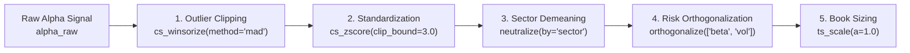

# Alpha Factor, Microstructure & Derivatives Primitives (`polars_anta.alpha`)

The `polars_anta.alpha` module provides **67 institutional alpha primitives** spanning cross-sectional standardization and multi-factor OLS orthogonalization, order flow toxicity (VPIN, OFI), index futures basis & open interest regimes, liquidity/spread estimators, fractal complexity metrics, and 33 canonical WorldQuant formulaic alphas.

---

## 1. Cross-Sectional Standardization, Neutralization & Orthogonalization

In multi-asset quantitative equity and futures portfolios, raw signals must be cleaned of outliers, standardized across the cross-section at each timestamp $t$, and orthogonalized against systematic risk factors.



### `cs_rank(expr, over=None, method="average", percentile=True)`
Computes the cross-sectional rank across all assets at each timestamp `over`:
$$\text{CSRank}_{i, t} = \frac{\text{rank}(x_{i, t})}{N_t} \in \left(\frac{1}{N_t}, 1.0\right]$$
Transforms arbitrary skewed cross-sectional distributions into a uniform distribution, ensuring extreme outliers cannot dominate portfolio weights.

---

### `cs_zscore(expr, over=None, clip_bound=None)`
Cross-sectional zero-mean, unit-variance standardization at each timestamp $t$:
$$Z_{i, t} = \frac{x_{i, t} - \mu_t}{\sigma_t}, \qquad \mu_t = \frac{1}{N_t}\sum_{j=1}^{N_t} x_{j, t}$$
When `clip_bound` is specified (e.g., `clip_bound=3.0`), clips $Z_{i, t}$ into $[-\text{clip\_bound}, +\text{clip\_bound}]$.

---

### `cs_winsorize(expr, over=None, method="quantile", lower=0.01, upper=0.99, threshold=3.0)`
Cross-sectional outlier clipping within each timestamp `over` supporting three statistical estimators:
- **`method="quantile"`**: Clips values outside empirical quantiles $[Q_{\text{lower}}, Q_{\text{upper}}]$.
- **`method="zscore"`**: Clips values outside $[\mu_t - k\sigma_t,\, \mu_t + k\sigma_t]$ where $k = \text{threshold}$.
- **`method="mad"` (Robust Median Absolute Deviation)**: Uses the consistent normal-equivalent MAD scale $\hat{\sigma}_{\text{MAD}} = 1.4826 \cdot \text{ median}(|x_{i,t} - \text{median}_t|)$ and clips outside $[\text{median}_t - k\hat{\sigma}_{\text{MAD}},\, \text{median}_t + k\hat{\sigma}_{\text{MAD}}]$.

---

### `neutralize(expr, by, over=None, standardize=False)`
Categorical Group / Sector / Industry Neutralization (WorldQuant primitive `indneutralize(x, g)`):
$$\tilde{x}_{i, t} = x_{i, t} - \frac{1}{|G(i)|} \sum_{j \in G(i)} x_{j, t}$$
Ensures that the sum of long and short weights within every sector $G$ at every timestamp $t$ is strictly zero ($\sum_{i \in G} \tilde{x}_{i, t} = 0$).

---

### `orthogonalize(expr, factors, over=None, standardize=True, ridge=0.0)`
**Mathematical Formulation (Frisch-Waugh-Lovell / Modified Gram-Schmidt OLS Projection):**
Given target alpha signal $Y$ and continuous risk exposures $X = [X_1, \dots, X_K]$ (such as Market Beta, Volatility, Size, or Amihud Illiquidity), `orthogonalize` removes all linear exposure to $\text{span}(1, X_1, \dots, X_K)$ within each cross-section `over`:
$$\epsilon_t = (I - P_{X_t})(Y_t - \bar{Y}_t) \implies \text{Corr}_t(\epsilon_t, X_{j, t}) = 0 \quad \forall j \in \{1, \dots, K\}$$

- **Quantitative Theory**: Whereas `neutralize` handles discrete categorical buckets (sectors), `orthogonalize` handles continuous risk factors. By applying iterated Modified Gram-Schmidt projections in pure Polars `.over(over)` window expressions, the resulting residual $\epsilon_t$ represents pure idiosyncratic alpha orthogonal to all specified risk factors.
- **Example**:
```python
df = df.anta.orthogonalize(
    col="raw_alpha",
    factors=["market_beta", "realized_vol", "amihud_20"],
    over="date",
    standardize=True,
    alias="pure_alpha",
)
```

---

### `ts_scale(expr, a=1.0, over=None)`
L1 Book-Size Normalization (WorldQuant primitive `scale(x, a)`):
$$w_{i, t} = \frac{a \cdot x_{i, t}}{\sum_{j=1}^{N_t} |x_{j, t}|} \implies \sum_{i=1}^{N_t} |w_{i, t}| = a$$

---

## 2. Intraday Order Flow, Microstructure & Liquidity Estimators

### `vpin(close, volume, period=20)`
**Bulk Volume Classification (BVC) Volume-Synchronized Probability of Informed Trading (Easley, López de Prado & O'Hara, 2012):**
$$V_t^B = V_t \cdot \Phi\left(\frac{\Delta P_t}{\hat{\sigma}_{\Delta P, t}}\right), \qquad V_t^S = V_t - V_t^B, \qquad \text{VPIN}_t = \frac{\sum_{k=0}^{N-1} |V_{t-k}^B - V_{t-k}^S|}{\sum_{k=0}^{N-1} V_{t-k}} \in [0, 1]$$
Measures order flow toxicity and adverse selection risk without requiring tick-level trade direction flags. Elevated VPIN values warn of informed institutional order flow and impending volatility expansion.

---

### `ofi(bid_price, bid_size, ask_price, ask_size, period=1)`
**Cont, Kukanov & Stoikov (2014) Level-1 Order Flow Imbalance:**
$$e_t^B = q_t^B \mathbb{I}_{\{b_t \ge b_{t-1}\}} - q_{t-1}^B \mathbb{I}_{\{b_t \le b_{t-1}\}}, \qquad e_t^A = q_t^A \mathbb{I}_{\{a_t \le a_{t-1}\}} - q_{t-1}^A \mathbb{I}_{\{a_t \ge a_{t-1}\}}$$
$$\text{OFI}_t(N) = \sum_{k=0}^{N-1} \left(e_{t-k}^B - e_{t-k}^A\right)$$
Quantifies net limit order book supply/demand pressure at the best bid and ask queues.

---

### `amihud_illiquidity(close, volume, period=20, scale=1e6)`
**Amihud (2002) Price-Impact Illiquidity Ratio:**
$$\text{ILLIQ}_t = \frac{\text{scale}}{N} \sum_{k=0}^{N-1} \frac{|r_{t-k}|}{P_{t-k} \cdot V_{t-k}}$$
Measures the average absolute percentage price impact per unit of dollar volume traded.

---

### `roll_spread(close, period=20)` & `corwin_schultz_spread(high, low, period=20)`
- **Roll (1984) Implicit Bid-Ask Spread**: Estimates effective spread from first-order negative serial covariance of log price changes caused by bid-ask bounce:
  $$S_{\text{Roll}, t} = 2\sqrt{\max\left(0,\, -\text{Cov}_t(\Delta p_t, \Delta p_{t-1})\right)}$$
- **Corwin & Schultz (2012) High-Low Spread**: Exploits the fact that the 2-bar High-Low log range reflects twice the variance of a 1-bar range but only once the bid-ask spread:
  $$\beta_t = \left[\ln\frac{H_t}{L_t}\right]^2 + \left[\ln\frac{H_{t-1}}{L_{t-1}}\right]^2, \qquad \gamma_t = \left[\ln\frac{\max(H_t, H_{t-1})}{\min(L_t, L_{t-1})}\right]^2$$
  $$\alpha_t = \frac{\sqrt{2\beta_t} - \sqrt{\beta_t}}{3 - 2\sqrt{2}} - \sqrt{\frac{\gamma_t}{3 - 2\sqrt{2}}}, \qquad S_{\text{CS}, t} = \max\left(0,\, \frac{2(e^{\alpha_t} - 1)}{1 + e^{\alpha_t}}\right)$$

---

### `kyle_lambda(close, volume, period=20, scale=1e6)`
**Kyle (1985) Market Depth / Price-Impact Coefficient ($\lambda$):**
Estimates the rolling OLS regression slope of price returns $r_t$ on signed dollar order flow $\text{SignedDV}_t = \text{sign}(r_t) \cdot P_t V_t$:
$$\hat{\lambda}_t = \frac{\text{Cov}_t(r, \text{SignedDV})}{\text{Var}_t(\text{SignedDV})} \times \text{scale}$$

---

## 3. Index Futures Basis & Open Interest Regimes

### `futures_basis(futures_close, spot_close, days_to_expiry=None, period=20, annualization=365.0)`
Returns a `pl.Struct` with fields `("basis", "basis_pct", "annualized_basis", "basis_zscore")`:
- `basis`: Raw point spread $F_t - S_t$ (e.g., VN30F1M minus VN30 cash index).
- `basis_pct`: Proportional basis $(F_t - S_t) / S_t$.
- `annualized_basis`: Annualized implied carry rate $\frac{F_t - S_t}{S_t} \cdot \frac{\text{annualization}}{\max(\text{DTE}_t, 1)}$.
- `basis_zscore`: Rolling $N$-period standardized Z-score of `basis` for index arbitrage entry/exit timing.

---

### `oi_regime(close, open_interest, period=1)`
Returns a `pl.Struct` with fields `("regime", "oi_change", "oi_pct_change", "conviction")` classifying derivatives price-OI dynamics into:
- `+2.0` (**Long Buildup**: $\Delta P > 0, \Delta \text{OI} > 0$),
- `+1.0` (**Short Covering**: $\Delta P > 0, \Delta \text{OI} < 0$),
- `-2.0` (**Short Buildup**: $\Delta P < 0, \Delta \text{OI} > 0$),
- `-1.0` (**Long Liquidation**: $\Delta P < 0, \Delta \text{OI} < 0$),
- `conviction`: Signed price return amplified by relative Open Interest expansion $\text{sign}(\Delta P_t) \cdot \frac{\Delta \text{OI}_t}{\text{OI}_{t-k}}$.

---

## 4. Regime Complexity & Long-Memory Estimators

### `hurst_exponent(close, period=50)`
**Rescaled Range ($R/S$) Hurst Exponent:**
For log returns $r_1, \dots, r_n$ in a trailing window of length $n$, let $Z_k = \sum_{i=1}^k (r_i - \bar{r})$ be the cumulative mean-adjusted series:
$$\frac{R_n}{S_n} = \frac{\max_{1 \le k \le n} Z_k - \min_{1 \le k \le n} Z_k}{\sqrt{\frac{1}{n}\sum_{i=1}^n (r_i - \bar{r})^2}}, \qquad H_t = \frac{\ln(R_n / S_n)}{\ln(n)} \in [0, 1]$$
- $H_t > 0.5$: Persistent trending regime (momentum strategies favored).
- $H_t < 0.5$: Anti-persistent / mean-reverting regime (Ornstein-Uhlenbeck / Bollinger reversal favored).
- $H_t \approx 0.5$: Geometric Brownian Motion random walk.

---

### `fractal_dimension(high, low, period=20)` & `entropy(close, period=20, bins=5)`
- **Ehlers' Fractal Dimension ($D \in [1, 2]$)**: Compares theHigh-Low range of the two half-windows ($N_1, N_2$) against the full window ($N_3$): $D = \frac{\ln(N_1 + N_2) - \ln(N_3)}{\ln 2}$. Values near $1.0$ indicate smooth straight-line trends; values near $2.0$ indicate space-filling choppy noise.
- **Normalized Shannon Information Entropy ($H \in [0, 1]$)**: Partitions rolling returns into $B$ empirical histogram bins with probabilities $p_b$:
  $$H_t = -\frac{1}{\ln B} \sum_{b=1}^B p_b \ln(p_b)$$

---

## 5. Time-Series Primitives & 33 WorldQuant Formulaic Alphas

| Primitive / Group | Formula / Definition |
| :--- | :--- |
| `ts_rank(x, d)` / `ts_zscore(x, d)` | Rolling percentile rank $[0, 1]$ / rolling standardization $(x_t - \mu_t)/\sigma_t$ |
| `ts_argmax(x, d)` / `ts_argmin(x, d)` | Bars elapsed since rolling $d$-bar peak / trough ($0 = \text{current bar}$) |
| `decay_linear(x, d)` | Linearly decaying weighted average with weights $w_i = \frac{2(i+1)}{d(d+1)}$ |
| `ts_delta(x, d)` / `ts_delay(x, d)` | Difference $x_t - x_{t-d}$ / lag operator $x_{t-d}$ |
| `signed_power(x, a)` | Sign-preserving power transform $\text{sign}(x) \cdot |x|^a$ |
| `ts_min`, `ts_max`, `ts_sum`, `ts_std`, `ts_product` | Rolling window minimum, maximum, sum, sample std, and product |
| `ts_correlation(x, y, d)` / `ts_covariance(x, y, d)` | Rolling Pearson correlation / sample covariance |
| `alpha_001` – `alpha_030`, `alpha_041`, `alpha_054`, `alpha_101` | 33 canonical formulaic alphas from Kakushadze (2016, *101 Formulaic Alphas*) |
