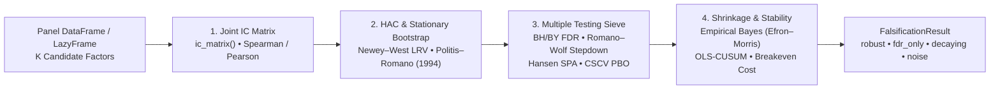

# Statistical Inference, Multiple Testing & Factor Falsification (`polars_anta.inference`)

Modern quantitative research faces a severe **multiple-testing and replication crisis**. When a researcher screens $K = 200$ technical indicators or alpha factors at a conventional $\alpha = 5\%$ significance threshold ($|t| > 1.96$), roughly $0.05 \times 200 = 10$ pure-noise signals will appear "statistically significant" by chance alone—even more when returns and Information Coefficients exhibit serial correlation (Harvey, Liu & Zhu, 2016; Jensen, Kelly & Pedersen, 2023).

`polars_anta.inference` provides a **zero-SciPy, pure Polars + NumPy econometric falsification engine** designed to separate genuine alpha from data-mining artifacts across time-series strategies and cross-sectional factor panels.

---

## End-to-End Falsification Architecture



---

## How to Read a `FalsificationResult`

Calling `pa.falsify_factors(...)` or `df.anta.falsify_factors(...)` executes a 7-stage statistical sieve and returns a [`FalsificationResult`](#falsificationresult-falsify_factors) dataclass with `.table` (`pl.DataFrame`), `.summary` (`dict`), `.ic_series` (`pl.DataFrame`), and `.report()` (`str`).

### Per-Factor Output Schema (`result.table`)

| Column | Type | Mathematical Meaning |
| :--- | :---: | :--- |
| `factor` | `String` | Candidate factor column name |
| `n_obs` | `Int64` | Number of common cross-sectional periods $T$ |
| `ic_mean` | `Float64` | Sample mean cross-sectional Information Coefficient $\overline{\text{IC}}_k$ |
| `ic_std` | `Float64` | Sample standard deviation of $\text{IC}_{k,t}$ (`ddof=1`) |
| `icir` | `Float64` | Information Ratio $\overline{\text{IC}}_k / s_{\text{IC},k}$ |
| `se_nw` | `Float64` | Newey–West (1987) HAC standard error $\sqrt{\hat{\Omega}_{\text{NW},k} / T}$ with lag $L = \max(1, h - 1)$ |
| `t_nw` | `Float64` | Newey–West HAC $t$-statistic $\overline{\text{IC}}_k / \text{se}_{\text{NW},k}$ |
| `p_raw` | `Float64` | Unadjusted two-sided Stationary Bootstrap $p$-value |
| `q_bh` | `Float64` | Benjamini–Hochberg (1995) False Discovery Rate $q$-value |
| `p_rw` | `Float64` | Romano–Wolf (2005, 2016) stepdown FWER-adjusted $p$-value |
| `posterior_ic` | `Float64` | Efron–Morris Empirical-Bayes shrunken $\text{IC}$ estimate |
| `shrinkage` | `Float64` | Shrinkage weight $B_k = s_k^2 / (s_k^2 + \hat{\tau}^2) \in [0, 1]$ ($1.0 \implies$ complete shrinkage to prior) |
| `prob_positive` | `Float64` | Posterior probability $\mathbb{P}(\mu_k \cdot \text{sign}(\hat{\mu}_k) > 0 \mid \text{data})$ |
| `cusum_stat` | `Float64` | Ploberger–Krämer (1992) HAC-normalized OLS-CUSUM supremum statistic |
| `p_cusum` | `Float64` | Asymptotic Brownian-bridge $p$-value for structural mean instability |
| `break_index` | `Int64` | Argmax period index $k^{\ast}$ of the cumulative IC deviation |
| `verdict` | `String` | Pre-registered classification: `'robust'`, `'fdr_only'`, `'decaying'`, or `'noise'` |

### Verdict Classification Rules (Priority: `decaying > robust > fdr_only > noise`)

1. **`'robust'`**: Survives family-wise error rate control across all $K$ tested factors (`p_rw <= fwer_alpha`, default $\alpha = 0.05$) and shows no statistically significant second-half attenuation.
2. **`'fdr_only'`**: Fails strict FWER control (`p_rw > fwer_alpha`) but passes Benjamini–Hochberg False Discovery Rate control (`q_bh <= fdr_q`, default $q = 0.10$) without structural decay. Suitable for diversified multi-factor ensembles where a controlled proportion of false positives is acceptable.
3. **`'decaying'`**: Statistically significant over the full sample (`p_rw <= fwer_alpha` or `q_bh <= fdr_q`), **but** rejects structural stability (`p_cusum <= 0.05`) with smaller magnitude in the second half of the sample ($|\overline{\text{IC}}_{\text{second half}}| < |\overline{\text{IC}}_{\text{first half}}|$). Signals alpha crowding or regime decay.
4. **`'noise'`**: Cannot be distinguished from a zero-IC random series once multiple testing is accounted for (`p_rw > fwer_alpha` and `q_bh > fdr_q`).

---

## 1. Stationary Bootstrap & Multiple-Testing Adjustments

### `stationary_bootstrap_indices`

Generates Politis & Romano (1994) Stationary Bootstrap index matrices of shape `(n_boot, n_obs)` with circular wrap-around and geometrically distributed block lengths (expected length $L = \text{mean\_block}$, Continuation probability $1 - 1/L$):

$$
I_{b,0} \sim \text{Uniform}\{0, \dots, T - 1\}, \qquad
I_{b,t} = \begin{cases}
(I_{b,t-1} + 1) \bmod T & \text{with probability } 1 - \frac{1}{L} \\
U_{b,t} \sim \text{Uniform}\{0, \dots, T - 1\} & \text{with probability } \frac{1}{L}
\end{cases}
$$

- **Parameters**: `n_obs: int`, `n_boot: int = 1000`, `mean_block: float | None = None` (defaults to $\max(1, T^{1/3})$), `seed: int | None = None`.
- **Citation**: Politis & Romano (1994).

```python
import polars_anta as pa

idx = pa.stationary_bootstrap_indices(n_obs=500, n_boot=1000, mean_block=10.0, seed=42)
assert idx.shape == (1000, 500)
```

---

### `bootstrap_test`

Performs a one-sample Stationary Bootstrap hypothesis test and percentile confidence interval for the sample **mean** or annualized **Sharpe ratio** against $H_0: \theta = \text{null\_value}$:

$$
\hat{p} = \frac{1 + \sum_{b=1}^{B} \mathbb{I}\left(\tilde{\theta}^{\ast}_b \succeq \hat{\theta}\right)}{B + 1}, \qquad \tilde{\theta}^{\ast}_b = \theta^{\ast}_b - \hat{\theta} + \theta_0
$$

Vectorized via `np.bincount` weight matrices `W @ X / T` for the mean and sufficient moments $(\sum X, \sum X^2)$ for the Sharpe ratio without materializing 3-D bootstrap arrays.

- **Parameters**: `series`, `statistic: Literal["mean", "sharpe"] = "mean"`, `null_value: float = 0.0`, `alternative: Literal["two-sided", "greater", "less"] = "two-sided"`, `n_boot: int = 2000`, `mean_block: float | None = None`, `ci_level: float = 0.95`, `annualization: float = 252.0`, `seed: int | None = None`.
- **Citation**: Politis & Romano (1994).

```python
import numpy as np
import polars_anta as pa

rng = np.random.default_rng(42)
returns = rng.normal(loc=0.0008, scale=0.01, size=1000)
res = pa.bootstrap_test(returns, statistic="sharpe", annualization=252.0, n_boot=1000, seed=42)
```

---

### `adjust_pvalues`

Adjusts a vector of raw $p$-values for multiple hypothesis testing across $m$ non-`NaN` hypotheses ordered as $p_{(1)} \le p_{(2)} \le \dots \le p_{(m)}$:

- **Bonferroni (`"bonferroni"`)**: $\tilde{p}_i = \min(1, m \cdot p_i)$
- **Holm (`"holm"`, 1979 step-down FWER)**: $\tilde{p}_{(i)} = \min\left(1, \max_{j \le i} (m - j + 1) p_{(j)}\right)$
- **Benjamini–Hochberg (`"bh"`, 1995 step-up FDR)**: $\tilde{p}_{(i)} = \min\left(1, \min_{j \ge i} \frac{m}{j} p_{(j)}\right)$
- **Benjamini–Yekutieli (`"by"`, 2001 arbitrary-dependence FDR)**: $\tilde{p}_{(i)} = \min\left(1, c(m) \min_{j \ge i} \frac{m}{j} p_{(j)}\right)$ where $c(m) = \sum_{k=1}^{m} \frac{1}{k}$

- **Parameters**: `p_values`, `method: Literal["bonferroni", "holm", "bh", "by"] = "bh"`.
- **Citations**: Holm (1979); Benjamini & Hochberg (1995); Benjamini & Yekutieli (2001).

```python
import polars_anta as pa

raw_p = [0.005, 0.01, 0.03, 0.04, 0.25]
q_bh = pa.adjust_pvalues(raw_p, method="bh")
p_holm = pa.adjust_pvalues(raw_p, method="holm")
```

---

### `romano_wolf`

Implements the Romano & Wolf (2005, 2016) studentized stepdown $\max$-$t$ multiple testing procedure using a shared Stationary Bootstrap index draw across all $K$ strategies/factors to preserve cross-sectional dependence:

$$
t_k = \frac{\sqrt{T}\,\bar{X}_k}{\hat{\omega}_k}, \qquad
t^{\ast}_{b,k} = \frac{\sqrt{T}\left(\bar{X}^{\ast}_{b,k} - \bar{X}_k\right)}{\hat{\omega}_k}, \qquad
\hat{\omega}_k = \sqrt{T}\,\text{sd}_b\!\left(\bar{X}^{\ast}_{b,k}\right)
$$

Ordering hypotheses as $t_{(1)} \ge t_{(2)} \ge \dots \ge t_{(K)}$, stepdown adjusted $p$-values are computed in a single pass via backward cumulative maxima $M^{\ast}_{b,j} = \max_{l \ge j} t^{\ast}_{b,(l)}$:

$$
\hat{p}^{\text{step}}_{(j)} = \frac{1 + \sum_{b=1}^{B} \mathbb{I}\left(M^{\ast}_{b,j} \ge t_{(j)}\right)}{B + 1}, \qquad
\hat{p}^{\text{RW}}_{(j)} = \max_{i \le j} \hat{p}^{\text{step}}_{(i)}
$$

- **Parameters**: `data`, `exclude: Sequence[str] = ()`, `n_boot: int = 2000`, `mean_block: float | None = None`, `alternative: Literal["two-sided", "greater"] = "two-sided"`, `seed: int | None = None`.
- **Citations**: Romano & Wolf (2005, 2016).

```python
import numpy as np
import polars_anta as pa

rng = np.random.default_rng(7)
mat = rng.standard_normal((500, 20))
mat[:, 0] += 0.18
rw_table = pa.romano_wolf(mat, n_boot=500, seed=7)
```

---

### `spa_test`

Tests the composite null hypothesis $H_0: \max_{1 \le k \le K} \mathbb{E}[d_{k,t}] \le 0$ that no candidate strategy outperforms a benchmark, using Hansen's (2005) studentized Superior Predictive Ability statistic and White's (2000) Reality Check recentering bounds:

$$
T_{\text{SPA}} = \max\left(0, \max_{1 \le k \le K} \frac{\sqrt{T}\,\bar{d}_k}{\hat{\omega}_k}\right)
$$

with three null recentering estimators $g_k^{(l)} = \max(\bar{d}_k, 0)$, $g_k^{(c)} = \bar{d}_k \cdot \mathbb{I}\!\left(\sqrt{T}\bar{d}_k/\hat{\omega}_k \ge -\sqrt{2\ln\ln T}\right)$, and $g_k^{(u)} = \bar{d}_k$, guaranteeing $p_{\text{lower}} \le p_{\text{consistent}} \le p_{\text{upper}}$.

- **Parameters**: `data`, `benchmark = None`, `exclude: Sequence[str] = ()`, `n_boot: int = 2000`, `mean_block: float | None = None`, `seed: int | None = None`.
- **Citations**: White (2000); Hansen (2005).

```python
import numpy as np
import polars_anta as pa

rng = np.random.default_rng(11)
excess_returns = rng.standard_normal((600, 30)) * 0.01
spa = pa.spa_test(excess_returns, benchmark=0.0, n_boot=500, seed=11)
```

---

## 2. Overfitting, Shrinkage & Out-of-Sample Evaluation

### `pbo_cscv`

Estimates the **Probability of Backtest Overfitting (PBO)** via Combinatorially Symmetric Cross-Validation (Bailey, Borwein, López de Prado & Zhu, 2017). Splits a $(T, N)$ strategy return matrix into $S$ equal sub-periods ($S$ even) and evaluates $\binom{S}{S/2}$ in-sample / out-of-sample partitions using pre-aggregated block sufficient moments `(sum_s, sumsq_s)`:

$$
\bar{\omega}_c = \frac{\text{rank}_{\text{OOS}}(n^{\ast}_c)}{N + 1}, \qquad
\lambda_c = \ln\left(\frac{\bar{\omega}_c}{1 - \bar{\omega}_c}\right), \qquad
\text{PBO} = \frac{1}{|\mathcal{C}|} \sum_{c \in \mathcal{C}} \mathbb{I}(\lambda_c \le 0)
$$

- **Parameters**: `data`, `exclude: Sequence[str] = ()`, `n_splits: int = 16`, `max_combinations: int = 20_000`, `seed: int | None = None`.
- **Citation**: Bailey, Borwein, López de Prado & Zhu (2017).

```python
import numpy as np
import polars_anta as pa

rng = np.random.default_rng(21)
strategy_matrix = rng.standard_normal((800, 12))
pbo_res = pa.pbo_cscv(strategy_matrix, n_splits=8)
```

---

### `empirical_bayes_shrinkage`

Applies Efron–Morris (1975) and Jensen, Kelly & Pedersen (2023) Empirical-Bayes hierarchical normal shrinkage across $K$ noisy factor estimates $\hat{\theta}_i$ with standard errors $s_i$:

$$
\hat{\tau}^2 = \max\left(0,\; \frac{1}{K}\sum_{i=1}^{K} (\hat{\theta}_i - \mu_0)^2 - \frac{1}{K}\sum_{i=1}^{K} s_i^2\right), \qquad
B_i = \frac{s_i^2}{s_i^2 + \hat{\tau}^2}, \qquad
\hat{\theta}^{\text{EB}}_i = (1 - B_i)\hat{\theta}_i + B_i \mu_0
$$

- **Parameters**: `estimates`, `std_errors`, `names = None`, `prior: Literal["zero", "grand_mean"] = "zero"`, `groups = None`.
- **Citations**: Efron & Morris (1975); Jensen, Kelly & Pedersen (2023).

```python
import polars_anta as pa

eb_df = pa.empirical_bayes_shrinkage(
    estimates=[0.045, 0.012, -0.004, 0.038],
    std_errors=[0.010, 0.015, 0.014, 0.011],
    names=["mom_20", "rsi_14", "noise_1", "value_ebitda"],
)
```

---

### `oos_r2`, `clark_west_test` & `diebold_mariano_test`

Out-of-sample forecast evaluation against a historical benchmark or competing model:

- **`oos_r2`** (Campbell & Thompson, 2008):
  $$R^2_{\text{OOS}} = 1 - \frac{\sum_{t \in \mathcal{T}} (y_t - \hat{y}_t)^2}{\sum_{t \in \mathcal{T}} (y_t - \bar{y}_t)^2}$$
- **`clark_west_test`** (Clark & West, 2007 nested model MSPE-adjusted test):
  $$f_t = (y_t - \hat{y}_{0,t})^2 - \left[(y_t - \hat{y}_{1,t})^2 - (\hat{y}_{0,t} - \hat{y}_{1,t})^2\right], \qquad t_{\text{CW}} = \frac{\bar{f}}{\widehat{\text{se}}_{\text{NW}}(\bar{f})} \quad (\text{one-sided } H_1: \mathbb{E}[f_t] > 0)$$
- **`diebold_mariano_test`** (Diebold & Mariano, 1995 equal predictive accuracy test):
  $$d_t = L(e_{1,t}) - L(e_{2,t}), \qquad \text{DM} = \frac{\bar{d}}{\widehat{\text{se}}_{\text{NW}}(\bar{d})}$$

```python
import numpy as np
import polars_anta as pa

rng = np.random.default_rng(99)
y_true = rng.normal(0.001, 0.02, size=300)
y_bench = np.zeros_like(y_true)
y_model = 0.25 * y_true + rng.normal(0.0, 0.005, size=300)

r2_val = pa.oos_r2(y_true, y_model, benchmark=y_bench)
cw_res = pa.clark_west_test(y_true, y_model, y_bench)
dm_res = pa.diebold_mariano_test(y_true, y_model, y_bench, loss="squared")
```

---

### `cusum_mean_test`

Tests structural stability of a factor IC or strategy return series via the Ploberger & Krämer (1992) HAC-standardized OLS-CUSUM Brownian bridge supremum statistic:

$$
W_T(k) = \frac{1}{\hat{\sigma}_{\text{NW}}\sqrt{T}} \sum_{t=1}^{k} \left(x_t - \bar{x}_T\right), \qquad
S_T = \max_{1 \le k \le T} \left|W_T(k)\right|, \qquad
p_{\text{CUSUM}} \approx 2 \sum_{j=1}^{100} (-1)^{j-1} \exp\!\left(-2 j^2 S_T^2\right)
$$

- **Parameters**: `series`, `nw_lags: int | None = None`.
- **Citation**: Ploberger & Krämer (1992).

```python
import numpy as np
import polars_anta as pa

ic_series = np.concatenate([np.full(150, 0.04), np.full(150, -0.01)])
cusum = pa.cusum_mean_test(ic_series)
```

---

### `breakeven_cost` & `breakeven_cost_from_backtest`

Computes the exact per-unit-turnover transaction cost rate $c^{\ast}$ (reported in both decimal and basis points) at which a strategy's mean net return or net Sharpe ratio is driven to zero:

$$
c^{\ast} = \frac{\sum_{t=1}^{T} r^{\text{gross}}_t}{\sum_{t=1}^{T} \tau_t}, \qquad \text{where } \sum_{t=1}^{T} \left(r^{\text{gross}}_t - c^{\ast} \tau_t\right) = 0
$$

```python
import polars_anta as pa

cost_info = pa.breakeven_cost(gross_returns=[0.002, 0.001, -0.0005], turnover=[0.5, 0.25, 0.25])
```

---

## 3. Panel Factor Falsification & Parameter Sweep Diagnostics

### `ic_matrix` & `long_short_returns`

Compute joint cross-sectional Information Coefficient matrices $(T \times K)$ and top-minus-bottom quantile long-short (or top-quantile long-only) return panels in a single Polars `group_by(group_by, maintain_order=True).agg(...)` pass:

```python
import polars as pl
import polars_anta as pa

panel = pl.DataFrame(
    {
        "date": [1, 1, 1, 2, 2, 2],
        "f1": [0.1, 0.5, 0.9, 0.2, 0.4, 0.8],
        "f2": [0.9, 0.4, 0.1, 0.7, 0.3, 0.2],
        "fwd_ret": [0.01, 0.02, 0.04, -0.01, 0.01, 0.03],
    }
)
ic_df = panel.anta.ic_matrix(["f1", "f2"], return_col="fwd_ret", group_by="date")
ls_df = panel.anta.long_short_returns(
    ["f1", "f2"], return_col="fwd_ret", group_by="date", quantiles=3
)
```

---

### `FalsificationResult` & `falsify_factors`

Runs the complete 7-stage statistical falsification funnel on a multi-asset panel `DataFrame` or `LazyFrame`. Exposed both at top level (`pa.falsify_factors`) and on `.anta` / `.ta` frame namespaces (`df.anta.falsify_factors`):

```python
import numpy as np
import polars as pl
import polars_anta as pa

rng = np.random.default_rng(42)
n_dates, n_assets = 80, 25
dates = np.repeat(np.arange(n_dates), n_assets)
fwd = rng.normal(0.0, 0.02, size=n_dates * n_assets)

df = pl.DataFrame(
    {
        "date": dates,
        "fwd_ret": fwd,
        "true_alpha": 0.35 * fwd + rng.normal(0.0, 0.02, size=n_dates * n_assets),
        "noise_alpha": rng.normal(0.0, 1.0, size=n_dates * n_assets),
    }
)

result = df.anta.falsify_factors(
    factor_cols=["true_alpha", "noise_alpha"],
    return_col="fwd_ret",
    group_by="date",
    horizon=1,
    n_boot=299,
    seed=42,
)
print(result.report())
```

---

### `sweep_robustness`

Evaluates a parameter sweep grid (`signals: Mapping[str, IntoExpr | str]`) via `parameter_sweep(...)` and immediately audits the resulting strategy return matrix with **CSCV Probability of Backtest Overfitting (`pbo_cscv`)**, **Hansen's SPA (`spa_test`)**, and **Romano–Wolf FWER (`romano_wolf`)** so parameter-mining inflation is quantified automatically.

---

## 4. Monte Carlo Size, Power & PBO Validation

The tables below are generated directly by [`benchmarks/inference_size_power.py`](https://github.com/huuan26/polars-anta/blob/master/benchmarks/inference_size_power.py) (`docs/assets/inference_size_power.md`, seed `42`, Python `3.14.1`, Polars `2.1.0`, NumPy `2.5.4`).

### Table 1 — Empirical Family-Wise Error Rate (Global Null, $\alpha = 0.05$)

Fraction of Monte Carlo replications ($R = 200$) with at least one false rejection across $K = 50$ pure-noise strategies ($T = 1000$). Under $\text{AR}(1)$ serial dependence ($\phi = 0.30$), the long-run variance is $\frac{1+\phi}{1-\phi} \approx 1.86\times$ the naive sample variance, causing i.i.d. procedures (`OLS t` and `mean_block=1` bootstrap) to severely over-reject (~60%) while HAC and the Politis–Romano Stationary Bootstrap reduce false rejections bynearly $4\times$:

| Multiple Testing Procedure | Empirical FWER — i.i.d. $\mathcal{N}(0,1)$ | Empirical FWER — $\text{AR}(1)$ ($\phi = 0.30$) | Nominal Target |
| :--- | :---: | :---: | :---: |
| Unadjusted (OLS $t$) | 93.5% | 100.0% | 5.0% |
| Bonferroni (OLS $t$) | 7.0% | 60.0% | 5.0% |
| Holm (OLS $t$) | 7.0% | 60.0% | 5.0% |
| Bonferroni (HAC $t$) | 6.5% | 14.5% | 5.0% |
| Holm (HAC $t$) | 6.5% | 14.5% | 5.0% |
| Romano–Wolf (i.i.d., `mean_block=1`) | 6.5% | 61.0% | 5.0% |
| Romano–Wolf (Stationary Bootstrap) | 5.5% | 16.0% | 5.0% |

### Table 2 — Empirical FDR & Statistical Power (5 True + 45 Null Strategies)

Equicorrelated factor zoo ($\rho = 0.50$, $K = 50$, $T = 1000$) containing $5$ true strategies with annualized Sharpe $= 1.0$ ($\mu = 1/\sqrt{252} \approx 0.063$) and $45$ zero-mean strategies:

| Metric | Value | Reference Target |
| :--- | :---: | :---: |
| Benjamini–Hochberg ($q = 0.10$) Empirical FDR | 8.2% | $\le 10.0\%$ ($\frac{m_0}{m} q = 9.0\%$) |
| Benjamini–Hochberg ($q = 0.10$) Average Power | 23.0% | — |
| Romano–Wolf Stepdown ($\alpha = 0.05$) Average Power | 15.1% | $\ge$ Bonferroni |
| Bonferroni ($\alpha = 0.05$) Average Power | 10.5% | — |
| Romano–Wolf Null-Subset FWER ($\alpha = 0.05$) | 5.5% | $\le 5.0\%$ |
| Bonferroni Null-Subset FWER ($\alpha = 0.05$) | 2.0% | $\le 5.0\%$ |

### Table 3 — CSCV Probability of Backtest Overfitting (PBO)

Exact Combinatorially Symmetric Cross-Validation ($S = 16$, $\binom{16}{8} = 12,870$ partitions) over $N = 20$ candidate strategies ($T = 1600$, 50 replications):

| Strategy Universe | Mean PBO | SD(PBO) | Mean Prob. OOS Loss | Theoretical Expectation |
| :--- | :---: | :---: | :---: | :---: |
| Pure Noise ($N = 20$ i.i.d. $\mathcal{N}(0,1)$) | 0.546 | 0.205 | 0.548 | $\approx 0.500$ |
| 1 Dominant Strategy ($\mu_1 = 0.12$) + 19 Noise | 0.046 | 0.082 | 0.044 | $< 0.050$ |

### Table 4 — End-to-End Panel Falsification Throughput

| Panel Dimensions | Rows | Bootstrap Replicates ($B$) | Wall-Clock Time | Surviving Robust Factors |
| :--- | :---: | :---: | :---: | :---: |
| `150` factors $\times$ `2500` periods $\times$ `100` assets | `250,000` | `1000` | `2.44 s` | `5 / 5` planted |

---

## 5. Academic References

- Politis, D. N., & Romano, J. P. (1994). The Stationary Bootstrap. *JASA*, 89(428), 1303–1313.
- Holm, S. (1979). A Simple Sequentially Rejective Multiple Test Procedure. *Scandinavian Journal of Statistics*, 6(2), 65–70.
- Benjamini, Y., & Hochberg, Y. (1995). Controlling the False Discovery Rate. *JRSS-B*, 57(1), 289–300.
- Benjamini, Y., & Yekutieli, D. (2001). The Control of the False Discovery Rate in Multiple Testing under Dependency. *Annals of Statistics*, 29(4), 1165–1188.
- White, H. (2000). A Reality Check for Data Snooping. *Econometrica*, 68(5), 1097–1126.
- Romano, J. P., & Wolf, M. (2005). Stepwise Multiple Testing as Formalized Data Snooping. *Econometrica*, 73(4), 1237–1282.
- Romano, J. P., & Wolf, M. (2016). Efficient Computation of Adjusted p-Values for Resampling-Based Stepdown Multiple Testing. *Statistics & Probability Letters*, 113, 38–40.
- Hansen, P. R. (2005). A Test for Superior Predictive Ability. *Journal of Business & Economic Statistics*, 23(4), 365–380.
- Bailey, D. H., Borwein, J. M., López de Prado, M., & Zhu, Q. J. (2017). The Probability of Backtest Overfitting. *Journal of Computational Finance*, 20(4), 39–69.
- Efron, B., & Morris, C. (1975). Data Analysis Using Stein's Estimator and Its Generalizations. *JASA*, 70(350), 311–319.
- Jensen, T. I., Kelly, B., & Pedersen, L. H. (2023). Is There a Replication Crisis in Finance? *Journal of Finance*, 78(5), 2465–2518.
- Harvey, C. R., Liu, Y., & Zhu, H. (2016). … and the Cross-Section of Expected Returns. *Review of Financial Studies*, 29(1), 5–68.
- Campbell, J. Y., & Thompson, S. B. (2008). Predicting Excess Stock Returns Out of Sample. *Review of Financial Studies*, 21(4), 1509–1531.
- Clark, T. E., & West, K. D. (2007). Approximately Normal Tests for Equal Predictive Accuracy in Nested Models. *Journal of Econometrics*, 138(1), 291–311.
- Diebold, F. X., & Mariano, R. S. (1995). Comparing Predictive Accuracy. *Journal of Business & Economic Statistics*, 13(3), 253–263.
- Ploberger, W., & Krämer, W. (1992). The CUSUM Test with OLS Residuals. *Econometrica*, 60(2), 271–285.
- Newey, W. K., & West, K. D. (1987). A Simple, Positive Semi-Definite, Heteroskedasticity and Autocorrelation Consistent Covariance Matrix. *Econometrica*, 55(3), 703–708.
