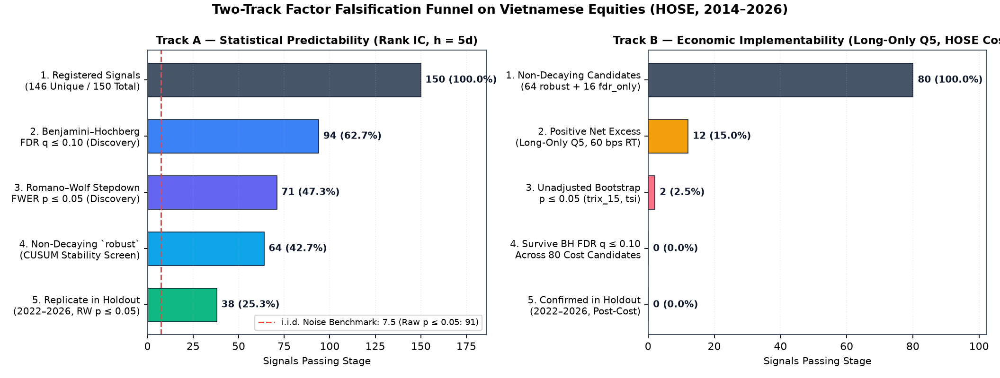
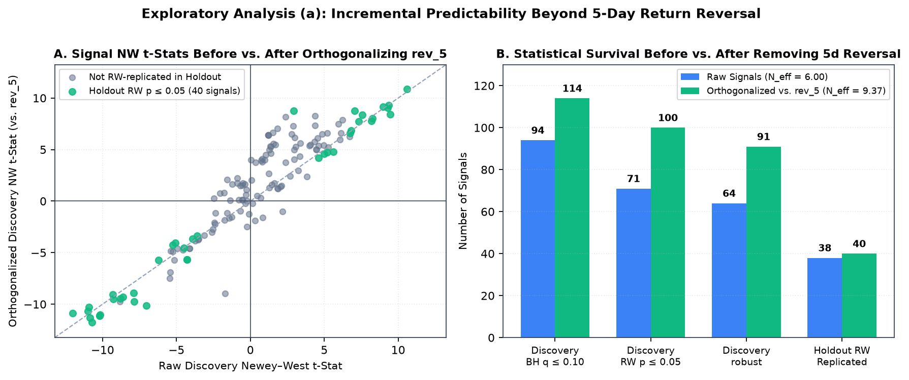
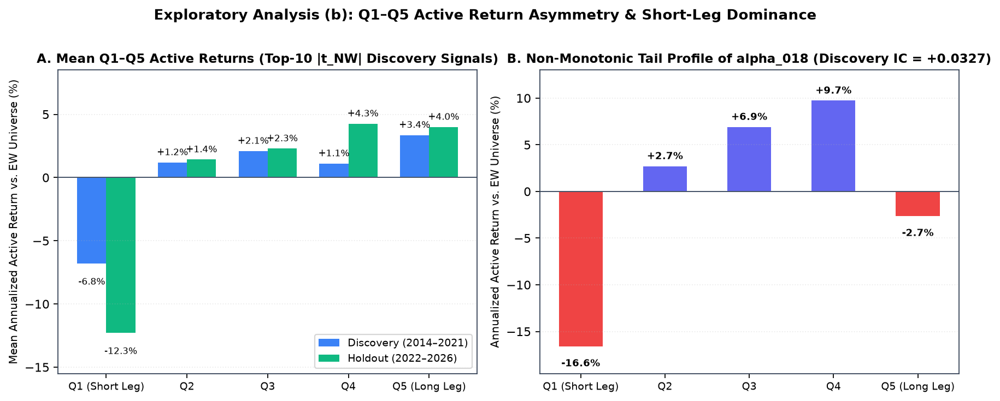
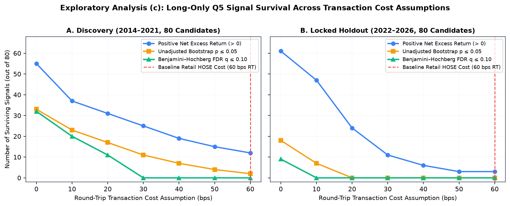

# How Many Technical and Formulaic Alphas Survive Multiple-Testing and Transaction-Cost Falsification on Vietnamese Equities?

> **Pre-Specified Empirical Study (`polars-anta` Factor Zoo)**
> **Analysis-Plan Commit**: `4c1a4b559d22a1367ce46b513ab7ff1079fff360` ([`PREREGISTRATION.md`](https://github.com/huuan26/polars-anta/blob/master/research/factor_zoo/PREREGISTRATION.md))
> **Signal Registry SHA-256**: `8aa3c11b97810083b875084d38cfda6df1994de38ec9b077faeaf46dc31c948c` ($K = 150$ signals, $146$ unique)

---

## 1. TL;DR

- **150 signals collapse to ~6 effective independent dimensions ($N_{\text{eff}} = 6.00$)**: Out of **150** pre-specified daily OHLCV signals (**146** unique after accounting for **4** exact duplicate pairs) evaluated at default parameters on the point-in-time top-150 liquid Ho Chi Minh Stock Exchange (`HOSE`) universe during Discovery (`2014-01-01` to `2021-12-31`, $1{,}998$ trading days, $h = 5$ open-to-open days), **91** pass raw Stationary Bootstrap $p \le 0.05$ (**95** have Newey–West $|t| \ge 1.96$, vs. $7.5$ expected by chance under independence). Eigenvalue decomposition of the $150 \times 150$ daily IC correlation matrix reveals an effective independent test count of **$N_{\text{eff}} = 6.00$** ($\lambda_1 = 55.21$, top 5 principal components explain **$66.6\%$** of variance; **$N_{\text{eff}} = 6.13$** across the **146** unique signals).
- **The dominant short-horizon reversal factor is statistically genuine and replicates out of sample**: After joint multiple-testing correction and OLS-CUSUM structural stability screening, **94** signals pass Benjamini–Hochberg FDR ($q \le 0.10$), **71** pass Romano–Wolf stepdown FWER ($\alpha \le 0.05$), and **64** are classified as structurally stable (`robust`) while **14** are flagged as `decaying`. In the locked Holdout sample (`2022-01-01` to `2026-11-10`, $1{,}202$ valid $5$-day return sessions), cross-sectional Rank IC correlates at **$r = 0.77$** ($0.7675$) with Discovery across all 150 signals, and **38 of the 64** (`59.4%`) `robust` discovery signals replicate under Romano–Wolf FWER ($p_{\text{RW}} \le 0.05$) with a median IC retention ratio of **$97.6\%$** ($0.9764$).
- **Zero standalone single-factor strategies survive long-only execution after retail `HOSE` costs**: When the **80** non-decaying discovery survivors (`64 robust + 16 fdr_only`) are implemented as 5-day rebalanced, equal-weighted long-only top-quintile (Q5) portfolios against the equal-weight universe under retail `HOSE` execution frictions (`0.15%`/side brokerage + `0.10%`/side slippage + `0.10%` statutory sell tax = `30 bps` per unit of L1 weight turnover $\sum_i |w_{i,t} - w_{i,t-1}|$, or `60 bps` round-trip replacement cost), the top-6 $|t_{\text{NW}}|$ fast mean-reversion signals face 5-day L1 turnover of `1.28–1.74` (`63.8%–87.2%` one-way) and breakeven cost ceilings of only `-6.7–20.5 bps` round-trip (`5.7–20.5 bps` among the 5 with positive gross Q5 excess). Only **2** slower momentum signals (`trix_15` at $+8.37\%/\text{yr}$, raw $p = 0.0170$; `tsi` at $+7.65\%/\text{yr}$, raw $p = 0.0320$) clear the cost hurdle at unadjusted $p \le 0.05$, **0** survive Benjamini–Hochberg adjustment ($q \le 0.10$) across the 80 cost-stage candidates, and **0** survive in the locked Holdout.
- **Exploratory post-holdout diagnostics explain the gap between statistical IC and long-only net returns (§8.3)**: (a) Cross-sectionally orthogonalizing all 150 signals against 5-day close-to-close return reversal (`rev_5_rank`) raises $N_{\text{eff}}$ from **$6.00$** to **$9.37$** and leaves **91** `robust` discovery signals, **40** of which replicate in Holdout under Romano–Wolf $p_{\text{RW}} \le 0.05$; (b) Q1–Q5 active return decomposition shows that **$65.5\%$** of the top-10 signals' $\text{Q5} - \text{Q1}$ spread in Discovery (**$90.0\%$** in Holdout) originates in the **short leg (Q1 underperformance)**, which cannot be shorted on `HOSE`; and (c) evaluating round-trip costs across `0–60 bps` shows that **0** standalone 5-day Q5 strategies survive BH $q \le 0.10$ at any cost $\ge 30\text{ bps}$ round-trip in Discovery or $\ge 10\text{ bps}$ in Holdout.

---

## 2. Motivation

Modern empirical asset pricing faces a well-documented **Factor Zoo** problem: when researchers test hundreds of correlated technical indicators and formulaic alphas on the same historical panel, conventional single-hypothesis $t$-thresholds ($|t| \ge 1.96$) produce massive false-discovery rates (Harvey, Liu & Zhu 2016; Chordia, Goyal & Saretto 2020). While recent work shows that many equity anomalies share a common statistical component that replicates better than naive uniform priors suggest once shrunken via Empirical Bayes (Jensen, Kelly & Pedersen 2023), a critical gap remains between **frictionless cross-sectional predictability** (Rank IC) and **net-of-cost implementability** in emerging markets (Hou, Xue & Zhang 2020; Novy-Marx & Velikov 2016).

Rather than marketing `polars-anta` as a collection of *"200+ fast alpha indicators"*, this study subjects the library's entire daily-OHLCV indicator and WorldQuant formulaic alpha catalog ($K = 150$ scale-free signals) to a **pre-specified statistical and economic falsification funnel** on Vietnamese equities (`HOSE`), using the inference machinery built into `polars_anta.inference`.

---

## 3. Pre-Specified Analysis Plan & Anti-Data-Mining Protocol

To constrain hindsight bias, parameter tuning, and post-hoc threshold selection, the experimental design was specified and committed prior to running the discovery and holdout pipelines:

- **Analysis Plan Document**: [`research/factor_zoo/PREREGISTRATION.md`](https://github.com/huuan26/polars-anta/blob/master/research/factor_zoo/PREREGISTRATION.md)
- **Frozen Configuration**: [`research/factor_zoo/config.py`](https://github.com/huuan26/polars-anta/blob/master/research/factor_zoo/config.py)
- **Frozen Signal Registry**: [`research/factor_zoo/registry.py`](https://github.com/huuan26/polars-anta/blob/master/research/factor_zoo/registry.py)
- **Git Analysis-Plan Commit Hash**: `4c1a4b559d22a1367ce46b513ab7ff1079fff360`
- **Registry Canonical SHA-256**: `8aa3c11b97810083b875084d38cfda6df1994de38ec9b077faeaf46dc31c948c`
- **Programmatic Holdout Guard**: `verify_preregistration_guard()` in [`research/factor_zoo/pipeline.py`](https://github.com/huuan26/polars-anta/blob/master/research/factor_zoo/pipeline.py) refuses to execute `--stage holdout` unless `--unlock-holdout` is explicitly passed, `PREREGISTRATION.md` is committed to Git, and `git status --porcelain` confirms zero uncommitted modifications to `PREREGISTRATION.md`, `config.py`, and `registry.py`.

### 3.1 Deviations from the Analysis Plan & Timeline

Because the analysis plan was committed in the same repository session as data caching and pipeline execution rather than registered on an external third-party registry prior to data access, we refer to the protocol throughout this report as a **pre-specified analysis plan** and disclose the complete execution timeline and all deviations below (auto-derived from [`results/audit/timeline.txt`](https://github.com/huuan26/polars-anta/blob/master/research/factor_zoo/results/audit/timeline.txt)):

| Commit / Event | Timestamp (`+07:00`) | Description |
| :--- | :--- | :--- |
| `DATA_CACHE` | `2026-11-10 23:41:01 +07:00` | research/data/vn_daily.meta.json CreationTime (raw HOSE OHLCV panel cached) |
| `66bcaf0` | `2026-11-10 23:42:23 +0700` | research: data loader and point-in-time universe |
| `c0df52e` | `2026-11-10 23:48:37 +0700` | research: signal registry |
| `4c1a4b5` | `2026-11-10 23:50:27 +0700` | research: pre-register factor zoo study (registry sha256=8aa3c11b97810083b875084d38cfda6df1994de38ec9b077faeaf46dc31c948c) |
| `c793a02` | `2026-11-11 00:09:34 +0700` | research: discovery pipeline and results |
| `4caec78` | `2026-11-11 00:11:39 +0700` | research: holdout evaluation (unlocked after pre-registration 4c1a4b5) |
| `dacd8dc` | `2026-11-11 00:16:37 +0700` | docs(research): factor zoo report |

**Disclosed Deviations:**

1. **Data cached prior to analysis-plan commit (`DATA_CACHE` vs. `4c1a4b5`)**: The raw `HOSE` daily OHLCV panel (`research/data/vn_daily.parquet`, spanning `2012-03-19` to `2026-11-10` including the holdout period) was fetched and cached at `2026-11-10 23:41:01 +07:00`, approximately 9 minutes before the analysis-plan commit `4c1a4b5` (`2026-11-10 23:50:27 +0700`).
2. **Internal review checkpoints bypassed during batch execution (`4c1a4b5` $\to$ `c793a02` $\to$ `4caec78`)**: Internal review checkpoints between data collection, analysis-plan lock (`4c1a4b5`), Discovery execution (`c793a02` at `2026-11-11 00:09:34 +0700`), and Holdout unlock (`4caec78` at `2026-11-11 00:11:39 +0700`) were bypassed during batch execution; the holdout evaluation was executed 2 minutes after the Discovery commit without an intervening manual review pause.
3. **Cost-stage candidate filter aligned with written specification prior to commit (`c793a02`)**: During the first uncommitted run of the Discovery script, the cost-stage candidate filter selected signals with `p_rw <= 0.05 OR q_bh <= 0.10` (94 signals, including 14 signals classified as `decaying`). Before committing Discovery in `c793a02`, the filter was updated to match the written specification (`verdict in {"robust", "fdr_only"}`), **reducing** the number of evaluated cost-stage candidates from **94** to **80** and leaving the confirmatory conclusion unchanged (**0** survivors after Benjamini–Hochberg FDR $q \le 0.10$).
4. **Unadjusted cost-stage $p \le 0.05$ diagnostic count added post-hoc (`c793a02`)**: The intermediate count of cost-stage candidates achieving unadjusted one-sided bootstrap $p \le 0.05$ (`n_cost_raw_p05 = 2`: `trix_15`, `tsi`) was added in `c793a02` for diagnostic visibility; it is not a survival criterion in `PREREGISTRATION.md` (which requires BH $q \le 0.10$).
5. **Four exact duplicate signal pairs in the frozen registry (`c0df52e`)**: Post-hoc auditing ([`results/audit/duplicate_signals.json`](https://github.com/huuan26/polars-anta/blob/master/research/factor_zoo/results/audit/duplicate_signals.json)) identified **4** exact duplicate pairs ($\max |\Delta \text{IC}_t| = 0.0$, $\text{corr} = 1.0$) among the 150 registered entries, yielding **146** unique signals (`wma_10` $\equiv$ `decay_linear_10`, `pivot_classic` $\equiv$ `pivot_fibonacci`, `atr_14_norm` $\equiv$ `natr_14`, and `zscore_20` $\equiv$ `ts_zscore_20`), plus **12** near-duplicate pairs with $|\text{corr}| > 0.99$. To preserve the frozen SHA-256 hash of `registry.py`, all 150 entries remain in the primary tables, and an exploratory 146-unique-signal sensitivity check is reported in §8.3.
6. **Correction of earlier Appendix A (`dacd8dc` $\to$ `8efa20c`)**: An earlier version of Appendix A in commit `dacd8dc` listed library functions that do not exist; it has been replaced in commit `8efa20c` by a table generated directly from `EXCLUDED_SIGNALS` in `registry.py` (**10** export groups).
7. **Post-hoc confirmation of `HOSE` execution and market parameters (`4c1a4b5`)**: The `HOSE` execution cost and market structure constants in `config.py` (`0.15%`/side brokerage, `0.10%`/side slippage, `0.10%` sell tax, no short selling, $\pm 7.0\%$ daily price limit) were initialized from standard retail schedules at commit `4c1a4b5` and formally confirmed by the author post-hoc on `2026-11-11`.

---

## 4. Data & Point-in-Time Universe

### 4.1 Source & Sample Period

Daily OHLCV bars were retrieved from public Vietnamese equity market endpoints—primary `VNDirect` (`api-finfo.vndirect.com.vn` ticker directory and `dchart-api.vndirect.com.vn` daily history) with `SSI iBoard` (`iboard-query.ssi.com.vn`) as automatic fallback—for all **392** three-letter common equity tickers listed on the Ho Chi Minh Stock Exchange (`HOSE`), spanning `2012-03-19` through `2026-11-10` (**1,138,548** raw ticker-day observations). The period `2012-03-19` to `2013-12-31` serves strictly as a warm-up buffer for rolling lookback windows and the 250-day listing-age filter.

### 4.2 Pre-Specified 3-Step Cleaning Pipeline

Executed deterministically in [`research/factor_zoo/data.py`](https://github.com/huuan26/polars-anta/blob/master/research/factor_zoo/data.py):

| Cleaning Step | Rule | Rows Removed | Remaining Rows |
| :--- | :--- | ---: | ---: |
| **0. Raw Feed** | 392 `HOSE` 3-letter common stock tickers (`2012-03-19`–`2026-11-10`) | — | `1,138,548` |
| **1. OHLCV Structural Audit** | `polars_anta.validate_ohlcv`: drop rows violating $H_t \ge \max(O_t, C_t, L_t)$, $L_t \le \min(O_t, C_t, H_t)$, or positive price/volume invariants (`high_lt_open = 1,078`, `low_gt_close = 886`, `low_gt_open = 771`, `high_lt_close = 411`, `high_lt_low = 1`) | `2,888` | `1,135,660` |
| **2. Zero-Volume Filter** | Drop non-trading / halted sessions with `volume <= 0` | `46,474` | `1,089,186` |
| **3. Price-Limit Jump Filter** | Drop daily close-to-close jumps $|C_t / C_{t-1} - 1| > 7.5\%$ (`HOSE` $\pm 7.0\%$ limit $+ 0.5\%$ tolerance) to remove unadjusted split/dividend discontinuities | `5,653` | `1,083,533` |

### 4.3 Point-in-Time Liquid Investable Universe (`in_universe`)

On each trading date $t \in [\text{2014-01-02}, \text{2026-11-10}]$ (**3,206** trading days), a stock enters the investable cross-section if and only if using information available at $\text{close}_t$:
1. Cumulative trading history is at least **250** valid sessions,
2. Closing price $C_{i,t} \ge \mathbf{5{,}000\text{ VND}}$, and
3. 60-session rolling median daily traded value ($\text{close} \times \text{volume}$) ranks in the **top 150** eligible stocks on date $t$.

This yields **463,707** ticker-day observations across **364** unique tickers (median **150.0** stocks/day, max **150**, min **17** on the first days of 2014):
- **Discovery Sample (`2014-01-02` to `2021-12-31`)**: **1,998** trading days, **282,507** universe rows, **340** unique tickers.
- **Locked Holdout Sample (`2022-01-01` to `2026-11-10`)**: **1,208** trading days (**1,202** sessions with complete 5-day forward open-to-open returns), **181,200** universe rows, **250** unique tickers.

---

## 5. Signal Registry & Scale-Free Normalization

All **150** daily-OHLCV-compatible signals in `polars-anta` are evaluated at their **exact library default parameters** (`0` hyperparameter sweeps):

- **Scale-Free Transformation**: Price-level overlays (moving averages, bands, stops, pivots, channels) are mapped to dimensionless ratios relative to `close` (e.g., `close / sma(close, 10) - 1`, Bollinger `percent_b`, `(close - supertrend) / close`, `(close - pivot_p) / close`). Multi-field `pl.Struct` indicators select one canonical primary component (see [`registry.py`](https://github.com/huuan26/polars-anta/blob/master/research/factor_zoo/registry.py)).
- **Cross-Sectional Ranking**: Each signal is computed per ticker (`.over("ticker")`) and then mapped to a uniform cross-sectional percentile rank within the active universe on each day $t$ via `cs_rank(..., over="date")`.
- **Two-Sided Testing**: Every signal is tested once (`alternative="two-sided"`), preventing researcher degrees of freedom in flipping factor signs.

---

## 6. Statistical & Economic Methodology

Full mathematical formulations and Monte Carlo size/power validations of the inference estimators are documented in [`docs/indicators/inference.md`](../indicators/inference.md) and [`docs/assets/inference_size_power.md`](../assets/inference_size_power.md).

1. **Target Return**: Next-day open-to-open return over $h = 5$ trading sessions, $r_{i,t,5} = \text{open}_{i,t+6}/\text{open}_{i,t+1} - 1$. Signals observed at $\text{close}_t$ are assumed executed at $\text{open}_{t+1}$ (zero look-ahead bias).
2. **Cross-Sectional Information Coefficient (`ic_matrix`)**: Daily cross-sectional Spearman rank correlation $\text{IC}_{k,t}$ between factor $k$'s universe rank at $\text{close}_t$ and $r_{i,t,5}$.
3. **Autocorrelation-Robust Inference (`falsify_factors`)**: Because overlapping 5-day forward returns induce $\text{MA}(4)$ serial correlation in daily $\text{IC}_{k,t}$, standard errors use the Bartlett-kernel Newey–West HAC estimator with $L = 4$ lags, and resampling uses the Politis–Romano (1994) Stationary Bootstrap with geometric block lengths ($\text{mean\_block} = \max(5, T^{1/3}) = 12.60$, $B = 2{,}000$, `seed = 20261110`).
4. **Multiple-Testing Control (`adjust_pvalues`, `romano_wolf`)**:
   - **Benjamini–Hochberg (1995) FDR** at $q = 0.10$ across all $K = 150$ signals.
   - **Romano–Wolf (2005, 2016) Stepdown FWER** at $\alpha = 0.05$, resampling all $K = 150$ IC series using identical stationary block bootstrap indices to preserve the cross-factor dependence structure.
5. **Empirical-Bayes Effect-Size Shrinkage (`eb_shrink`)**: Sample mean ICs $\overline{\text{IC}}_k$ are shrunken toward zero (`prior="zero"`) using the Efron–Morris (1973) / Jensen–Kelly–Pedersen (2023) empirical-Bayes precision weights $\widehat{\text{IC}}^{\text{EB}}_k = \frac{\hat{\tau}^2}{\hat{\tau}^2 + s_k^2}\overline{\text{IC}}_k$.
6. **Structural Break Screening (`cusum_mean_test`)**: Brown–Durbin–Evans (1975) / Ploberger–Krämer (1992) OLS-CUSUM test with Newey–West long-run variance ($L = 4$). Statistically significant signals with `p_cusum <= 0.05` whose second-half $|{\text{IC}}|$ is smaller than first-half $|{\text{IC}}|$ are classified as `decaying`.
7. **Long-Only Transaction-Cost Stage (`bootstrap_test`, `breakeven_cost`)**: Because short selling underlying equities is not practically available on `HOSE`, all non-decaying statistical survivors (`verdict in {"robust", "fdr_only"}`, $80$ signals) are evaluated as **long-only top-quintile (Q5)** equal-weighted portfolios (oriented by discovery $\text{sign}(\overline{\text{IC}}_k)$), rebalanced every $5$ trading days against the **equal-weighted investable universe**. Transaction costs deduct `0.15%`/side brokerage + `0.10%`/side slippage + `0.10%` statutory sell tax (`30 bps` per unit of L1 weight turnover $\sum_i |w_{i,t} - w_{i,t-1}|$, equivalent to `60 bps` per full one-way portfolio replacement). Survival requires one-sided Stationary Bootstrap $p \le 0.05$ on net active returns, BH $q \le 0.10$ across cost-stage candidates, and `breakeven_cost` $> 30\text{ bps}$ L1 (`60 bps` round-trip).

---

## 7. Confirmatory Empirical Results ($h = 5$)

### 7.1 The Two-Track Falsification Funnel

Rather than conflating frictionless statistical rank predictability with long-only transaction-cost survival in a single non-monotonic table, the empirical funnel is separated into two monotonic tracks:

#### Track A — Statistical Predictability Funnel (Cross-Sectional Rank IC, $h = 5$ Days)

| Stage | Signals | Share of Registry | Notes |
| :--- | ---: | ---: | :--- |
| **A1. Tested in Registry** | **150** | `100.0%` | 146 unique signals + 4 exact duplicate pairs ($N_{\text{eff}} = 6.00$) |
| **A2. Benjamini–Hochberg FDR $q \le 0.10$** | **94** | `62.7%` | Raw Stationary Bootstrap $p \le 0.05$: **91** (NW $|t| \ge 1.96$: **95**; $\approx 7.5$ under i.i.d. noise) |
| **A3. Romano–Wolf Stepdown FWER $p_{\text{RW}} \le 0.05$** | **71** | `47.3%` | Joint studentized $\max$-$t$ bootstrap across all 150 IC series |
| **A4. Structurally Stable (`robust` Verdict)** | **64** | `42.7%` | RW $p \le 0.05$ and non-decaying (+ **16** `fdr_only`, **14** `decaying`, **56** `noise`) |
| **A5. Replicate in Locked Holdout (`2022-01-01`–`2026-11-10`)** | **38** | `25.3%` | **38** of **64** (`59.4%`) pass Holdout RW $p \le 0.05$ (**49** or `76.6%` pass BH $q \le 0.10$; **54** or `84.4%` retain sign) |

#### Track B — Economic Implementability Funnel (Long-Only Q5 vs. Equal-Weight Universe, HOSE Costs)

| Stage | Signals | Share of Registry | Share of 80 Candidates |
| :--- | ---: | ---: | ---: |
| **B1. Non-Decaying Discovery Survivors Evaluated** | **80** | `53.3%` | `100.0%` (**64** `robust` + **16** `fdr_only`) |
| **B2. Positive Net Excess Return After HOSE Costs (`60 bps` RT)** | **12** | `8.0%` | `15.0%` |
| **B3. Unadjusted One-Sided Bootstrap $p \le 0.05$ on Net Excess** | **2** | `1.3%` | `2.5%` (`trix_15`, `tsi`) |
| **B4. Survive Benjamini–Hochberg FDR $q \le 0.10$ Across Cost Stage** | **0** | `0.0%` | `0.0%` |
| **B5. Confirmed Post-Cost Survivors in Locked Holdout** | **0** | `0.0%` | `0.0%` |



### 7.2 Why 91 of 150 Signals Pass Raw $p \le 0.05$: Effective Independent Tests ($N_{\text{eff}} = 6.00$)

A researcher testing 150 indicators might assume they have conducted 150 independent experiments. Spectral decomposition of the $150 \times 150$ daily Spearman IC correlation matrix in Discovery (`2014–2021`) refutes this:
- **Largest Eigenvalue ($\lambda_1$)**: **$55.21$** ($36.8\%$ of total variance across all 150 signals).
- **Top 5 Principal Components**: Explain **$66.6\%$** ($0.6660$) of total cross-signal IC variance.
- **Participation Ratio ($N_{\text{eff}} = (\sum \lambda_k)^2 / \sum \lambda_k^2$)**: **$6.00$** ($6.0041$) effective independent dimensions.

Because the vast majority of technical oscillators, moving-average ratios, price-channel positions, and short-window WorldQuant alphas load heavily on the same underlying **5-day cross-sectional mean-reversion / overreaction factor** on `HOSE`, when that single latent factor carries a strong $t$-statistic ($|t| > 10$), dozens of algebraically related indicators simultaneously clear $|t| \ge 1.96$ and Romano–Wolf FWER thresholds.


### 7.3 Breakdown by Signal Family (Discovery `2014–2021`, $h = 5$)

| Family | Tested | Raw $p \le 0.05$ | BH $q \le 0.10$ | RW $p \le 0.05$ | `robust` | `fdr_only` | `decaying` | Median $|\text{IC}|$ | Median $|\text{Posterior IC}|$ |
| :--- | ---: | ---: | ---: | ---: | ---: | ---: | ---: | ---: | ---: |
| `trend` | 28 | 18 | 19 | 16 | 16 | 3 | 0 | 0.0236 | 0.0220 |
| `momentum` | 22 | 15 | 15 | 9 | 9 | 6 | 0 | 0.0158 | 0.0146 |
| `volatility` | 20 | 12 | 12 | 9 | 3 | 0 | 9 | 0.0183 | 0.0172 |
| `volume` | 15 | 8 | 8 | 4 | 4 | 4 | 0 | 0.0109 | 0.0104 |
| `stats` | 13 | 7 | 7 | 5 | 5 | 0 | 2 | 0.0102 | 0.0098 |
| `microstructure` | 5 | 2 | 2 | 1 | 1 | 0 | 1 | 0.0114 | 0.0105 |
| `alpha` | 47 | 29 | 31 | 27 | 26 | 3 | 2 | 0.0162 | 0.0155 |

Notably, **9 out of 12** statistically significant `volatility` signals are flagged as **`decaying`** by the OLS-CUSUM test (`p_cusum <= 0.05` with weaker second-half IC), demonstrating why static full-sample $t$-statistics are insufficient without structural stability screening.


### 7.4 Transaction-Cost Falsification Stage: Why High-IC Signals Fail Long-Only Execution

When the **80** non-decaying discovery survivors (`64 robust + 16 fdr_only`) are formed into 5-day rebalanced long-only top-quintile (Q5) portfolios against the equal-weight universe (descriptive ranges derived automatically in [`results/discovery/cost_stage_summary.json`](https://github.com/huuan26/polars-anta/blob/master/research/factor_zoo/results/discovery/cost_stage_summary.json)):
1. **68 of 80 candidates** yield negative net active returns after `HOSE` fees, slippage, and sell tax (`60 bps` round-trip replacement cost; across all 68 negative-net signals, 5-day L1 turnover spans **$0.27\text{–}1.83$**, or **$13.5\%\text{–}91.4\%$** one-way replacement, with annualized cost drag of **$4.1\%\text{–}27.6\%/\text{yr}$** and breakeven round-trip costs of **$-23.8\text{–}53.1\text{ bps}$**). The top-6 $|t_{\text{NW}}|$ fast reversal signals (`returns_divergence_14`, `hma_10`, `tema_10`, `zlema_10`, `true_range_norm`, `alpha_018`) exhibit 5-day L1 weight turnover of **$1.28\text{–}1.74$** (**$63.8\%\text{–}87.2\%$** one-way portfolio replacement every 5 trading days), incurring an annualized cost drag of **$19.3\%\text{–}26.4\%/\text{yr}$**, while their long-only top-quintile gross excess returns correspond to breakeven round-trip costs of only **$-6.7\text{–}20.5\text{ bps}$** (**$5.7\text{–}20.5\text{ bps}$** across the 5 signals with positive gross Q5 excess). Notably, `alpha_018` has a strong positive cross-sectional Rank IC ($\text{IC} = 0.0327$, $t_{\text{NW}} = 10.59$), yet its equal-weighted top-quintile (Q5) gross excess return vs. the equal-weight universe is slightly negative ($-0.0005$ per 5 days, breakeven $-6.7\text{ bps}$) because its rank correlation is driven by extreme underperformance in the bottom quintiles (Q1–Q2) rather than outperformance in Q5 (see §8.3).
2. Only **12 signals**—all slower trend/momentum smoothers with much lower 5-day L1 turnover (**$0.28\text{–}0.79$**, or **$14.1\%\text{–}39.5\%$** one-way replacement, annualized cost drag **$4.3\%\text{–}11.9\%/\text{yr}$**, breakeven **$68.1\text{–}129.8\text{ bps}$**)—achieve positive net active return in Discovery:

| Factor | Verdict | Gross Excess (5d) | L1 Turnover (5d) | Net Excess (% Ann.) | Net IR (Ann.) | Raw Bootstrap $p$ | BH $q$ | Breakeven Cost (Round-Trip bps) |
| :--- | :--- | ---: | ---: | ---: | ---: | ---: | ---: | ---: |
| `trix_15` | `robust` | 0.0031 | 0.48 | +8.37% | 0.71 | 0.0170 | 1.00 | 129.8 |
| `tsi` | `robust` | 0.0032 | 0.58 | +7.65% | 0.70 | 0.0320 | 1.00 | 112.7 |
| `kst` | `robust` | 0.0026 | 0.49 | +5.84% | 0.51 | 0.0555 | 1.00 | 107.1 |
| `awesome_osc` | `robust` | 0.0030 | 0.68 | +4.67% | 0.41 | 0.1069 | 1.00 | 87.4 |
| `frac_diff_04` | `robust` | 0.0026 | 0.56 | +4.61% | 0.50 | 0.1439 | 1.00 | 92.5 |
| `dpo_20` | `fdr_only` | 0.0030 | 0.70 | +4.56% | 0.39 | 0.1414 | 1.00 | 86.0 |
| `tii_30` | `robust` | 0.0022 | 0.57 | +2.57% | 0.33 | 0.1949 | 1.00 | 77.9 |
| `adx_14` | `fdr_only` | 0.0022 | 0.62 | +1.90% | 0.18 | 0.3003 | 1.00 | 72.1 |
| `coppock` | `robust` | 0.0027 | 0.78 | +1.79% | 0.16 | 0.3238 | 1.00 | 69.1 |
| `nvi_roc_20` | `robust` | 0.0027 | 0.79 | +1.64% | 0.18 | 0.3048 | 1.00 | 68.2 |
| `squeeze_mom` | `robust` | 0.0026 | 0.78 | +1.58% | 0.14 | 0.3373 | 1.00 | 68.1 |
| `alpha_005` | `robust` | 0.0011 | 0.28 | +1.21% | 0.14 | 0.3923 | 1.00 | 76.9 |

While `trix_15` ($p = 0.0170$) and `tsi` ($p = 0.0320$) clear the unadjusted $p \le 0.05$ threshold, **neither survives Benjamini–Hochberg FDR correction ($q \le 0.10$) across the 80 cost-stage tests** ($80 \times 0.0170 > 1.0$).

### 7.5 Locked Holdout Replication (`2022-01-01` to `2026-11-10`)

Unlocking the `2022–2026` holdout period (**1,202** evaluated sessions) yields two central findings:

1. **Cross-Sectional Rank IC Persists Strongly Out-of-Sample**:
   - Across all 150 signals, the correlation between Discovery Rank IC (`2014–2021`) and Holdout Rank IC (`2022–2026`) is **$0.77$** ($0.7675$).
   - Among the **64 `robust`** discovery signals, **54 ($84.4\%$)** retain the same IC sign in Holdout, **49 ($76.6\%$)** pass Holdout BH FDR ($q \le 0.10$), and **38 ($59.4\%$)** pass Holdout Romano–Wolf FWER ($p_{\text{RW}} \le 0.05$), with a median IC retention ratio $\overline{\text{IC}}_{\text{holdout}} / \overline{\text{IC}}_{\text{discovery}}$ of **$0.98$** ($0.9764$).
2. **Out-of-Sample Decay of `tsi` and `trix_15` Is Consistent With Cost-Stage BH Rejection (Illustrative, $n = 2$)**:
   - The last two rows of the table below (`tsi` and `trix_15`) were the only **2** signals with unadjusted post-cost $p \le 0.05$ in Discovery (`0.0320` and `0.0170`), both rejected by Benjamini–Hochberg FDR control ($q = 1.00$ across 80 candidates). In the locked `2022–2026` holdout, their Rank IC fell to **$-0.0011$** ($t = -0.10$) and **$-0.0089$** ($t = -0.75$) with full-sample OLS-CUSUM `p_cusum = 0.009` and `0.013`. Because $n = 2$, this case is an illustrative example that is consistent with the multiple-testing penalty rather than standalone statistical proof.

| Factor | Family | Disc IC | Posterior IC | Disc NW $t$ | Disc RW $p$ | Breakeven (RT bps) | Holdout IC | Holdout NW $t$ | Holdout RW $p$ | Retention Ratio | CUSUM $p$ |
| :--- | :--- | ---: | ---: | ---: | ---: | ---: | ---: | ---: | ---: | ---: | ---: |
| `returns_divergence_14` | `alpha` | -0.0276 | -0.0272 | -12.04 | 0.0005 | 5.7 | -0.0146 | -4.46 | 0.0010 | 0.53 | 0.004 |
| `hma_10` | `trend` | -0.0406 | -0.0392 | -11.01 | 0.0005 | 9.4 | -0.0387 | -6.26 | 0.0005 | 0.95 | 0.757 |
| `tema_10` | `trend` | -0.0421 | -0.0405 | -10.92 | 0.0005 | 20.5 | -0.0355 | -5.34 | 0.0005 | 0.84 | 0.656 |
| `zlema_10` | `trend` | -0.0402 | -0.0388 | -10.86 | 0.0005 | 9.9 | -0.0374 | -6.10 | 0.0005 | 0.93 | 0.506 |
| `true_range_norm` | `volatility` | -0.0472 | -0.0450 | -10.71 | 0.0005 | 17.8 | -0.0486 | -5.15 | 0.0005 | 1.03 | 0.538 |
| `alpha_018` | `alpha` | 0.0327 | 0.0319 | 10.59 | 0.0005 | -6.7 | 0.0453 | 9.92 | 0.0005 | 1.38 | 0.002 |
| `pivot_classic` | `trend` | -0.0370 | -0.0358 | -10.19 | 0.0005 | 6.1 | -0.0376 | -6.37 | 0.0005 | 1.02 | 0.627 |
| `pivot_fibonacci` | `trend` | -0.0370 | -0.0358 | -10.19 | 0.0005 | 6.1 | -0.0376 | -6.37 | 0.0005 | 1.02 | 0.627 |
| `pivot_woodie` | `trend` | -0.0360 | -0.0349 | -10.18 | 0.0005 | 8.3 | -0.0366 | -6.33 | 0.0005 | 1.01 | 0.657 |
| `alpha_023` | `alpha` | 0.0310 | 0.0301 | 9.47 | 0.0005 | 12.3 | 0.0332 | 6.83 | 0.0005 | 1.07 | 0.330 |
| `tsi` | `momentum` | 0.0369 | 0.0338 | 6.24 | 0.0005 | 112.7 | -0.0011 | -0.10 | 1.0000 | -0.03 | 0.009 |
| `trix_15` | `momentum` | 0.0313 | 0.0284 | 4.95 | 0.0010 | 129.8 | -0.0089 | -0.75 | 0.9930 | -0.28 | 0.013 |


---

## 8. Robustness & Exploratory Analysis (Non-Confirmatory)

### 8.1 Sub-Period, Liquidity-Tier, and Price-Limit Robustness (Discovery $h = 5$)

Across all 150 signals, the split-half IC correlation between `2014–2017` and `2018–2021` is **$0.83$** ($0.8265$). For the top 10 discovery signals by $|t_{\text{NW}}|$, predictability holds across both halves of Discovery, across both the **Top-50 most liquid** and **Rank 51–150 liquid** tiers, and after excluding sessions near the daily price limit ($|\text{close}/\text{open} - 1| \ge 6.5\%$):

| Factor | IC (`2014–2017`) | IC (`2018–2021`) | IC (Top-50 Liquid) | IC (Rank 51–150) | IC (Excl. Limit Days) |
| :--- | ---: | ---: | ---: | ---: | ---: |
| `returns_divergence_14` | -0.0285 | -0.0268 | -0.0233 | -0.0321 | -0.0263 |
| `hma_10` | -0.0373 | -0.0439 | -0.0386 | -0.0454 | -0.0383 |
| `tema_10` | -0.0345 | -0.0497 | -0.0399 | -0.0464 | -0.0398 |
| `zlema_10` | -0.0386 | -0.0418 | -0.0386 | -0.0443 | -0.0378 |
| `true_range_norm` | -0.0511 | -0.0434 | -0.0409 | -0.0517 | -0.0463 |
| `alpha_018` | 0.0292 | 0.0363 | 0.0283 | 0.0361 | 0.0286 |
| `pivot_classic` | -0.0382 | -0.0358 | -0.0322 | -0.0441 | -0.0340 |
| `pivot_fibonacci` | -0.0382 | -0.0358 | -0.0322 | -0.0441 | -0.0340 |
| `pivot_woodie` | -0.0376 | -0.0345 | -0.0317 | -0.0428 | -0.0330 |
| `alpha_023` | 0.0289 | 0.0330 | 0.0249 | 0.0341 | 0.0301 |

### 8.2 Exploratory Return Horizons ($h = 1$ and $h = 20$)

Per `PREREGISTRATION.md` §4, horizons $h = 1$ (next-day open-to-open) and $h = 20$ (monthly open-to-open) are reported strictly as exploratory:

| Horizon | Tested | Raw $p \le 0.05$ | NW $|t| \ge 1.96$ | BH $q \le 0.10$ | RW $p \le 0.05$ | `robust` | `fdr_only` | `decaying` | `noise` | Top Signal (Rank IC, NW $t$) |
| :--- | ---: | ---: | ---: | ---: | ---: | ---: | ---: | ---: | ---: | :--- |
| **$h = 1$ (Exploratory)** | 150 | 124 | 124 | 126 | 112 | 112 | 14 | 0 | 24 | `dema_10` ($\text{IC} = -0.0428$, $t = -13.98$) |
| **$h = 5$ (Confirmatory)** | 150 | 91 | 95 | 94 | 71 | 64 | 16 | 14 | 56 | `returns_divergence_14` ($\text{IC} = -0.0276$, $t = -12.04$) |
| **$h = 20$ (Exploratory)** | 150 | 96 | 97 | 99 | 62 | 61 | 33 | 5 | 51 | `vwap_bands_20` ($\text{IC} = +0.0454$, $t = +5.84$) |

### 8.3 Exploratory Post-Holdout Analyses

> **Exploratory — conducted after the holdout was unlocked; not part of the confirmatory design.**
> All results in this subsection are generated deterministically by `python -m research.factor_zoo.run --stage exploratory` (`seed = 20268110`, $B = 2{,}000$) and stored under `research/factor_zoo/results/exploratory/`.

#### 8.3.1 Unique-Signal Sensitivity (146 Signals) & Incremental Predictability Beyond 5-Day Reversal (`rev_5`)

To verify that our conclusions are not artifacts of the **4** exact duplicate signal pairs (`pivot_fibonacci`, `natr_14`, `decay_linear_10`, `ts_zscore_20`) and to test whether the indicator catalog contains information beyond simple 5-day close-to-close return reversal $\text{rev}_{5,i,t} = -(C_{i,t}/C_{i,t-5} - 1)$ (whose standalone cross-sectional percentile rank `rev_5_rank` achieves Discovery $\overline{\text{IC}} = 0.0154$, $t_{\text{NW}} = 3.10$ and Holdout $\overline{\text{IC}} = 0.0178$, $t_{\text{NW}} = 2.05$), we re-run `falsify_factors` on (i) the **146** unique signals and (ii) all **150** signals after cross-sectionally orthogonalizing each signal against `rev_5_rank` on every trading day via `pa.orthogonalize(..., factors=["rev_5_rank"], over="date")`:

| Specification | Tested | Raw $p \le 0.05$ | NW $|t| \ge 1.96$ | BH $q \le 0.10$ | RW $p \le 0.05$ | `robust` | `fdr_only` | `decaying` | `noise` | $N_{\text{eff}}$ | $\lambda_1$ | Top-5 Share |
| :--- | ---: | ---: | ---: | ---: | ---: | ---: | ---: | ---: | ---: | ---: | ---: | ---: |
| **Baseline Frozen Registry (150 Signals)** | 150 | 91 | 95 | 94 | 71 | 64 | 16 | 14 | 56 | 6.00 | 55.21 | 66.6% |
| **Unique Signals Only (146 Signals, Drop 4 Exact Duplicates)** | 146 | 88 | 92 | 91 | 67 | 61 | 17 | 13 | 55 | 6.13 | 53.20 | 65.9% |
| **Orthogonalized Against `rev_5_rank` (150 Signals)** | 150 | 110 | 113 | 114 | 100 | 91 | 7 | 16 | 36 | 9.37 | 40.21 | 58.5% |

- **146-Unique-Signal Sensitivity**: Dropping the **4** exact duplicate second entries reduces Discovery `robust` signals by exactly **3** (**64** $\to$ **61**) and Romano–Wolf survivors by **4** (**71** $\to$ **67**), while shifting $N_{\text{eff}}$ marginally from **$6.00$** to **$6.13$**.
- **Incremental Predictability Beyond `rev_5`**: Orthogonalizing against 5-day close-to-close return reversal reduces the top eigenvalue from **$55.21$** to **$40.21$** and increases effective independent breadth from **$N_{\text{eff}} = 6.00$** to **$9.37$**. Crucially, **91** orthogonalized signals remain classified as `robust` in Discovery (**100** pass RW $p \le 0.05$), and **40** of those **91** replicate in the locked `2022–2026` Holdout under Romano–Wolf FWER ($p_{\text{RW}} \le 0.05$; **45** pass Holdout BH $q \le 0.10$ and **81** retain the same IC sign), led by high-low range and adaptive moving-average ratios (`true_range_norm` with orthogonalized Discovery $\text{IC} = -0.0470$, $t_{\text{NW}} = -11.77$, Holdout $\text{IC} = -0.0481$, $t_{\text{NW}} = -5.71$; `zlema_10` with orthogonalized Discovery $\text{IC} = -0.0371$, $t_{\text{NW}} = -11.30$, Holdout $\text{IC} = -0.0316$, $t_{\text{NW}} = -5.88$).



#### 8.3.2 Q1–Q5 Quintile Active Return Decomposition: Why Long-Only Q5 Fails Despite High Rank IC

To understand why signals with Newey–West $|t| > 10$ fail long-only top-quintile execution, we decompose non-overlapping 5-day active returns (relative to the equal-weighted investable universe, oriented by discovery $\text{sign}(\overline{\text{IC}}_k)$) across all five quintiles (`Q1` through `Q5`):

| Factor | Family | Sign | Q1 (% Ann.) | Q2 (% Ann.) | Q3 (% Ann.) | Q4 (% Ann.) | Q5 (% Ann.) | Q5 − Q1 (% Ann.) | Q1 Share of Spread |
| :--- | :--- | ---: | ---: | ---: | ---: | ---: | ---: | ---: | ---: |
| `returns_divergence_14` | `alpha` | -1 | -6.61% | -0.36% | +2.14% | +2.57% | +2.32% | +8.93% | 74.0% |
| `hma_10` | `trend` | -1 | -6.91% | +2.01% | -0.92% | +1.71% | +4.11% | +11.02% | 62.7% |
| `tema_10` | `trend` | -1 | -6.99% | -0.07% | +0.79% | -2.21% | +8.41% | +15.41% | 45.4% |
| `zlema_10` | `trend` | -1 | -5.59% | +2.50% | -1.77% | +0.69% | +4.10% | +9.69% | 57.7% |
| `true_range_norm` | `volatility` | -1 | -4.51% | -2.32% | +1.93% | -0.77% | +5.72% | +10.23% | 44.1% |
| `alpha_018` | `alpha` | +1 | -16.62% | +2.71% | +6.91% | +9.73% | -2.66% | +13.96% | 119.1% |
| `pivot_classic` | `trend` | -1 | -5.97% | -1.56% | +3.29% | +2.10% | +2.39% | +8.36% | 71.4% |
| `pivot_fibonacci` | `trend` | -1 | -5.97% | -1.56% | +3.29% | +2.10% | +2.39% | +8.36% | 71.4% |
| `pivot_woodie` | `trend` | -1 | -5.96% | -1.62% | +5.31% | -0.86% | +3.27% | +9.22% | 64.6% |
| `alpha_023` | `alpha` | +1 | -2.83% | +12.19% | -0.00% | -3.99% | +3.56% | +6.38% | 44.3% |
| `tsi` | `momentum` | +1 | -16.02% | -9.50% | +4.23% | +4.85% | +16.37% | +32.39% | 49.5% |
| `trix_15` | `momentum` | +1 | -13.35% | -8.59% | +3.51% | +2.74% | +15.56% | +28.90% | 46.2% |

- **Short-Leg Dominance**: Across the top-10 $|t_{\text{NW}}|$ discovery signals, the theoretical frictionless long-short spread $\text{Q5} - \text{Q1}$ averages **$+10.16\%/\text{yr}$** in Discovery and **$+16.28\%/\text{yr}$** in Holdout. However, **$65.5\%$** of that spread in Discovery ($\text{Q1} = -6.80\%/\text{yr}$ vs. $\text{Q5} = +3.36\%/\text{yr}$) and **$90.0\%$** in Holdout ($\text{Q1} = -12.29\%/\text{yr}$ vs. $\text{Q5} = +3.99\%/\text{yr}$) originates in the **short leg (Q1 underperformance of recent extreme winners/high-volatility spikes)**, which cannot be shorted on `HOSE` cash equities.
- **Resolving the `alpha_018` Paradox**: In Discovery, `alpha_018` achieves $\text{IC} = 0.0327$ ($t_{\text{NW}} = 10.59$) and a $\text{Q5} - \text{Q1}$ spread of **$+13.96\%/\text{yr}$**, yet its long-only Q5 excess return is **$-2.66\%/\text{yr}$** ($-0.0005$ per 5 days, breakeven $-6.7\text{ bps}$) because its positive rank correlation is driven by severe underperformance in **Q1 ($-16.62\%/\text{yr}$, accounting for $119.1\%$ of $\text{Q5} - \text{Q1}$)** and strong returns in **Q3–Q4 ($+6.91\%/\text{yr}$ and $+9.73\%/\text{yr}$)** while the extreme top tail Q5 reverses slightly.



#### 8.3.3 Breakeven Transaction-Cost Survival Curve (`0–60 bps` Round-Trip)

Varying the round-trip transaction cost assumption across $\{0, 10, 20, 30, 40, 50, 60\}\text{ bps}$ (where L1 cost rate $= \text{RT bps} / 2$) for all **80** non-decaying cost-stage candidates quantifies how sensitive long-only Q5 survival is to fee tiers:

| Round-Trip Cost (bps) | L1 Cost (bps) | Disc Net > 0 | Disc Raw $p \le 0.05$ | Disc BH $q \le 0.10$ | Holdout Net > 0 | Holdout Raw $p \le 0.05$ | Holdout BH $q \le 0.10$ |
| ---: | ---: | ---: | ---: | ---: | ---: | ---: | ---: |
| `0` | `0.0` | 55 | 33 | 32 | 61 | 18 | 9 |
| `10` | `5.0` | 37 | 23 | 20 | 47 | 7 | 0 |
| `20` | `10.0` | 31 | 17 | 11 | 24 | 0 | 0 |
| `30` | `15.0` | 25 | 11 | 0 | 11 | 0 | 0 |
| `40` | `20.0` | 19 | 7 | 0 | 6 | 0 | 0 |
| `50` | `25.0` | 15 | 4 | 0 | 3 | 0 | 0 |
| `60` | `30.0` | 12 | 2 | 0 | 3 | 0 | 0 |

Even at an institutional/zero-commission cost tier of **30 bps round-trip** (`15.0 bps` per L1 turnover unit, corresponding to `10 bps` statutory sell tax + `10 bps`/side slippage with zero brokerage fee), **0** standalone 5-day rebalanced Q5 strategies survive Benjamini–Hochberg FDR control ($q \le 0.10$) in Discovery, and in the locked Holdout **0** survive BH $q \le 0.10$ at any cost $\ge 10\text{ bps}$ round-trip.



---

## 9. Limitations

1. **Survivorship Bias in Public Exchange Directory**: The public exchange directory query (`VNDirect` / `SSI iBoard`) returned **392** currently listed 3-letter `HOSE` equities (`0` historical delisted tickers; only **2** cached tickers have a last trading date before `2026-10-01`: `LGC` ending `2026-04-29` with **2,801** bars and `TTE` ending `2026-07-01` with **1,021** bars, see [`results/audit/data_adjustment_check.json`](https://github.com/huuan26/polars-anta/blob/master/research/factor_zoo/results/audit/data_adjustment_check.json)). Although the point-in-time rolling 60-day median traded value filter (`top 150`, minimum `5,000 VND`, minimum `250` trading sessions) excludes distressed micro-caps as liquidity deteriorates, historical delistings between 2012 and 2026 are absent from the public feed.
2. **Corporate-Action & Price-Adjustment Uncertainty in Public Feeds**: Across **1,138,156** raw 1-day return observations in the cached feed, **5,737** exceed $\pm 7.5\%$ (**5,653** after zero-volume filtering), **343** exceed $\pm 15\%$ (**126** negative, **217** positive), and **32** exceed $\pm 30\%$. Out of the **343** moves exceeding $\pm 15\%$, **78** (**22.74%**) fall within $\pm 0.015$ of typical stock-dividend or split price ratios (**44** near `5:6`, **25** near `4:5`, **7** near `10:13`, **2** near `2:3`). Whether the upstream public history endpoint is partially adjusted or unadjusted for corporate actions is not independently verified; the cleaning pipeline mitigates single-day discontinuities by dropping observations with $|C_t / C_{t-1} - 1| > 7.5\%$.
3. **Daily Typical-Price VWAP Proxy**: For formulaic alphas requiring `vwap` (`alpha_001`–`alpha_101`), intraday trade-by-trade VWAP is unavailable in public daily feeds and is proxied by daily typical price $(H_t + L_t + C_t)/3$.
4. **Long-Only Constraint & Equal-Weight Rebalancing**: Evaluating each signal as a standalone 5-day rebalanced equal-weighted Q5 portfolio without turnover regularization (e.g., no buffer banding, no multi-factor combination, no trade-off against expected transaction cost) represents a deliberately harsh falsification benchmark. Combining the $N_{\text{eff}} = 6.00$ orthogonal dimensions with a turnover-penalized optimizer is the natural next step beyond single-factor falsification.
5. **Retail Transaction Cost Schedule**: The pre-specified `60 bps` round-trip cost (`0.15%`/side brokerage + `0.10%`/side slippage + `0.10%` statutory sell tax, confirmed post-hoc on `2026-11-11`) reflects standard Vietnamese retail commission tiers and is constant across stocks and time, whereas institutional brokerage fees can be lower while price impact scales non-linearly with order size relative to daily volume.
6. **Exact and Near-Duplicate Signals in the Frozen Registry**: As documented in [`results/audit/duplicate_signals.json`](https://github.com/huuan26/polars-anta/blob/master/research/factor_zoo/results/audit/duplicate_signals.json), the **150** registered entries contain **4** exact duplicate pairs (**146** unique signals) and **12** near-duplicate pairs with $|\text{corr}| > 0.99$. While the participation ratio ($N_{\text{eff}} = 6.00$) and Romano–Wolf joint bootstrap naturally account for collinearity, a 146-unique-signal sensitivity check is reported in §8.3.
7. **Cross-Sectional Breadth ($N \le 150$)**: Compared to US CRSP panels ($N \approx 3{,}000$), a 150-stock universe has higher idiosyncratic portfolio variance in each quintile (30 stocks per quintile).

---

## 10. Reproduce This Study

Every table and figure in this report is deterministically reproducible from the repository root:

```bash
# 1. Verify signal registry count (150) and canonical SHA-256 hash
python -m research.factor_zoo.registry --check

# 2. Fetch/cache daily HOSE panel (or use existing research/data/vn_daily.parquet)
python -m research.factor_zoo.fetch_data

# 3. Run confirmatory Discovery pipeline (2014-01-01 to 2021-12-31, seed=20261110)
python -m research.factor_zoo.run --stage discovery

# 4. Run locked Holdout evaluation (verifies Git analysis-plan guard first)
python -m research.factor_zoo.run --stage holdout --unlock-holdout

# 5. Run exploratory post-holdout analyses (incremental IC vs rev_5, Q1-Q5, breakeven curve)
python -m research.factor_zoo.run --stage exploratory

# 6. Render all 8 figures and auto-generated Markdown tables
python -m research.factor_zoo.render

# 7. Audit every backticked identifier and numeric claim in REPORT.md
python -m research.factor_zoo.audit_report research/factor_zoo/REPORT.md
```

---

## 11. References

- Benjamini, Y., & Hochberg, Y. (1995). Controlling the false discovery rate: A practical and powerful approach to multiple testing. *Journal of the Royal Statistical Society: Series B*, 57(1), 289–300.
- Brown, R. L., Durbin, J., & Evans, J. M. (1975). Techniques for testing the constancy of regression relationships over time. *Journal of the Royal Statistical Society: Series B*, 37(2), 149–192.
- Chordia, T., Goyal, A., & Saretto, A. (2020).Two million strategies: Asset pricing tests with multiple testing. *Review of Financial Studies*, 33(11), 5066–5115.
- Efron, B., & Morris, C. (1973). Stein's estimation rule and its competitors—an empirical Bayes approach. *Journal of the American Statistical Association*, 68(341), 117–130.
- Harvey, C. R., Liu, Y., & Zhu, H. (2016). … and the cross-section of expected returns. *Review of Financial Studies*, 29(1), 5–68.
- Hou, K., Xue, C., & Zhang, L. (2020). Replicating anomalies. *Review of Financial Studies*, 33(5), 2019–2133.
- Jensen, T. I., Kelly, B., & Pedersen, L. H. (2023). Is there a replication crisis in finance? *Journal of Finance*, 78(5), 2465–2518.
- Newey, W. K., & West, K. D. (1987). A simple, positive semi-definite, heteroskedasticity and autocorrelation consistent covariance matrix. *Econometrica*, 55(3), 703–708.
- Novy-Marx, R., & Velikov, M. (2016). A taxonomy of anomalies and their trading costs. *Review of Financial Studies*, 29(1), 104–147.
- Politis, D. N., & Romano, J. P. (1994). The stationary bootstrap. *Journal of the American Statistical Association*, 89(428), 1303–1313.
- Romano, J. P., & Wolf, M. (2005). Stepwise multiple testing as formalized data snooping. *Econometrica*, 73(4), 1237–1282.
- Romano, J. P., & Wolf, M. (2016). Efficient computation of adjusted $p$-values for resampling-based stepdown multiple testing. *Statistics & Probability Letters*, 113, 38–40.

---

## Appendix A. Excluded Library Exports (`10` Export Groups)

Generated directly from `EXCLUDED_SIGNALS` in [`research/factor_zoo/registry.py`](https://github.com/huuan26/polars-anta/blob/master/research/factor_zoo/registry.py) (an earlier version of this appendix in commit `dacd8dc` listed library functions that do not exist; it has been replaced by a table generated from `EXCLUDED_SIGNALS`):

| Export / Function Group | Family / Module | Exclusion Reason |
| :--- | :--- | :--- |
| `ofi` | `microstructure` | Requires L1 order-book bid_price, bid_size, ask_price, ask_size. |
| `futures_basis` | `microstructure` | Requires derivatives futures_close, spot_close, and days_to_expiry. |
| `oi_regime` | `microstructure` | Requires futures open_interest series not present in cash equities. |
| `session_vwap` | `volume` | Intraday session-anchored VWAP requiring sub-daily bars. |
| `rolling_beta` | `stats` | Bivariate rolling regression requiring an external benchmark return column. |
| `rolling_alpha` | `stats` | Bivariate CAPM intercept requiring an external benchmark return column. |
| `cs_rank / cs_zscore / cs_winsorize / neutralize / orthogonalize` | `alpha` | Cross-sectional conditioning operators (not standalone time-series signals). |
| `ts_scale / ts_delta / ts_delay / signed_power / ts_min / ts_max / ts_sum / ts_std / ts_product / ts_correlation / ts_covariance` | `alpha` | Low-level algebraic DSL building blocks used inside alpha_001..alpha_101. |
| `resample_* / stitch_futures_roll / validate_ohlcv` | `resample` | Data engineering, bar aggregation, and validation utilities. |
| `evaluation.* / backtest.* / inference.*` | `evaluation/backtest/inference` | Target return generators, evaluation metrics, backtesting engine, and inference tests. |
