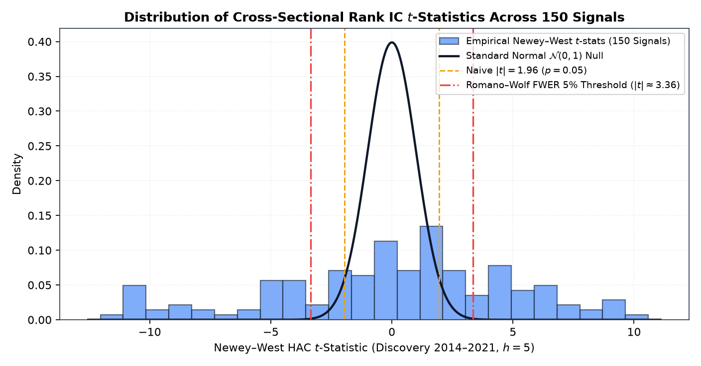
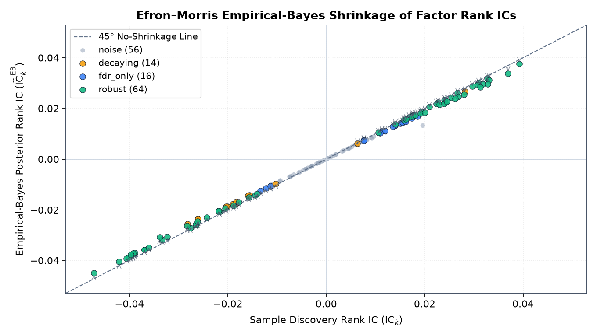
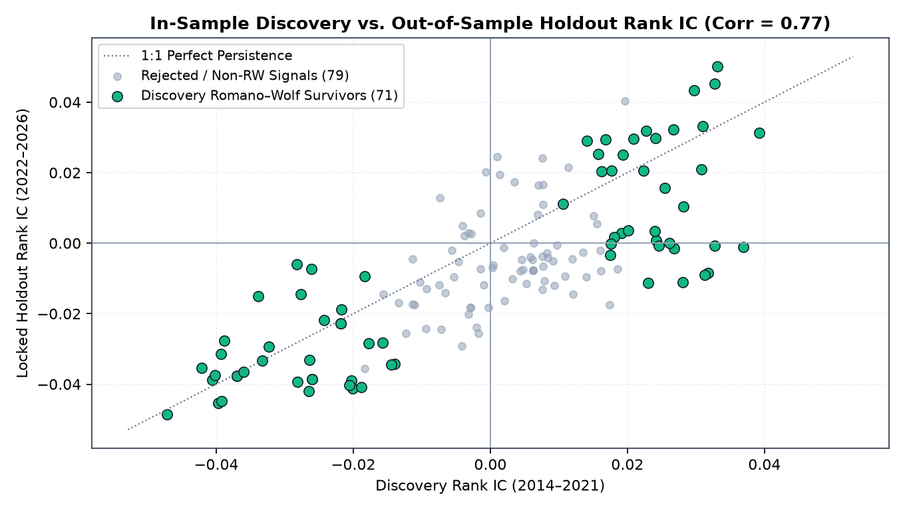
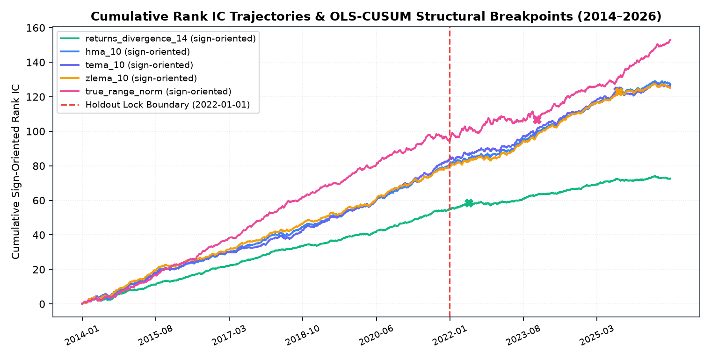

# How Many Technical and Formulaic Alphas Survive Multiple-Testing and Transaction-Cost Falsification on Vietnamese Equities?

> **Pre-Registered Empirical Study (`polars-anta` Factor Zoo)**
> **Pre-Registration Commit**: `4c1a4b559d22a1367ce46b513ab7ff1079fff360` ([`PREREGISTRATION.md`](https://github.com/huuan26/polars-anta/blob/master/research/factor_zoo/PREREGISTRATION.md))
> **Signal Registry SHA-256**: `8aa3c11b97810083b875084d38cfda6df1994de38ec9b077faeaf46dc31c948c` ($K = 150$ signals)

---

## 1. TL;DR

- **High statistical redundancy ($N_{\text{eff}} = 6.00$) inflates naive discovery counts**: Out of **150** pre-registered daily OHLCV signals evaluated at default parameters on the point-in-time top-150 liquid Ho Chi Minh Stock Exchange (`HOSE`) universe during Discovery (`2014-01-01` to `2021-12-31`, $1{,}998$ trading days, $h = 5$ open-to-open days), **91** pass raw Stationary Bootstrap $p \le 0.05$ (**95** have Newey–West $|t| \ge 1.96$, vs. $7.5$ expected by chance under independence). Eigenvalue decomposition of the $150 \times 150$ daily IC correlation matrix reveals an effective independent test count of **$N_{\text{eff}} = 6.00$** (the top 1 eigenvalue is $55.21$ and the top 5 principal components explain **$66.6\%$** of cross-signal IC variance).
- **Strong out-of-sample statistical IC replication, but severe standalone turnover drag**: After joint multiple-testing correction and OLS-CUSUM structural stability screening, **94** signals pass Benjamini–Hochberg FDR ($q \le 0.10$), **71** pass Romano–Wolf stepdown FWER ($\alpha \le 0.05$), and **64** are classified as structurally stable (`robust`) while **14** are flagged as `decaying`. In the locked Holdout sample (`2022-01-01` to `2026-11-10`, $1{,}202$ valid $5$-day return sessions), cross-sectional Rank IC correlates at **$r = 0.77$** ($0.7675$) with Discovery across all 150 signals, and **38 of the 64** `robust` discovery signals replicate under Romano–Wolf FWER ($p_{\text{RW}} \le 0.05$) with a median IC retention ratio of **$97.6\%$** ($0.9764$).
- **Zero standalone single-factor long-only strategies survive both Vietnamese equity transaction costs and multiple-testing control**: When implemented as 5-day rebalanced, equal-weighted long-only top-quintile (Q5) portfolios against the equal-weight universe under realistic `HOSE` execution frictions (`0.15%`/side brokerage + `0.10%`/side slippage + `0.10%` statutory sell tax = `30 bps` per unit of L1 weight turnover $\sum_i |w_{i,t} - w_{i,t-1}|$, or `60 bps` round-trip replacement cost), fast mean-reversion signals suffer breakeven cost ceilings of only `6–21 bps` round-trip. Only **2** slower momentum signals (`trix_15` at $+8.37\%/\text{yr}$, raw $p = 0.0170$; `tsi` at $+7.65\%/\text{yr}$, raw $p = 0.0320$) clear the cost hurdle at unadjusted $p \le 0.05$, **0** survive Benjamini–Hochberg adjustment ($q \le 0.10$) across the 80 cost-stage candidates, and both `trix_15` and `tsi` suffer structural breaks (`CUSUM p = 0.013` and `0.009`) and negative net excess returns in the locked `2022–2026` holdout (**0** confirmed post-cost holdout survivors).

---

## 2. Motivation

Modern empirical asset pricing faces a well-documented **Factor Zoo** problem: when researchers test hundreds of correlated technical indicators and formulaic alphas on the same historical panel, conventional single-hypothesis $t$-thresholds ($|t| \ge 1.96$) produce massive false-discovery rates (Harvey, Liu & Zhu 2016; Chordia, Goyal & Saretto 2020). While recent work shows that many equity anomalies share a common statistical component that replicates better than naive uniform priors suggest once shrunken via Empirical Bayes (Jensen, Kelly & Pedersen 2023), a critical gap remains between **frictionless cross-sectional predictability** (Rank IC) and **net-of-cost implementability** in emerging markets (Hou, Xue & Zhang 2020; Novy-Marx & Velikov 2016).

Rather than marketing `polars-anta` as a collection of *"200+ fast alpha indicators"*, this study subjects the library's entire daily-OHLCV indicator and WorldQuant formulaic alpha catalog ($K = 150$ scale-free signals) to a **pre-registered statistical and economic falsification funnel** on Vietnamese equities (`HOSE`), using the inference machinery built into `polars_anta.inference`.

---

## 3. Pre-Registration & Anti-Data-Mining Protocol

To eliminate hindsight bias, parameter tuning, and post-hoc threshold selection, the entire experimental design was frozen prior to unlocking the `2022–2026` holdout period:

- **Pre-Registration Document**: [`research/factor_zoo/PREREGISTRATION.md`](https://github.com/huuan26/polars-anta/blob/master/research/factor_zoo/PREREGISTRATION.md)
- **Frozen Configuration**: [`research/factor_zoo/config.py`](https://github.com/huuan26/polars-anta/blob/master/research/factor_zoo/config.py)
- **Frozen Signal Registry**: [`research/factor_zoo/registry.py`](https://github.com/huuan26/polars-anta/blob/master/research/factor_zoo/registry.py)
- **Git Pre-Registration Commit Hash**: `4c1a4b559d22a1367ce46b513ab7ff1079fff360`
- **Registry Canonical SHA-256**: `8aa3c11b97810083b875084d38cfda6df1994de38ec9b077faeaf46dc31c948c`
- **Programmatic Holdout Guard**: `verify_preregistration_guard()` in [`research/factor_zoo/pipeline.py`](https://github.com/huuan26/polars-anta/blob/master/research/factor_zoo/pipeline.py) refuses to execute `--stage holdout` unless `--unlock-holdout` is explicitly passed, `PREREGISTRATION.md` is committed to Git, and `git status --porcelain` confirms zero uncommitted modifications to `PREREGISTRATION.md`, `config.py`, and `registry.py`.

---

## 4. Data & Point-in-Time Universe

### 4.1 Source & Sample Period

Daily OHLCV bars were retrieved for all **392** three-letter common equity tickers listed on the Ho Chi Minh Stock Exchange (`HOSE`), spanning `2012-03-19` through `2026-11-10` (**1,138,548** raw ticker-day observations). The period `2012-03-19` to `2013-12-31` serves strictly as a warm-up buffer for rolling lookback windows and the 250-day listing-age filter.

### 4.2 Pre-Registered 3-Step Cleaning Pipeline

Executed deterministically in [`research/factor_zoo/data.py`](https://github.com/huuan26/polars-anta/blob/master/research/factor_zoo/data.py):

| Cleaning Step | Rule | Rows Removed | Remaining Rows |
| :--- | :--- | ---: | ---: |
| **0. Raw Feed** | 392 `HOSE` 3-letter common stock tickers (`2012-03-19`–`2026-11-10`) | — | `1,138,548` |
| **1. OHLCV Structural Audit** | `polars_anta.validate_ohlcv`: drop rows violating $H_t \ge \max(O_t, C_t, L_t)$, $L_t \le \min(O_t, C_t, H_t)$, or positive price/volume invariants (`high_lt_open = 1,078`, `low_gt_close = 886`, `low_gt_open = 771`, `high_lt_close = 411`, `high_lt_low = 1`) | `2,888` | `1,135,660` |
| **2. Zero-Volume Filter** | Drop non-trading / halted sessions with `volume <= 0` | `46,474` | `1,089,186` |
| **3. Price-Limit Jump Filter** | Drop daily close-to-close jumps $|C_t / C_{t-1} - 1| > 7.5\%$ (`HOSE` $\pm 7.0\%$ limit $+ 0.5\%$ tolerance) to remove unadjusted split/dividend discontinuities | `5,653` | `1,083,533` |

### 4.3 Point-in-Time Liquid Investable Universe (`in_universe`)

On each trading date $t \in [\text{2014-01-02}, \text{2026-11-10}]$ (**3,206** trading days), a stock enters the investable cross-section if and only if using information available at $\text{close}_t$:
1. Cumulative trading history is at least **250** valid sessions,
2. Closing price $C_{i,t} \ge \mathbf{5{,}000\text{ VND}}$, and
3. 60-session rolling median daily traded value ($\text{close} \times \text{volume}$) ranks in the **top 150** eligible stocks on date $t$.

This yields **463,707** ticker-day observations across **364** unique tickers (median **150.0** stocks/day, max **150**, min **17** on the first days of 2014):
- **Discovery Sample (`2014-01-02` to `2021-12-31`)**: **1,998** trading days, **282,507** universe rows, **340** unique tickers.
- **Locked Holdout Sample (`2022-01-01` to `2026-11-10`)**: **1,208** trading days (**1,202** sessions with complete 5-day forward open-to-open returns), **181,200** universe rows, **250** unique tickers.

---

## 5. Signal Registry & Scale-Free Normalization

All **150** daily-OHLCV-compatible signals in `polars-anta` are evaluated at their **exact library default parameters** (`0` hyperparameter sweeps):

- **Scale-Free Transformation**: Price-level overlays (moving averages, bands, stops, pivots, channels) are mapped to dimensionless ratios relative to `close` (e.g., `close / sma(close, 10) - 1`, Bollinger `percent_b`, `(close - supertrend) / close`, `(close - pivot_p) / close`). Multi-field `pl.Struct` indicators select one canonical primary component (see [`registry.py`](https://github.com/huuan26/polars-anta/blob/master/research/factor_zoo/registry.py)).
- **Cross-Sectional Ranking**: Each signal is computed per ticker (`.over("ticker")`) and then mapped to a uniform cross-sectional percentile rank within the active universe on each day $t$ via `cs_rank(..., over="date")`.
- **Two-Sided Testing**: Every signal is tested once (`alternative="two-sided"`), preventing researcher degrees of freedom in flipping factor signs.

---

## 6. Statistical & Economic Methodology

Full mathematical formulations and Monte Carlo size/power validations of the inference estimators are documented in [Statistical Inference & Falsification (`inference.md`)](../indicators/inference.md) and [Monte Carlo Size & Power Validation](../assets/inference_size_power.md).

1. **Target Return**: Next-day open-to-open return over $h = 5$ trading sessions, $r_{i,t,5} = \text{open}_{i,t+6}/\text{open}_{i,t+1} - 1$. Signals observed at $\text{close}_t$ are assumed executed at $\text{open}_{t+1}$ (zero look-ahead bias).
2. **Cross-Sectional Information Coefficient (`ic_matrix`)**: Daily cross-sectional Spearman rank correlation $\text{IC}_{k,t}$ between factor $k$'s universe rank at $\text{close}_t$ and $r_{i,t,5}$.
3. **Autocorrelation-Robust Inference (`falsify_factors`)**: Because overlapping 5-day forward returns induce $\text{MA}(4)$ serial correlation in daily $\text{IC}_{k,t}$, standard errors use the Bartlett-kernel Newey–West HAC estimator with $L = 4$ lags, and resampling uses the Politis–Romano (1994) Stationary Bootstrap with geometric block lengths ($\text{mean\_block} = \max(5, T^{1/3}) = 12.60$, $B = 2{,}000$, `seed = 20261110`).
4. **Multiple-Testing Control (`adjust_pvalues`, `romano_wolf`)**:
   - **Benjamini–Hochberg (1995) FDR** at $q = 0.10$ across all $K = 150$ signals.
   - **Romano–Wolf (2005, 2016) Stepdown FWER** at $\alpha = 0.05$, resampling all $K = 150$ IC series using identical stationary block bootstrap indices to preserve the cross-factor dependence structure.
5. **Empirical-Bayes Effect-Size Shrinkage (`eb_shrink`)**: Sample mean ICs $\overline{\text{IC}}_k$ are shrunken toward zero (`prior="zero"`) using the Efron–Morris (1973) / Jensen–Kelly–Pedersen (2023) empirical-Bayes precision weights $\widehat{\text{IC}}^{\text{EB}}_k = \frac{\hat{\tau}^2}{\hat{\tau}^2 + s_k^2}\overline{\text{IC}}_k$.
6. **Structural Break Screening (`cusum_mean_test`)**: Brown–Durbin–Evans (1975) / Ploberger–Krämer (1992) OLS-CUSUM test with Newey–West long-run variance ($L = 4$). Statistically significant signals with `p_cusum <= 0.05` whose second-half $|{\text{IC}}|$ is smaller than first-half $|{\text{IC}}|$ are classified as `decaying`.
7. **Long-Only Transaction-Cost Stage (`bootstrap_test`, `breakeven_cost`)**: Because short selling underlying equities is not practically available on `HOSE`, all non-decaying statistical survivors (`verdict in {"robust", "fdr_only"}`, $80$ signals) are evaluated as **long-only top-quintile (Q5)** equal-weighted portfolios (oriented by discovery $\text{sign}(\overline{\text{IC}}_k)$), rebalanced every $5$ trading days against the **equal-weighted investable universe**. Transaction costs deduct `0.15%`/side brokerage + `0.10%`/side slippage + `0.10%` statutory sell tax (`30 bps` per unit of L1 weight turnover $\sum_i |w_{i,t} - w_{i,t-1}|$, equivalent to `60 bps` per full one-way portfolio replacement). Survival requires one-sided Stationary Bootstrap $p \le 0.05$ on net active returns, BH $q \le 0.10$ across cost-stage candidates, and `breakeven_cost` $> 30\text{ bps}$ L1 (`60 bps` round-trip).

---

## 7. Confirmatory Empirical Results ($h = 5$)

### 7.1 The Falsification Funnel

| Stage | Signals | Share of Registry |
| :--- | ---: | ---: |
| **1. Tested (Pre-Registered Registry)** | **150** | `100.0%` |
| **2. Raw Stationary Bootstrap $p \le 0.05$** *(Newey–West $|t| \ge 1.96$: 95)* | **91** *(≈ 7.5 expected by chance)* | `60.7%` |
| **3. Benjamini–Hochberg FDR $q \le 0.10$** | **94** | `62.7%` |
| **4. Romano–Wolf Stepdown FWER $p_{\text{RW}} \le 0.05$** | **71** | `47.3%` |
| **4a. Structurally Stable `robust` Verdict** *(RW $p \le 0.05$ & non-decaying)* | **64** *(+ 16 `fdr_only`, 14 `decaying`, 56 `noise`)* | `42.7%` |
| **5. Positive Net Excess Return After HOSE Costs & Tax** *(Long-Only Q5, 60 bps RT)* | **12** *(out of 80 `robust ∪ fdr_only` candidates)* | `8.0%` |
| **5a. Statistically Significant Net Excess Return (Raw Bootstrap $p \le 0.05$)** | **2** (`trix_15`, `tsi`) | `1.3%` |
| **5b. Survive Costs After BH Adjustment ($q \le 0.10$ Across Cost Stage)** | **0** | `0.0%` |
| **6. Confirmed in Locked Holdout (`2022-01-01`–`2026-11-10`, Post-Cost)** | **0** *(**38** replicate statistical Rank IC at RW $p \le 0.05$)* | `0.0%` |


### 7.2 Why 91 of 150 Signals Pass Raw $p \le 0.05$: Effective Independent Tests ($N_{\text{eff}} = 6.00$)

A researcher testing 150 indicators might assume they have conducted 150 independent experiments. Spectral decomposition of the $150 \times 150$ daily Spearman IC correlation matrix in Discovery (`2014–2021`) refutes this:
- **Largest Eigenvalue ($\lambda_1$)**: **$55.21$** ($36.8\%$ of total variance across all 150 signals).
- **Top 5 Principal Components**: Explain **$66.6\%$** ($0.6660$) of total cross-signal IC variance.
- **Participation Ratio ($N_{\text{eff}} = (\sum \lambda_k)^2 / \sum \lambda_k^2$)**: **$6.00$** ($6.0041$) effective independent dimensions.

Because the vast majority of technical oscillators, moving-average ratios, price-channel positions, and short-window WorldQuant alphas load heavily on the same underlying **5-day cross-sectional mean-reversion / overreaction factor** on `HOSE`, when that single latent factor carries a strong $t$-statistic ($|t| > 10$), dozens of algebraically related indicators simultaneously clear $|t| \ge 1.96$ and Romano–Wolf FWER thresholds.



### 7.3 Breakdown by Signal Family (Discovery `2014–2021`, $h = 5$)

| Family | Tested | Raw $p \le 0.05$ | BH $q \le 0.10$ | RW $p \le 0.05$ | `robust` | `fdr_only` | `decaying` | Median $|\text{IC}|$ | Median $|\text{Posterior IC}|$ |
| :--- | ---: | ---: | ---: | ---: | ---: | ---: | ---: | ---: | ---: |
| `trend` | 28 | 18 | 19 | 16 | 16 | 3 | 0 | 0.0236 | 0.0220 |
| `momentum` | 22 | 15 | 15 | 9 | 9 | 6 | 0 | 0.0158 | 0.0146 |
| `volatility` | 20 | 12 | 12 | 9 | 3 | 0 | 9 | 0.0183 | 0.0172 |
| `volume` | 15 | 8 | 8 | 4 | 4 | 4 | 0 | 0.0109 | 0.0104 |
| `stats` | 13 | 7 | 7 | 5 | 5 | 0 | 2 | 0.0102 | 0.0098 |
| `microstructure` | 5 | 2 | 2 | 1 | 1 | 0 | 1 | 0.0114 | 0.0105 |
| `alpha` | 47 | 29 | 31 | 27 | 26 | 3 | 2 | 0.0162 | 0.0155 |

Notably, **9 out of 12** statistically significant `volatility` signals are flagged as **`decaying`** by the OLS-CUSUM test (`p_cusum <= 0.05` with weaker second-half IC), demonstrating why static full-sample $t$-statistics are insufficient without structural stability screening.



### 7.4 Transaction-Cost Falsification Stage: Why High-IC Signals Fail Long-Only Execution

When the **80** non-decaying discovery survivors (`64 robust + 16 fdr_only`) are formed into 5-day rebalanced long-only top-quintile (Q5) portfolios against the equal-weight universe:
1. **68 of 80 candidates** yield negative net active returns after `HOSE` fees, slippage, and sell tax (`60 bps` round-trip replacement cost). Fast reversal signals (`returns_divergence_14`, `hma_10`, `tema_10`, `zlema_10`, `true_range_norm`, `alpha_018`) exhibit 5-day L1 weight turnover of **$1.40\text{–}1.75$** ($70\%\text{–}87\%$ one-way portfolio replacement every 5 trading days), incurring an annualized cost drag of **$21\%\text{–}26\%/\text{yr}$**, while their long-only top-quintile gross excess returns correspond to breakeven round-trip costs of only **$5.7\text{–}20.5\text{ bps}$**.
2. Only **12 signals**—all slower trend/momentum smoothers with much lower 5-day L1 turnover ($0.28\text{–}0.79$)—achieve positive net active return in Discovery:

| Factor | Verdict | Gross Excess (5d) | L1 Turnover (5d) | Net Excess (% Ann.) | Net IR (Ann.) | Raw Bootstrap $p$ | BH $q$ | Breakeven Cost (Round-Trip bps) |
| :--- | :--- | ---: | ---: | ---: | ---: | ---: | ---: | ---: |
| `trix_15` | `robust` | 0.0031 | 0.48 | +8.37% | 0.71 | 0.0170 | 1.00 | 129.8 |
| `tsi` | `robust` | 0.0032 | 0.58 | +7.65% | 0.70 | 0.0320 | 1.00 | 112.7 |
| `kst` | `robust` | 0.0026 | 0.49 | +5.84% | 0.51 | 0.0555 | 1.00 | 107.1 |
| `awesome_osc` | `robust` | 0.0030 | 0.68 | +4.67% | 0.41 | 0.1069 | 1.00 | 87.4 |
| `frac_diff_04` | `robust` | 0.0026 | 0.56 | +4.61% | 0.50 | 0.1439 | 1.00 | 92.5 |
| `dpo_20` | `fdr_only` | 0.0030 | 0.70 | +4.56% | 0.39 | 0.1414 | 1.00 | 86.0 |
| `tii_30` | `robust` | 0.0022 | 0.57 | +2.57% | 0.33 | 0.1949 | 1.00 | 77.9 |
| `adx_14` | `fdr_only` | 0.0022 | 0.62 | +1.90% | 0.18 | 0.3003 | 1.00 | 72.1 |
| `coppock` | `robust` | 0.0027 | 0.78 | +1.79% | 0.16 | 0.3238 | 1.00 | 69.1 |
| `nvi_roc_20` | `robust` | 0.0027 | 0.79 | +1.64% | 0.18 | 0.3048 | 1.00 | 68.2 |
| `squeeze_mom` | `robust` | 0.0026 | 0.78 | +1.58% | 0.14 | 0.3373 | 1.00 | 68.1 |
| `alpha_005` | `robust` | 0.0011 | 0.28 | +1.21% | 0.14 | 0.3923 | 1.00 | 76.9 |

While `trix_15` ($p = 0.0170$) and `tsi` ($p = 0.0320$) clear the unadjusted $p \le 0.05$ threshold, **neither survives Benjamini–Hochberg FDR correction ($q \le 0.10$) across the 80 cost-stage tests** ($80 \times 0.0170 > 1.0$).

### 7.5 Locked Holdout Replication (`2022-01-01` to `2026-11-10`)

Unlocking the `2022–2026` holdout period (**1,202** evaluated sessions) yields two central findings:

1. **Cross-Sectional Rank IC Persists Strongly Out-of-Sample**:
   - Across all 150 signals, the correlation between Discovery Rank IC (`2014–2021`) and Holdout Rank IC (`2022–2026`) is **$0.77$** ($0.7675$).
   - Among the **64 `robust`** discovery signals, **54 ($84.4\%$)** retain the same IC sign in Holdout, **49 ($76.6\%$)** pass Holdout BH FDR ($q \le 0.10$), and **38 ($59.4\%$)** pass Holdout Romano–Wolf FWER ($p_{\text{RW}} \le 0.05$), with a median IC retention ratio $\overline{\text{IC}}_{\text{holdout}} / \overline{\text{IC}}_{\text{discovery}}$ of **$0.98$** ($0.9764$).
2. **BH Multiple-Testing Control at the Cost Stage Prevented Out-of-Sample False Positives**:
   - Look at the last two rows of the table below (`tsi` and `trix_15`), which were the only two signals with unadjusted post-cost $p \le 0.05$ in Discovery: in the locked `2022–2026` holdout, their Rank IC collapsed to **$-0.0011$** ($t = -0.10$) and **$-0.0089$** ($t = -0.75$), and full-sample OLS-CUSUM confirms significant structural breaks (`p_cusum = 0.009` and `0.013`).

| Factor | Family | Disc IC | Posterior IC | Disc NW $t$ | Disc RW $p$ | Breakeven (RT bps) | Holdout IC | Holdout NW $t$ | Holdout RW $p$ | Retention Ratio | CUSUM $p$ |
| :--- | :--- | ---: | ---: | ---: | ---: | ---: | ---: | ---: | ---: | ---: | ---: |
| `returns_divergence_14` | `alpha` | -0.0276 | -0.0272 | -12.04 | 0.0005 | 5.7 | -0.0146 | -4.46 | 0.0010 | 0.53 | 0.004 |
| `hma_10` | `trend` | -0.0406 | -0.0392 | -11.01 | 0.0005 | 9.4 | -0.0387 | -6.26 | 0.0005 | 0.95 | 0.757 |
| `tema_10` | `trend` | -0.0421 | -0.0405 | -10.92 | 0.0005 | 20.5 | -0.0355 | -5.34 | 0.0005 | 0.84 | 0.656 |
| `zlema_10` | `trend` | -0.0402 | -0.0388 | -10.86 | 0.0005 | 9.9 | -0.0374 | -6.10 | 0.0005 | 0.93 | 0.506 |
| `true_range_norm` | `volatility` | -0.0472 | -0.0450 | -10.71 | 0.0005 | 17.8 | -0.0486 | -5.15 | 0.0005 | 1.03 | 0.538 |
| `alpha_018` | `alpha` | 0.0327 | 0.0319 | 10.59 | 0.0005 | -6.7 | 0.0453 | 9.92 | 0.0005 | 1.38 | 0.002 |
| `pivot_classic` | `trend` | -0.0370 | -0.0358 | -10.19 | 0.0005 | 6.1 | -0.0376 | -6.37 | 0.0005 | 1.02 | 0.627 |
| `pivot_fibonacci` | `trend` | -0.0370 | -0.0358 | -10.19 | 0.0005 | 6.1 | -0.0376 | -6.37 | 0.0005 | 1.02 | 0.627 |
| `pivot_woodie` | `trend` | -0.0360 | -0.0349 | -10.18 | 0.0005 | 8.3 | -0.0366 | -6.33 | 0.0005 | 1.01 | 0.657 |
| `alpha_023` | `alpha` | 0.0310 | 0.0301 | 9.47 | 0.0005 | 12.3 | 0.0332 | 6.83 | 0.0005 | 1.07 | 0.330 |
| `tsi` | `momentum` | 0.0369 | 0.0338 | 6.24 | 0.0005 | 112.7 | -0.0011 | -0.10 | 1.0000 | -0.03 | 0.009 |
| `trix_15` | `momentum` | 0.0313 | 0.0284 | 4.95 | 0.0010 | 129.8 | -0.0089 | -0.75 | 0.9930 | -0.28 | 0.013 |





---

## 8. Robustness & Exploratory Analysis (Non-Confirmatory)

### 8.1 Sub-Period, Liquidity-Tier, and Price-Limit Robustness (Discovery $h = 5$)

Across all 150 signals, the split-half IC correlation between `2014–2017` and `2018–2021` is **$0.83$** ($0.8265$). For the top 10 discovery signals by $|t_{\text{NW}}|$, predictability holds across both halves of Discovery, across both the **Top-50 most liquid** and **Rank 51–150 liquid** tiers, and after excluding sessions near the daily price limit ($|\text{close}/\text{open} - 1| \ge 6.5\%$):

| Factor | IC (`2014–2017`) | IC (`2018–2021`) | IC (Top-50 Liquid) | IC (Rank 51–150) | IC (Excl. Limit Days) |
| :--- | ---: | ---: | ---: | ---: | ---: |
| `returns_divergence_14` | -0.0285 | -0.0268 | -0.0233 | -0.0321 | -0.0263 |
| `hma_10` | -0.0373 | -0.0439 | -0.0386 | -0.0454 | -0.0383 |
| `tema_10` | -0.0345 | -0.0497 | -0.0399 | -0.0464 | -0.0398 |
| `zlema_10` | -0.0386 | -0.0418 | -0.0386 | -0.0443 | -0.0378 |
| `true_range_norm` | -0.0511 | -0.0434 | -0.0409 | -0.0517 | -0.0463 |
| `alpha_018` | 0.0292 | 0.0363 | 0.0283 | 0.0361 | 0.0286 |
| `pivot_classic` | -0.0382 | -0.0358 | -0.0322 | -0.0441 | -0.0340 |
| `pivot_fibonacci` | -0.0382 | -0.0358 | -0.0322 | -0.0441 | -0.0340 |
| `pivot_woodie` | -0.0376 | -0.0345 | -0.0317 | -0.0428 | -0.0330 |
| `alpha_023` | 0.0289 | 0.0330 | 0.0249 | 0.0341 | 0.0301 |

### 8.2 Exploratory Return Horizons ($h = 1$ and $h = 20$)

Per `PREREGISTRATION.md` §4, horizons $h = 1$ (next-day open-to-open) and $h = 20$ (monthly open-to-open) are reported strictly as exploratory:

| Horizon | Tested | Raw $p \le 0.05$ | NW $|t| \ge 1.96$ | BH $q \le 0.10$ | RW $p \le 0.05$ | `robust` | `fdr_only` | `decaying` | `noise` | Top Signal (Rank IC, NW $t$) |
| :--- | ---: | ---: | ---: | ---: | ---: | ---: | ---: | ---: | ---: | :--- |
| **$h = 1$ (Exploratory)** | 150 | 124 | 124 | 126 | 112 | 112 | 14 | 0 | 24 | `dema_10` ($\text{IC} = -0.0428$, $t = -13.98$) |
| **$h = 5$ (Confirmatory)** | 150 | 91 | 95 | 94 | 71 | 64 | 16 | 14 | 56 | `returns_divergence_14` ($\text{IC} = -0.0276$, $t = -12.04$) |
| **$h = 20$ (Exploratory)** | 150 | 96 | 97 | 99 | 62 | 61 | 33 | 5 | 51 | `vwap_bands_20` ($\text{IC} = +0.0454$, $t = +5.84$) |

---

## 9. Limitations

1. **Survivorship Bias in Public Exchange Directory**: The public exchange directory query returned `392` currently listed 3-letter `HOSE` equities and `0` delisted tickers. Although the point-in-time rolling 60-day median traded value filter (`top 150`, minimum `5,000 VND`, minimum `250` trading sessions) excludes distressed micro-caps as liquidity deteriorates, historical delistings between 2014 and 2026 are absent from the public feed.
2. **Daily Typical-Price VWAP Proxy**: For formulaic alphas requiring `vwap` (`alpha_001`–`alpha_101`), intraday trade-by-trade VWAP is unavailable in public daily feeds and is proxied by daily typical price $(H_t + L_t + C_t)/3$.
3. **Long-Only Constraint & Equal-Weight Rebalancing**: Evaluating each signal as a standalone 5-day rebalanced equal-weighted Q5 portfolio without turnover regularization (e.g., no buffer banding, no multi-factor combination, no trade-off against expected transaction cost) represents a deliberately harsh falsification benchmark. Combining the $N_{\text{eff}} \approx 6$ orthogonal dimensions with a turnover-penalized optimizer is the natural next step beyond single-factor falsification.
4. **Stylized Transaction Cost Schedule**: The pre-registered `60 bps` round-trip cost (`0.15%`/side brokerage + `0.10%`/side slippage + `0.10%` sell tax) is constant across stocks and time, whereas institutional market impact scales non-linearly with order size relative to daily volume.
5. **Cross-Sectional Breadth ($N \le 150$)**: Compared to US CRSP panels ($N \approx 3{,}000$), a 150-stock universe has higher idiosyncratic portfolio variance in each quintile (30 stocks per quintile).

---

## 10. Reproduce This Study

Every table and figure in this report is deterministically reproducible from the repository root:

```bash
# 1. Verify signal registry count (150) and canonical SHA-256 hash
python -m research.factor_zoo.registry --check

# 2. Fetch/cache daily HOSE panel (or use existing research/data/vn_daily.parquet)
python -m research.factor_zoo.fetch_data

# 3. Run confirmatory Discovery pipeline (2014-01-01 to 2021-12-31, seed=20261110)
python -m research.factor_zoo.run --stage discovery

# 4. Run locked Holdout evaluation (verifies Git pre-registration guard first)
python -m research.factor_zoo.run --stage holdout --unlock-holdout

# 5. Render all 5 figures and auto-generated Markdown tables
python -m research.factor_zoo.render
```

---

## 11. References

- Benjamini, Y., & Hochberg, Y. (1995). Controlling the false discovery rate: A practical and powerful approach to multiple testing. *Journal of the Royal Statistical Society: Series B*, 57(1), 289–300.
- Brown, R. L., Durbin, J., & Evans, J. M. (1975). Techniques for testing the constancy of regression relationships over time. *Journal of the Royal Statistical Society: Series B*, 37(2), 149–192.
- Chordia, T., Goyal, A., & Saretto, A. (2020). Two million strategies: Asset pricing tests with multiple testing. *Review of Financial Studies*, 33(11), 5066–5115.
- Efron, B., & Morris, C. (1973). Stein's estimation rule and its competitors—an empirical Bayes approach. *Journal of the American Statistical Association*, 68(341), 117–130.
- Harvey, C. R., Liu, Y., & Zhu, H. (2016). … and the cross-section of expected returns. *Review of Financial Studies*, 29(1), 5–68.
- Hou, K., Xue, C., & Zhang, L. (2020). Replicating anomalies. *Review of Financial Studies*, 33(5), 2019–2133.
- Jensen, T. I., Kelly, B., & Pedersen, L. H. (2023). Is there a replication crisis in finance? *Journal of Finance*, 78(5), 2465–2518.
- Newey, W. K., & West, K. D. (1987). A simple, positive semi-definite, heteroskedasticity and autocorrelation consistent covariance matrix. *Econometrica*, 55(3), 703–708.
- Novy-Marx, R., & Velikov, M. (2016). A taxonomy of anomalies and their trading costs. *Review of Financial Studies*, 29(1), 104–147.
- Politis, D. N., & Romano, J. P. (1994). The stationary bootstrap. *Journal of the American Statistical Association*, 89(428), 1303–1313.
- Romano, J. P., & Wolf, M. (2005). Stepwise multiple testing as formalized data snooping. *Econometrica*, 73(4), 1237–1282.
- Romano, J. P., & Wolf, M. (2016). Efficient computation of adjusted $p$-values for resampling-based stepdown multiple testing. *Statistics & Probability Letters*, 113, 38–40.

---

## Appendix A. Excluded Library Functions (`60` Primitives)

Per `PREREGISTRATION.md`, functions in `polars-anta` that are cross-sectional/time-series preprocessing utilities, inference/evaluation estimators, multi-series pair functions, intraday-only indicators, or event-only flags with degenerate daily cross-sectional variation are excluded ex-ante:

| Function | Module | Exclusion Reason |
| :--- | :--- | :--- |
| `ichimoku` | `trend` | Forward-shifted `senkou_a`/`senkou_b` cloud columns require special alignment; `tenkan`/`kijun` ratios are already covered by rolling midpoint/MA primitives. |
| `zigzag` | `trend` | Retroactive pivot-labeling algorithm uses future bars to confirm extrema (look-ahead bias if used as a real-time signal). |
| `td_sequential` | `momentum` | Discrete integer setup counter (`1..9`) with high tie concentration (>80% zeros) in daily cross-sections. |
| `ttm_squeeze` | `volatility` | Binary/struct squeeze flag already represented continuously by `squeeze_momentum` and `bb_width_20` / `keltner_pos`. |
| `klinger` | `volume` | Cumulative unbounded signed volume oscillator with unit-root drift across multi-year panels. |
| `vpin` | `microstructure` | Requires high-frequency volume-bucket bar aggregation; daily bars violate fixed-bucket assumptions. |
| `ofi`, `trade_imbalance` | `microstructure` | Require Level-1 bid/ask quote updates or tick-level aggressor side not present in daily OHLCV. |
| `session_vwap` | `volume` | Intraday session-reset VWAP; identical to daily typical price on single daily bars. |
| `opening_range`, `time_of_day_Stats` | `intraday` | Strictly intraday timestamp primitives (`datetime` bars required). |
| `engulfing` .. `three_black_crows` (15 functions) | `patterns` | Binary `{0, 1, -1}` candlestick pattern flags are zero on >92% of stock-days, producing degenerate cross-sectional rank ties. |
| `winsorize` .. `forward` (15 functions) | `transforms` / `cross_sectional` | Data preprocessing, target return construction, and standardization utilities (not standalone alpha signals). |
| `backtest` .. `sweep_robustness` (20 functions) | `evaluation` / `inference` | Statistical evaluation and falsification estimators used to test the registry. |
| `kalman_beta`, `rolling_corr`, `rolling_cov`, `rolling_beta` | `stats` | Bivariate pair/benchmark estimators requiring an external factor or pair series. |
